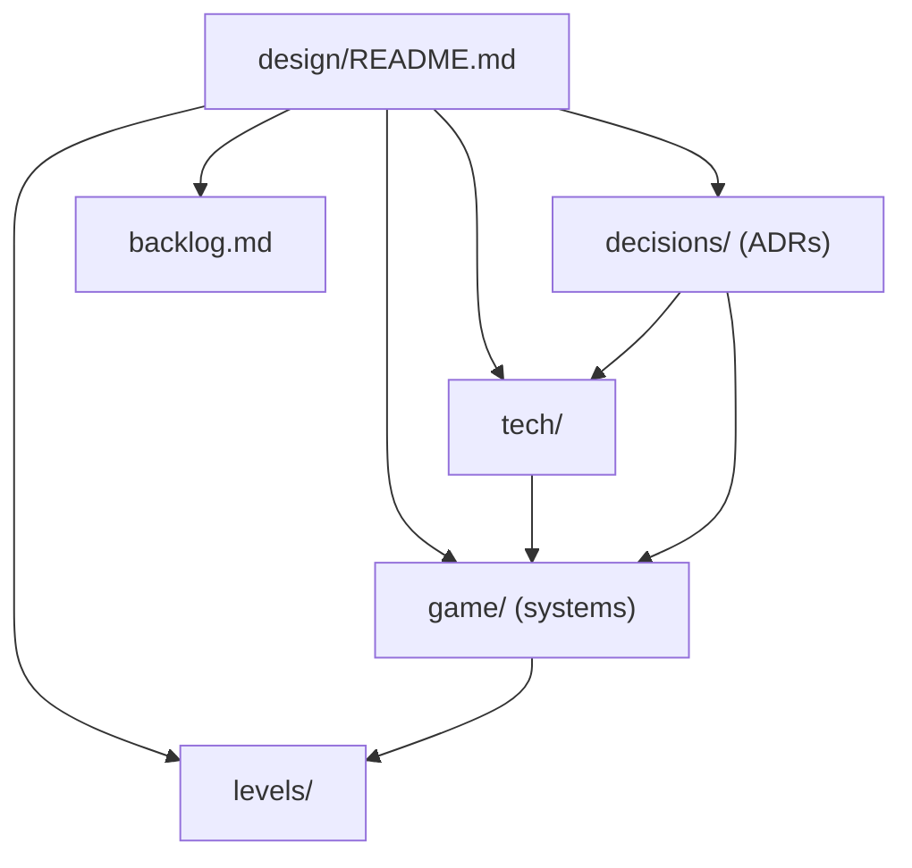

# ImSimProto design

Entry point for all design documentation. Code-facing rules for agents are in [../AGENTS.md](../AGENTS.md); setup is in [../README.md](../README.md).

## Vision and pillars

A first-person immersive sim in the spirit of Deus Ex (2000): systemic, emergent gameplay where several approaches solve the same problem. v0 is a prototype that proves the systemic framework.

Pillars (v0): stealth/perception, physics objects, security/electronics, fire. Water, electricity and social systems come later ([backlog](backlog.md)).

## v0 scope

In:

- A hub, a test gallery (one room per system) and one small warehouse mission.
- Player movement incl. mantle and vents; body-part damage; pistol, shotgun, sniper rifle, assault rifle (Kenney Blaster Kit models), a silencer attachment and the stun baton; grid inventory. Guards and training dummies are animated Kenney Blocky Characters ([ADR 0103](decisions/0103-character-models-and-animation.md)).
- Skills (4 tiers) and augmentations with energy; no leveling.
- Light-based visibility; graded guard AI with communication and alarm; cameras, turret, alarm devices (controller, sirens, radio base station), locks, keypads, computers.
- Network hacking: subnets, firewalls, a deck, computers with desktop apps, tracers ([game/hacking.md](game/hacking.md)).
- Stimulus/response framework with attributes, modifiers and tags; EventLog; debug panel; save/load from the Esc game menu.
- GdUnit4 tests in three layers.

Out (parked in [backlog](backlog.md)): progression, security robot, water/electricity, lean/ladders, gamepad and rebinding, difficulty settings, real art, voiced barks, inventory rotation, remote/CI.

## Doc map

## Milestones

| # | Milestone | Gallery room |
|---|---|---|
| M0 | Skeleton: git, docs, AGENTS/README/CLAUDE, GdUnit4 runner, gdtoolkit hook, folder layout, input map, EventLog, DebugPanel shell, hub graybox | Hub |
| M1 | Player controller: walk/crouch/sprint/jump/mantle/vents, footstep noise | Movement course |
| M2 | Core framework: stimulus/response, attributes/modifiers/tags, StimulusSystem autoload | none |
| M3 | Physics objects and fire | Physics and fire |
| M4 | Body-part damage, pistol, baton, aiming | Shooting range |
| M5 | Grid inventory, belt, items, pickup/drop | Inventory bay |
| M6 | Skills, augmentations, energy, stats tab, save/load (Esc game menu) | Inventory bay |
| M7 | Light level, guard perception and AI, alerts, bodies | Perception lab, AI arena |
| M8 | Security: cameras, turret, doors/locks/keypads, terminals (credentials placeholder); security devices with a stimulus-based remote command interface over a physical link graph; alarm controller, sirens and radio base station replace the global LevelAlarm; multitool and Electronics removed ([ADR 0075](decisions/0075-alarms-as-network-devices.md), [ADR 0076](decisions/0076-computer-skill-multitool-removed.md)) | Security wing |
| M9 | Mission: warehouse (separate night level, objectives, summary with ghost/pacifist badges, reinforcements, weapon drops) and scenario tests ([ADR 0086](decisions/0086-warehouse-mission.md)) | Warehouse mission |
| M10 | Lockpicking minigame: pin-tumbler locks, skill rework ([game/lockpicking.md](game/lockpicking.md)) | Security wing (practice locks) |
| M11 | Tab interface: one tabbed screen on Tab (Health, Skills, Augmentations, Logs, Inventory); the existing shortcut keys open it on their tab. Later milestones add their tabs to it (to be designed) | none |
| M12a | Network hacking ([ADR 0112](decisions/0112-hacking-reconciled-with-the-built-game.md)): addresses, subnets, routers (subnets behind one hidden until it is hacked, chained), trust, power; computers (Halcyon OS overlay: Mail, Files, Security; the Security app replaces the terminal) with logins and Fill in; the deck (Map, Icebreaker, remote desktops); entry points (computer, wall jack, maintenance port, deck in a computer); tracers; Computer skill assists ([game/hacking.md](game/hacking.md), [ADR 0074](decisions/0074-network-hacking.md)) | Network lab; warehouse network |
| M12b | Intrusion ([ADR 0115](decisions/0115-m12b-intrusion-and-m12c-consequences.md)): exploits (one-use inventory items by device kind since [ADR 0121](decisions/0121-exploits-as-items-and-map-fixes.md); Map icons and visible scans), the Firewall tool (rules decide which devices reach which), wireless (access points, wireless devices, Wi-Fi keys cracked by aiming the deck, range by Computer skill) | Network lab; warehouse network |
| M12c | Network consequences ([ADR 0115](decisions/0115-m12b-intrusion-and-m12c-consequences.md)): status LEDs, plates and closets, the deck's AR cable view, feedback after an action; mail needs a route to its server, loss-of-signal alarms, fail-secure vaults, the "Clean hands" badge | Network lab; warehouse |
| M13a | Weapon feel loop ([ADR 0120](decisions/0120-weapon-feel.md)): accuracy blending skill and aim (closer to Counter-Strike with each tier), recoil patterns with the camera climbing, skill-scaled recoil, the submachine gun, the shooting range with live tuning sliders, a settings menu in the Esc menu | Shooting range |
| M13b | Weapon feedback ([ADR 0120](decisions/0120-weapon-feel.md)): hit markers, impacts by material, tracers, aim punch and guard flinch, guards obeying recoil, weapon motion, per-weapon sounds | Shooting range |
| M13c | Device overhaul ([ADR 0130](decisions/0130-device-overhaul.md)): one design language (kind colour strip, Map icon, one light, labelled ports, name plate), rack and desk versions of routers, switches, computers and alarm controllers, linking bays, door controllers as the network devices, keys and the keychain, the frame's status line and no E prompts; 3D models first, shown in a hub showroom | Network lab, security wing, warehouse (the step 0 hub showroom was removed in step 3) |
| M14 | Explosives ([ADR 0131](decisions/0131-grenades-mines-and-effects.md), [explosives.md](game/explosives.md)): frag, gas, EMP and jamming grenades, thrown or stuck as proximity mines (one LMB, a ghost within 1.2 m), chains through Explosive and Breakable, the "Jammed" network status, the Demolition skill; a grenade lane, a mine corridor and an EMP/jamming corner in the shooting range, grenades as warehouse loot | Shooting range, warehouse |
| M15 | Factions: NPC groups that are allied, neutral or hostile to each other, a colour-coded crosshair, hostility in perception (to be designed) | to be designed |
| M16 | AI overhaul: smarter combat (cover, flanking, grenades), then daily life (needs and schedules, Sims-like); starts by measuring the cost of many NPCs in a large space; guards logging in at devices, the security operator and the deck's Sniffer (moved from M12, [ADR 0112](decisions/0112-hacking-reconciled-with-the-built-game.md)) (to be designed) | AI arena |
| M17 | Dialogue: branching conversations whose choices set story flags (to be designed) | to be designed |
| M18 | Experience: XP from objectives, dialogue, discoveries and hacks; spent on skills in the Tab interface (to be designed) | none |
| M19 | Money and shops: currency, traders, an economy tuned with XP and loot; then a compact test area (a street with NPCs, a shop and a side quest) to try factions, dialogue, XP and money together (to be designed) | test area |
| M20 | Open map and story: a large map, a 30-minute story, side quests, places to discover, NPCs to meet; starts with a layout and scale prototype (frame rate, navigation) and the engine decision: stay on Godot or move to Unreal 5.8+ (World Partition, Nanite; costs: binary assets agents can't diff, slower build and test loop), measured by a 1–2 day trial porting one system (to be designed) | the map |

Each milestone is one branch; manual checks are in [tech/playtest-checklist.md](tech/playtest-checklist.md).

## Index

### Game systems

- [game/stimulus-response.md](game/stimulus-response.md): stimuli, receptrons, effects, propagation, EventLog.
- [game/attributes-and-tags.md](game/attributes-and-tags.md): tags, attributes, modifier evaluation.
- [game/movement.md](game/movement.md): walk, crouch, sprint, jump, mantle, vents, footstep noise.
- [game/controls.md](game/controls.md): physical-key bindings.
- [game/light-and-visibility.md](game/light-and-visibility.md): analytic light level and visibility.
- [game/perception-and-ai.md](game/perception-and-ai.md): guards, awareness states, communication, bodies.
- [game/damage.md](game/damage.md): body parts and damage types.
- [game/weapons-and-aiming.md](game/weapons-and-aiming.md): pistol, baton, reticle.
- [game/objects-and-fire.md](game/objects-and-fire.md): physics objects and fire.
- [game/security.md](game/security.md): cameras, alarm devices, turret, doors and locks, computers.
- [game/hacking.md](game/hacking.md): network, deck, computers, credentials, Icebreaker, exploits, tracers.
- [game/lockpicking.md](game/lockpicking.md): pin-tumbler lockpicking minigame.
- [game/inventory.md](game/inventory.md): grid, belt, items.
- [game/abilities.md](game/abilities.md): skills and augmentations.
- [game/debug-panel.md](game/debug-panel.md): debug tabs.
- [game/saving.md](game/saving.md): saveable contract, save/load (Esc game menu).

### Levels

- [levels/metrics.md](levels/metrics.md): player size, clearances, jump/mantle limits, noise numbers for level building.
- [levels/hub-and-gallery.md](levels/hub-and-gallery.md): hub and seven test rooms; a network lab planned for M12.
- [levels/mission-warehouse.md](levels/mission-warehouse.md): warehouse mission: night compound, many routes, objectives, badges.

### Tech

- [tech/architecture.md](tech/architecture.md): layers, folders, autoloads, tick model.
- [tech/conventions.md](tech/conventions.md): code style and typing rules.
- [tech/testing.md](tech/testing.md): three test layers, scenario tests, commands.
- [tech/playtest-checklist.md](tech/playtest-checklist.md): manual checks per milestone.

### Decisions and backlog

- [decisions/README.md](decisions/README.md): ADR index (130 decisions, 0001–0136; 0134 and 0135 unused; 0062, 0081, 0118 and 0119 unused).
- [backlog.md](backlog.md): parked items.
- [retrospectives.md](retrospectives.md): what went wrong per milestone and the process changes made.
