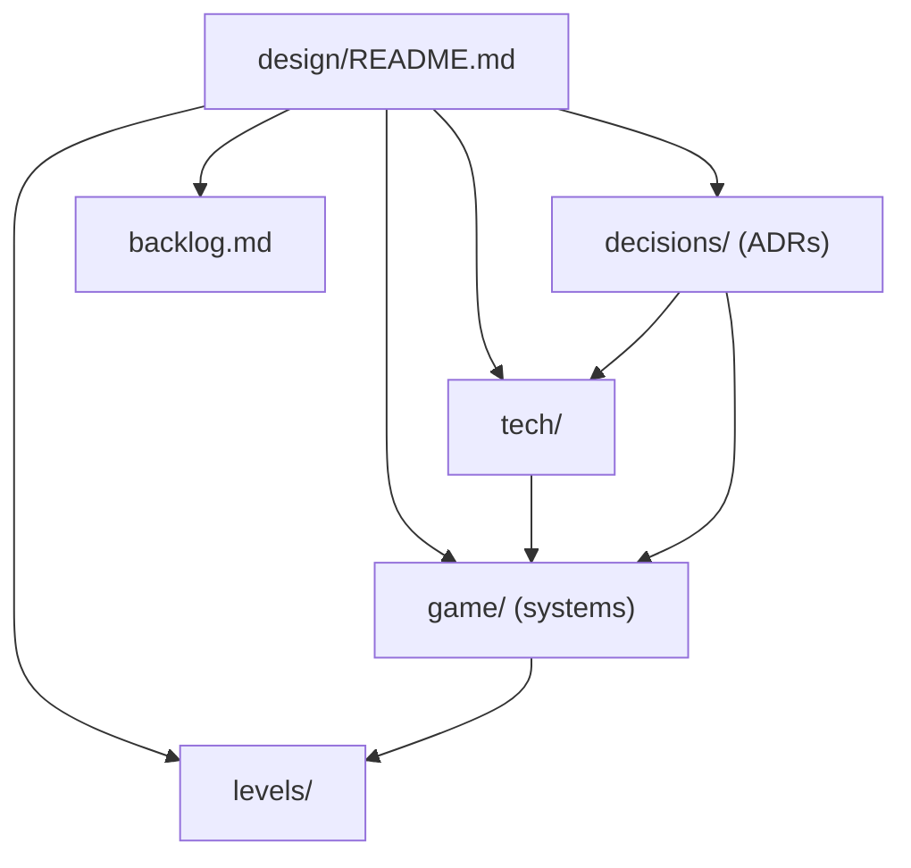

# ImSimProto design

Entry point for all design documentation. Code-facing rules for agents are in [../AGENTS.md](../AGENTS.md); setup is in [../README.md](../README.md).

## Vision and pillars

A first-person immersive sim in the spirit of Deus Ex (2000): systemic, emergent gameplay where several approaches solve the same problem. v0 is a prototype that proves the systemic framework.

Pillars (v0): stealth/perception, physics objects, security/electronics, fire. Water, electricity and social systems come later ([backlog](backlog.md)).

## v0 scope

In:

- A hub, a test gallery (one room per system) and one small warehouse mission.
- Player movement incl. mantle and vents; body-part damage; pistol, shotgun, sniper rifle, assault rifle (Kenney Blaster Kit models), a silencer attachment and the stun baton; grid inventory. Guards and training dummies are animated Kenney Blocky Characters ([ADR 0103](decisions/0103-character-models-and-animation.md)).
- Skills (4 tiers) and augmentations with energy; no leveling.
- Light-based visibility; graded guard AI with communication and alarm; cameras, turret, alarm devices (controller, sirens, radio base station), locks, keypads, terminals.
- Network hacking: subnets, firewalls, a deck, computers with desktop apps, tracers ([game/hacking.md](game/hacking.md)).
- Stimulus/response framework with attributes, modifiers and tags; EventLog; debug panel; save/load from the Esc game menu.
- GdUnit4 tests in three layers.

Out (parked in [backlog](backlog.md)): progression, security robot, water/electricity, lean/ladders, gamepad and rebinding, difficulty settings, real art, voiced barks, inventory rotation, remote/CI.

## Doc map

## Milestones

| # | Milestone | Gallery room |
|---|---|---|
| M0 | Skeleton: git, docs, AGENTS/README/CLAUDE, GdUnit4 runner, gdtoolkit hook, folder layout, input map, EventLog, DebugPanel shell, hub graybox | Hub |
| M1 | Player controller: walk/crouch/sprint/jump/mantle/vents, footstep noise | Movement course |
| M2 | Core framework: stimulus/response, attributes/modifiers/tags, StimulusSystem autoload | none |
| M3 | Physics objects and fire | Physics and fire |
| M4 | Body-part damage, pistol, baton, aiming | Shooting range |
| M5 | Grid inventory, belt, items, pickup/drop | Inventory bay |
| M6 | Skills, augmentations, energy, stats tab, save/load (Esc game menu) | Inventory bay |
| M7 | Light level, guard perception and AI, alerts, bodies | Perception lab, AI arena |
| M8 | Security: cameras, turret, doors/locks/keypads, terminals (credentials placeholder); security devices with a stimulus-based remote command interface over a physical link graph; alarm controller, sirens and radio base station replace the global LevelAlarm; multitool and Electronics removed ([ADR 0075](decisions/0075-alarms-as-network-devices.md), [ADR 0076](decisions/0076-computer-skill-multitool-removed.md)) | Security wing |
| M9 | Mission: warehouse (separate night level, objectives, summary with ghost/pacifist badges, reinforcements, weapon drops) and scenario tests ([ADR 0086](decisions/0086-warehouse-mission.md)) | Warehouse mission |
| M10 | Lockpicking minigame: pin-tumbler locks, skill rework ([game/lockpicking.md](game/lockpicking.md)) | Security wing (practice locks) |
| M11 | Network hacking: addresses, subnets, firewalls; the deck and its tools; computers with Mail, Files, Security; intrusion (credentials, Icebreaker, exploits); tracers; Computer skill consumers ([game/hacking.md](game/hacking.md), [ADR 0074](decisions/0074-network-hacking.md)) | Network lab; warehouse network |

Each milestone is one branch; manual checks are in [tech/playtest-checklist.md](tech/playtest-checklist.md).

## Index

### Game systems

- [game/stimulus-response.md](game/stimulus-response.md): stimuli, receptrons, effects, propagation, EventLog.
- [game/attributes-and-tags.md](game/attributes-and-tags.md): tags, attributes, modifier evaluation.
- [game/movement.md](game/movement.md): walk, crouch, sprint, jump, mantle, vents, footstep noise.
- [game/controls.md](game/controls.md): physical-key bindings.
- [game/light-and-visibility.md](game/light-and-visibility.md): analytic light level and visibility.
- [game/perception-and-ai.md](game/perception-and-ai.md): guards, awareness states, communication, bodies.
- [game/damage.md](game/damage.md): body parts and damage types.
- [game/weapons-and-aiming.md](game/weapons-and-aiming.md): pistol, baton, reticle.
- [game/objects-and-fire.md](game/objects-and-fire.md): physics objects and fire.
- [game/security.md](game/security.md): cameras, alarm devices, turret, doors and locks, terminals.
- [game/hacking.md](game/hacking.md): network, deck, computers, credentials, Icebreaker, exploits, tracers.
- [game/lockpicking.md](game/lockpicking.md): pin-tumbler lockpicking minigame.
- [game/inventory.md](game/inventory.md): grid, belt, items.
- [game/abilities.md](game/abilities.md): skills and augmentations.
- [game/debug-panel.md](game/debug-panel.md): debug tabs.
- [game/saving.md](game/saving.md): saveable contract, save/load (Esc game menu).

### Levels

- [levels/metrics.md](levels/metrics.md): player size, clearances, jump/mantle limits, noise numbers for level building.
- [levels/hub-and-gallery.md](levels/hub-and-gallery.md): hub and seven test rooms; a network lab planned for M11.
- [levels/mission-warehouse.md](levels/mission-warehouse.md): warehouse mission: night compound, many routes, objectives, badges.

### Tech

- [tech/architecture.md](tech/architecture.md): layers, folders, autoloads, tick model.
- [tech/conventions.md](tech/conventions.md): code style and typing rules.
- [tech/testing.md](tech/testing.md): three test layers, scenario tests, commands.
- [tech/playtest-checklist.md](tech/playtest-checklist.md): manual checks per milestone.

### Decisions and backlog

- [decisions/README.md](decisions/README.md): ADR index (107 decisions, 0001–0109; 0062 and 0081 unused).
- [backlog.md](backlog.md): parked items.
- [retrospectives.md](retrospectives.md): what went wrong per milestone and the process changes made.
