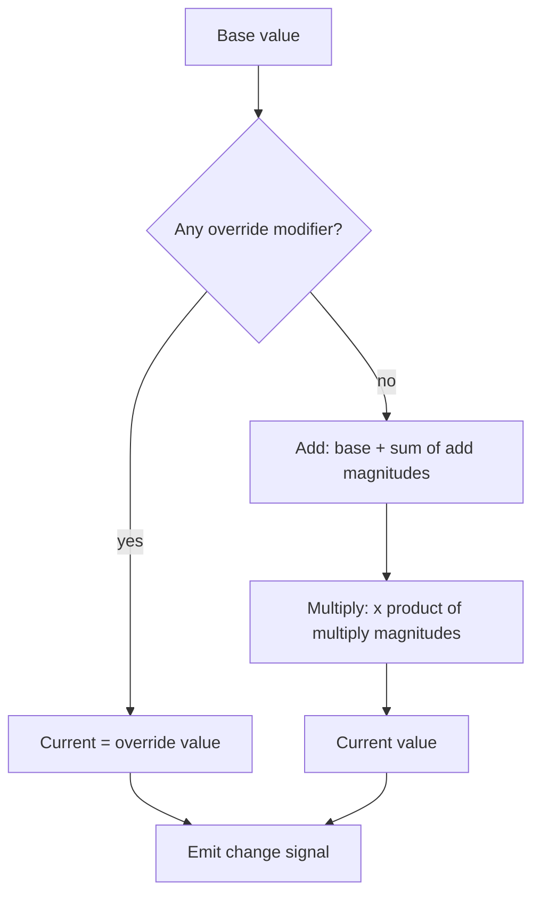

# Attributes and tags

Milestone: M2.

## Purpose

A shared model for state and stats. Tags describe what something is or is currently doing; attributes hold numbers; modifiers change numbers. Skills, augmentations, damage effects and later progression are all modifiers, so the same framework carries them.

## Player-facing behaviour

Indirect: a burning crate, a slowed player with a damaged leg, a skill tier that speeds up lockpicking are all tag/attribute/modifier changes.

## Rules

- **Tags**: hierarchical StringNames (`material.metal`, `state.burning`, `actor.guard`) with prefix queries (`material` matches `material.metal`). Held in a `TagContainer`.
- **Attributes**: `AttributeSet` of named float attributes with base values. Emits change signals.
- **Modifier**: attribute, op (`add` | `multiply` | `override`), magnitude, source.
- **Current value** = the override if any, else (base + sum of add) x product of multiply.

- Modifiers carry a `source` so they can be removed when the source ends (augmentation toggled off, effect expired).
- Pure logic (containers, evaluation) is RefCounted/Resource and unit-tested without the scene tree.
- Attribute sets are saveable ([saving.md](saving.md)).

## Interactions

- Effects apply modifiers: [stimulus-response.md](stimulus-response.md)
- Skills and augmentations: [abilities.md](abilities.md)
- Body-part health and resistances: [damage.md](damage.md)
- Stats tab: [debug-panel.md](debug-panel.md)
- Progression is parked: [../backlog.md](../backlog.md)

## Open questions

- Multiple override modifiers: which wins? TBD in M2.
- Modifier stacking and expiry details: TBD in M2.
