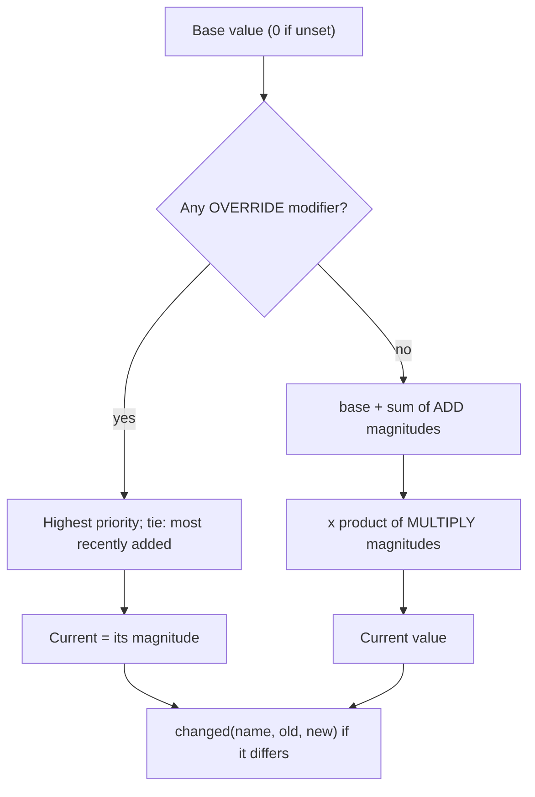

# Attributes and tags

Milestone: M2.

## Purpose

A shared model for state and stats. Tags describe what something is or is currently doing; attributes hold numbers; modifiers change numbers. Skills, augmentations, damage effects and later progression are all modifiers, so the same framework carries them.

## Player-facing behaviour

Indirect: a burning crate, a slowed player with a damaged leg, a skill tier that speeds up lockpicking are all tag/attribute/modifier changes.

## Rules

### Tags (`core/attributes/`)

- Hierarchical StringNames (`material.metal`, `state.burning`, `actor.guard`). In use since M3: `material.wood|metal|glass|cardboard`, `object.crate|box|barrel|explosive|bottle|barricade|brazier`, `state.burning`, `state.charred`, `actor.player` ([objects-and-fire.md](objects-and-fire.md)). Since M4: `actor.dummy`, `object.medkit`, `state.dead`, `state.unconscious`, `state.legs_disabled`, `state.arms_disabled` ([damage.md](damage.md)). Since M5: `object.item` plus `object.<item id>` on world pickups (`object.medkit` stays), e.g. `object.pistol`, `object.keycard` ([inventory.md](inventory.md)); `object.datapad` on world datapads, which are not items (no `object.item`, ADR 0060).
- `TagContainer` (RefCounted): `add(tag)`, `remove(tag)` (exactly that tag, not its descendants), `has(query)`: true if `query` or any descendant is held (`has(&"material")` while `material.metal` is held; `material` does not match `materials`). Also `has_exact`, `has_all`, `has_any`, `tags()`. Signal `changed(tag, added)`, only on real changes. `to_dict()` / `from_dict()`.
- `TagContainer.matches(tag, query)` is the one hierarchy rule; receptron stimulus types use it too.
- `Tags` component (Node): `initial_tags` exported for the inspector, added in `_ready`; `container` holds the live tags. Saveable (`save_state` / `load_state`, group `saveable`).

### Attributes

- `Modifier` (Resource): `attribute`, `op` (`ADD` | `MULTIPLY` | `OVERRIDE`), `magnitude`, `priority` (OVERRIDE only), `source` (StringName, for removal).
- `AttributeSet` (RefCounted): named base values (`set_base`, `base`), `add_modifier` (one instance is applied at most once), `remove_modifier`, `remove_by_source(source)`, `value(name)`. Signal `changed(name, old, new)`, emitted only when the value actually changes. `to_dict()` / `from_dict()` (bases and modifiers in order).
- Attributes without a base value start from 0.
- `Attributes` component (Node): `base_values: Dictionary[StringName, float]` exported, applied in `_ready`; `attribute_set` holds the live set. Saveable.
- Attributes in use since M3: `health` on objects (Breakable lowers its base value), `carry_mass_limit` on the player (base 20 kg; Combat Strength adds +50 while on).
- Since M4 on characters: `move_speed_mult` (base 1; one disabled leg x0.6), `aim_spread_add` (base 0; +3 degrees per disabled arm), `aim_sway_mult` (base 1; x2 per disabled arm). `BodyParts` owns the injury modifiers (source `body_parts`) and re-derives them on every change; body-part health itself lives in `BodyParts`, not in attributes ([damage.md](damage.md)).
- Since M6 ([abilities.md](abilities.md), [ADR 0061](../decisions/0061-abilities-model.md)): `energy` (the base is the charge) and `energy_max`; attributes read with the consumer's own tuning as the base (`AttributeSet.evaluate(attribute, base)` / `Attributes.read(entity, attribute, base)`: the stored base is ignored, the entity's modifiers apply): `pistol_*` / `melee_*` `damage_mult`, `cycle_mult`, `reload_mult`, `spread_mult`, `settle_time` (weapons), `medical_heal_mult`, `jump_apex_height`, `mantle_max_height`, `footstep_noise_mult`, `landing_noise_mult`, `bypass_time_mult` (removed in M8 with Electronics, which Computer replaces, [ADR 0076](../decisions/0076-computer-skill-multitool-removed.md)), `lockpick_time_mult` (replaced in M10 by `lockpick_window_low`, `lockpick_window_high`, `lockpick_drop_threshold`, `lockpick_drop_delay`, `lockpick_lift_tolerance`, `lockpick_rake`, `lockpick_assist`, [ADR 0107](../decisions/0107-lockpicking-minigame.md)). Modifier sources: `skill.<id>` (Skills) and `aug.<id>` (Augmentations), each re-derived on change like `body_parts`. Tag `state.cloaked` (Cloak; guard sight ignores it in M7).

### Evaluation

**value = the winning OVERRIDE if any, else (base + sum of ADD) x product of MULTIPLY.**

- Override conflicts ([ADR 0040](../decisions/0040-override-modifier-conflict-rule.md)): the highest `priority` wins; on a tie the most recently added wins. Removing the winner reveals the next one.
- ADD and MULTIPLY ignore `priority`; their order does not matter.

- Modifiers carry a `source` so they can be removed when the source ends (augmentation toggled off, effect expired).
- `ApplyModifierEffect` adds a copy of its modifier per firing (stacking); with `replace_same_source` it first removes modifiers of the same source.
- Pure logic (containers, evaluation) is RefCounted/Resource and unit-tested without the scene tree.

## Interactions

- Effects apply tags and modifiers: [stimulus-response.md](stimulus-response.md)
- Skills and augmentations: [abilities.md](abilities.md)
- Body-part health and resistances: [damage.md](damage.md)
- Stats tab: [debug-panel.md](debug-panel.md)
- Saving: [saving.md](saving.md)
- Progression is parked: [../backlog.md](../backlog.md)

## Open questions

- Modifier expiry (timed modifiers): add when a system needs it (M4 damage effects or M6 augmentations); today the source removes its modifiers.
- Clamping (health >= 0, max values): left to the owning component (M4 `BodyParts` clamps part health to 0..max).
