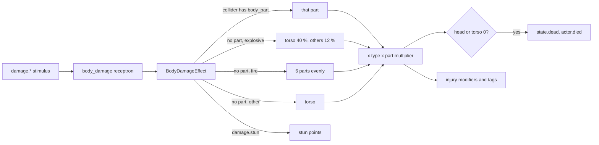

# Damage

Milestone: M4 (Shooting range). Systems done in M4; the gallery room is built on top of them.

## Purpose

Deus Ex 1 style per-body-part damage for the player and guards.

## Player-facing behaviour

A HUD body silhouette shows each part's health (pure green only at full health, yellow at half, red near 0, black when disabled; any damage already shifts a part toward yellow, `HudRules.HURT_GREEN_SHARE`) and the screen flashes red on every hit. Injuries change behaviour: a shot leg slows you, two legs force a crawl, a disabled arm makes aim wide and shaky, two arms stop you from using weapons. A head or torso at 0 kills: "You died", press E to restart the level or Esc for the game menu (Load). Hard landings hurt the legs. Medkits heal, spread over the hurt parts from the belt, or one chosen part from the Tab interface's Health page.

## Rules

### Body parts (`actors/common/body/`)

- Six parts: `head`, `torso`, `arm_l`, `arm_r`, `leg_l`, `leg_r`. Max health per part from the actor's `BodyProfile` (`<actor>_body.tres`):

| Profile | Head | Torso | Each arm | Each leg |
|---|---|---|---|---|
| Player (`actors/player/player_body.tres`) | 60 | 100 | 60 | 70 |
| Dummy / guard (`actors/dummy/dummy_body.tres`) | 40 | 80 | 50 | 50 |

- `BodyDamageModel` (pure, unit-tested) holds current health; health never goes below 0. `BodyParts` (node component) is the adapter: damage, stun, heal, death, knockout, the injury modifiers and tags. Saveable (part health, stun, dead, unconscious; the tags save themselves).
- **Head or torso at 0 = dead**: tag `state.dead`, signal `died`, EventLog `actor.died {actor, by}` (once).
- **Injuries** are Modifiers on the entity's `Attributes` (source `body_parts`, re-derived on every change) so M6 skills and augmentations stack with them:

| Injury | Effect |
|---|---|
| One leg at 0 | `move_speed_mult` x0.6 |
| Both legs at 0 | tag `state.legs_disabled`: forced crawl (crouched, cannot stand up) at 1.0 m/s x `move_speed_mult` |
| Each arm at 0 | `aim_spread_add` +3 degrees and `aim_sway_mult` x2 ([weapons-and-aiming.md](weapons-and-aiming.md)) |
| Both arms at 0 | tag `state.arms_disabled`: weapons refuse to fire (`weapon.refused {reason: arms_disabled}`); no two-handed items exist in v0 |

- **Other systems check the tags, never BodyParts** (`ActorState`, `actors/common/actor_state.gd`, [ADR 0056](../decisions/0056-generic-character-components.md)): `state.dead` or `state.unconscious` stop input, using things, the inventory screen and weapons (`weapon.refused {reason: incapacitated}`); `state.arms_disabled` stops weapons; `state.legs_disabled` forces the crawl. So an Effect adding the same tag (sleep gas: `state.unconscious`, handcuffs: `state.arms_disabled`) has exactly the injury's effect.
- Dead and unconscious are the `state.dead` / `state.unconscious` tags (audit S5): `BodyParts.is_dead()` / `is_unconscious()` read them, so a body knocked out by an Effect that only adds the tag is down for every reader (a training dummy's pose, the range's reset button, healing, the Health page). A BodyParts on an entity without Tags keeps the two tags in a container of its own (saved).

### Hit location ([ADR 0047](../decisions/0047-hitboxes-layer-5-part-aware-ray.md))

- Characters carry `actors/common/body/hitboxes.tscn`: six `AnimatableBody3D` boxes/spheres on collision layer 5 (hitboxes) with no mask and metadata `body_part`, sized for a 1.8 m humanoid (origin at the feet, facing -Z). The player's hitboxes move down with crouching. Guards and training dummies carry `blocky_hitboxes.tscn`: the shapes moved to their blocky model's parts at rest (torso box 0.96 m, arms at ±0.4 m; legs unchanged; [ADR 0103](../decisions/0103-character-models-and-animation.md)), and the head a box matching the model's head at rest: a 0.528 m cube centred at 1.518 m (1.254-1.782 m, measured from the mesh; [ADR 0105](../decisions/0105-character-model-playtest-fixes.md)). They do not animate. The head rules are unchanged (40 health, `damage.ballistic` x2), but the head is much easier to hit: the player's pistol snapped onto a head at 10 m kills within 2 s on 6 of 8 seeds (1 of 8 with the old 0.14 m sphere), and a shotgun aimed at the torso at 15 m kills in 1-3 shots (was 3-6): its upper pellets land on the head (`weapon_outcomes_test.gd`). Only weapon rays and the interactor's ray see hitboxes; the player's body never collides with them.
- Weapon rays and melee sweeps query `PhysicsLayers.WEAPON_MASK` (world, objects, hitboxes), never the character bodies (layers 2/3), and exclude the shooter's own body and hitboxes.
- StimulusSystem passes the hit `collider` to the receivers' effects (`EffectContext.data`, also for CONTACT: the node touched). The `body_damage` receptron (`actors/common/body/receptrons/body_damage.tres`, `BodyDamageEffect`) reads the part from the collider's metadata.
- **Without a part** (RADIUS, or CONTACT to the entity itself) damage is shared out by the profile's `area_weights_by_type` (type -> part shares, the most specific type wins; data in the `.tres`, ADR 0056): `damage.explosive` torso 40 %, each other part 12 %; `damage.fire` evenly over all six; `damage.blunt` torso; `damage.fall` both legs 50/50; any type without an entry to `default_part` (torso).

### Damage types and resistances

- Types arrive as stimuli: `damage.ballistic`, `damage.blunt`, `damage.stun`, `damage.fire`, `damage.explosive`, `damage.fall` (see Fall damage).
- `BodyDamageEffect` deals (perceived - `threshold`) x `scale`: the `body_damage` receptron uses 0 and x1 (the intensity is the damage).
- Guards' shots and baton swings are the same stimuli through the same `WeaponHolder` as the player's ([ADR 0070](../decisions/0070-guard-combat-and-loadouts.md)): a guard's pistol round is `damage.ballistic` 25 on the hitbox it hits, and the player's BodyParts take it like any other hit (4 torso or 2 head hits kill).
- Props thrown at a character: `ImpactNoise` sends `damage.blunt` CONTACT (kinetic energy / 40) to what the prop collides with. Props pass through the player (ADR 0054), so the player's `ImpactSensor` reports a prop flying into its capsule with the same formula (a 10 kg crate at 10 m/s: about 12); on bodies props collide with (the dummy) the sensor is off, so a hit counts once (ADR 0056).
- Dealt = amount x the profile's type multiplier (most specific entry wins, missing = x1; all 1.0 in v0) x the part's multiplier for the type (head `damage.ballistic` x2: headshots). EventLog `actor.damaged {actor, part, type, amount, health, by}` per part, `amount` before clamping (a 50 headshot on a 40 head reads 50).
- `damage.stun` never lowers health: it adds stun points (knockout, [weapons-and-aiming.md](weapons-and-aiming.md)). Objects take no stun (`damage.stun` x0 in every material).
- Objects take damage through their `Breakable`'s material multipliers ([objects-and-fire.md](objects-and-fire.md)): security devices are electronics (blunt x4: the baton's blunt 5 deals 20, so one or two hits break one) and the turret armoured (blunt x2: six hits); hits per device and the baton's reach in [security.md](security.md#breaking-devices) ([ADR 0104](../decisions/0104-devices-breakable-by-the-baton.md)).
- Fire and explosions already reach characters (M3): standing in a fire's radius or carrying a burning object (`damage.fire` 2 CONTACT per 0.5 s pulse, split over six parts) hurts.

### Fall damage (any character with `FallImpact`)

- `FallImpact` (`actors/common/movement/`) emits `damage.fall` CONTACT on its own body on every touchdown of at least 3 m/s, intensity = impact speed (m/s), source = the body itself. The `fall_damage` receptron (`actors/common/body/receptrons/fall_damage.tres`, `include_self`) runs `BodyDamageEffect` with threshold 10 and scale 16, shared 50/50 over the legs: each leg takes (speed - 10) x 8. `body_damage` ignores it (own stimulus). With the player's 2x gravity a 5 m drop lands at about 14 m/s: 32 per leg. A 2 m drop (8.9 m/s) is harmless.
- An augmentation or armour changes falls by swapping or blocking the receptron (e.g. a higher threshold) or with a `damage.fall` type multiplier in the profile.

### Healing

- `BodyParts.heal(amount)`: split evenly over the damaged parts; what a part cannot take (it reached max) is split again over the parts still damaged. Disabled limbs heal too; the dead cannot heal. `BodyParts.heal(amount, source, part)` heals that part only, up to its max (`BodyDamageModel.heal_part`). EventLog `actor.healed {actor, amount, requested, part}` (`part` "" when spread).
- **Medkit** (M5: an inventory item, `items/medkit/`, 1 x 1, stack 15): E picks it up; using it (LMB with it in hand after its belt key or the wheel, ADR 0059; or the inventory screen's Use) sends a `heal` 30 CONTACT stimulus to the player and consumes one; any character with the `heal` receptron (`actors/common/body/receptrons/heal.tres`: `HealEffect` -> `BodyParts.heal`; player and training dummy) is healed by it ([ADR 0057](../decisions/0057-forces-item-use-and-heat-as-generic-systems.md)). Unhurt (or dead): refused and kept, `item.use_refused {item, reason}`, HUD "You are not hurt" ([inventory.md](inventory.md)). The M4 world-use medkit is gone. The Medicine skill scales it on the healer's side: the medkit's `use_scale_attribute` `medical_heal_mult` multiplies the outgoing `heal` (30 / 45 / 60 / 90; [ADR 0061](../decisions/0061-abilities-model.md)).
- **Medkit on one part** (M11, [ADR 0111](../decisions/0111-character-tabs-and-per-part-medkit.md)): the Tab interface's Health page has "Use a medkit on the <part>" for the part selected on its silhouette or list. The medkit's use stimuli go to that part's hitbox instead of the whole user (`PlayerInventory.use_stack(stack, part)`): the CONTACT is delivered to the user's receivers with the hitbox as `collider`, exactly like a hit, and `HealEffect` heals only the part the hitbox names (`Hitboxes.part_of`), by 30 x the user's Medicine multiplier, capped at the part's max. Refused and kept with the same "You are not hurt" when that part is unhurt (the dry run checks the part). Any character with hitboxes and the `heal` receptron can be healed on a part this way; "Heal all" on the page and the belt's medkit keep the spread heal. `item.used` logs the `part`.
- **Regeneration** augmentation (M6): while on it sends `heal` 2 CONTACT to its own entity every 0.5 s (4 HP/s), through the same `heal` receptron and split, only while something is hurt (the `would_affect` dry run); it keeps draining 5 energy/s ([abilities.md](abilities.md)).

### Health page (M11, [ADR 0111](../decisions/0111-character-tabs-and-per-part-medkit.md))

The Tab interface's Health page (`ui/tab_interface/tabs/health_tab.tscn`; the world keeps running) shows the body of any character with BodyParts and updates live: a clickable silhouette (HUD colours) and one row per part with its bar and "value / max"; a disabled part says what that does, worded from the body profile's numbers (`HealthTabRules.disabled_text`: a leg "Move speed x0.6. Both legs: crawl at 1 m/s.", an arm "Aim spread +3° and sway x2. Both arms: weapons won't fire.", a vital part, `BodyDamageModel.VITAL`, "Death."). Current effects show what is applied, nothing recomputed (audit S10): one "Injuries:" line worded from the modifiers BodyParts has on the attributes (source `body_parts`, combined per attribute: "Injuries: move speed x0.6", two arms "aim spread +6°, sway x4"; the page's `modifier_labels` name each attribute), then a neutral name for each state tag of the page's `tag_effects` the character has, whatever added it ("Legs disabled", "Arms disabled", "Burning", "Unconscious", "Cloaked"; what a state does belongs to the systems reading the tag, so the page does not restate it). Treatment: the healing items carried (consumables whose use stimuli include `heal`), what one heals now (`heal` x the user's scale attribute, with the skill that sets it, "45 (Medicine: Trained)"), "Use a medkit on the <part>" for the selected part (disabled when it is unhurt) and "Heal all (spread over hurt parts)"; the result or the refusal shows on the page.

### Death (player)

- Input is disabled (no movement, look, weapons, carry); what is carried is dropped and the weapon holstered. The HUD shows "You died" and "E: restart level · Esc: menu" (the game menu's Load works there, Save is refused; [ADR 0064](../decisions/0064-game-menu.md)); E reloads the current scene (`LevelReset.reload_level`: clears queued stimuli, logs `level.reset`). The debug Spawn tab has the same "Reset level" button.

### Knockout (player)

- The player is knocked out by the same stun rules as anyone (a guard's baton: 20 stun a hit against the player's threshold 60, so the third hit; `state.unconscious` from any source, e.g. a sleep-gas Effect, counts the same). Input stops as on death. The HUD shows the same losing overlay titled "Knocked out" with "E: restart level · Esc: menu" (Load works, Save says "Cannot save while knocked out"; `HudRules.overlay_title`, dead wins). It reads the tags every frame, so if something wakes the player (the `revive` stimulus, ADR 0071) the overlay hides and input returns. Nothing wakes the player today: stun never decays and guards only tend their allies, so in practice it is a losing screen.

### Training dummy (`actors/dummy/`)

- Static humanoid (`StaticBody3D` on layers 3, actors, and 7, static actors) with BodyParts (dummy profile), Hitboxes (`blocky_hitboxes.tscn`), `Awareness` (exported `aware`, default false) and a facing (-Z). It looks like the Kenney blocky crash-test character `character-d` on a round base, standing still like a mannequin (`CharacterAnimator` with `blocky_mannequin_anim.tres`, whose idle clip is the model's `static` pose; [ADR 0103](../decisions/0103-character-models-and-animation.md), [ADR 0105](../decisions/0105-character-model-playtest-fixes.md)). It does not move, so it has no MovementNoise, FallImpact or Knockback; props collide with layer 7, so thrown props bounce off it and its ImpactSensor stays off ([ADR 0070](../decisions/0070-guard-combat-and-loadouts.md)).
- Composed of shared components (audit S4); its script (`training_dummy.gd`) is only the reset hook. Any entity can have these:
  - **`DamageNumbers`** (`actors/common/body/damage_numbers.gd`, tuning `damage_numbers.tres`): on any entity with BodyParts, every hit shows a floating number (`Label3D` over the part's hitbox, or above the origin without Hitboxes; part and amount, stun points in blue, `KO` in yellow) that rises and fades over 1.2 s; numbers in quick succession alternate sides and heights; restoring the body (`BodyParts.restored`) clears them.
  - **`DownedPose`** (the guards' component): knocked out or dead (the tags, whatever added them) it tips over backwards (hitboxes and the shadow proxy over 0.5 s, the collision laid flat) and leaves the character layers for DOWNED like a guard's body, so the player walks through a lying dummy (ADR 0082; props still bounce off it, layer 7); its model plays `die`; standing up again the model eases back to its still pose.
- `use` (E) on it, or `reset()`, sends it a `restore` CONTACT: the `restore` receptron (`actors/common/body/receptrons/restore.tres`, `include_self`, `RestoreEffect`) runs `BodyParts.reset()`: health, stun, consciousness and pose back, numbers cleared (`actor.reset {actor, by}`). The range's "Reset dummies" button sends the same stimulus (ADR 0125).

## Interactions

- [stimulus-response.md](stimulus-response.md) (RAY masks, `collider` in delivery data), [attributes-and-tags.md](attributes-and-tags.md) (`move_speed_mult`, `aim_spread_add`, `aim_sway_mult`; `state.dead`, `state.unconscious`, `state.legs_disabled`, `state.arms_disabled`), [movement.md](movement.md), [perception-and-ai.md](perception-and-ai.md), [objects-and-fire.md](objects-and-fire.md) (fire and explosive damage), [weapons-and-aiming.md](weapons-and-aiming.md)

## Open questions

- Damage to an already disabled limb is lost (DX1 passes it to the torso); revisit if limbs feel like damage sponges.
- Stun points never decay; M7 decides whether guards recover or only wake when another guard finds them.
- Guards (M7) use the dummy's numbers (`actors/guard/guard_body.tres`) and the same hitboxes (`blocky_hitboxes.tscn`, ADR 0103); their capsule and hitboxes need a crouch pose if guards ever crouch.
