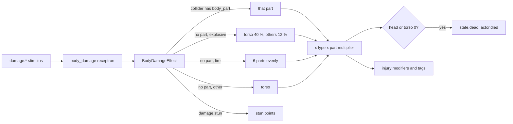

# Damage

Milestone: M4 (Shooting range). Systems done in M4; the gallery room is built on top of them.

## Purpose

Deus Ex 1 style per-body-part damage for the player and guards.

## Player-facing behaviour

A HUD body silhouette shows each part's health (pure green only at full health, yellow at half, red near 0, black when disabled; any damage already shifts a part toward yellow, `HudRules.HURT_GREEN_SHARE`) and the screen flashes red on every hit. Injuries change behaviour: a shot leg slows you, two legs force a crawl, a disabled arm makes aim wide and shaky, two arms stop you from using weapons. A head or torso at 0 kills: "You died", press E to reset the level. Hard landings hurt the legs. Medkits heal.

## Rules

### Body parts (`actors/common/body/`)

- Six parts: `head`, `torso`, `arm_l`, `arm_r`, `leg_l`, `leg_r`. Max health per part from the actor's `BodyProfile` (`<actor>_body.tres`):

| Profile | Head | Torso | Each arm | Each leg |
|---|---|---|---|---|
| Player (`actors/player/player_body.tres`) | 60 | 100 | 60 | 70 |
| Dummy / guard (`actors/dummy/dummy_body.tres`) | 40 | 80 | 50 | 50 |

- `BodyDamageModel` (pure, unit-tested) holds current health; health never goes below 0. `BodyParts` (node component) is the adapter: damage, stun, heal, death, knockout, the injury modifiers and tags. Saveable (part health, stun, dead, unconscious; the tags save themselves).
- **Head or torso at 0 = dead**: tag `state.dead`, signal `died`, EventLog `actor.died {actor, by}` (once).
- **Injuries** are Modifiers on the entity's `Attributes` (source `body_parts`, re-derived on every change) so M6 skills and augmentations stack with them:

| Injury | Effect |
|---|---|
| One leg at 0 | `move_speed_mult` x0.6 |
| Both legs at 0 | tag `state.legs_disabled`: forced crawl (crouched, cannot stand up) at 1.0 m/s x `move_speed_mult` |
| Each arm at 0 | `aim_spread_add` +3 degrees and `aim_sway_mult` x2 ([weapons-and-aiming.md](weapons-and-aiming.md)) |
| Both arms at 0 | tag `state.arms_disabled`: weapons refuse to fire (`weapon.refused {reason: arms_disabled}`); no two-handed items exist in v0 |

### Hit location ([ADR 0047](../decisions/0047-hitboxes-layer-5-part-aware-ray.md))

- Characters carry `actors/common/body/hitboxes.tscn`: six `AnimatableBody3D` boxes/spheres on collision layer 5 (hitboxes) with no mask and metadata `body_part`, sized for a 1.8 m humanoid (origin at the feet, facing -Z). The player's hitboxes move down with crouching.
- Weapon rays and melee sweeps query `PhysicsLayers.WEAPON_MASK` (world, objects, hitboxes), never the character bodies (layers 2/3), and exclude the shooter's own body and hitboxes.
- StimulusSystem passes the hit `collider` to the receivers' effects (`EffectContext.data`, also for CONTACT: the node touched). The `body_damage` receptron (`actors/common/body/receptrons/body_damage.tres`, `BodyDamageEffect`) reads the part from the collider's metadata.
- **Without a part** (RADIUS, or CONTACT to the entity itself) damage is shared out by the profile: `damage.explosive` torso 40 %, each other part 12 %; `damage.fire` evenly over all six; anything else (a blunt CONTACT) to the torso.

### Damage types and resistances

- Types arrive as stimuli: `damage.ballistic`, `damage.blunt`, `damage.stun`, `damage.fire`, `damage.explosive`; fall damage is applied directly as `damage.fall`.
- Dealt = amount x the profile's type multiplier (most specific entry wins, missing = x1; all 1.0 in v0) x the part's multiplier for the type (head `damage.ballistic` x2: headshots). EventLog `actor.damaged {actor, part, type, amount, health, by}` per part, `amount` before clamping (a 50 headshot on a 40 head reads 50).
- `damage.stun` never lowers health: it adds stun points (knockout, [weapons-and-aiming.md](weapons-and-aiming.md)). Objects take no stun (`damage.stun` x0 in every material).
- Fire and explosions already reach characters (M3): standing in a fire's radius or carrying a burning object (`damage.fire` 2 CONTACT per 0.5 s pulse, split over six parts) hurts.

### Fall damage (player)

- Landing faster than 10 m/s (downwards): each leg takes (speed - 10) x 8 (`fall_min_speed`, `fall_damage_per_speed` in the profile). With the player's 2x gravity a 5 m drop lands at about 14 m/s: 32 per leg. A 2 m drop (8.9 m/s) is harmless.

### Healing

- `BodyParts.heal(amount)`: split evenly over the damaged parts; what a part cannot take (it reached max) is split again over the parts still damaged. Disabled limbs heal too; the dead cannot heal. EventLog `actor.healed {actor, amount, requested}`.
- **Medkit** (M5: an inventory item, `items/medkit/`, 1 x 1, stack 15): E picks it up; using it (belt key or the inventory screen's Use) heals 30 and consumes one. Unhurt (or dead): refused and kept, `item.use_refused {item, reason}`, HUD "You are not hurt" ([inventory.md](inventory.md)). The M4 world-use medkit is gone. The Medicine skill scales the amount in M6.

### Death (player)

- Input is disabled (no movement, look, weapons, carry); what is carried is dropped and the weapon holstered. The HUD shows "You died" and "Press E to reset the level"; E reloads the current scene (`LevelReset.reload_level`: clears queued stimuli, logs `level.reset`). The debug Spawn tab has the same "Reset level" button.

### Training dummy (`actors/dummy/`)

- Static humanoid graybox figure (`StaticBody3D` on layer 3, actors) with BodyParts (dummy profile), Hitboxes, `Awareness` (exported `aware`, default false) and a facing (-Z, marked by its visor). It does not move.
- Every hit shows a floating number (`Label3D`, part and amount; stun points in blue, `KO` in yellow) that rises and fades over 1.2 s.
- Knocked out or dead it tips over backwards (figure, hitboxes and collision together). `use` (E) on it, or `reset()`, restores health, stun, consciousness and pose (`actor.reset`).

## Interactions

- [stimulus-response.md](stimulus-response.md) (RAY masks, `collider` in delivery data), [attributes-and-tags.md](attributes-and-tags.md) (`move_speed_mult`, `aim_spread_add`, `aim_sway_mult`; `state.dead`, `state.unconscious`, `state.legs_disabled`, `state.arms_disabled`), [movement.md](movement.md), [perception-and-ai.md](perception-and-ai.md), [objects-and-fire.md](objects-and-fire.md) (fire and explosive damage), [weapons-and-aiming.md](weapons-and-aiming.md)

## Open questions

- Damage to an already disabled limb is lost (DX1 passes it to the torso); revisit if limbs feel like damage sponges.
- Stun points never decay; M7 decides whether guards recover or only wake when another guard finds them.
- Guards (M7) reuse the dummy profile and hitboxes; their capsule and hitboxes need a crouch pose then.
- Regeneration augmentation ([abilities.md](abilities.md)) calls `heal()` over time in M6.
