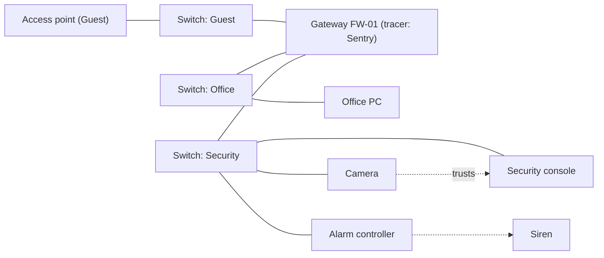

# Hacking

Milestones: M12a (network, computers, the deck's Map and Icebreaker, tracers) and M12b (exploits, Firewall, Logs, wireless) ([ADR 0112](../decisions/0112-hacking-reconciled-with-the-built-game.md)); guards logging in, the security operator and the Sniffer move to M16. M8 builds the security devices, the alarm devices and a remote command interface wired by physical links: see [security.md](security.md) and [ADR 0075](../decisions/0075-alarms-as-network-devices.md). Design decision: [ADR 0074](../decisions/0074-network-hacking.md). Skill: [ADR 0076](../decisions/0076-computer-skill-multitool-removed.md).

Approved mockup: [hacking_screens.html](../prototypes/hacking_screens.html) (supersedes the old wireframes).

## Purpose

Hacking as a believable network, not a minigame. The level has real devices with addresses, subnets, firewalls and accounts. The player wins by finding clues, choosing an entry point and understanding what each machine can reach. Several approaches solve the same problem: crack a password, find it on a sticky note, cut the power to a switch, or shoot the siren.

## Player-facing behaviour

- **Real time**: the world keeps running while you hack. Hacking is silent (no `noise` stimulus), but guards can see you standing at a computer or holding the deck.
- **Screens are overlays** like the Tab interface: an 85 % panel over the dimmed, running world; the player stands still; Esc or the ✕ leaves.
- **The deck** is an inventory item (one model, no upgrades). Exploring the network and hacking happen only on the deck: computers have no network map.
- **Computers** run a simple desktop (placeholder name "Halcyon OS") with three apps: Mail, Files, Security. You can use any computer bare-handed, but only its own desktop. A computer you have an account on can also be used **remotely** from the deck.

### Entry points

| Entry point | Needs | Your address | Leaving it | Milestone |
|---|---|---|---|---|
| Any computer, bare-handed | its credentials (or an unlocked session) | none: you use its desktop only | Running actions continue; you cannot start new ones | M12a |
| Wall network jack | the deck | the deck's address on the jack's subnet | Tethered: walking away unplugs the deck and stops its tools | M12a |
| Autonomous device's maintenance port | the deck | a direct link to that device only | Tethered, like a jack | M12a |
| Plugging the deck into a computer | the deck | the computer's address | Tethered, like a jack | M12a |
| Wireless, within an access point's range | the deck | the deck's address on the access point's subnet | You can lower the deck; tools keep running while you stay in range. Leaving the range stops them | M12b |

- "You" in a firewall rule is the address the deck currently uses (its own, or the computer's when plugged into one).
- Lowering the deck (Esc) while plugged in keeps its tools running.

### Deck tools

| Tool | What it does | Milestone |
|---|---|---|
| Map | Shows the devices you can see (see [Discovery](#discovery)), drawn like the old terminal's Network tab (grouped by hub, pan and zoom: [ADR 0099](../decisions/0099-network-map-layout-pan-zoom.md)). Clicking a device opens its menu: its address, status and account names; per account "Log in" (a login the Journal knows) or the Icebreaker; on a device you have access to, its actions; on a computer you have an account on, "Open its desktop (remote)" | M12a |
| Icebreaker | Brute-forces an account's password. Deterministic, no randomness. Adds trace while it runs | M12a |
| Exploits | Runs a known exploit against a device whose vendor, product and version match. Adds trace | M12b |
| Firewall | As admin of a gateway: view and edit its rules | M12b |
| Logs | As admin of a device: read its log and erase entries | M12b |
| Sniffer | Wireless only. Captures the logins guards make on devices connected through the same access point | M16 (needs guards logging in) |

## Network model

- **Devices** have IP addresses and are grouped into **subnets** (never "segments"). One switch carries one subnet. No VLANs.
- **Physical links**: cable or wireless. An access point has a range. A device can also be **autonomous** (no link at all); it has a maintenance port.
- **Gateways** (firewalls) are nodes between subnets. Rules are an ordered list of from / to / allow or deny; the first match wins. From and To are a subnet, a device or "you". No ports.
- **Power and damage**: switches, access points and gateways have `Powered` and `Breakable` like any prop ([ADR 0066](../decisions/0066-power-circuits-shootable-lights.md)). Unpowering or breaking one cuts everything behind it. A device that loses its link falls back to standalone behaviour (see [Devices](#devices-and-their-remote-actions)).
- **Doors on power loss**: a door's tag says fail-safe (unlocks on power loss) or fail-secure (stays locked). Breaking a switch can disable security, but it can also stop you opening a door remotely.
- **Access is per machine**: local accounts with user or admin rights. No domain accounts.
- **Reach**: what a machine can do depends on its subnet, the firewall rules for its address, and which devices trust it. Example: cameras trust the security console, so the console's Security app controls them; an office PC cannot reach them.
- A device accepts a command from a session logged in on the device itself, or from a machine on its trust list that can reach it.

### Discovery

- From an entry point the Map shows every device on your own subnet, plus its gateway. **What lies behind a gateway is hidden**: no node, no count.
- **Hacking a gateway** (gaining an account on it, by a known login or the Icebreaker) reveals the subnets behind it and their devices. A gateway inside those subnets can be hacked in turn: you hack your way through several subnets in a row.
- Devices once seen stay on the map, greyed out, when you lose access. Node colours follow the network map's rule ([ADR 0099 amendment](../decisions/0099-network-map-layout-pan-zoom.md#amendment-node-colours-m9h)): grey out of reach, red disabled, else green; devices you have access to are drawn amber.

## Credentials and clues

- **Explicit clues** (a sticky note, a datapad, an email with a password): the credential is learned automatically and listed in the Journal's **Codes and logins** ([ADR 0110](../decisions/0110-tab-interface.md)). Login screens offer the logins known for that machine with "Fill in"; the deck's Map offers "Log in" with them.
- **Implicit clues** (an email "my cat's name plus the year we moved in" and a photo "Mishka, 2029"): nothing is learned. They go to the Journal's Notes; the player types the guess. A wrong guess adds trace.
- Clues never lower a password's strength.
- Logging in with correct credentials adds no trace. Failed logins, exploits and the Icebreaker add trace.
- The Journal is the one list of what you know: codes and logins, exploits (a section added in M12b) and notes.

## Icebreaker

Brute force, deterministic. The letters lock in one by one.

| Password strength | Base time |
|---|---|
| Weak | 10 s |
| Medium | 24 s |
| Strong | 50 s |

| Computer skill | Crack time | Trace gain | Strongest password it cracks |
|---|---|---|---|
| Untrained | ×1 | ×1 | Weak |
| Trained | ×0.75 | ×0.8 | Medium |
| Advanced | ×0.5 | ×0.6 | Strong |
| Master | ×0.3 | ×0.4 | Strong |

Resulting crack times (the longest is 25 s: no crack should make the player wait much longer):

| Computer skill | Weak | Medium | Strong |
|---|---|---|---|
| Untrained | 10 s | can't | can't |
| Trained | 7.5 s | 18 s | can't |
| Advanced | 5 s | 12 s | 25 s |
| Master | 3 s | 7 s | 15 s |

- **Skill assists** (shown on the deck, tier by tier like lockpicking, [ADR 0112](../decisions/0112-hacking-reconciled-with-the-built-game.md)): Trained: time estimates (crack time per account, time left); Advanced: + the trace an action will add ("about +30 %"); Master: + how many hidden subnets a gateway routes to.
- Stopping keeps the progress on the deck (saved with the game). Running it on the same account later resumes. If the password has changed since, the progress is lost.
- The skill affects only the deck's tools. Admin access allows every admin action: no action is skill-gated.

## Exploits

- Exploits are found in the world (files, datapads). Reading one learns it, like a code.
- Each targets a vendor, a product and a version range, and states the access it grants (user or admin).
- Reusable, but burnable: when an exploit run is detected (it ran against a device on a subnet a running tracer watches), the devices on that subnet are patched against it.
- Difficulty comes from the software versions the level designer gives each device.

## Tracers

- A tracer is not a property of a subnet. It is an app running on a computer, server or gateway. Example: "Sentry tracer" on firewall FW-01 watches the Guest and Office subnets. A subnet with no tracer is unwatched.
- Tuning is a `.tres` on the tracer: trace gain rate, the amount a failed login or an exploit run adds, drain rate while you are idle, lockout duration. Starting values in [Tuning](#tuning).
- Activity against a device adds trace to every running tracer that watches the device's subnet. The Computer skill scales the gain.
- Trace drains while nothing adds to it.
- **Full trace**: the tracer behaves like a camera. It sends an incident to the alarm controller (location: your entry point, not your position) and blocks your address for the lockout duration. While blocked, the watched devices refuse your address and tools running against them stop (Icebreaker progress stays on the deck).
- **Disabling a tracer**: if its host is disabled, unpowered or cut off, its subnets are unwatched. If only its link to the alarm controller is cut, it still detects and blocks you, but nothing rings. An admin of its host can stop the app; the security console then shows "Tracer offline" to an operator.
- No subnet tiers: difficulty comes from what the level designer places (tracers, software versions, firewall rules).

## Alarms

The alarm is made of devices ([ADR 0075](../decisions/0075-alarms-as-network-devices.md), built in M8, details in [security.md](security.md)):

- An **alarm controller** receives incidents from sensors (cameras, tracers, panic buttons) and sends "ring" to every siren it can reach.
- A **siren** emits a loud siren stimulus; guards who hear it go into Searching.
- A **radio base station**, if the controller reaches it, broadcasts the incident location to guards with radio equipment (`equipment.radio`, [ADR 0072](../decisions/0072-shouts-radio-level-alarm.md)).
- If every siren is broken, disabled or disconnected, nothing rings.

## Devices and their remote actions

| Device | Remote actions | Standalone (link lost) |
|---|---|---|
| Door | open, close, lock, unlock, grant access (adds the deck's owner to its access list: it then opens for them like for a keyholder and stays locked for others) | Works locally (key, keycard, keypad); power loss follows its fail-safe or fail-secure tag |
| Camera | view feed, stop sweep, pan, disable (M8 commands: `command.stop_sweep`, `resume_sweep`, `pan_left`, `pan_right`, `disable`, `enable`; [ADR 0079](../decisions/0079-security-cameras-and-turret.md)) | Keeps watching; its incidents reach no controller |
| Turret | disable, edit target tags (its hostile tags, [ADR 0069](../decisions/0069-hostile-and-ally-tags.md); M8: preset commands `command.target_intruders`, `target_guards`, `target_everyone`) | Keeps its target tags |
| Siren | silence, test | Cannot be rung |
| Alarm controller | disarm, reset, trigger | Rings the sirens it still reaches |
| Computer | mail, files | Its own desktop only |
| Keypad | read its code, open its door | Accepts its code |
| Laser array | disable, enable | Keeps tripping; its incidents reach no controller |
| Panic button | disable, enable (M12a) | Pressing it reaches no controller |
| Radio base station | disable, enable (M12a); the alarm controller sends it `broadcast` | Guards get no radio broadcast |

- There is no camera feed loop (removed from the design).
- **Quiet vs loud**: panning a camera away is quiet. Disabling it makes its feed go dark; from M16 a security operator (a guard at the monitors) radios someone to check it.

### Desktop apps

| App | What it shows |
|---|---|
| Mail | The account's emails |
| Files | The machine's files |
| Security | Replaces the old terminal's Camera tab. A list grouped by kind (cameras and turrets; doors; alarm: controller, sirens, radio base stations, panic buttons; laser arrays), an icon per device kind and its status; the selected device's detail pane with its status, actions and, for cameras and turrets, the live view. It lists **only the devices this computer controls** (they trust it and it reaches them); a computer that controls none says so and points to the deck |

- Reading a mail or file adds it to the Journal automatically, like a datapad ([ADR 0060](../decisions/0060-datapads-read-in-place-personal-log.md)). Credentials, codes and (M12b) exploits inside are learned; implicit clues are kept as notes.
- **Remote desktop**: from the deck's Map, a computer you have an account on opens its desktop inside the deck ("Back to the map" returns). Its Security app controls the devices that trust that computer, from wherever the deck is plugged in.
- "Copy to deck" (in the game UI) exists only for objectives that need the file itself. Deleting a file can also be an objective.

#### Computers as built (M12a, [ADR 0114](../decisions/0114-computers-halcyon-os.md))

- **Components**: a computer is a device entity with `Computer`, `DeviceAccounts` and `ComputerUse` (E). `objects/computer/computer.tscn` is the wall unit; per instance its accounts, its `ComputerData` `.tres` (mail and files), its `credentials_id`, host name and label; `session_user` starts it unlocked.
- **Mail** belongs to an account (a mail with no account is in every inbox); **files** belong to the machine. Each document is a `ComputerDocument`: title (subject or file name), sender, text, codes and code labels like a datapad, and an `implicit_clue` flag (nothing learned, kept as a note). The first item is read when the app opens; clicking another reads it. The reader's last line says what it taught ("Learned: Office PC 2 login kbrandt / ferry19 · added to the Journal.") or that a clue teaches nothing.
- **Login**: Fill in lists every login the Journal knows under the computer's code id, one per user (the latest learned); the Journal's Codes and logins lists them the same way. A wrong guess shows "Wrong user or password." and a quiet beep (a sound, never a noise stimulus); the trace it adds is the tracers' (`DeviceAccounts.try_login()`).
- **Title bar**: host name, the address a component offers through `device_address()`, the account and "user" or "admin", the trace bar slot (`ComputerScreen.add_trace_bar()`, filled on `opened`), ✕.
- **Security app**: kinds, groups and icons are data (`ComputerConfig.kinds`, by entity tag); the list is `Computer.devices()`, filtered by `Computer.controls()` (trust, at the network integration). Offline devices stay listed, grey, without actions. Panic buttons and radio base stations are listed but have no disable / enable yet (their components do not accept those commands).
- **Remote**: the desktop draws above the deck in its content area (`ComputerScreen.remote_area`); Esc or Back to the map closes it (the deck stays open) and emits `Computer.desktop_closed`.

### NPCs and logs

- Devices keep logs: logins (successful and failed), exploit runs, remote actions, with the source address. An admin can erase entries with the deck's Logs tool (M12b). An undetected exploit run still leaves an entry. In v0 only the player reads logs (operators reading them: [backlog](../backlog.md)).
- **M16** (AI overhaul): guards log in to devices through a "use device" action at patrol waypoints (feeding the Sniffer and the logs), and a security operator watches the monitors.

## UI

Overlays, like the Tab interface ([mockup](../prototypes/hacking_screens.html)):

| Screen | Contents |
|---|---|
| Computer (Halcyon OS) | Title bar (host, address, account and access level, trace bars, ✕). Login: user and password, "Fill in" for the logins known for this machine, an error line ("+15 % trace" on a wrong guess). Desktop: Mail, Files, Security in a dock |
| Deck | Title bar (entry point and address, trace bars, ✕). Tools on the left (Map, Icebreaker; M12b tools greyed until then); the Map's device menus; the Icebreaker with the letters locking in and Start / Stop; remote desktops inside the deck |

- One trace bar per tracer watching you (an undiscovered tracer shows as "unknown tracer"), only inside these screens.
- Skill assists appear on the deck (see [Icebreaker](#icebreaker)).

Controls ([controls.md](controls.md)):

- E on a computer uses it bare-handed. With the deck in hand (belt), LMB on a wall jack, maintenance port or computer plugs it in; LMB within an access point's range raises it (M12b; [ADR 0059](../decisions/0059-belt-selects-lmb-uses.md): the belt selects, LMB uses).
- Esc (or the ✕) always steps away from the screen or lowers the deck, also while typing. It never also opens the game menu.
- E does not step away: only Esc leaves a computer-like screen ([ADR 0083](../decisions/0083-security-terminal-redesign.md)).
- The mouse drives the cursor on the screen.

## Rules

- **Systemic**: every behaviour comes from components and data on devices (address, subnet, links, accounts, trust list, software vendor/product/version, `Powered`, `Breakable`, tags). A new device that combines existing behaviours is a scene and `.tres`, no new code. Remote commands are stimuli delivered to the device; its receptrons decide what they do ([ADR 0075](../decisions/0075-alarms-as-network-devices.md)).
- **Skill**: the deck reads its user's Computer skill attributes, so any actor with the skill gets the same tool timings ([abilities.md](abilities.md)).
- **Deterministic**: no randomness anywhere in hacking.
- **Saving** ([saving.md](saving.md)): network state (device power and links, firewall rules, patched devices, logs, discovered devices), known credentials and exploits (PersonalLog), the deck's contents (copied files, crack progress), tracer trace and lockouts.

## Levels

- **Network lab** (gallery, M12a, [../levels/hub-and-gallery.md](../levels/hub-and-gallery.md)): Office and Security subnets behind a gateway that runs a tracer; a wall jack on the Office subnet; an office PC with a sticky note giving its login and a mail with an implicit clue to a second account; a security console that a camera and a door trust; a switch you can unpower to cut the Security subnet; a sign at each station.
- **Warehouse** (M12a, [../levels/mission-warehouse.md](../levels/mission-warehouse.md)): its existing office PCs, wall jack and security console become real computers on real subnets, with one tracer on the gateway between the offices and security. M12b adds exploits and wireless.

## Interactions

- Devices, alarm controller, sirens, radio base station, doors and keypads: [security.md](security.md).
- Guards hearing sirens, radio, the security operator, "use device": [perception-and-ai.md](perception-and-ai.md).
- Power and breaking: [objects-and-fire.md](objects-and-fire.md), [light-and-visibility.md](light-and-visibility.md).
- Deck item: [inventory.md](inventory.md). Skill: [abilities.md](abilities.md). Controls: [controls.md](controls.md).
- Parked: [../backlog.md](../backlog.md) (terminal app, deck upgrades, VLANs, gamepad hacking, remote-hacking augmentation, buying exploits, NPCs noticing changed firewall rules, network app on computers).

## Tuning

Starting values, to be checked by feel in playtest ([playtest checklist](../tech/playtest-checklist.md)). Rule of thumb: no single wait longer than about 25 s, and trace drains fast enough that waiting it out takes seconds, not a minute.

| Value | Start | Result |
|---|---|---|
| Icebreaker base time | Weak 10 s, Medium 24 s, Strong 50 s | See the crack time table above |
| Map scan of a subnet | 2 s, +10 % trace | Matches the "12 % (your scan)" wireframe |
| Exploit run | 4 s, +10 % trace | The fast route; burned if a tracer watches the subnet |
| Failed login (wrong guess) | +15 % trace | About six wrong guesses fill a tracer |
| Tracer gain while a tool runs against a watched device | 4 %/s | One crack fits: Trained Medium 18 s × 4 × 0.8 = 58 %; Advanced Strong 25 s × 4 × 0.6 = 60 %; two in a row without a pause fill it |
| Sensitive tracer variant (`.tres`) | 7 %/s | Trained Medium 18 s × 7 × 0.8 = 101 %: find the password, use an exploit or train the skill |
| Trace drain | 10 %/s, starting 2 s after the last gain | 60 % drains in 8 s |
| Lockout after full trace | 30 s | Short: the alarm is the real penalty |

All trace gains are multiplied by the Computer skill's trace gain (×1 / 0.8 / 0.6 / 0.4).

- **Account names**: the Map lists the account names of every device you have seen (like a login banner). Passwords are the secret; clues, the Sniffer and Icebreaker supply them.
- **Security operator's radio call** (M16): on a dark camera feed or "Tracer offline", the operator radios the nearest guard with `equipment.radio`, who goes to investigate the device. Other guards are not alerted.
