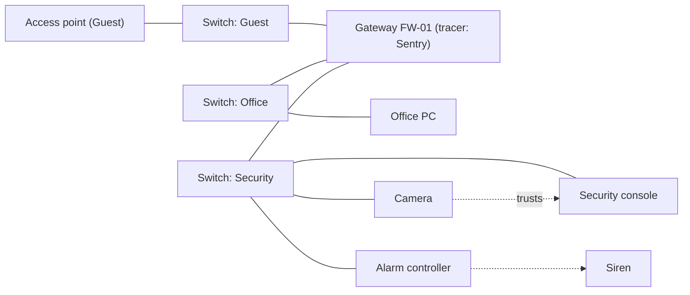

# Hacking

Milestone: M12 (network, deck, desktop apps, intrusion, tracers). M8 builds the security devices, the alarm devices and a remote command interface wired by physical links: see [security.md](security.md) and [ADR 0075](../decisions/0075-alarms-as-network-devices.md). Design decision: [ADR 0074](../decisions/0074-network-hacking.md). Skill: [ADR 0076](../decisions/0076-computer-skill-multitool-removed.md).

UI wireframes: [hacking UI wireframes](https://claude.ai/artifact/49sxCzMfWBQXKAtq1s6jGJ) (private artifact).

## Purpose

Hacking as a believable network, not a minigame. The level has real devices with addresses, subnets, firewalls and accounts. The player wins by finding clues, choosing an entry point and understanding what each machine can reach. Several approaches solve the same problem: crack a password, find it on a sticky note, cut the power to a switch, or shoot the siren.

## Player-facing behaviour

- **Real time**: the world keeps running while you hack. Hacking is silent (no `noise` stimulus), but guards can see you standing at a computer or holding the deck.
- **The deck** is an inventory item (one model, no upgrades). Network discovery and hacking happen only on the deck. Computers have no network app.
- **Computers** have a simple desktop (placeholder name "Halcyon OS") with three apps: Mail, Files, Security. You can use any computer bare-handed, but only its own desktop.

### Entry points

| Entry point | Needs | Your address | Leaving it |
|---|---|---|---|
| Any computer, bare-handed | its credentials (or an unlocked session) | none: you use its desktop only | Running actions continue; you cannot start new ones |
| Wall network jack | the deck | the deck's address on the jack's subnet | Tethered: walking away unplugs the deck and stops its tools |
| Wireless, within an access point's range | the deck | the deck's address on the access point's subnet | You can lower the deck; tools keep running while you stay in range. Leaving the range stops them |
| Autonomous device's maintenance port | the deck | a direct link to that device only | Tethered, like a jack |
| Plugging the deck into a computer | the deck | the computer's address | Tethered, like a jack |

- "You" in a firewall rule is the address the deck currently uses (its own, or the computer's when plugged into one).

### Deck tools

| Tool | What it does |
|---|---|
| Map | Scanner. Shows the devices you can see from your entry point (see [Discovery](#discovery)); drawn like the terminal's Network tab (grouped by hub, pan and zoom: [ADR 0099](../decisions/0099-network-map-layout-pan-zoom.md)) |
| Icebreaker | Brute-forces an account's password. Deterministic, no randomness. Adds trace while it runs |
| Exploits | Runs a known exploit against a device whose vendor, product and version match. Adds trace |
| Sniffer | Wireless only. Captures the logins made on devices connected through the same access point as the deck, while it runs (see [NPCs and logs](#npcs-and-logs)) |
| Firewall | As admin of a gateway: view and edit its rules |
| Logs | As admin of a device: read its log and erase entries |

## Network model

- **Devices** have IP addresses and are grouped into **subnets** (never "segments"). One switch carries one subnet. No VLANs.
- **Physical links**: cable or wireless. An access point has a range. A device can also be **autonomous** (no link at all); it has a maintenance port.
- **Gateways** (firewalls) are nodes between subnets. Rules are an ordered list of from / to / allow or deny; the first match wins. From and To are a subnet, a device or "you". No ports.
- **Power and damage**: switches, access points and gateways have `Powered` and `Breakable` like any prop ([ADR 0066](../decisions/0066-power-circuits-shootable-lights.md)). Unpowering or breaking one cuts everything behind it. A device that loses its link falls back to standalone behaviour (see [Devices](#devices-and-their-remote-actions)).
- **Doors on power loss**: a door's tag says fail-safe (unlocks on power loss) or fail-secure (stays locked). Breaking a switch can disable security, but it can also stop you opening a door remotely.
- **Access is per machine**: local accounts with user or admin rights. No domain accounts.
- **Reach**: what a machine can do depends on its subnet, the firewall rules for its address, and which devices trust it. Example: cameras trust the security console, so the console's Security app controls them; an office PC cannot reach them.
- A device accepts a command from a session logged in on the device itself, or from a machine on its trust list that can reach it.

### Discovery

- From an entry point the Map shows every device on your own subnet, plus the gateway.
- A subnet behind a gateway you cannot pass shows as one locked node: its address range and "? devices".
- Gaining access to it (a firewall rule that lets you through, or a foothold on a machine inside) reveals its devices.
- Devices once seen stay on the map, greyed out, when you lose access. Node colours follow the terminal's rule ([ADR 0099 amendment](../decisions/0099-network-map-layout-pan-zoom.md#amendment-node-colours-m9h)): grey out of reach, red disabled, else green.

## Credentials and clues

- **Explicit clues** (a sticky note, a datapad, an email with a password): the credential is learned automatically. It is listed in the game UI's known-credentials list with a "Fill in" button.
- **Implicit clues** (an email "my dog's name plus the year" and a photo "Rex, 2031"): nothing is learned. The player types the guess. A wrong guess adds trace.
- Clues never lower a password's strength.
- Logging in with correct credentials adds no trace. Failed logins, exploits and the Icebreaker add trace.

## Icebreaker

Brute force, deterministic. The letters lock in one by one.

| Password strength | Base time |
|---|---|
| Weak | 10 s |
| Medium | 24 s |
| Strong | 50 s |

| Computer skill | Crack time | Trace gain | Strongest password it cracks |
|---|---|---|---|
| Untrained | ×1 | ×1 | Weak |
| Trained | ×0.75 | ×0.8 | Medium |
| Advanced | ×0.5 | ×0.6 | Strong |
| Master | ×0.3 | ×0.4 | Strong |

Resulting crack times (the longest is 25 s: no crack should make the player wait much longer):

| Computer skill | Weak | Medium | Strong |
|---|---|---|---|
| Untrained | 10 s | can't | can't |
| Trained | 7.5 s | 18 s | can't |
| Advanced | 5 s | 12 s | 25 s |
| Master | 3 s | 7 s | 15 s |

- Stopping keeps the progress on the deck (saved with the game). Running it on the same account later resumes. If the password has changed since, the progress is lost.
- The skill affects only the deck's tools. Admin access allows every admin action: no action is skill-gated.

## Exploits

- Exploits are found in the world (files, datapads). Reading one learns it, like a code.
- Each targets a vendor, a product and a version range, and states the access it grants (user or admin).
- Reusable, but burnable: when an exploit run is detected (it ran against a device on a subnet a running tracer watches), the devices on that subnet are patched against it.
- Difficulty comes from the software versions the level designer gives each device.

## Tracers

- A tracer is not a property of a subnet. It is an app running on a computer, server or gateway. Example: "Sentry tracer" on firewall FW-01 watches the Guest and Office subnets. A subnet with no tracer is unwatched.
- Tuning is a `.tres` on the tracer: trace gain rate, the amount a failed login or an exploit run adds, drain rate while you are idle, lockout duration. Starting values in [Tuning](#tuning).
- Activity against a device adds trace to every running tracer that watches the device's subnet. The Computer skill scales the gain.
- Trace drains while nothing adds to it.
- **Full trace**: the tracer behaves like a camera. It sends an incident to the alarm controller (location: your entry point, not your position) and blocks your address for the lockout duration. While blocked, the watched devices refuse your address and tools running against them stop (Icebreaker progress stays on the deck).
- **Disabling a tracer**: if its host is disabled, unpowered or cut off, its subnets are unwatched. If only its link to the alarm controller is cut, it still detects and blocks you, but nothing rings. An admin of its host can stop the app; the security console then shows "Tracer offline" to an operator.
- No subnet tiers: difficulty comes from what the level designer places (tracers, software versions, firewall rules).

## Alarms

The alarm is made of devices ([ADR 0075](../decisions/0075-alarms-as-network-devices.md), built in M8, details in [security.md](security.md)):

- An **alarm controller** receives incidents from sensors (cameras, tracers, panic buttons) and sends "ring" to every siren it can reach.
- A **siren** emits a loud siren stimulus; guards who hear it go into Searching.
- A **radio base station**, if the controller reaches it, broadcasts the incident location to guards with radio equipment (`equipment.radio`, [ADR 0072](../decisions/0072-shouts-radio-level-alarm.md)).
- If every siren is broken, disabled or disconnected, nothing rings.

## Devices and their remote actions

| Device | Remote actions | Standalone (link lost) |
|---|---|---|
| Door | open, close, lock, unlock, grant access (adds the deck's owner to its access list: it then opens for them like for a keyholder and stays locked for others) | Works locally (key, keycard, keypad); power loss follows its fail-safe or fail-secure tag |
| Camera | view feed, stop sweep, pan, disable (M8 commands: `command.stop_sweep`, `resume_sweep`, `pan_left`, `pan_right`, `disable`, `enable`; [ADR 0079](../decisions/0079-security-cameras-and-turret.md)) | Keeps watching; its incidents reach no controller |
| Turret | disable, edit target tags (its hostile tags, [ADR 0069](../decisions/0069-hostile-and-ally-tags.md); M8: preset commands `command.target_intruders`, `target_guards`, `target_everyone`) | Keeps its target tags |
| Siren | silence, test | Cannot be rung |
| Alarm controller | disarm, reset, trigger | Rings the sirens it still reaches |
| Computer | mail, files | Its own desktop only |
| Keypad | read its code, open its door | Accepts its code |

- There is no camera feed loop (removed from the design).
- **Quiet vs loud**: panning a camera away is quiet. Disabling it makes its feed go dark, and a security operator (a guard at the monitors) radios someone to check it.

### Desktop apps

| App | What it shows |
|---|---|
| Mail | The account's emails |
| Files | The machine's files |
| Security | On every computer. Lists what this machine can reach and which devices trust it, with their actions. On an office PC: "Cannot reach SEC-SERVER" |

- Reading a mail or file adds it to the PersonalLog automatically, like a datapad ([ADR 0060](../decisions/0060-datapads-read-in-place-personal-log.md)). Credentials, clues, exploits and codes inside are learned.
- "Copy to deck" (in the game UI) exists only for objectives that need the file itself. Deleting a file can also be an objective.

### NPCs and logs

- NPCs log in to devices through a "use device" action at patrol waypoints. This feeds the Sniffer and the device logs.
- Devices keep logs: logins (successful and failed), exploit runs, remote actions, with the source address. An admin can erase entries with the deck's Logs tool. An undetected exploit run still leaves an entry. In v0 only the player reads logs (operators reading them: [backlog](../backlog.md)).

## UI

Two in-world layers and one overlay ([wireframes](https://claude.ai/artifact/49sxCzMfWBQXKAtq1s6jGJ)):

| Layer | Where | Contents |
|---|---|---|
| Computer screen | in the world, on the hacked computer | Halcyon OS desktop: login, Mail, Files, Security |
| Deck screen | in the world, the player's device | Map, Icebreaker, Exploits, Sniffer, Firewall, Logs |
| Game UI overlay | beside or below the screen | Known credentials with "Fill in"; deck actions ("Plug in deck: run Icebreaker", "Copy file to deck"); this machine's address and your access level; "Learned" toasts; control hints; "Tracers watching you" bars (one per tracer; an undiscovered one shows as "unknown tracer"); time estimates |

Controls ([controls.md](controls.md)):

- E on a computer uses it bare-handed. With the deck in hand (belt), LMB on a wall jack, maintenance port or computer plugs it in; LMB within an access point's range raises it ([ADR 0059](../decisions/0059-belt-selects-lmb-uses.md): the belt selects, LMB uses).
- Esc always steps away from the screen or lowers the deck, also while typing. It never also opens the game menu.
- E does not step away: only Esc leaves a computer-like screen ([ADR 0083](../decisions/0083-security-terminal-redesign.md)).
- The mouse drives the cursor on the screen.

## Rules

- **Systemic**: every behaviour comes from components and data on devices (address, subnet, links, accounts, trust list, software vendor/product/version, `Powered`, `Breakable`, tags). A new device that combines existing behaviours is a scene and `.tres`, no new code. Remote commands are stimuli delivered to the device; its receptrons decide what they do ([ADR 0075](../decisions/0075-alarms-as-network-devices.md)).
- **Skill**: the deck reads its user's Computer skill attributes, so any actor with the skill gets the same tool timings ([abilities.md](abilities.md)).
- **Deterministic**: no randomness anywhere in hacking.
- **Saving** ([saving.md](saving.md)): network state (device power and links, firewall rules, patched devices, logs, discovered devices), known credentials and exploits (PersonalLog), the deck's contents (copied files, crack progress), tracer trace and lockouts.

## Levels

- Gallery: a network lab room ([../levels/hub-and-gallery.md](../levels/hub-and-gallery.md)).
- Warehouse mission: a small network ([../levels/mission-warehouse.md](../levels/mission-warehouse.md)).

## Interactions

- Devices, alarm controller, sirens, radio base station, doors and keypads: [security.md](security.md).
- Guards hearing sirens, radio, the security operator, "use device": [perception-and-ai.md](perception-and-ai.md).
- Power and breaking: [objects-and-fire.md](objects-and-fire.md), [light-and-visibility.md](light-and-visibility.md).
- Deck item: [inventory.md](inventory.md). Skill: [abilities.md](abilities.md). Controls: [controls.md](controls.md).
- Parked: [../backlog.md](../backlog.md) (terminal app, deck upgrades, VLANs, gamepad hacking, remote-hacking augmentation, buying exploits, NPCs noticing changed firewall rules, network app on computers).

## Tuning

Starting values, to be checked by feel in playtest ([playtest checklist](../tech/playtest-checklist.md)). Rule of thumb: no single wait longer than about 25 s, and trace drains fast enough that waiting it out takes seconds, not a minute.

| Value | Start | Result |
|---|---|---|
| Icebreaker base time | Weak 10 s, Medium 24 s, Strong 50 s | See the crack time table above |
| Map scan of a subnet | 2 s, +10 % trace | Matches the "12 % (your scan)" wireframe |
| Exploit run | 4 s, +10 % trace | The fast route; burned if a tracer watches the subnet |
| Failed login (wrong guess) | +15 % trace | About six wrong guesses fill a tracer |
| Tracer gain while a tool runs against a watched device | 4 %/s | One crack fits: Trained Medium 18 s × 4 × 0.8 = 58 %; Advanced Strong 25 s × 4 × 0.6 = 60 %; two in a row without a pause fill it |
| Sensitive tracer variant (`.tres`) | 7 %/s | Trained Medium 18 s × 7 × 0.8 = 101 %: find the password, use an exploit or train the skill |
| Trace drain | 10 %/s, starting 2 s after the last gain | 60 % drains in 8 s |
| Lockout after full trace | 30 s | Short: the alarm is the real penalty |

All trace gains are multiplied by the Computer skill's trace gain (×1 / 0.8 / 0.6 / 0.4).

- **Account names**: the Map lists the account names of every device you have seen (like a login banner). Passwords are the secret; clues, the Sniffer and Icebreaker supply them.
- **Security operator's radio call**: on a dark camera feed or "Tracer offline", the operator radios the nearest guard with `equipment.radio`, who goes to investigate the device. Other guards are not alerted.
