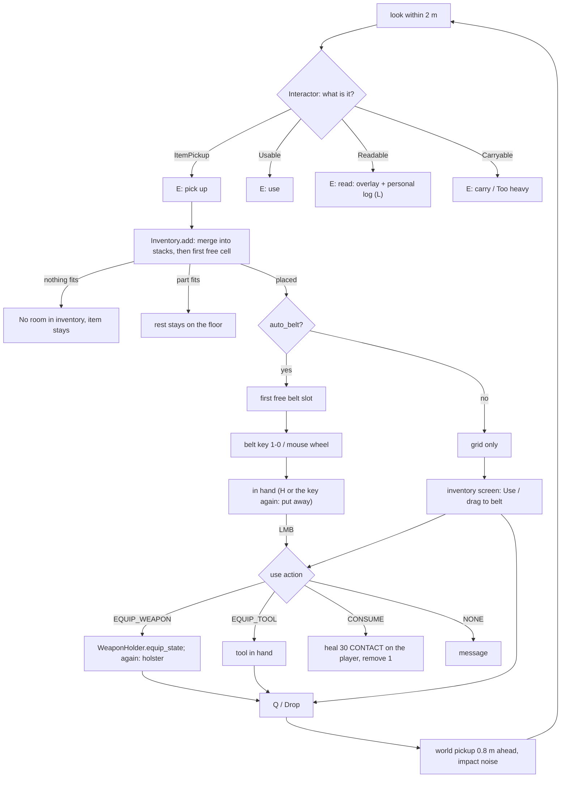

# Inventory

Milestone: M5 (Inventory bay). Systems done in M5; the gallery room ([7 Inventory and abilities bay](../levels/hub-and-gallery.md#7-inventory-and-abilities-bay)) and the hub's loadout table (the player starts empty) are built on top of them.

## Purpose

Deus Ex 1 style grid inventory: what you carry is a spatial puzzle, the belt is your quick bar, and everything you drop is a physics object again.

## Player-facing behaviour

- Look at an item within 2 m: the HUD says "E: pick up Multitool (3)". E puts it into the grid; what does not fit stays on the floor ("No room in inventory").
- New weapons, tools and consumables go to the first free belt slot. Keys 1-0 or the mouse wheel select a slot and put its item in hand, nothing more: a weapon is drawn, anything else is held; the same key again, or H, puts it away ([ADR 0059](../decisions/0059-belt-selects-lmb-uses.md)). The wheel steps to the next / previous non-empty slot (down = right), wrapping; from empty hands down takes the first item, up the last.
- LMB uses the item in hand: a weapon fires, a medkit heals (one per click, it stays in hand until the last is used), a biocell restores 25 energy (refused with "Energy full" at full energy, M6), a tool does nothing (until M8).
- Q with something in hand (and nothing carried) drops it in front of you; it falls, makes an impact noise and can be picked up again with the same magazine or key.
- Datapads are not items: they are read in place (E) and what they say goes to the personal log (L), see [Datapads and the personal log](#datapads-and-the-personal-log).
- I opens the inventory screen and pauses the game: drag items around the grid, onto belt slots, or out of the panel to drop them; right-click for Use / Drop / Split stack / Assign to belt slot; hover for a tooltip.

## Rules

### Items (`items/`)

- `ItemData` Resource per item (`items/<item>/<item>.tres`; the weapons' in `items/weapons/<weapon>/<weapon>_item.tres`): id, display and short name, description, footprint (w x h cells), max stack, graybox icon colour, world scene (a path, to avoid a load cycle with the scene's ItemPickup), `auto_belt`, `default_state`, use action (`NONE`, `EQUIP_WEAPON`, `CONSUME`, `EQUIP_TOOL`) and its parameters (weapon; `use_stimuli`, `use_scale_attribute` and `refused_message` for consumables; the `NONE` message). `use_scale_attribute` (M6) names an attribute of the user that scales every use stimulus on emit (`Stimulus.scale_attribute`, [ADR 0061](../decisions/0061-abilities-model.md)): the medkit's `medical_heal_mult` is the Medicine skill.
- `items/item_catalog.tres` (`ItemCatalog`) lists every item; saves store ids and look them up there; the debug panel's "Give item" lists it.
- Instance state lives on the stack (`state` Dictionary): `magazine` (pistol), `key_id` (keycard). Items with state have max stack 1 and never merge.
- Icons are generated: a rect of the item's colour, its short name, the count of a stackable or a weapon's rounds. No image assets.

| Item | id | Footprint | Stack | Use (LMB in hand, or Use) | Auto-belt | Instance state |
|---|---|---|---|---|---|---|
| Silenced pistol | `pistol` | 2 x 1 | 1 | equip / holster | yes | `magazine` (10 when new) |
| Stun baton | `baton` | 1 x 3 | 1 | equip / holster | yes | |
| Pistol ammo | `pistol_ammo` | 1 x 1 | 100 | none ("Nothing happens") | no | |
| Medkit | `medkit` | 1 x 1 | 15 | heal 30 x the user's `medical_heal_mult` (Medicine), consumes one; refused when unhurt | yes | |
| Multitool | `multitool` | 1 x 1 | 10 | in hand (used in M8) | yes | |
| Lockpick | `lockpick` | 1 x 1 | 10 | in hand (M8: hold-to-pick placeholder; M10: [lockpicking minigame](lockpicking.md), breaks only on failure, success consumes nothing; loadout economy to retune) | yes | |
| Bioelectric cell | `biocell` | 1 x 1 | 20 | `energy` 25 to the user, consumes one; refused ("Energy full") at full energy ([abilities.md](abilities.md)) | yes | |
| Keycard | `keycard` | 1 x 1 | 1 | "Use it on a door" (doors read `key_id` in M8) | no | `key_id` |

### World pickups

- Each item has a world scene: a `PhysicsObject` RigidBody3D on layer 4 (objects) with `continuous_cd`, a graybox mesh at roughly real size, `ImpactNoise` (metal, or cardboard for ammo boxes and keycards), Tags `object.item`, `object.<id>`, `material.*`, and an `ItemPickup` component (item, count, state overrides). `ItemPickup` is saveable (count, state). Level designers set `count` and `state` (e.g. `{"key_id": "office"}`) on placed pickups.
- The M4 world medkit (`objects/medkit/`, E healed on the spot) is gone: `items/medkit/medkit.tscn` is a pickup and E picks it up.

### Grid ([ADR 0050](../decisions/0050-inventory-model-and-belt-references.md))

`Inventory` (`items/inventory/inventory.gd`, pure, unit-tested), 6 x 5 cells (`items/inventory/inventory_config.tres`).

- `add(item, count, state)`: first fills existing stacks of the same item that have room (placement order), then places new stacks at the first free position scanning rows top to bottom, each row left to right, never rotated. Returns what did not fit (0 = all in). A full inventory changes nothing.
- `move(stack, cell)`: only inside the grid and not overlapping another stack; the stack's own old cells do not block it.
- `remove(stack, n)`, `split(stack, n)` (the new stack goes to the first free position; refused without room), `take(id, n)` (empties the smallest stacks first), `count_of(id)`.
- `to_dict()` / `from_dict(data, catalog)`: stacks as `{id, count, state, cell: [x, y]}` (JSON-safe).

### Belt

`Belt` (`items/inventory/belt.gd`, pure): 10 slots, index 0 = key 1 ... index 9 = key 0 (`belt_1` ... `belt_0`).

- Slots reference stacks, never copies; a stack is in at most one slot. Assigning a stack moves it from its old slot. A stack that leaves the grid (used up, dropped) clears its slot.
- `auto_belt` items (weapons, tools, consumables) take the first free slot when a new stack is placed (pickup, Give item, split).
- `selected` is the slot whose item is in hand (highlighted on the HUD), -1 when none. Saved as stack indices.
- `next_filled(from, step)`: the next non-empty slot from `from` towards `step` (> 0 right, < 0 left), wrapping; from -1 the first (step > 0) or last (step < 0) non-empty slot; `from` itself when it is the only item, -1 when the belt is empty. The mouse wheel uses it.

### Use, hand, ammo (`PlayerInventory`, `items/inventory/player_inventory.gd`)

- In hand ([ADR 0059](../decisions/0059-belt-selects-lmb-uses.md)): `select_slot` (belt key) and `cycle` (wheel) call `hold(stack)`: an `EQUIP_WEAPON` item is drawn through the WeaponHolder (`equip_state`), any other item becomes `held`; either replaces what was in hand. The same belt key again, H (`holster` action) and death call `put_away()`. `use_held()` (LMB, when nothing is carried) uses the held item as below, except a tool; with a weapon or nothing in hand LMB goes to the WeaponHolder.
- Use (LMB on a held item, or the inventory screen's Use): `EQUIP_WEAPON` / `EQUIP_TOOL` (screen only) toggle the item in hand; a tool in hand shows its name and LMB does nothing until M8. `CONSUME` ([ADR 0057](../decisions/0057-forces-item-use-and-heat-as-generic-systems.md)): the item's `use_stimuli` (type -> intensity; medkit `{heal: 30}`) go to the player as CONTACT stimuli with the player as source, delivered at once (`StimulusSystem.emit_now`: the inventory screen pauses the game), and one is consumed; the player's receptrons decide what they do (the `heal` receptron -> `HealEffect` -> `BodyParts.heal`). Refused, item kept, when none of them would do anything to the player (`StimulusSystem.would_affect` dry run: a medkit when unhurt or dead): the item's `refused_message` ("You are not hurt") and `item.use_refused {item, reason: no_effect}`. Logged `item.used {item, action: consume, stimuli}`; the heal itself logs `actor.healed` (source: the player). `EQUIP_WEAPON` and `EQUIP_TOOL` stay inventory verbs: they change what is in hand and nothing in the world could react to them. `NONE` shows the item's message. An empty slot does nothing.
- Each weapon stack gets a `WeaponState`; its magazine is mirrored into the stack's `magazine` state (after every shot, reload, equip, save and drop). Spare rounds are the inventory's stacks of the weapon's `ammo_item` (`InventoryAmmo`): a reload takes what the magazine needs from the smallest stacks first; the HUD shows "magazine / rounds in the inventory".
- Death puts the item in hand away.

### Pickup and interaction ([ADR 0051](../decisions/0051-single-interactor-hud-prompts.md))

- One `Interactor` component on the player casts one ray per physics tick from the eyes, 2.0 m (`interact_reach` in `player_config.tres`), on layers 1, 4 and 5 (world, objects, hitboxes; a hitbox stands for its character), excluding the player and its hitboxes.
- Resolution order: `ItemPickup` ("E: pick up Multitool (3)", count only above 1), `Usable` ("E: reset Training dummy": the usable's verb; a `Readable` names its title: "E: read Storage access"), `Carryable` within the carry limit ("E: carry Small crate") or above it ("Too heavy"); while carrying: "E: put down Small crate". Names come from the item, else `Usable.target_name()`, else `display_name` metadata, else the node name in words.
- E does what the prompt says. Picking up takes what fits: all of it frees the pickup, part of it leaves the rest with a smaller count ("No room in inventory (30 left behind)"), nothing leaves it untouched ("No room in inventory").

### Drop

- From the inventory screen (Drop in the context menu, or drag out of the panel) or with Q when something is in hand and nothing is carried (Q while carrying keeps its M3 meaning: let go). Drops the whole stack (split first to drop part).
- Spawns the item's world scene 0.8 m ahead (horizontal view direction) at chest height (1.3 m above the feet) with 1.0 m/s forward; if a wall or object is between the eyes and that point, it appears 0.15 m before the hit. It lands with an `object.impact` noise like any physics object.

### Inventory screen ([ADR 0052](../decisions/0052-inventory-pauses-the-game.md))

- `ui/inventory/inventory_screen.tscn` (child of the Player). `inventory` (I) toggles, Esc closes. Opens only when the player can act (alive, conscious, input enabled, debug panel closed). While open the SceneTree is paused (the screen runs with `PROCESS_MODE_ALWAYS`) and the mouse is free; closing restores the previous mouse mode.
- Dark panel, 64 px cells with thin grid lines, items as coloured rects with short name and count; the belt row (56 px slots) under the grid.
- Left-drag: the item follows the mouse; over the grid a green (fits) or red (blocked or out of bounds) footprint shows where it lands; release on the grid moves it, on a belt slot assigns it, outside the panel drops it. Dragging an item out of a belt slot and releasing it anywhere but another slot clears that slot.
- Right-click: Use (Equip / Put away / Use) / Drop / Split stack (half, only for counts above 1) / Assign to belt slot 1-0. Hover: tooltip (name, description, count, magazine, key). Hover + a belt key assigns the item to that slot.
- `PauseScreens` (`ui/inventory/pause_screens.gd`) tracks every open pause screen (inventory, log screen, reading overlay); the pause ends when the last closes. Closing resyncs the player's held keys so the closing key is not also an in-game press.

### Datapads and the personal log

[ADR 0060](../decisions/0060-datapads-read-in-place-personal-log.md).

- A datapad (`objects/datapad/datapad.tscn`) is a physics prop, not an item: blasts and the player push it, it makes impact noise, it can never enter the inventory (and is not carried: E reads it). Its `Readable` component holds `entry_id` (stable, unique: `<level>.<room>.<name>`), `title`, `text`, `codes` (keypad code id -> code) and `source` ("Datapad"). Any entity with a `Readable` reads the same way.
- Look at it within 2 m: "E: read Storage access". E opens the reading overlay and passes the entry to the player's `PersonalLog` (`actors/common/personal_log/`, any actor can have one): a new `entry_id` is added (HUD "Added to log: Storage access", EventLog `log.entry_added {entry_id, title, codes}`) and its codes become known; reading it again only shows it.
- Known codes: the last entry added wins a shared code id. M8 keypads ask `PersonalLog.known_code(code_id)` and `code_source(code_id)` ([security.md](security.md)).
- Reading overlay (`ui/log/reading_overlay.tscn`, child of the Player): the entry's title and text in a panel, shown on every read; pauses like the inventory; E or Esc closes (that E is not also an in-game press).
- Log screen (`ui/log/log_screen.tscn`, child of the Player): L (`personal_log`) toggles, Esc closes; pauses like the inventory. Left: entry titles, newest first (the newest is selected), and the known codes ("Storage Door: 2817  (Storage access)"); right: the selected entry's title and text (mouse wheel scrolls long text). It opens only when the player can act and no other pause screen is open; the inventory does not open over it.
- Saving: `PersonalLog` is in group `saveable` (`save_state()`: `{entries: [{entry_id, title, text, source, codes}]}`); codes are rebuilt from the entries on load.

### HUD

- Belt: bottom centre, 10 slots (52 px) with the key number, short name and count; the selected slot has a yellow border.
- The name of the item put in hand shows just above the belt for `InventoryConfig.item_name_time` (1.5 s, fading over its last half); holstering hides it at once.
- Prompt under the reticle; messages (2.5 s, fading) above the item name; the name of the item in hand and ammo bottom right.

### Saving

- `Player.save_state()` includes `inventory`: `{inventory: Inventory.to_dict(), belt: Belt.to_dict(), in_hand: stack index or -1}`; `load_state` restores it and puts the item that was in hand back in hand (never uses it). M6 wires quicksave.

### EventLog

`item.picked_up {item, count, left}`, `item.pickup_refused {item, count, reason}`, `item.dropped {item, count}`, `item.used {item, action}` (`equip` for every item put in hand, `consume` + `stimuli`, `nothing`), `item.use_refused {item, reason}`, `debug.gave_item {item, count}`; reading: `log.entry_added {entry_id, title, codes}`.

## Interactions

- Dropped items are physics objects: [objects-and-fire.md](objects-and-fire.md)
- Medkits: [damage.md](damage.md); biocells: [abilities.md](abilities.md); multitools, lockpicks, keycards: [security.md](security.md); weapons and ammo: [weapons-and-aiming.md](weapons-and-aiming.md)
- Controls: [controls.md](controls.md); debug Give item: [debug-panel.md](debug-panel.md); saving: [saving.md](saving.md)

## Open questions

- Rotation stays parked ([../backlog.md](../backlog.md)).
- Dropping part of a stack takes a Split first; DX1 drops one at a time. Revisit after playtests.
- Picking up a second pistol makes a second 2 x 1 stack (no ammo is stripped from it as DX1 does).
- Keycards may move to a keyring (no grid space) once M8 doors use them.
