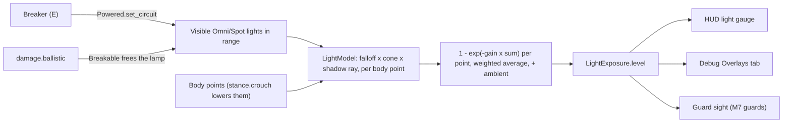

# Light and visibility

Milestone: M7 (Perception lab).

## Purpose

Light level affects how visible the player is to guards, computed analytically so it is testable headless.

## Player-facing behaviour

A HUD light gauge (a gem and a bar above the body silhouette and energy bar) shows how lit the player is: dark blue below about 0.12, amber while dim, pale yellow from about 0.45. Crouching under a lamp lowers it; cover between the lamp and your body lowers it. Lamps can be shot out (glass breaks, the light goes out); a breaker panel cuts every lamp on its circuit. Fire lights you up too.

## Rules

- Light level is computed analytically ([ADR 0013](../decisions/0013-light-analytic.md), model in [ADR 0065](../decisions/0065-light-level-model.md)). No render-based light gem.
- `LightExposure` component (`actors/common/light/`), on any entity (the player now, guards later): group `light_exposure`, `level` in [0, 1] (1 fully lit, 0.04 ambient darkness), `LightExposure.of(entity)`. Pure logic in `LightModel`, tuning in `light_exposure.tres`. Updates at 10 Hz.
- Lights: every visible `OmniLight3D` / `SpotLight3D` whose range reaches the entity (fire and explosion lights included). `DirectionalLight3D` is ignored (no level uses one indoors).
- Per light and body point: `energy x luminance(colour) x (1 - (d / range)^4)^2 / d^attenuation` (Godot's own falloff) x the spot cone factor, 0 when the shadow ray from the light hits world geometry or a prop (layers 1 and 4; the entity's own colliders and the light's lamp never block).
- Body points above the feet: 0.2, 1.0, 1.6 m standing; 0.2, 0.55, 0.85 m with `stance.crouch`; weights 0.25 / 0.5 / 0.25.
- Point level `1 - exp(-4 x sum)`; level `0.04 + 0.96 x weighted average`.
- Reference values: lit lane 0.93 standing / 0.88 crouched, dim lane 0.31 / 0.21, dark 0.04; hub spawn about 0.65. Guard thresholds (dark < 0.1, fully visible >= 0.5) live with the guards ([perception-and-ai.md](perception-and-ai.md)); light zones keep clear of both.
- Rooms that must look dark override the environment ambient with a `ReflectionProbe` (ambient colour mode) whose box encloses every surface by more than its blend distance; otherwise the hub's ambient makes them look grey while they read 0.04.
- Shootable lamps (`objects/light_fixture/ceiling_lamp.tscn`, `wall_lamp.tscn`) are Breakable glass with `health` 1; breaking frees the lamp and its light. `Powered` puts a lamp on a circuit; a `CircuitBreaker` (breaker panel) switches the circuit ([ADR 0066](../decisions/0066-power-circuits-shootable-lights.md), [security.md](security.md)). Lamp, breaker and circuit state are saved; a broken lamp stays broken after a load.
- Light level is shown in the debug Overlays tab ([debug-panel.md](debug-panel.md)).

## Interactions

- Cloak augmentation: [abilities.md](abilities.md)
- Shootable lights take damage: [damage.md](damage.md)
- Perception lab room: [../levels/hub-and-gallery.md](../levels/hub-and-gallery.md)

## Open questions

- Whether light should be smoothed over time for guards (it is raw at 10 Hz; the HUD gauge eases its display).
- Flashlights or muzzle flashes as light sources: none yet.
