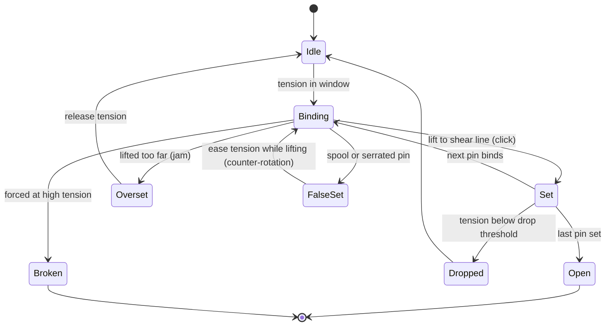

# Lockpicking

Milestone: M10 (minigame, built: [ADR 0107](../decisions/0107-lockpicking-minigame.md)). M8 built locks as data and a placeholder: see [security.md](security.md). The approved prototype is [lockpicking_bench.html](../prototypes/lockpicking_bench.html); the game ports its mechanics, numbers and drawing.

## Purpose

A mechanical-lock minigame true to real pin-tumbler locks and their vocabulary. The player's understanding matters most; the Lockpicking skill makes it more forgiving but never gates a lock ([ADR 0073](../decisions/0073-realistic-lockpicking.md)).

## Player-facing behaviour

- **Start**: lockpick selected on the belt, left-click a lock within reach (a door's pin lock: its leaf, where the keyhole sits on the handle, from either face, [ADR 0098](../decisions/0098-door-lock-hardware-and-keycard-relock.md)) ([ADR 0059](../decisions/0059-belt-selects-lmb-uses.md): the belt selects, LMB uses). The camera turns to face the lock (0.25 s) and the player stops moving (the stance stays): W / S / A / D work the lock, the mouse lifts the pick.
- **Leave**: E or Esc (Esc does not open the game menu), taking damage, being unable to act, the lock unlocked or opened by other means, out of reach (2.5 m from the eyes), or the last lockpick broken. Leaving releases tension and loses all progress. A picked lock's screen closes once the plug has turned (0.8 s). LMB still held when the screen closes does not start it again.
- **Real time**: the game does not pause; guards can walk up on you.
- **Screen** (`LockpickScreen`, a child of the player): a centred panel about 45% of the screen with the prototype's front view (door plate, plug and keyway, tension wrench, pick, pick-depth dots), drawn in 2D over the live first-person view, above the HUD's belt. Captions at the bottom of the panel, one line of control hints under it.
- **Assists by skill** (cumulative): Untrained hears the lock only (sound and tool motion); Trained adds the **tension gauge** at the panel's right edge (bands at the picker's real thresholds: drop zone, too low, sweet spot, too high; needle, % and zone word); Advanced adds **captions** (the prototype's texts: "click", "deep clunk, the plug turns further", "a pin drops"...); Master adds the **pins view** under the panel (the clear acrylic side view: key pins, drivers, springs, the shear line, the pick). The level is the `lockpick_assist` attribute, so an augmentation could raise it. A practice lock always shows all three.
- **Tension**: W raises it, S lowers it (0.5 per second; with Shift 0.15, fine steps), and the level holds where you leave it (no leak). The wrench angle shows it.
- **Pins**: A / D move the pick between pins (discrete steps). **Changing pins resets the lift** ([ADR 0107](../decisions/0107-lockpicking-minigame.md)): the lift target goes to the bottom, the tip drops below the pins (0.05 s from full lift), then the pick moves across (0.05 s per pin); mouse lift is ignored until it arrives, and further presses during the move queue. Moving with the pick up can no longer jam the next pin (a prototype bug).
- **Lift**: relative mouse Y moves a lift target (0.003 of the range per pixel, a tuning value; it stays where it is left). The pick tip follows the target like a spring. When a binding pin resists, the tip lags behind the target and that lag is the applied force. Pushing further raises the force until the pin sets, oversets, or the pick strains and breaks.

### How a pin-tumbler lock behaves

- **Binding order**: under tension one pin binds at a time. Lift it to the shear line and it sets with a click; the plug turns a hair and the next pin binds.
- **Overset**: lifting a pin too far jams it. Recover by releasing tension.
- **Tension window**:

| Tension | Result |
|---|---|
| Too low (below the drop threshold) | Set pins drop back: the last set pin drops after 0.3 s below the threshold; all pins drop at 0% |
| Sweet spot | Clean sets |
| Too high | Pins are stiff and need more lift force, the set click is muted, overset and pick breakage are likely. Never a hard block |

- **Spool pins** give a false set: the plug turns noticeably more, then counter-rotates when lifted (the plug pushes back). The player eases tension with S so the plug turns back while still lifting with the mouse. Holding tension keeps the spool stuck; forcing it risks breaking the pick.
- **Serrated pins**: several small clicks per pin, each a false set of its own.
- "False gates" in our vocabulary means false sets from spool and serrated pins.

### Lock tiers

Pin data is random but seeded per lock, so a lock is the same across retries.

| Tier | Pins | Target time, untrained | Target time, max skill |
|---|---|---|---|
| Simple | 3 standard | ~5 s | auto-rake |
| Standard | 5 standard | ~15 s | ~7 s |
| Secure | 5, 2 of them spools | ~30 s | ~15 s |
| High-security | 6 with spools and serrated pins, tighter tolerances | ~60 s | ~25 s |

Times are for a player who understands the mechanic.

### Feedback

- **Sounds**: binding scrape, crisp set click, duller and bigger false-set clunk, counter-rotation creak, serrated ticks, rising strain before a break, overset jam. Placeholder sounds first (the prototype's synth sounds: one-shots baked to WAV, the scrape and strain synthesised live; `LockpickAudio`, [ADR 0108](../decisions/0108-lockpick-sounds.md)); a real sound pass later.
- **Tool motion**: the wrench turns with the plug and kicks back on counter-rotation; the pick bends with force; the plug turns a hair per set and noticeably on a false set.
- **Camera**: tiny nudges on clicks.
- **Practice locks**: clear acrylic wall locks (`objects/locks/practice_lock/practice_lock.tscn`; `MechanicalLockData.practice` with a `practice_tier`: Simple, Standard, Secure or High-security, the prototype's pins and tolerances). Every assist shows whatever the skill. Picks break on them like on any lock. Once opened, the plug turns back about 3 s later and the lock re-locks with a **new random pin layout** (real locks keep their `pin_seed` across retries): the `relock` sound, the pins drop and settle at their new heights over 0.5 s, the caption "new pin layout", and the panel's layout counter ("Practice lock · Standard · Layout 3"). It re-locks also when the picker has left. They are the tutorial: the Security wing's hall has one per tier on its west wall, Simple to High-security from left to right as you face it, each named by a small sign ([hub-and-gallery](../levels/hub-and-gallery.md)). One prop serves every tier: its visible pins are built from the lock's pin count (`PracticeLockPins`). The final game will likely have a Deus Ex-style training course ([../backlog.md](../backlog.md)).

## Rules

- **Noise** (perceived = loudness - distance, heard when >= 1; [../levels/metrics.md](../levels/metrics.md)):

| Event | Loudness | Heard to about |
|---|---|---|
| Click, scrape | 2 | 1 m |
| Overset jam, false-set clunk | 3 | 2 m |
| Lock opening | 4 | 3 m |
| Pick breaking | 6 | 5 m (like a footstep) |

- **Lockpicking skill** ([abilities.md](abilities.md)), as attributes and modifiers like the other skills (the prototype's `skillParams(t)`, t = tier 0-3):

| Attribute (base in the tuning) | Per tier (ADD) | Untrained / Trained / Advanced / Master |
|---|---|---|
| `lockpick_window_low` (0.30) | -0.04 | 30 / 26 / 22 / 18 % tension |
| `lockpick_window_high` (0.60) | +0.04 | 60 / 64 / 68 / 72 % |
| `lockpick_drop_threshold` (0.15) | -0.03 | 15 / 12 / 9 / 6 % |
| `lockpick_drop_delay` (0.3 s) | +0.15 | 0.3 / 0.45 / 0.6 / 0.75 s per dropped pin |
| `lockpick_lift_tolerance` (0) | +0.012 | added to the base 0.045 around the shear line |
| `lockpick_rake` (0) | Master +1 | rakes when at least 0.5 |
| `lockpick_assist` (0) | +1 | the assists above |

  - Master rakes rakeable locks (at most 3 pins, all standard: a Simple lock): hold LMB in the tension window; a pin sets every 0.65 s (about 2 s for three) with normal click noise; letting go stops it.
  - The prototype's binding-pin hint (a louder scrape and pick tremor at tier 2+) is dropped: the normal scrape plays at every tier.
  - Skill never hard-gates a lock: hard locks are very hard untrained but possible.
- **Tuning** (`objects/locks/lockpicking/lockpick_tuning.tres`, every prototype number unchanged): tension rates, pin heights, spring, lift force, strain and break, false sets, ticks, rake, noise table, plug turn, the four practice tiers. Each lock's data: `pins`, `pin_seed`, `tolerance_mult` (1.0; the tiers: Simple 1.1, Standard 1.0, Secure 0.9, High-security 0.7), `tool`, `practice`, `practice_tier`.
- **Lockpicks break only on failure**: forcing a heavily bound pin at high tension, or prying an overset. A broken pick removes one lockpick from the picker's inventory (another stays in hand while any is left); with none left the attempt ends ("Out of lockpicks"). Success consumes nothing ([inventory.md](inventory.md)).
- **Noise**: every event emits a `noise` at the lock through the usual noise path (the table above: set click, scrape at most every 1.2 s while the binding pin rubs, serrated tick 2; overset jam, false-set clunk 3; opening 4; snap 6). Pin drops and the creak make no noise, as in the prototype.
- **Systemic**: any entity with a `Lock` component and its pin data (doors, desk drawers, lockers, crates, padlocked gates) uses the same minigame. Pin-tumbler only for now.

### Plan

- **M8** (built, [ADR 0078](../decisions/0078-doors-locks-and-door-navigation.md)): `MechanicalLock` with `MechanicalLockData` (`pins`: one type per pin, `pin_seed`, `tool`), the pick hook is the `Lock` tool interface (`accepts_tool`, `tool_hold`, `tool_release`, `tool_progress`) driven by the user's `ToolUse` while LMB is held with a lockpick; the placeholder takes pins x 1 s x `lockpick_time_mult`. M10 replaces `tool_hold` without touching doors.
- **M10** (built, [ADR 0107](../decisions/0107-lockpicking-minigame.md)): `MechanicalLock.tool_hold()` opens the user's `LockpickScreen`; the model is `PinTumbler` (pure, the prototype's `step()`), built by the lock (`new_model()`), with `LockpickParams` from the picker's attributes; success calls `complete_pick()` (unlocks it for the user, who wants it open); noises through `pick_noise()`. Practice locks (`PracticeRelock`). Sounds: `LockpickAudio` ([ADR 0108](../decisions/0108-lockpick-sounds.md)). The skill's attributes replaced `lockpick_time_mult`.
- **Later gamepad milestone** ([../backlog.md](../backlog.md)): L2 tension, R2 lift, right stick changes pins, rumble.

## Interactions

- Noise stimuli reach guards like any other ([perception-and-ai.md](perception-and-ai.md), [stimulus-response.md](stimulus-response.md)).
- Controls: [controls.md](controls.md). Skill: [abilities.md](abilities.md). Pick item: [inventory.md](inventory.md). Locks on doors: [security.md](security.md).
- Practice locks: [../levels/hub-and-gallery.md](../levels/hub-and-gallery.md) room 5.

## Open questions

- Exact tolerances per lock tier and skill tier (the prototype's, to be tuned in playtests).
- Pick break thresholds.
- Captions as an accessibility option independent of skill (later pass).
- Loadout economy (2 picks today).
