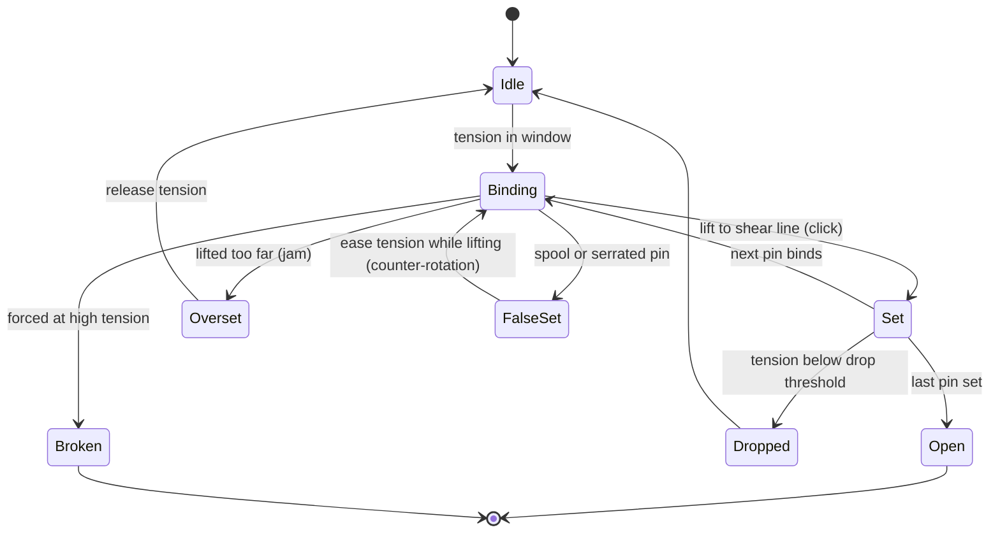

# Lockpicking

Milestone: M10 (minigame). M8 builds locks as data and a placeholder: see [security.md](security.md).

## Purpose

A mechanical-lock minigame true to real pin-tumbler locks and their vocabulary. The player's understanding matters most; the Lockpicking skill makes it more forgiving but never gates a lock ([ADR 0073](../decisions/0073-realistic-lockpicking.md)).

## Player-facing behaviour

- **Start**: lockpick selected on the belt, left-click a lock within reach (a door's pin lock: its leaf, where the keyhole sits on the handle, from either face, [ADR 0098](../decisions/0098-door-lock-hardware-and-keycard-relock.md)) ([ADR 0059](../decisions/0059-belt-selects-lmb-uses.md): the belt selects, LMB uses). The view locks onto the lock.
- **Leave**: E or Esc, or taking damage. Leaving releases tension and loses all progress.
- **Real time**: the world keeps running; guards can walk up on you.
- **View**: outside only: keyway, tension wrench and pick tip. No HUD meters, no X-ray. The player reads the lock through sound and tool motion.
- **Tension**: W raises it, S lowers it, and the level holds where you leave it (no leak). The wrench angle shows it.
- **Pins**: A / D move the pick between pins (discrete steps).
- **Lift**: mouse Y. The pick tip follows a target height like a spring. When a binding pin resists, the tip lags behind the target and that lag is the applied force. Pushing further raises the force until the pin sets, oversets, or the pick strains and breaks.

### How a pin-tumbler lock behaves

- **Binding order**: under tension one pin binds at a time. Lift it to the shear line and it sets with a click; the plug turns a hair and the next pin binds.
- **Overset**: lifting a pin too far jams it. Recover by releasing tension.
- **Tension window**:

| Tension | Result |
|---|---|
| Too low (below the drop threshold) | Set pins drop back: the last set pin drops after 0.3 s below the threshold; all pins drop at 0% |
| Sweet spot | Clean sets |
| Too high | Pins are stiff and need more lift force, the set click is muted, overset and pick breakage are likely. Never a hard block |

- **Spool pins** give a false set: the plug turns noticeably more, then counter-rotates when lifted (the plug pushes back). The player eases tension with S so the plug turns back while still lifting with the mouse. Holding tension keeps the spool stuck; forcing it risks breaking the pick.
- **Serrated pins**: several small clicks per pin, each a false set of its own.
- "False gates" in our vocabulary means false sets from spool and serrated pins.

### Lock tiers

Pin data is random but seeded per lock, so a lock is the same across retries.

| Tier | Pins | Target time, untrained | Target time, max skill |
|---|---|---|---|
| Simple | 3 standard | ~5 s | auto-rake |
| Standard | 5 standard | ~15 s | ~7 s |
| Secure | 5, 2 of them spools | ~30 s | ~15 s |
| High-security | 6 with spools and serrated pins, tighter tolerances | ~60 s | ~25 s |

Times are for a player who understands the mechanic.

### Feedback

- **Sounds**: binding scrape, crisp set click, duller and bigger false-set clunk, counter-rotation creak, serrated ticks, rising strain before a break, overset jam. Placeholder sounds first; a real sound pass later.
- **Tool motion**: the wrench turns with the plug and kicks back on counter-rotation; the pick bends with force; the plug turns a hair per set and noticeably on a false set.
- **Camera**: tiny nudges on clicks.
- **Practice locks**: clear acrylic locks (one per tier) in the Security wing show the pins. They are the tutorial. The final game will likely have a Deus Ex-style training course ([../backlog.md](../backlog.md)).

## Rules

- **Noise** (perceived = loudness - distance, heard when >= 1; [../levels/metrics.md](../levels/metrics.md)):

| Event | Loudness | Heard to about |
|---|---|---|
| Click, scrape | 2 | 1 m |
| Overset jam, false-set clunk | 3 | 2 m |
| Lock opening | 4 | 3 m |
| Pick breaking | 6 | 5 m (like a footstep) |

- **Lockpicking skill** ([abilities.md](abilities.md)), as attributes and modifiers like the other skills:
  - Tiers 1-3 widen the tension window and the lift tolerance, lower the drop threshold, slow pin drops and make feedback clearer.
  - Tier 2 adds a binding-pin hint: a stronger scrape and a slight pick tremor on the binding pin. No overlay.
  - Tier 3 auto-rakes Simple locks: hold LMB about 2 s, the pick rakes with normal click noise; cancellable.
  - Skill never hard-gates a lock: hard locks are very hard untrained but possible.
- **Starting tuning** (all in a `.tres`): working window 30-60% tension untrained, drop zone below 15%, reset at 0%.
- **Lockpicks break only on failure**: forcing a heavily bound pin at high tension, or prying an overset. Success consumes nothing ([inventory.md](inventory.md)).
- **Systemic**: any entity with a `Lock` component and its pin data (doors, desk drawers, lockers, crates, padlocked gates) uses the same minigame. Pin-tumbler only for now.

### Plan

- **M8** (built, [ADR 0078](../decisions/0078-doors-locks-and-door-navigation.md)): `MechanicalLock` with `MechanicalLockData` (`pins`: one type per pin, `pin_seed`, `tool`), the pick hook is the `Lock` tool interface (`accepts_tool`, `tool_hold`, `tool_release`, `tool_progress`) driven by the user's `ToolUse` while LMB is held with a lockpick; the placeholder takes pins x 1 s x `lockpick_time_mult`. M10 replaces `tool_hold` without touching doors.
- **M10**: the minigame on mouse and keyboard, the practice locks, the skill rework (tolerance attributes replace `lockpick_time_mult`).
- **Later gamepad milestone** ([../backlog.md](../backlog.md)): L2 tension, R2 lift, right stick changes pins, rumble.

## Interactions

- Noise stimuli reach guards like any other ([perception-and-ai.md](perception-and-ai.md), [stimulus-response.md](stimulus-response.md)).
- Controls: [controls.md](controls.md). Skill: [abilities.md](abilities.md). Pick item: [inventory.md](inventory.md). Locks on doors: [security.md](security.md).
- Practice locks: [../levels/hub-and-gallery.md](../levels/hub-and-gallery.md) room 5.

## Open questions

- Exact tolerances per lock tier and skill tier.
- Sound design.
- Pick break thresholds.
- Loadout economy (2 picks today).
