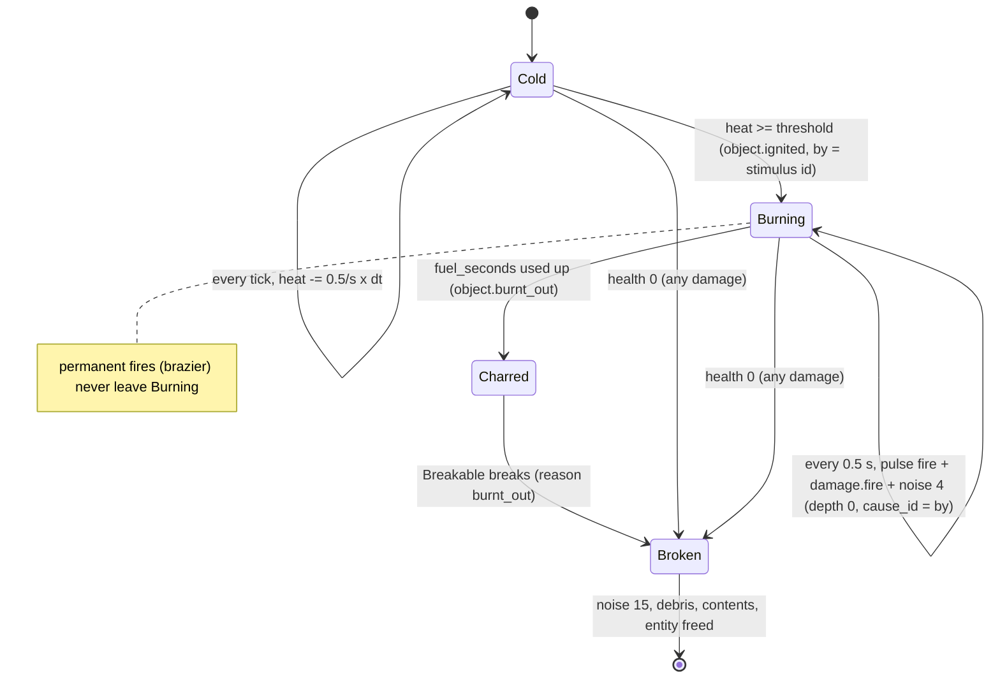
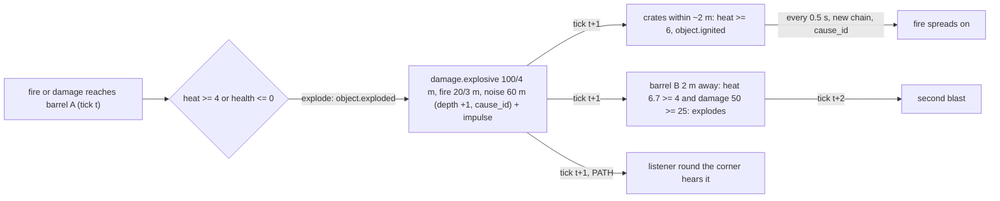

# Objects and fire

Milestone: M3 (Physics and fire room). Systems done in M3; the gallery room ([hub-and-gallery.md](../levels/hub-and-gallery.md#3-physics-and-fire)) is built on top of them.

## Purpose

Physics props that are throwable, breakable, flammable and explosive, giving the systemic playground.

## Player-facing behaviour

Pick up, carry and throw objects. Impacts make noise. Fire spreads to flammable neighbours at a readable pace and stops at walls. Explosive barrels blow up when burned or damaged, ignite what is close and set off other barrels. Glass bottles shatter when thrown. A wooden barricade burns away and opens its doorway.

## Rules

Scope ([ADR 0044](../decisions/0044-fire-scope-v0.md)): characters never catch fire, they only take `damage.fire` while in range (and on every pulse while carrying a burning object); only objects with a `Flammable` burn, never kit or level geometry; no extinguishing, fires burn out.

### Objects (`objects/<object>/`)

Every physics prop is a `PhysicsObject` (`RigidBody3D`, collision layer 4 objects, mask world/player/actors/objects, [ADR 0045](../decisions/0045-collision-layers.md)) with `Tags` (`material.*`, `object.*`), `Attributes` (`health`), a `StimulusReceiver` at its centre and component children. Static props (barricade, brazier) are `StaticBody3D` on layer 1 (world) with their origin on the floor, in group `navigation_source` so a level's navmesh bake treats them as obstacles.

| Object | Scene | Size | Mass | Health | Material | Flammable: threshold / fuel / intensity / radius |
|---|---|---|---|---|---|---|
| Small wooden crate | `small_crate` | 0.6 m cube | 10 kg | 30 | wood | 6 / 20 s / 2.0 / 1.5 m |
| Large wooden crate | `large_crate` | 1.2 m cube | 60 kg | 80 | wood | 10 / 40 s / 3.0 / 2.0 m |
| Metal crate | `metal_crate` | 0.8 m cube | 25 kg | 200 | metal | none |
| Cardboard box | `cardboard_box` | 0.5 m cube | 2 kg | 10 | cardboard | 2 / 8 s / 1.5 / 1.0 m |
| Explosive barrel | `explosive_barrel` | Ø0.6 x 0.9 m | 30 kg | 25 | metal | explodes at heat 4 (no burning phase) |
| Glass bottle | `glass_bottle` | Ø0.08 x 0.3 m | 0.5 kg | 1 | glass | none; breaks on an impact >= 4 m/s |
| Wooden barricade | `wooden_barricade` | 1.3 x 2.2 x 0.12 m (blocks a 1.2 x 2.2 door) | static | 60 | wood | 8 / 30 s / 2.5 / 1.8 m |
| Brazier | `brazier` | Ø0.6 x 0.9 m | static | none | metal | permanent fire 3.0 / 1.2 m from its centre (0.45 m up) |

All carry Carryable except the static ones; only objects up to the carry limit (20 kg) can actually be lifted. Every object is saveable: `PhysicsObject` saves `scene_file_path`, transform and velocities; `Tags`, `Attributes` (health), `Flammable` (state, heat, fuel left, pulse timer, igniting id) and `Explosive` (heat) save themselves. `objects/object_catalog.tres` lists the scenes for the debug Spawn tab.

### Components (`objects/components/`)

- **Flammable** (`FlammableConfig` in `<object>_fire.tres`): heat model, ignition, burning, burn-out ([ADR 0046](../decisions/0046-heat-accumulation-fire-model.md)).
- **Explosive** (`ExplosiveConfig`): explodes at health 0 or heat >= threshold.
- **Breakable** (`MaterialProfile`, `break_settings.tres`): damage by type, breaking.
- **ImpactNoise** (`MaterialProfile`, `impact_settings.tres`): collision noise and blunt damage.
- **Carryable**: marks a body the player can carry; `carrier` while held.
- Receptrons shared by all objects: `receptrons/heat_from_fire.tres` (`fire`, blocked while `state.burning` or `state.charred`, `HeatEffect` -> Flammable/Explosive `add_heat`) and `receptrons/take_damage.tres` (`damage`, `DamageEffect` -> Breakable `take_damage`).
- Materials (`objects/materials/*.tres`, `MaterialProfile`): impact loudness multiplier, impact sounds (light/medium/heavy), damage multipliers by stimulus type (most specific entry wins, missing = x1), break sound, break-on-impact speed, debris colour.

| Material | Impact loudness | Damage multipliers | Impact sounds | Break sound |
|---|---|---|---|---|
| wood | x1.0 | fire x1, explosive x0.5, stun x0 | impactWood | Hollywood/Wooden Crate Destruction |
| metal | x1.4 | fire x0, blunt x0.5, stun x0 | impactMetal | Hollywood/Metal Glass Destruction |
| glass | x1.6 | fire x0, stun x0 | impactGlass | impactGlass_heavy |
| cardboard | x0.4 | fire x1, stun x0 | impactSoft | impactSoft_heavy |

### Fire: heat, ignition, burning

- `fire` reaching a flammable adds its **perceived** intensity (linear falloff) to `heat`; heat cools at 0.5 per second continuously while not burning.
- Heat >= threshold: **ignite**. Tag `state.burning`, log `object.ignited {object, by, heat}` (`by` = id of the igniting stimulus), start the fire effect: orange flickering `OmniLight3D` (range 3 x fire radius), flame particles, crackle loop (`Community Requests/Stoke Coal Oven.wav`, -16 dB).
- **Burning**: a pulse every 0.5 s, from the Flammable node (the object's centre): `fire` and `damage.fire` (RADIUS, LINE_OF_SIGHT, intensity and radius of the object), a crackle `noise` of 4 m, and `damage.fire` CONTACT to the carrier if it is being carried. Each pulse is a new chain (depth 0) with `cause_id` = `by`.
- **Burn-out** after `fuel_seconds`: remove `state.burning`, add `state.charred` (meshes turn black), log `object.burnt_out`; a Breakable object then breaks (reason `burnt_out`). Charred objects never reignite.
- Expected spread (unit-tested): touching small crates (centres 0.6 m: 1.2 per pulse, net 0.95) ignite in **3.0 s**; a small crate touching the brazier (0.62 m from its centre: 1.45 per pulse) in **2.0 s**; with a 0.6 m gap (centres 1.2 m: 0.4 per pulse, net 0.15) only after 19 s; a cardboard box next to a burning crate in 0.5 s; behind a wall or metal: never.

### Explosions (`Explosive`)

- Trigger: health <= 0 (its Breakable has `break_on_depleted` off and emits `depleted`) or heat >= 4 (fire adds heat like Flammable).
- Blast, emitted as children of the triggering stimulus (depth + 1, `cause_id` = its id): `damage.explosive` 100 / 4 m (LOS), `fire` 20 / 3 m (LOS), `noise` 60 m (PATH). Radial impulse to physics objects within 4 m that the blast can see: 120 N s x (1 - d / 4), slightly upwards. Sound `Hollywood/Mega Bomb.wav`, flash light and fireball/smoke particles. Log `object.exploded {object, by}`; the barrel is freed.
- Effects at distance d: the fire burst ignites small crates within 2.0 m (20 x (1 - 2/3) = 6.7 >= 6), large crates within 1.5 m, cardboard within 2.7 m and barrels within 2.4 m (heat 4) on the next tick. Wood takes explosive damage x0.5: a small crate at 1.8 m takes 27.5 and survives burning; closer than about 1.6 m it is blown apart.

### Breaking (`Breakable`)

- Damage: the `damage` receptron passes the stimulus type and perceived intensity; dealt = intensity x the material multiplier for that type; health is the `health` attribute's base value. Log `object.damaged {object, type, amount, health}`.
- At health <= 0 (or burn-out, or a glass impact): emit `noise` 15 m (PATH), play the material's break sound, spawn 3-6 debris pieces (`Debris`: on no collision layer, collide with the world only, despawn after 10 s, not saved), spawn each scene of `contents` at the object's centre (several items spread on a horizontal circle a quarter of the object's size wide, so they never spawn inside each other), log `object.broken {object, reason, by, debris, contents}`, free the entity. A broken or burnt-out barricade frees its doorway.

### Impacts (`ImpactNoise`)

- The body's contact monitor is on; every tick the component reads the contacts. A contact that is new this tick is an impact at the speed the body approached it along the contact normal (its previous-tick velocity relative to the other body).
- From 2.5 m/s, at most every 0.15 s, never while carried: loudness = clamp(speed x sqrt(mass) x 0.8, 2, 30) x material multiplier; `noise` (PATH) of that loudness from the body; the material's impact sound (light < 8 <= medium < 16 <= heavy, volume 10 dB per decade around 10 m); `damage.blunt` CONTACT = 0.5 m v^2 / 40 to the body itself (source: what it hit) and to what it hit. Log `object.impact {object, other, speed, loudness}`.
- Examples: a small crate dropped 2 m (6.2 m/s) -> 15.8 m and 4.8 damage; a metal crate at the same speed -> 34.7 m; a thrown bottle (12 m/s) breaks on the first wall.

### Carry and throw (player, `actors/player/player_carry.gd`, `carry_rules.gd`)

- Look at an object within 2.0 m and press **E** (`use`): picked up if its mass <= the player's `carry_mass_limit` attribute (base 20 kg; Combat Strength in M6 adds a modifier). Too heavy: `player.pickup_refused {object, mass, limit}`.
- Held 1.2 m along the view from the eyes and 0.3 m lower. The body stays physical: each tick its velocity is set to (hold point - position) x 20/s, capped at 15 m/s, gravity off, rotation stopped, collision with the player's capsule ignored. It is dropped (`how: stuck`) when more than 1.5 m from the hold point.
- While carrying: **E** puts it down gently (velocity zero), **Q** (`drop_throw`) drops it, **LMB** (`fire`) throws it along the view at min(12, 40 / mass) m/s (40 N s impulse: small crate 4 m/s, cardboard and bottles 12 m/s). Carrying 10 kg or more: move speed x0.8. No mantling while carrying.
- Log `player.picked_up {object}`, `player.dropped {object, how}` (`put_down`, `drop`, `stuck`, `load`, `respawn`), `player.threw {object, speed}`.
- Carrying is not saved: loading drops the object.
- The player has `Tags` (`actor.player`), `Attributes` (`carry_mass_limit`, and the M4 injury attributes) and a `StimulusReceiver` (chest height) whose `body_damage` receptron (M4) applies every `damage` stimulus to its body parts: fire in range and a carried burning object (`damage.fire` CONTACT every pulse) are split evenly over the six parts, explosions 40 % torso / 12 % each other part ([damage.md](damage.md)).

## Interactions

- Stimuli, LINE_OF_SIGHT, `cause_id`: [stimulus-response.md](stimulus-response.md)
- Tags `state.burning`, `state.charred`, `material.*`, `object.*`; attributes `health`, `carry_mass_limit`: [attributes-and-tags.md](attributes-and-tags.md)
- Damage types and M4 body parts: [damage.md](damage.md)
- Combat Strength raises `carry_mass_limit`: [abilities.md](abilities.md)
- Dropped inventory items become physics objects: [inventory.md](inventory.md)
- Breakable doors and walls opened with explosives: [security.md](security.md)
- The mission back-wall route uses a loud barrel: [../levels/mission-warehouse.md](../levels/mission-warehouse.md)
- Spawn, Time and Heat overlay: [debug-panel.md](debug-panel.md)
- Water and electricity are parked: [../backlog.md](../backlog.md)

## Open questions

- Pushing props by walking into them: the player is a `CharacterBody3D` and only stops; revisit if the room needs shoving.
- Navmesh after a barricade burns away: static props are part of the bake; M7 decides whether guards need a re-bake.
- M6 save/load: level-placed objects that were destroyed need a "removed" record; spawned objects are recreated from `scene_file_path`.
- Fire damage against characters (perceived 2-3 per pulse, split over six parts) is mild; tune with the M4 profiles' `damage.fire` multiplier if fire feels harmless.
