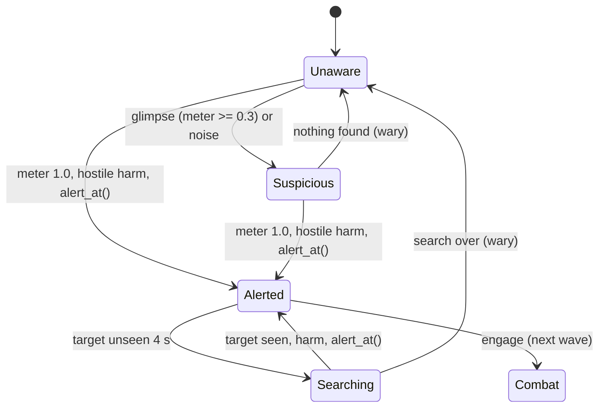

# Perception and AI

Milestone: M7 (Perception lab, AI arena).

## Purpose

Guards that see, hear, communicate and escalate in graded steps.

## Player-facing behaviour

- One guard archetype, two loadouts (pistol / baton).
- Feedback: Metal Gear Solid style `?` / `!` icons above guards (toggleable) plus text barks with a placeholder sound. Voiced barks are parked.
- Guards discover bodies (dead or unconscious) and raise the alert. Guards wake unconscious guards. Unconscious guards never wake on their own in v0. The player can carry and drop bodies.
- Guards communicate (shouts are noise stimuli; radio within range). A level-wide alarm state exists (alarm panels, cameras: [security.md](security.md)).

## Awareness states

[ADR 0068](../decisions/0068-awareness-states-and-guard-behaviour.md). **Deviation from the first sketch** (Suspicious -> Searching -> Alerted): investigating a suspicion happens inside Suspicious (look, walk to the point, look around); Searching follows a lost target after Alerted. After any return to Unaware the guard is wary for 60 s: vision gain x1.5 and Suspicious from 0.2.

| State | Icon | Behaviour (timings in `actors/guard/guard_awareness.tres`) |
|---|---|---|
| Unaware | none | Patrol its route (`PatrolRoute`, waits per point); without one hold the post (spawn position and facing), glancing ±45° for 1.5 s every 6 s |
| Suspicious | `?` yellow | Stop, face the point 2 s; walk there at 2.5 m/s; look around 4 s; give up. New evidence moves the point. A noise perceived >= 10 skips the look and runs (5 m/s) |
| Alerted | `!` red | Run to the last known position (tracks the target while seen); stop and face a seen target within 1.5 m. Unseen 4 s: Searching |
| Searching | `?` orange | 4 random navmesh points within 8 m of the last known position (first at run pace, then walk), look around 3 s at each, 30 s at most |

## Vision ([ADR 0067](../decisions/0067-vision-and-detection.md))

- Targets: entities whose tags include a hostile tag (`actor.player`) and no hidden tag (`state.cloaked`) ([ADR 0069](../decisions/0069-hostile-and-ally-tags.md)).
- Eyes 1.6 m above the feet; rays to the target's head, chest and feet (fractions of its collision shape, so crouching lowers them); world and props block; seen if any ray is clear.
- Focus ±30°, 20 m; peripheral ±60°, 10 m, x0.4; nothing outside ±60° (horizontal angle and distance).
- Suspicion per second = 1.25 x light x distance x zone x stance (crouch 0.7) x wary (1.5). Light = clamp((L - 0.1) / 0.4, 0, 1) from the target's light level L (its `LightExposure`, [ADR 0065](../decisions/0065-light-level-model.md); 1.0 without one; the guard has one too), at least 0.5 within 2 m. Distance = 1 to 5 m, down to 0.25 at 20 m. Decay 0.25/s unseen. Suspicious at 0.3, Alerted at 1.0.

| Situation | Gain | Time to Alerted |
|---|---|---|
| Lit (L 0.6), 4 m, focus | 1.25/s | 0.8 s (Suspicious 0.24 s) |
| Lit, 12 m | 0.81/s | 1.2 s |
| Dim (L 0.25), 4 m | 0.47/s | 2.1 s |
| Crouched, dim, 8 m | 0.28/s | 3.6 s |
| Lit, 45° off, 6 m (peripheral) | 0.48/s | 2.1 s |
| Dark (L 0.05), 6 m / cloaked / behind | 0 | never |
| Dark, 1.5 m, focus (close override) | 0.63/s | 1.6 s |

## Hearing

- `noise` stimuli through the `heard_noise` receptron on the guard's `Ears` receiver at floor level: perceived = loudness - navmesh path distance from the guard's feet; heard at perceived >= 1.0. Walking on concrete (6) is heard at 3.5 m, not at 6.5 m; sprinting (14) at up to 13 m; a guard's own walk (5) / run (12).
- Noise whose source has an ally tag (`actor.guard`) is ignored; the player, thrown props, breaking crates and explosions are heard.
- Harm from a source with a hostile tag alerts at once (the `harmed` receptron).

## Rules

- Perception is a receiver on the stimulus framework ([stimulus-response.md](stimulus-response.md)); hearing uses navmesh path distance with door attenuation.
- Guards are built from the same character components as the player ([ADR 0056](../decisions/0056-generic-character-components.md)): `MovementNoise` (their footsteps and landings are `noise` other guards ignore as allies'; the controller sets `stance.sprint` from 4 m/s; guard loudness walk 5, run 12), `FallImpact` + the `fall_damage` receptron, `Knockback` + the `knockback` receptron, BodyParts + `body_damage`, `StepClimber` (walks up steps and stairs of up to 0.35 m; the navmesh climbs 0.3 m; [ADR 0058](../decisions/0058-step-climbing.md)), `BodyPusher` (pushes props with bounded force, ADR 0054), `ImpactSensor` (props pass through guards and their hits deal `damage.blunt`). Whether a guard can act comes from its `state.*` tags (`ActorState`); unconscious or dead it lies down (`DownedPose`), sees and hears nothing and keeps no awareness state.
- Vision depends on light level ([light-and-visibility.md](light-and-visibility.md)) and Cloak ([abilities.md](abilities.md)).
- Components (`actors/common/`): `PerceptionSensor` + `VisionRules` (perception/), `GradedAwareness` + `AwarenessModel` + `AwarenessEffect` + `AwarenessIndicator` + `BarkLines` (awareness/), `AwarenessBehaviour` + `PatrolRoute` (behaviour/), `NavWalker` (movement/), `BodyPusher` (pusher/), `DownedPose` (body/). The guard (`actors/guard/guard.tscn`) is a scene of these plus `.tres` tuning; it has no script of its own.
- Navigation via NavigationServer3D (`NavWalker` follows its NavigationAgent3D; walk 1.8, investigate 2.5, run 5.0 m/s, turn 240°/s); doors are navigation links.
- Barks: a text line above the head for 2 s on each state change with a generated beep (lines in `actors/guard/guard_barks.tres`).
- Icons, state labels and barks: [debug-panel.md](debug-panel.md) Overlays tab toggles.
- EventLog: `actor.awareness {actor, from, to, reason, meter, point}` (reasons: sight, noise, harm, alert, nothing_found, lost, search_over, reset), `actor.heard {actor, perceived, point}`, `actor.bark {actor, line, from, to}`.
- Extension points for the next wave: `Awareness.alert_at(position)` (alarm, radio, shouts; or an `AwarenessEffect` of kind ALERT on a receptron) and the Alerted state (combat).

## Interactions

- Damage and knockout: [damage.md](damage.md), [weapons-and-aiming.md](weapons-and-aiming.md)
- Carrying bodies and dropping: [controls.md](controls.md)
- Rooms: [../levels/hub-and-gallery.md](../levels/hub-and-gallery.md)

## Open questions

- Radio range, shouts, body discovery, the alarm and combat: next wave.
- Vertical limits of the cones (guards on balconies), if levels get tall.
- Guard avoidance of each other (NavigationAgent3D avoidance is off).

Settled in M7 ([ADR 0067](../decisions/0067-vision-and-detection.md), [ADR 0068](../decisions/0068-awareness-states-and-guard-behaviour.md)): cone angles and ranges, gains and thresholds, transition timings, wary duration (60 s), patrol authoring (`PatrolRoute`), bark lines.
