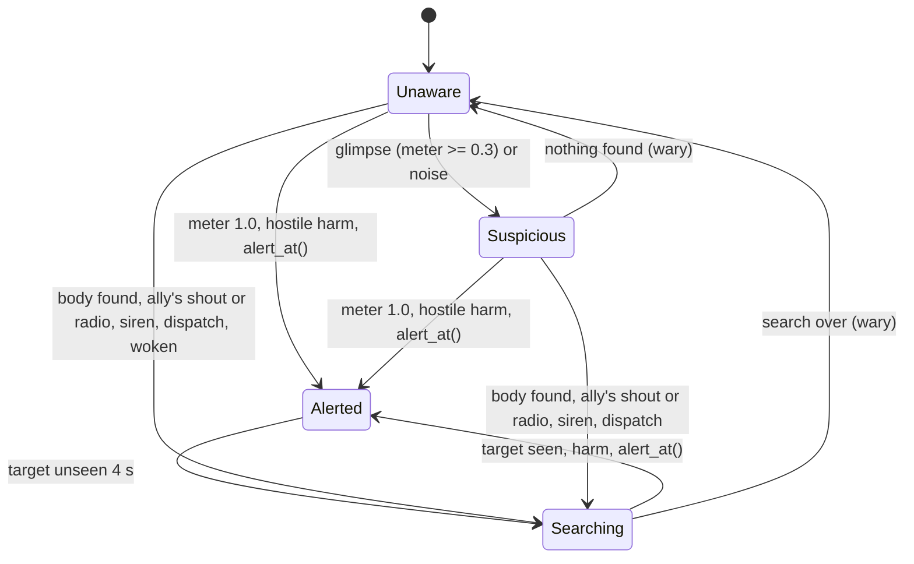

# Perception and AI

Milestone: M7 (Perception lab, AI arena).

## Purpose

Guards that see, hear, communicate and escalate in graded steps.

## Player-facing behaviour

- One guard archetype, two loadouts (pistol / baton).
- Feedback: Metal Gear Solid style `?` / `!` icons above guards (toggleable) plus text barks with a placeholder sound. Voiced barks are parked.
- Guards discover bodies (dead or unconscious) and raise the alert. Guards wake unconscious guards. Unconscious guards never wake on their own in v0. The player can carry and drop bodies.
- Guards communicate (shouts are noise stimuli; radio within range). The alarm is made of devices (alarm controller, sirens, radio base station: [security.md](security.md), [ADR 0077](../decisions/0077-devices-cables-and-remote-commands.md)); guards react to the sirens they hear.
- From M11 guards log in to devices at patrol waypoints, and a security operator watches the monitors ([hacking.md](hacking.md)).

## Awareness states

[ADR 0068](../decisions/0068-awareness-states-and-guard-behaviour.md). **Deviation from the first sketch** (Suspicious -> Searching -> Alerted): investigating a suspicion happens inside Suspicious (look, walk to the point, look around); Searching follows a lost target after Alerted. After any return to Unaware the guard is wary for 60 s: vision gain x1.5 and Suspicious from 0.2.

| State | Icon | Behaviour (timings in `actors/guard/guard_awareness.tres`) |
|---|---|---|
| Unaware | none | Patrol its route (`PatrolRoute`, waits per point); without one hold the post (spawn position and facing), glancing ±45° for 1.5 s every 6 s |
| Suspicious | `?` yellow | Stop, face the point 2 s; walk there at 2.5 m/s; look around 4 s; give up. New evidence moves the point. A noise perceived >= 10 skips the look and runs (5 m/s) |
| Alerted | `!` red | Run to the last known position (tracks the target while seen); stop and face a seen target within 1.5 m. Armed and seeing the target: fight it ([Combat](#combat)). Unseen 4 s: Searching |
| Searching | `?` orange | 4 random navmesh points within 8 m of the last known position (first at run pace, then walk), look around 3 s at each, 30 s at most. Entered from a call, a body or the alarm: the reported point first (run), then 3 random points. By an unconscious ally: stand by it until it is woken (TEND, 8 s at most) |

## Bodies ([ADR 0071](../decisions/0071-bodies-discovery-waking-carrying.md))

- A **body** is any entity with an ally tag of the watcher (`actor.guard`) and a `body_tags` tag (`state.unconscious`, `state.dead`; `guard_perception.tres`). `PerceptionSensor.look_for_bodies()` uses the vision rules (cones, line of sight, the body's light level, wary x1.5) measured to the middle of its collision shape; sight rays aim at its real height (a body lying down is 0.7 m high, so a low wall hides it).
- **Discovery** (`BodyDiscovery` + pure `BodyDiscoveryModel`): per body, the vision gain accumulates to 1.0 (decay 0.5/s unseen; `guard_awareness.tres` group Bodies): a lit body 4 m ahead is found in 0.8 s; in the dark (light level < 0.1) only within 2 m (the close-light override: 1.6 s at 1.5 m). Each body is found once per watcher (saved) until it stands up again.
- **Found**: `actor.body_found {actor, body, state, point}`, the bark "Man down!", a shout, wary for at least 180 s; unless Alerted (an engaged guard keeps fighting), Searching around the body (reason `body`), running first to 0.5 m beside it.
- **Waking** an unconscious body: the guard stands by it (phase TEND, facing it); after 3 s within 1.2 m (its centre to the body's bounds, horizontal) it emits a `revive` CONTACT stimulus at the body (`actor.wake {actor, body}`). The body's `revive` receptron (requires `state.unconscious`, blocked by `state.dead`) runs `ReviveEffect` (BodyParts.revive(): stun 0, conscious, `state.unconscious` removed; health and injuries stay; `actor.revived {actor, by}`) and an `AwarenessEffect` SEARCH (reason `woken`): the woken guard searches around where it lay, and the waker searches on. Sight of the player ends a tend at once (Alerted, combat). Dead bodies are never woken; unconscious ones never wake by themselves.
- **Carried bodies** ([controls.md](controls.md)): the player can carry a downed character and drop it anywhere; guards find it where it lies.
- **Walking over bodies** ([ADR 0082](../decisions/0082-walkable-downed-bodies.md)): while down, a character's body is on the `downed` collision layer, which no character scans: the player and guards walk through it (paths are not blocked). It still lies on the floor, guards still see it at its real height, the player still aims at it (hitboxes) to carry it, and blasts, fire and shots still hit it. Woken, it collides again.

## Communication and the alarm ([ADR 0072](../decisions/0072-shouts-radio-level-alarm.md))

- **Shout** (`AlertComms`, tuning `guard_comms.tres`): on entering Alerted and on finding a body a guard emits `alert.shout`, loudness 18 along the navmesh like noise. Allies' `heard_shout` receptron on the `Ears` (perceived >= 1: up to 17 m of path) calls `notice_call()`: only a source with an ally tag counts; the hearer searches at the shouter's position (run pace, reason `shout`) unless Alerted or tending. Allies' footsteps (`noise`) are still ignored.
- **Radio**: on entering Alerted a guard tagged `equipment.radio` (guard.tscn has it) emits `alert.radio`, 30 m straight-line radius (walls do not matter). Allies' `heard_radio` receptron (requires `equipment.radio`) makes them search at the sender's position (reason `radio`). Searchers neither shout nor radio, so calls do not cascade.
- **Sirens** (M8, [ADR 0075](../decisions/0075-alarms-as-network-devices.md), [ADR 0077](../decisions/0077-devices-cables-and-remote-commands.md); replace M7's level-wide `LevelAlarm`): a sounding siren emits `alarm.siren` every second, loudness 35 along the navmesh like noise, its own type so it is not ignored as an ally's noise. The `heard_siren` receptron on the guard's `Ears` (perceived >= 1: up to 34 m of path) runs `HeardAlarmEffect`, which tells the guard's `AlarmHearing`; on each pulse `AlertComms.answer_alarm()` keeps the guard wary (60 s, `guard_comms.tres` `alarm_wary`) and, when Unaware or Suspicious, starts a search around where it stands (reason `alarm`); Alerted and Searching guards carry on, and a finished search starts again while the siren is heard. A guard out of earshot does not react. The player carries the same receptron and `AlarmHearing`: the HUD shows "ALARM" while the player hears a siren (1.5 s after the last pulse).
- **Radio dispatch**: a radio base station the alarm controller reaches emits `alert.dispatch` (40 m straight from the station) about the incident location (`Stimulus.about_point`). The `heard_dispatch` receptron (requires `equipment.radio`) runs `AwarenessEffect` SEARCH: the guard searches at the incident (reason `radio`), even when Searching after a siren. If no siren rings and no base station is reached, nobody reacts. Guards do not run to panic buttons yet.
- **Security operator** (M11): a guard posted at the security console's monitors. When a camera feed goes dark (disabled, unpowered or broken) or the console shows "Tracer offline", the operator radios someone to check it. Panning a camera away is not noticed.
- **"Use device"** (M11): a patrol waypoint can name a device; the guard stops there and logs in. The login goes to the device's log and can be captured by the player's Sniffer ([hacking.md](hacking.md)).
- EventLog: `actor.shout {actor, reason, point}`, `actor.radio {actor, point}`, `actor.heard_call {actor, from, kind, point}`, `actor.heard_alarm {actor, point}` (when it starts hearing a siren); the devices' entries are in [security.md](security.md#alarm-devices).

## Vision ([ADR 0067](../decisions/0067-vision-and-detection.md))

- Targets: entities whose tags include a hostile tag (`actor.player`) and no hidden tag (`state.cloaked`) ([ADR 0069](../decisions/0069-hostile-and-ally-tags.md)).
- Eyes 1.6 m above the feet; rays to the target's head, chest and feet (fractions of its collision shape, so crouching lowers them); world and props block; seen if any ray is clear.
- Focus ±30°, 20 m; peripheral ±60°, 10 m, x0.4; nothing outside ±60° (horizontal angle and distance).
- Suspicion per second = 1.25 x light x distance x zone x stance (crouch 0.7) x wary (1.5). Light = clamp((L - 0.1) / 0.4, 0, 1) from the target's light level L (its `LightExposure`, [ADR 0065](../decisions/0065-light-level-model.md); 1.0 without one; the guard has one too), at least 0.5 within 2 m. Distance = 1 to 5 m, down to 0.25 at 20 m. Decay 0.25/s unseen. Suspicious at 0.3, Alerted at 1.0.

| Situation | Gain | Time to Alerted |
|---|---|---|
| Lit (L 0.6), 4 m, focus | 1.25/s | 0.8 s (Suspicious 0.24 s) |
| Lit, 12 m | 0.81/s | 1.2 s |
| Dim (L 0.25), 4 m | 0.47/s | 2.1 s |
| Crouched, dim, 8 m | 0.28/s | 3.6 s |
| Lit, 45° off, 6 m (peripheral) | 0.48/s | 2.1 s |
| Dark (L 0.05), 6 m / cloaked / behind | 0 | never |
| Dark, 1.5 m, focus (close override) | 0.63/s | 1.6 s |

Security cameras and turrets see with the same sensor and rules and their own configs (no hidden tags: Cloak does not hide you from them; no peripheral cone), filling a `SightMeter` instead of an awareness model: [security.md](security.md#cameras-and-turrets), [ADR 0079](../decisions/0079-security-cameras-and-turret.md).

## Combat

[ADR 0070](../decisions/0070-guard-combat-and-loadouts.md). No extra awareness state: a guard fights while it is **Alerted and sees** a hostile target that can act (`CombatBehaviour`, `actors/common/combat/`, tuning `actors/guard/guard_combat.tres`; any NavWalker character with an `Aim/WeaponHolder` fights the same way). Out of sight for 0.5 s it stops; the Alerted flow continues (run to the last known position, Searching after 4 s unseen).

- **Loadouts** are data: `actors/guard/guard.tscn` is unarmed (stands off at 1.5 m), `guard_pistol.tscn` and `guard_baton.tscn` only set the holder's weapon. The weapon is drawn on engaging and holstered when the guard is back to Unaware or cannot act.
- **One owner of the walker**: combat takes the `NavWalker` while engaged (`take_control`) and hands it back (`release_control`); the AwarenessBehaviour pauses meanwhile.
- **Shots and swings** go through the same `WeaponHolder.trigger()` as the player's: the same `damage.*` stimuli, hitboxes, noise (guards' pistol: 25 m) and EventLog (`weapon.fired`, `weapon.swung`, `weapon.reload_started`, `weapon.reloaded`).

| Pistol guard | |
|---|---|
| First shot | 0.5 s of sight after engaging |
| Rate | a random 0.6-0.9 s between shots; standing (< 0.3 m/s) and facing the target within 15° |
| Range | keeps 6-12 m: beyond 12 advances to 11 (2.5 m/s), under 6 backs off to 7 (1.8 m/s) still facing the target; cornered, stands |
| Ammo | magazine 10, reloads when empty (1.6 s), 30 spare; tops up when not fighting |
| Line of fire | aims at the first of the target's hitboxes (torso, head, arms, legs) whose line from the eye is clear; never fires when the first thing on every line is an ally, a wall or a prop; blocked 1 s: steps 1.5 m aside |
| Cone (half-angle) | 2.0° + 0.15° per metre beyond 4 m, +2° on a target faster than 3 m/s, x1 -> x0.75 over 2 s on a still target; +3° while walking; arm injuries as the player's |

| Baton guard | |
|---|---|
| Approach | runs in (5 m/s) to 1.2 m |
| Swing | within the baton's reach (1.8 m from the eye) minus 0.3, facing within 15°, after 0.5 s of sight; every 0.6 s (the baton's cycle) |
| Stun | 20 a hit on the player (no `Awareness`: always aware, never the sneak x10): knocked out on the 3rd |

Measured against the player's body (25 a hit, x2 head; dead after 4 torso or 2 head hits), time from the first shot to death: standing in the open at 4 m 2.25 s, at 10 m 4.4 s; hit chance per shot: standing 10 m 76 %, crouched and still at 15 m 26 %, running at 6 m 82 % (details in ADR 0070).

| Rifle guard (M9, `guard_rifle.tscn`, [ADR 0088](../decisions/0088-weapon-drops-and-bursts.md)) | |
|---|---|
| Fire | the pistol guard's rules, but in **bursts**: the trigger held for 3-5 shots (`burst_shots_min` / `max` in `guard_combat.tres`) at the rifle's 0.1 s cycle, then the 0.6-0.9 s interval; a burst ends early when the line closes, the guard must move or the magazine runs dry |
| Ammo | the assault rifle's: magazine 30, 90 spare, 2.2 s reload; 14 a hit |

- **Weapon drops** (M9, [ADR 0088](../decisions/0088-weapon-drops-and-bursts.md)): a guard that goes down (knocked out or dead) drops its weapon beside the body as a pickup, with the rounds in its magazine (`WeaponDrop`). Woken, it is unarmed: CombatBehaviour never engages without a loadout (the awareness flow still runs: it searches, gets Alerted, chases to the last known position, but does not attack).
- **Reinforcements** (M9 missions, [ADR 0087](../decisions/0087-mission-systems.md)): 30 s of mission time after the first alarm rings in a mission level, the Mission spawns its reinforcements (data: two pistol guards) once at the level's `ReinforcementSpawn`; they search where that alarm was raised (`GradedAwareness.search_at`, reason `alarm`), then hold the spawn point as their post.
- Guards hurt each other only by accident (a shot inside the cone after a clear check); a guard hit by an ally is not alerted (harm counts only from a hostile tag).
- EventLog: `actor.engaged {actor, target}`, `actor.disengaged {actor, reason}` (lost, calm, incapacitated, unarmed, target_down).

## Hearing

- `noise` stimuli through the `heard_noise` receptron on the guard's `Ears` receiver at floor level: perceived = loudness - navmesh path distance from the guard's feet; heard at perceived >= 1.0. Walking on concrete (6) is heard at 3.5 m, not at 6.5 m; sprinting (14) at up to 13 m; a guard's own walk (5) / run (12).
- Noise whose source has an ally tag (`actor.guard`) is ignored; the player, thrown props, breaking crates and explosions are heard.
- Harm from a source with a hostile tag alerts at once (the `harmed` receptron).

## Rules

- Perception is a receiver on the stimulus framework ([stimulus-response.md](stimulus-response.md)); hearing uses navmesh path distance with door attenuation.
- Guards are built from the same character components as the player ([ADR 0056](../decisions/0056-generic-character-components.md)): `MovementNoise` (their footsteps and landings are `noise` other guards ignore as allies'; the controller sets `stance.sprint` from 4 m/s; guard loudness walk 5, run 12), `FallImpact` + the `fall_damage` receptron, `Knockback` + the `knockback` receptron, BodyParts + `body_damage`, `StepClimber` (walks up steps and stairs of up to 0.35 m; the navmesh climbs 0.3 m; [ADR 0058](../decisions/0058-step-climbing.md)), `BodyPusher` (pushes props with bounded force, ADR 0054), `ImpactSensor` (props pass through guards and their hits deal `damage.blunt`). Whether a guard can act comes from its `state.*` tags (`ActorState`); unconscious or dead it lies down (`DownedPose`), sees and hears nothing and keeps no awareness state.
- Vision depends on light level ([light-and-visibility.md](light-and-visibility.md)) and Cloak ([abilities.md](abilities.md)).
- Components (`actors/common/`): `CombatBehaviour` + `CombatModel` + `CombatConfig` (combat/), `PerceptionSensor` + `VisionRules` (perception/), `GradedAwareness` + `AwarenessModel` + `AwarenessEffect` + `AwarenessIndicator` + `BarkLines` + `BodyDiscovery` + `BodyDiscoveryModel` + `AlertComms` + `CommsRules` + `CommsConfig` + `AlarmHearing` + `HeardAlarmEffect` (awareness/), `AwarenessBehaviour` + `PatrolRoute` (behaviour/), `NavWalker` (movement/), `DoorOpener` (door_opener/), `BodyPusher` (pusher/), `DownedPose` + `ReviveEffect` (body/), `Carryable` (objects/components/). The alarm devices live in `objects/alarm/` and `objects/devices/` ([security.md](security.md#alarm-devices)). The guard (`actors/guard/guard.tscn`) is a scene of these plus `.tres` tuning; it has no script of its own.
- Navigation via NavigationServer3D (`NavWalker` follows its NavigationAgent3D; walk 1.8, investigate 2.5, run 5.0 m/s, turn 240°/s); doors are navigation links ([ADR 0078](../decisions/0078-doors-locks-and-door-navigation.md)): a locked door's link is off the guards' layer unless a guard has its access (`access.<id>` tag); a guard's `DoorOpener` opens a closed door its path crosses within 3.5 m, and leaves it open.
- Barks: a text line above the head for 2 s on each state change with a generated beep (lines in `actors/guard/guard_barks.tres`); a search entered for a body ("Man down!"), a call, a dispatch or a siren ("On my way!") or after being woken ("My head...") has its own lines.
- Icons, state labels and barks: [debug-panel.md](debug-panel.md) Overlays tab toggles.
- EventLog: `actor.awareness {actor, from, to, reason, meter, point}` (reasons: sight, noise, harm, alert, nothing_found, lost, search_over, reset, body, shout, radio, alarm, woken), `actor.heard {actor, perceived, point}`, `actor.bark {actor, line, from, to}`.
- Inputs: `Awareness.alert_at(position)` (Alerted at once; `AwarenessEffect` ALERT), `search_at(position, why)` (SEARCH), `notice_call(position, source, why)` (CALL: allies only), `GradedAwareness.notice_body()`, `make_wary()`. Combat plugs into Alerted (ADR 0070).
- Facing is world yaw: `NavWalker` turns its global rotation, so guards in a room instanced turned (90 or 180 degrees) face where they should.

## Interactions

- Damage and knockout: [damage.md](damage.md), [weapons-and-aiming.md](weapons-and-aiming.md)
- Carrying bodies and dropping: [controls.md](controls.md)
- Rooms: [../levels/hub-and-gallery.md](../levels/hub-and-gallery.md)

## Open questions

- Guards running to panic buttons (M8, [security.md](security.md)); how the operator's "check it" call is modelled (M11).
- Two guards may both go to wake the same body; the second gives up once it stands.
- Combat tactics beyond keeping range: cover, flanking, strafing while firing, leading a moving target, grenades.
- Vertical limits of the cones (guards on balconies), if levels get tall.
- Guard avoidance of each other (NavigationAgent3D avoidance is off).

Settled in M7 ([ADR 0067](../decisions/0067-vision-and-detection.md), [ADR 0068](../decisions/0068-awareness-states-and-guard-behaviour.md), [ADR 0071](../decisions/0071-bodies-discovery-waking-carrying.md), [ADR 0072](../decisions/0072-shouts-radio-level-alarm.md)): cone angles and ranges, gains and thresholds, transition timings, wary duration (60 s; 180 s after a body), patrol authoring (`PatrolRoute`), bark lines, body discovery and waking, shout loudness (18) and radio range (30 m), alarm duration (90 s). M8 ([ADR 0077](../decisions/0077-devices-cables-and-remote-commands.md)): siren loudness 35 (34 m of path), base station range 40 m.
