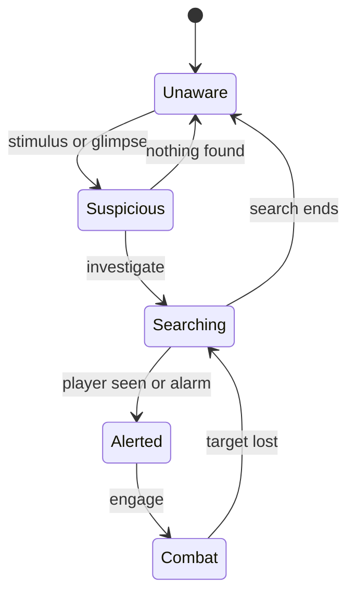

# Perception and AI

Milestone: M7 (Perception lab, AI arena).

## Purpose

Guards that see, hear, communicate and escalate in graded steps.

## Player-facing behaviour

- One guard archetype, two loadouts (pistol / baton).
- Feedback: Metal Gear Solid style `?` / `!` icons above guards (toggleable) plus text barks with a placeholder sound. Voiced barks are parked.
- Guards discover bodies (dead or unconscious) and raise the alert. Guards wake unconscious guards. Unconscious guards never wake on their own in v0. The player can carry and drop bodies.
- Guards communicate (shouts are noise stimuli; radio within range). A level-wide alarm state exists (alarm panels, cameras: [security.md](security.md)).

## Awareness states

After an alert guards stay wary: they re-alert faster. The arrows are a first sketch of the spec sequence (Unaware, Suspicious, Searching, Alerted/Combat, Searching, Unaware); exact triggers settle in M7.

## Rules

- Perception is a receiver on the stimulus framework ([stimulus-response.md](stimulus-response.md)); hearing uses navmesh path distance with door attenuation.
- Guards are built from the same character components as the player ([ADR 0056](../decisions/0056-generic-character-components.md)): `MovementNoise` (their footsteps and landings are `noise` other guards hear; the controller sets `stance.crouch` / `stance.sprint`), `FallImpact` + the `fall_damage` receptron, `Knockback` + the `knockback` receptron, BodyParts + `body_damage`. Whether a guard can act comes from its `state.*` tags (`ActorState`). Before thrown props hit guards: a kinematic body that scans props under-reads their impact in `ImpactNoise` (ADR 0056, open).
- Vision depends on light level ([light-and-visibility.md](light-and-visibility.md)) and Cloak ([abilities.md](abilities.md)).
- Components: `PerceptionSensor` plus pure AI-transition logic (unit-tested).
- Navigation via NavigationServer3D; doors are navigation links.
- State and bark labels show in the debug Overlays tab ([debug-panel.md](debug-panel.md)).

## Interactions

- Damage and knockout: [damage.md](damage.md), [weapons-and-aiming.md](weapons-and-aiming.md)
- Carrying bodies and dropping: [controls.md](controls.md)
- Rooms: [../levels/hub-and-gallery.md](../levels/hub-and-gallery.md)

## Open questions

- Transition timings and thresholds, vision cone angle/range, radio range, wary duration: TBD in M7.
- Patrol authoring and bark text list: TBD in M7.
