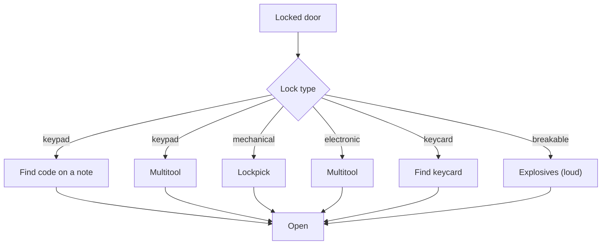

# Security

Milestone: M8 (Security wing).

## Purpose

Electronic and mechanical obstacles that offer several ways through.

## Player-facing behaviour

- **Cameras** see the player even when cloaked.
- **Alarm panel** raises the level-wide alarm; linked to cameras.
- **Turret** guards an area; Cloak does not hide the player from it.
- **Breaker panel** cuts lights ([light-and-visibility.md](light-and-visibility.md)). Built in M7 ([ADR 0066](../decisions/0066-power-circuits-shootable-lights.md)): `objects/breaker_panel/breaker_panel.tscn`, a `CircuitBreaker` (a `Usable`, "E: switch off <label>" / "switch on") that switches every `Powered` on its `circuit` through the circuit's group, clunks (noise 6) and logs `power.switched`. Lamps opt in with their `Powered.circuit`; the breaker names none. The perception lab has one (circuit `perception_lab`).
- **Terminals** are unlocked with credentials found in the world. The user's own hacking design comes later ([../backlog.md](../backlog.md)).

## Door and lock types

- Keypad: code found in world notes, or multitool.
  - Datapads are read in place and copied to the player's personal log (not picked up). A datapad can carry codes linked to a keypad (by the keypad's code id). Once the player has read it, the keypad's entry screen shows a reminder with the known code ("Note: 0451, from 'Shift roster'"); the player still types it. A code learned any other way (a conversation, a log entry) feeds the same reminder. Data side (built, [ADR 0060](../decisions/0060-datapads-read-in-place-personal-log.md)): a datapad's `Readable.codes` maps the keypad's code id to the code; the keypad asks the user's `PersonalLog.known_code(code_id)` ("" when unknown) and `code_source(code_id)` (the entry's title) for the reminder. The gallery's "Storage access" datapad carries `storage_door: 2817`.
- Mechanical lock: lockpick, a pin-tumbler minigame ([lockpicking.md](lockpicking.md), M10). M8 builds locks as data (pin count and pin types per lock, a `Lock` component) with a pick interaction hook and a placeholder: hold LMB with a lockpick, timer scaled by `lockpick_time_mult`. M10 replaces the placeholder without touching doors.
- Electronic: multitool.
- Keycard.
- Breakable: explosives.

## Rules

- Skills: Electronics (bypass time / multitools used), Lockpicking (tolerances; M8 placeholder: pick time; picks break only on failure): [abilities.md](abilities.md).
- Closed doors attenuate noise along the path; doors are navigation links for guards ([perception-and-ai.md](perception-and-ai.md), [stimulus-response.md](stimulus-response.md)).
- Multitools are consumable inventory items; from M10 lockpicks break only on failure, success consumes nothing ([inventory.md](inventory.md), [lockpicking.md](lockpicking.md)).
- Cameras and turrets use the same perception and receiver framework.

## Interactions

- Mission office and side-door route: [../levels/mission-warehouse.md](../levels/mission-warehouse.md)

## Open questions

- Camera field of view and sweep, turret damage and behaviour, bypass durations, alarm duration and reset, terminal content: TBD in M8.
