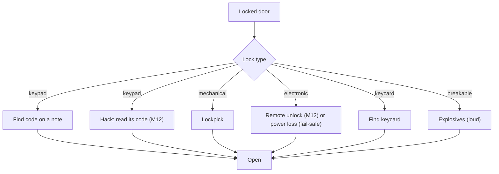

# Security

Milestone: M8 (Security wing). Network hacking (the deck, computers, firewalls, tracers) is M12: [hacking.md](hacking.md).

## Purpose

Electronic and mechanical obstacles that offer several ways through.

## Player-facing behaviour

- **Laser arrays** ([ADR 0096](../decisions/0096-laser-tripwires.md), [ADR 0100](../decisions/0100-laser-arrays-alarm-time-downed-targets.md)): one emitter feeding 1 to 4 beams, each between two wall boxes, one device on the network; anything with a body breaking a beam (the player, a thrown prop, a body falling into it; not an able guard) sends an incident to the alarm controller it reaches: see [Laser arrays](#laser-arrays).
- **Cameras** see the player even when cloaked (not in the dark). A camera that sees an intruder sends an incident to the alarm controller it reaches: see [Cameras and turrets](#cameras-and-turrets).
- **Alarms are devices** ([ADR 0075](../decisions/0075-alarms-as-network-devices.md), replaces the global `LevelAlarm`): see [Alarm devices](#alarm-devices).
- **Turret** guards an area; Cloak does not hide the player from it. Who it shoots is a preset a computer's Security app can change (intruders, guards, everyone).
- **Breaker panel** cuts lights ([light-and-visibility.md](light-and-visibility.md)). Built in M7 ([ADR 0066](../decisions/0066-power-circuits-shootable-lights.md)): `objects/breaker_panel/breaker_panel.tscn`, a `CircuitBreaker` (a `Usable`, "E: switch off <label>" / "switch on") that switches every `Powered` on its `circuit` through the circuit's group, clunks (noise 6) and logs `power.switched`. Lamps opt in with their `Powered.circuit`; the breaker names none. The perception lab has one (circuit `perception_lab`).
- **Computers** (M12a, replacing the M8 terminals) unlock with logins found in the world (a datapad, a mail): their Halcyon OS desktop has Mail, Files and a Security app listing the devices they control with each device's status, live view and a button per command: see [Computers](#computers-m12a), [hacking.md](hacking.md).

## Devices

Cameras, laser arrays, turrets, doors, keypads, sirens, alarm controllers, radio base stations, panic buttons and computers are devices: entities with a link to the network (cable or wireless) or autonomous (no link, a maintenance port). Switches and access points connect them.

- **Power and damage**: devices, switches and access points have `Powered` and `Breakable` like any prop. Unpowering or breaking a switch or access point cuts every device behind it.
- **Standalone behaviour** when a device loses its link: a door still works locally (key, keycard, keypad) but cannot be opened remotely; a camera keeps watching but its incidents reach no controller; a turret keeps its target tags; a siren cannot be rung; a keypad accepts its code.
- **Doors on power loss**: a tag says fail-safe (unlocks) or fail-secure (stays locked). Breaking a switch can disable security but also stop you opening a door remotely.
- **Remote command interface** (M8): a command (open, lock, ring, disable, ...) is a stimulus delivered to the target device; the device's receptrons run it, blocked while it is unpowered or broken (`state.unpowered`, `state.broken`). Nothing branches on a device's identity. Doors: [Remote commands](#remote-commands).
- **Reach**: in M8 a device reaches another when every link and node between them is powered and unbroken (a simple physical link graph). M12 adds addresses, subnets and firewall rules on top ([hacking.md](hacking.md)).

### Built in M8 ([ADR 0077](../decisions/0077-devices-cables-and-remote-commands.md))

- **`Device`** (`objects/devices/device.gd`): the component that makes an entity a device. It mirrors `state.unpowered` (its `Powered` off) and `state.broken` (its `Breakable` depleted) into the entity's tags; up = powered and unbroken. Device scenes keep the broken husk (`Breakable.break_on_depleted` off) and hide the nodes in `broken_hide`. Saveable (`broken`).
- **Cables**: `Device.links` lists the devices it is cabled to (node paths to their entities); links are undirected, so one end is enough. A **network switch** (`objects/devices/network_switch.tscn`) is a device with links, `Powered` (the level sets its circuit) and `Breakable`. Links are invisible in M8.
- **Reach**: `DeviceGraph` (pure, `objects/devices/device_graph.gd`); `Device.graph(tree)` builds it from the level for each query. `Device.reaches(target)`; `Device.reached(type)`: the reached devices that accept `type` (one of their receivers has a receptron for it), nearest first.
- **Sending**: `Device.send_command(command, target, at = Device.NO_POINT, by = null) -> bool` emits `Stimulus.make_contact(command, 1.0, target_entity, sender_entity)` (origin `at`, or the target's position) through `StimulusSystem.emit()` only when the sender reaches the target, and logs `device.command {command, from, to, sent, point, stimulus, by}` either way (`stimulus`: the command's stimulus id when sent; `by`: the operator, a computer's user, M9 [ADR 0087](../decisions/0087-mission-systems.md)). A turret makes the last preset or enable command it obeyed the cause of its shots, so a kill traces back to the operator. `send_to_all(command, at)` sends to every reached device that accepts it; `report_incident(at)` sends `device.incident` (origin = the incident) that way. Senders that are not devices (the debug panel) emit `Device.command_stimulus(command, target, source, at)` themselves.
- **Receiving**: one receptron per type in `objects/devices/receptrons/` (`command_ring.tres`, ..., `device_incident.tres`), blocked on `state.unpowered` and `state.broken`, runs `DeviceActionEffect`: `Device.receive_action()` emits `action_received(action, stimulus)` for the entity's behaviour components.
- Command types (constants on `Device`): `command.open`, `command.close`, `command.lock`, `command.unlock`, `command.ring`, `command.silence`, `command.test`, `command.disarm`, `command.reset`, `command.trigger`, `command.disable`, `command.enable`, `command.broadcast` (controller to base station); `device.incident` (sensor to controller). Cameras and turrets ([ADR 0079](../decisions/0079-security-cameras-and-turret.md)): `command.stop_sweep`, `command.resume_sweep`, `command.pan_left`, `command.pan_right`, `command.target_intruders`, `command.target_guards`, `command.target_everyone`.
- `NetworkSource.connected()` (M12a; `Device.connected_devices()` of [ADR 0080](../decisions/0080-credentials-terminal.md) until then): the reached devices plus the dead ones right behind a live link (`DeviceGraph.connected()`). `DeviceGraph.component()` ([ADR 0083](../decisions/0083-security-terminal-redesign.md)): every device the cables join, up or down (a computer's Security app lists those it controls). `Device.device_address()` gives a device's address to screens (a computer's title bar).
- **Status** ([ADR 0083](../decisions/0083-security-terminal-redesign.md), `DeviceStatus`): a device's behaviour components may implement `device_status() -> PackedStringArray` (their state in words) and `device_view() -> Node3D` (the node they see from, null while blind). Screens show "offline" for any device they cannot reach (unpowered, broken or behind a dead switch: never "broken"), else "online" and the components' words. A component that a command can switch off also implements `device_disabled() -> bool` (camera, turret and laser array while disabled, alarm controller while disarmed); `DeviceStatus.is_disabled()` is true when one says so, and a map row's `disabled` (`NetworkRow`) carries it for reachable devices only ([ADR 0099](../decisions/0099-network-map-layout-pan-zoom.md#amendment-node-colours-m9h)).
- Remote actions per device (open, close, lock, unlock, grant access; view feed, stop sweep, pan, disable; ...): [hacking.md](hacking.md#devices-and-their-remote-actions). M8 builds the interface; who may send which command over the network is M12.

## Alarm devices

[ADR 0075](../decisions/0075-alarms-as-network-devices.md), built in M8.

| Device | Behaviour |
|---|---|
| Alarm controller | Receives incidents from sensors (cameras, laser arrays, panic buttons; tracers from M12) and sends "ring" to every siren it reaches. Rings for 45 s ([ADR 0100](../decisions/0100-laser-arrays-alarm-time-downed-targets.md); 90 s before M9h); another incident restarts it. Remote actions: disarm, reset, trigger |
| Siren | While rung, emits a loud siren stimulus. Guards who hear it go into Searching around where they stand. Remote actions: silence, test |
| Radio base station | If the controller reaches it, broadcasts the incident location; guards with `equipment.radio` in its range search there first. Remote actions (M12a): disable, enable (switched off it ignores broadcasts) |
| Panic button | The old alarm panel: using it sends an incident to the controller it reaches. Remote actions (M12a): disable, enable (switched off, pressing it tells nobody) |

- If every siren is broken, disabled or disconnected, nothing rings.
- The HUD shows "ALARM" while the player can hear a ringing siren.

Scenes (graybox, wall-mounted: origin on the wall face, +Z out; each has `Tags`, `Attributes` health, `Breakable` (`material.electronics`, husk kept: [Breaking devices](#breaking-devices)), `Powered` (a green LED shows while powered), `Device` and a behaviour component with `.tres` tuning):

| Scene | Component, tuning | Accepts | Behaviour |
|---|---|---|---|
| `objects/alarm/alarm_controller.tscn` | `AlarmController`, `alarm_controller.tres` (duration 90 s, ring refresh 1 s); group `alarm_controller` | `device.incident`, `command.trigger`, `reset`, `disarm`, `disable`, `enable` | An incident or a trigger rings it for 90 s (another restarts it; `AlarmTimer`). While ringing it sends `command.ring` to every reached device that accepts it, again every second, and `command.silence` when it stops; on an incident it also sends `command.broadcast` at the incident location. `reset` stops it. `disarm` (or `disable`) stops it and makes it ignore incidents and triggers until `enable` re-arms it (a power cycle does not). Losing power or breaking stops it. Saveable |
| `objects/alarm/siren.tscn` | `Siren`, `siren.tres` (loudness 35, every 1 s, ring hold 2.5 s, test 3 s) | `command.ring`, `silence`, `test` | `ring` sounds it for 2.5 s (the controller's refresh keeps it going; cut off, it falls silent within 2.5 s), `test` for 3 s, `silence` stops it. While sounding: `alarm.siren` every second (RADIUS, PATH, loudness 35: heard up to 34 m of path), a red beacon, a placeholder tone. Unpowered or broken: silent. Saveable |
| `objects/alarm/radio_base_station.tscn` | `RadioBaseStation`, `radio_base_station.tres` (range 40 m) | `command.broadcast` | Emits `alert.dispatch`, 40 m straight from the station, `about_point` = the incident; guards' `heard_dispatch` (radios) search there |
| `objects/alarm/panic_button.tscn` | `PanicButton` (a `Usable`, "E: press panic button"), `DeviceSwitch` (M12a) | `command.disable`, `command.enable` | Reports an incident at the button (silent), unless switched off |
| `objects/devices/network_switch.tscn` | | | Carries links; the level sets its `Powered.circuit` |

EventLog: `device.command {command, from, to, sent, point, stimulus, by}`, `device.state {device, up, unpowered, broken}`, `device.panic {button, by, controllers}`, `alarm.raised {by, point, duration, again}`, `alarm.ended {reason}` (timeout, reset, disarmed, unpowered, broken), `alarm.armed {armed}`, `alarm.ignored {by, point}`, `siren.started {siren, by}`, `siren.stopped {siren, reason}` (silenced, timeout, unpowered, broken), `radio.dispatch {station, point, range}`.

In the hub: the AI arena ([hub-and-gallery.md](../levels/hub-and-gallery.md)) has a controller, a switch (circuit `ai_arena_network`, no breaker: shoot it) carrying two sirens, a panic button and a radio base station cabled to the controller. The security wing (room 5, [hub-and-gallery.md](../levels/hub-and-gallery.md#5-security-wing)) cables a controller, two sirens, a panic button, a radio base station, a camera, three laser arrays (one of two beams), a turret, a vault door and a computer through one switch on breaker B (circuit `security_wing_b`), so cutting B or shooting the switch cuts the whole chain.

## Cameras and turrets

[ADR 0079](../decisions/0079-security-cameras-and-turret.md), built in M8. Both see through a `PerceptionSensor` on their turning head with their own `PerceptionConfig`: the guards' light, distance and line-of-sight rules ([ADR 0067](../decisions/0067-vision-and-detection.md)), no hidden tags (Cloak does not hide you), no peripheral cone. A `SightMeter` (pure, `objects/devices/sight_meter.gd`) rises by the sighting's gain per second, falls 0.25/s unseen; at 1.0 the device detects and reports `Device.report_incident(target position)` to the alarm controllers it reaches, then reports nothing more until no target has been seen for 10 s. A device cut off from its controller still detects but tells nobody.

| Scene | Component, tuning | Accepts | Behaviour |
|---|---|---|---|
| `objects/camera/security_camera.tscn` (wall or ceiling, origin on the face, +Z out; mount about 2.6 m up) | `SecurityCamera`, `security_camera.tres`; vision `security_camera_perception.tres` | `command.disable`, `enable`, `stop_sweep`, `resume_sweep`, `pan_left`, `pan_right` | Hostile `actor.player`; focus ±25° to 15 m; gain 0.8 (lit at 4 m: 1.25 s; 6 m: 1.3 s; dim at 4 m: 3.3 s; dark: never). Sweeps ±40° around its rest yaw at 15°/s, 2 s hold at each end; waits while it sees a target. Lamp: green, amber above 0.3, red while detected; off while blind. Detection: incident, beep (noise 8). Pan: 15° steps clamped to ±40° (stops the sweep). Disabled, unpowered or broken: blind. Health 20, `material.electronics` (blunt ×4): one pistol round or baton hit breaks it. Saveable |
| `objects/turret/turret.tscn` (floor-standing, origin on the floor, +Z forward; head 1.15 m up) | `Turret`, `turret.tres`; vision `turret_perception.tres`; weapon `turret_gun.tres`, aim `turret_aim.tres` | `command.disable`, `enable`, `target_intruders`, `target_guards`, `target_everyone` | Hostile tags from its preset (`TurretConfig.presets`: intruders `actor.player`, guards `actor.guard`, everyone both); focus ±60° to 15 m; gain 2.0. Turns toward what it sees (120°/s). Full meter: incident, 1 s wind-up (beep noise 10, red laser), then bursts of 1.5 s / 0.75 s pause through `WeaponHolder.trigger()`: 15 ballistic a hit every 0.25 s, cone 3° + 0.1° per metre beyond 4 m, shot noise 25. Never fires unless the first thing on the line is the target (the guards' line of fire). A target that goes down (unconscious, dead) is dropped and never seen again as a target ([ADR 0100](../decisions/0100-laser-arrays-alarm-time-downed-targets.md)). Stops 1 s after losing sight. Standing lit player at 6 m: dead in about 4 s from stepping into view. Disabled, unpowered or broken: idle. Health 60, `armoured` (blunt ×2: three pistol rounds, six baton hits; [ADR 0104](../decisions/0104-devices-breakable-by-the-baton.md)). Saveable |

In the gallery: the security wing's camera over its vault door watches the lit corridor (two dark alcoves, light level 0.04, where it cannot see you), and its turret faces the inside of the vault door ([hub-and-gallery.md](../levels/hub-and-gallery.md#5-security-wing)).

EventLog: `camera.detected {camera, target, point, controllers}`, `turret.detected {turret, target, point, controllers}`, `turret.engaged {turret, target}`, `turret.disengaged {turret, reason}`, `turret.retargeted {turret, preset, tags}`; shots as `weapon.fired`.

## Laser arrays

[ADR 0096](../decisions/0096-laser-tripwires.md) (M9g, single tripwires), [ADR 0100](../decisions/0100-laser-arrays-alarm-time-downed-targets.md) (M9h: arrays).

| Scene | Component, tuning | Accepts | Behaviour |
|---|---|---|---|
| `objects/laser/laser_array.tscn` (wall-mounted: origin on the first beam's emitter face at its height, +Z across the gap; a one-beam array, `Beam1`; per instance each beam's `length` = the gap to the far wall face, `LaserBehaviour.start_disabled`, `Device.links`). More beams: instance `objects/laser/laser_beam.tscn` under it (`LaserBeam`: origin on its emitter face at its height, +Z across, its own `length`) | `LaserArray`, `laser_array.tres` | `command.disable`, `enable` | One device for 1 to 4 beams (`max_beams`), grouped by authoring (its `LaserBeam` children), never by distance: one network node, one status, one Disable / Enable. Each tick a 0.03 m box along each beam (0.08 m in from each end) is checked against player, actors, objects, static actors and downed bodies (never the world), and held props through the `carried` group. Ignores `actor.guard` unless `state.unconscious` or `state.dead`. Any beam's break: one incident at that beam's point nearest the body, beep (noise 8 at the emitter), `laser.tripped`; nothing more until every beam has been clear for 1 s (a body crossing several beams is one incident). Disabled, unpowered or broken: no check, no beams. Status: enabled / disabled, clear / tripped. One emitter feeds every beam: each beam's head and receiver box and the mast joining the heads are the array's one body; health 20, `material.electronics`: one pistol round at any of them breaks the array and every beam goes dark. Saveable |

- **Heights** ([metrics](../levels/metrics.md)): low beam 0.4 m, jumped (apex 1.0 m; a walking take-off 0.64 to 1.92 m before the beam clears it); high beam 1.3 m, crouched under (crouched height 0.95 m); a two-beam array 0.4 m + 1.3 m stops both: disable it (terminal), cut its power or shoot its emitter.
- Throwing a prop through a beam rings the alarm on purpose (a distraction).
- EventLog: `laser.tripped {laser, beam, by, point, controllers}`, `laser.toggled {laser, enabled}`.

In the gallery: the security wing's laser hall behind closet D1 has a low one-beam array, a high one and a two-beam array, cabled to the wing's switch ([hub-and-gallery.md](../levels/hub-and-gallery.md#5-security-wing)). In the warehouse: two high one-beam arrays across the roof's arrivals, with a camera over duct B's lit forecourt, on the yard network ([mission-warehouse.md](../levels/mission-warehouse.md#roof-security-m9g), [ADR 0097](../decisions/0097-warehouse-roof-security.md)).

## Network (M12a)

[ADR 0113](../decisions/0113-network-layer-tracers-and-the-deck.md), player-facing rules in [hacking.md](hacking.md):

- **Addresses and subnets** are `Device` exports (`address`, `subnet`); a device without a subnet takes the subnet of a cabled device that names one (its switch). Levels without network data stay one open network, as in M8.
- **Gateways** (`objects/network/gateway.tscn`: `Gateway` + `DeviceAccounts`) sit between subnets: their ordered rules first, else devices' traffic passes (cameras still report to a controller behind a gateway) and a user's only once that user has an account on the gateway.
- **Trust**: a device's `trusted` list names the devices allowed to command it (a camera trusting the security console); without a list any device that reaches it may (M8). A session on the device itself (the deck with an account on it) may too. Incidents are reports: trust does not stop them.
- **Ports**: a wall jack (`objects/network/wall_jack.tscn`, `deck_port` JACK) puts the deck on its subnet; an autonomous device (no cables) has a maintenance port (the deck reaches that device only); a computer lends the deck its address.
- **DeviceSwitch** (`objects/devices/device_switch.gd`): `command.disable` / `enable` for devices without a switch of their own (panic buttons, radio base stations), status enabled / disabled, saved.

## Computers (M12a)

[ADR 0114](../decisions/0114-computers-halcyon-os.md) (replaces the M8 terminal of [ADR 0080](../decisions/0080-credentials-terminal.md) and [ADR 0083](../decisions/0083-security-terminal-redesign.md); design in [hacking.md](hacking.md)). `objects/computer/computer.tscn` (wall-mounted, origin on the face, +Z out; screen centre about 1.45 m up): a Device with `Powered`, `Breakable` (health 20, electronics), `Accounts` (`DeviceAccounts`: its local accounts), `Computer` (tuning `computer.tres`) and `ComputerUse` (a `Usable`, "E: use <label>"). Per instance: the accounts, and on `Computer` its `data` (a `ComputerData` `.tres`: mails and files), `credentials_id`, `host_name`, `label` and optionally `session_user` (an unlocked session).

- **Logins**: a readable's `codes[credentials_id] = "user:password"` (split at the first colon). The login screen lists every such login the player has read, one per user, each with a Fill in button; Enter or Log in tries it (`DeviceAccounts.try_login()`). User names ignore case, passwords do not. Wrong: "Wrong user or password." and a beep, but no noise stimulus (hacking is silent). It stays logged in until someone logs out (saved).
- **Screen** (`ui/computer/computer_screen.tscn`, a child of the Player): an 85 % panel over the running world, the HUD hidden; Esc or the ✕ leaves, every time (also while typing), never also opening the game menu; E never does. It closes when you walk more than 3 m away, cannot act, or the computer dies. The title bar shows the host name, the address (when the network gives one), the account and its access level, and the tracers' trace bars (M12a network).
- **Desktop**: a dock with Mail, Files and Security, the account and Log out. Mail and Files list the computer's documents (mail per account); selecting one reads it into the Journal like a datapad (source Mail or Files): logins and codes in it are learned, an implicit clue is only a note.
- **Security app** (replaces the terminal's Camera tab): the devices the computer controls (`Computer.devices()`: on its cabled network, reached or cut off, and trusting it: `Computer.controls()`, [ADR 0113](../decisions/0113-network-layer-tracers-and-the-deck.md)), grouped by kind (Cameras and turrets; Doors; Alarm: controller, sirens, radio base stations, panic buttons; Laser arrays), a line icon per kind and each device's short status in its colour: **grey** offline (unreachable for whatever reason: unpowered, broken, cut off), **red** reachable and disabled, amber while an alert word shows (alert, suspicious, tracking, firing, ringing, broadcasting), else green. The kinds, groups and icons are data (`ComputerConfig.kinds`, by entity tag): switches and computers have none and are not listed. The selected device's pane: name, kind and status, the live view for a device with a view (cameras and turrets: 480 x 270, rendered only while shown; "No signal" when offline or disabled), its status words and address, one button per command it accepts that applies now (`DeviceStatus.applicable()`: Enable only while disabled; Stop or Resume sweep, Lock or Unlock, Open or Close by state) from the label table (`ComputerConfig.command_labels`, in order: Open, Close, Lock, Unlock, Enable, Disable, Stop sweep, Resume sweep, Pan left, Pan right, Target intruders / guards / everyone, Trigger, Reset, Disarm, Ring, Test, Silence), and what the last press did. Status words come from the device's components (`DeviceStatus`): camera enabled / disabled, sweeping / holding, suspicious / alert; turret enabled / disabled, targets intruders / guards / everyone, idle / tracking / firing; alarm controller armed / disarmed, ringing / silent; siren ringing / silent; door open / closed and locked / unlocked; radio base station broadcasting / idle; laser array enabled / disabled, clear / tripped (one row per array); a computer logged in / out. Refreshed four times a second. A computer that controls nothing says so and points to the deck.
- **Remote desktop** (from the deck, M12a): the same desktop inside the deck's panel ("Remote desktop", "Back to the map"); its Security app controls the devices that trust that computer.
- EventLog: `computer.opened {computer, by, remote}`, `computer.login {computer, user, ok}`, `computer.logout {computer}`; commands log as `device.command` with the player as `by`.
- The old network map (the terminal's Network tab, [ADR 0099](../decisions/0099-network-map-layout-pan-zoom.md)) becomes the deck's Map ([hacking.md](hacking.md)).

Showcase (tests and screenshots, not a gallery room): `tests/objects/fixtures/showcase/security_showcase.tscn`, a computer (`Console`) cabled through a switch to a camera, a turret, an alarm controller, a siren and a door, with the credentials datapad on a desk.

In the gallery: the security wing (room 5, [hub-and-gallery.md](../levels/hub-and-gallery.md#5-security-wing)) chains every M8 device into one route: a keypad code on a datapad opens a closet with the booth keycard, a lockpicked closet holds the booth computer's login datapad, the booth computer's Security app disables or retargets the turret and opens the fail-secure vault door; a camera with a sweep watches the corridor to the vault (two dark alcoves to wait in), a baton guard holds a post by the vault door, and breaker A unlocks a fail-safe door.

## Breaking devices

[ADR 0104](../decisions/0104-devices-breakable-by-the-baton.md). Any damage that gets past a device's material breaks it through its `Breakable`: shots, blasts, thrown props and the baton alike. A broken device keeps its husk (no break noise), goes dark and tags `state.broken`; `device.state` logs it and every computer's Security app shows it (and whatever it cut off) as offline. Wall devices are `material.electronics` (blunt ×4, fire and stun ×0); the turret is `armoured` (blunt ×2); lamps are glass. The baton deals blunt 5 (its stun 20 does nothing to objects): 20 on electronics, 10 on armour. A swing is a 3 m noise, a hit 6 m at the device (a pistol shot 25 m).

| Device | Material | Health | Baton hits | Pistol rounds |
|---|---|---|---|---|
| Camera, laser array (emitter, receiver or mast), computer, siren | electronics | 20 | 1 | 1 |
| Panic button | electronics | 10 | 1 | 1 |
| Alarm controller, radio base station | electronics | 30 | 2 | 2 |
| Network switch (and access points, office wall jacks) | electronics | 40 | 2 | 2 |
| Turret | armoured | 60 | 6 (from behind or disabled: it sees ±60° ahead) | 3 |
| Wall, ceiling and flood lamps | glass | 1 | 1 | 1 |

Measured with the player's baton through the real swing (`tests/objects/devices/baton_devices_test.gd`, `baton_reach_test.gd`). Low-Tech and Combat Strength scale the hit like any melee damage.

**Reach**: the swing sweeps a 0.2 m sphere along the view until its front is 1.8 m from the eye (1.65 m up standing). From the floor, standing about 0.6 m from the wall, it reaches a wall device whose underside is up to about 3.4 m high (about 3.2 m from 1.0 m away; pressed against the wall the sphere scrapes the wall above about 3.0 m, so step back); straight up about 3.45 m; a jumping swing at the apex about 4.3 m. In the levels:

| Needs | Devices |
|---|---|
| Nothing (from the floor or walkway below) | Every camera but the yard one (the roof camera is 2.6 m above the roof), every siren (hub 3.0 m, warehouse 1.8 m), switches, controllers, base stations, panic buttons, computers, laser arrays, the turret; wall lamps and the lamps of small rooms, corridors and catwalks (1.8-3.1 m above their floor) |
| A jump | Hub: the hall ceiling lamps (3.63 m: perception lab, AI arena, security wing hall). Warehouse: the ground-floor office ceiling lamps (3.64 m), the annex lamp (3.88 m), the yard camera (3.83 m), the roof flood lamp (3.4 m above the roof: at the edge standing), the two bridge lamps (4.07 m above the walkway: at the edge of a jump) |
| Out of reach (shoot it, or stack crates) | Warehouse: the yard flood lamps (5.2-7.2 m), the high-bay lamps (8.45 m), the guest access point (5.9 m above the yard) |

**Door wall boxes** (keypad, card reader, status, control box) have no health of their own: a hit on one reaches the door, which takes no ballistic or blunt damage (a plain door has no damage receptron; the breakable door's `reinforced` only takes explosive). Shooting or clubbing a box does nothing: it never unlocks, opens or breaks the door.

## Door and lock types

Built in M8 ([ADR 0078](../decisions/0078-doors-locks-and-door-navigation.md)). Showcase: `tests/objects/fixtures/showcase/door_showcase.tscn` (one door per lock type). In the gallery: the security wing's lock row (keypad, pin lock, keycard, fail-safe electronic, breakable with a barrel beside it) and its fail-secure vault door ([hub-and-gallery.md](../levels/hub-and-gallery.md#5-security-wing)).

### Doors

- `objects/door/door.tscn`: a sliding pocket door filling a 1.2 x 2.2 m doorway (origin on the floor at the doorway's centre, panel in the wall's middle plane, X along the wall). The panel slides 1.3 m along +X into the wall in 0.6 s (`door_settings.tres`). Closed, it blocks bodies and sight (world layer) and its `SoundAttenuator` adds 6 m to noise paths through the doorway (while less than half open). It does not close on a body in the doorway (player, guard, prop: `door.blocked`; a closing door that something walks into opens again). Place it where 1.35 m of wall continues on its +X side (the pocket) and 0.3 m on its -X side (wall boxes); set `Door.wall_thickness` (default 0.25) so the wall boxes sit on the wall faces. A face that opens into a corridor too narrow for its boxes beside the doorway sets `Door.front_side_wall` / `back_side_wall` (the distance from the doorway's centre line to the corridor's side wall on the boxes' side): its boxes then hang on the side wall, facing across the corridor, 0.4 m in from the door's wall face ([ADR 0092](../decisions/0092-warehouse-polish.md)). Rotate it 180 degrees to swap sides.
- **Size and motion are data** ([ADR 0090](../decisions/0090-door-size-free-side-locks-warehouse-security.md)): `DoorSettings.doorway` (width x height, default 1.2 x 2.2), `travel` (where the panel moves to open, door-local: +X slides it into the wall beside the doorway, +Y raises it into the wall above), `panel_thickness`, `panel_offset` (off the wall's middle plane, e.g. a gate sliding past its posts outside a fence) and `open_time`. The door sizes its panel, noise attenuator, navigation carve and control panels from them at `_ready`. Shipped: `door_settings.tres` (1.2 x 2.2, slides 1.3 m in 0.6 s), `roller_door_settings.tres` (4 x 4 m, rises 4.1 m in 2.5 s, noise 15), `vehicle_gate_settings.tres` (6 x 3 m, slides 6.2 m past its post, 0.3 m outside the fence line, in 3 s), `fence_gate_settings.tres` (1.2 x 3 m in a 3 m fence). A roller door needs `travel.y` of wall above the doorway; a pocket door 1.35 m of wall beside it. `DoorSettings.bar_spacing` above 0 makes the panel a grille (vertical bars `bar_width` wide and two rails, one concave shape and one mesh): bodies are stopped, sight, shots and light pass between the bars like the palisade fence; the two gate settings use the fence's 0.22 m and do not muffle noise (`attenuate_below` 0, [ADR 0092](../decisions/0092-warehouse-polish.md)).
- **Lock hardware** ([ADR 0098](../decisions/0098-door-lock-hardware-and-keycard-relock.md), built by the door's `DoorHardware` and placed by `DoorLayout` from its settings and wall, never per level): every leaf has a **handle** on its leading edge, 1.0 m up, proud of both faces; a leaf that slides into its wall carries it 0.12 m past its edge, so the open door's handle stands 7 cm out of the jamb (a roller door has a bar 0.3 m up). A **pin lock's keyhole** is on both faces of the handle. **Keypads and card readers** are their own small boxes on both wall faces beside the frame, on the side away from the pocket (centred 0.17 m from the doorway edge, top box 1.35 m up, stacked downward); an **electronic lock** shows on them as the lock light, or gets its own status box when no other lock has one; a door whose leaf rises out of reach (`DoorSettings.wall_control`: the roller door) gets a plain control box. Every box's light is red while the door is closed and locked, green while unlocked or open, dark when broken or unpowered.
- **What the player looks at**: E on the leaf: "E: open" / "E: close", else "Locked: keypad or lockpick" (every lock's reason), "Locked" with no lock; the pin lock is picked with the lockpick on the leaf, from either face (LMB starts the lockpicking minigame, [lockpicking.md](lockpicking.md)). E on a keypad box: "E: enter code" (the keypad screen). E on a reader box: "E: open (keycard)" with the card, else "Locked: keycard". Any box says "E: open" / "E: close" while the door is unlocked or open, or from a free side.
- `objects/door/breakable_door.tscn`: the same plus `Breakable` (health 50, material `reinforced`: `damage.explosive` x1; ballistic, blunt, stun and fire x0) with `free_entity` off. A barrel blast (100 / 4 m) breaks it within about 2 m of the door's centre (100 x (1 - 2/4) = 50); pistol rounds (25 ballistic) and baton hits (20 stun + 5 blunt) never do. Broken, the panel is gone for good: passable, no attenuation, `state.broken`.
- Saveable: `Door` (`open`, `broken`), `Lockable` (`locked`); `Tags` and `Attributes` save themselves. A door opened with a keycard saves as open and locked: closed after loading, it is locked.
- EventLog: `door.opened` / `door.closed` {door, by}, `door.opened_freely` (from a lock's free side), `door.blocked`, `door.refused`, `door.command {door, command, done}`; `lock.unlocked` / `lock.locked` / `lock.granted` {entity, how}, `lock.code_entered {entity, code_id, correct}`, `lock.pick_started` / `lock.pick_cancelled {reason}` / `lock.pick_broke` / `lock.picked`, `lock.relocked {layout}` (practice locks).

### Locks (components on any entity)

`Lockable` (`objects/locks/lockable.gd`) holds the locked state; each `Lock` component on the same entity is one way to unlock it, with its data in a Resource. A door can have several locks or none. The door places each lock on its hardware (its noises come from there): `Lock.mount()` says where (LEAF, WALL, INDICATOR) and `Lock.hardware()` gives the scene (`objects/locks/hardware/`). A user who unlocks on purpose also opens the door; power loss and commands only unlock. A keycard only grants an opening (`Lockable.grant()`): the door opens and stays locked, so it is locked again once closed ([ADR 0098](../decisions/0098-door-lock-hardware-and-keycard-relock.md)).

| Component | Data | Opens by | Notes |
|---|---|---|---|
| `KeypadLock` | `KeypadLockData`: `code_id`, `code`, `max_digits` 8, `wrong_noise` 4, `accept_noise` 2 | E on the keypad box opens the user's keypad screen; the right code unlocks it for good | A wrong code beeps (noise 4) and clears the entry. The screen shows "Note: 2817, from 'Storage access'" when the user's PersonalLog knows the code (`known_code(code_id)`, `code_source(code_id)`); the user still types it. Only the code opens it until M12 ([ADR 0076](../decisions/0076-computer-skill-multitool-removed.md)) |
| `MechanicalLock` | `MechanicalLockData`: `pins` (one type per pin: `standard`, `spool`, `serrated`), `pin_seed`, `tolerance_mult` 1.0, `tool` (`lockpick`), `practice` / `practice_tier` (practice locks) | LMB with a lockpick in hand, looking at the door leaf (its keyhole is on the handle, both faces) | M10: the lockpicking minigame ([lockpicking.md](lockpicking.md), [ADR 0107](../decisions/0107-lockpicking-minigame.md)). The `Lock` tool interface (`accepts_tool`, `tool_hold`) driven by the user's `ToolUse` opens the user's `LockpickScreen`; `complete_pick()` unlocks it for the user (the door opens); its noises come from the lock (`pick_noise()`). Picks break only on failure, success consumes nothing. EventLog `lock.pick_started`, `lock.pick_cancelled {reason}`, `lock.pick_broke`, `lock.picked`, `lock.relocked {layout}` (practice locks) |
| `KeycardLock` | `KeycardLockData`: `access_id`, `accept_noise` 2 | E on the reader box while carrying a keycard whose `key_id` is the access id: the door opens and stays locked (locked again once closed: the card is needed every time) | A character tagged `access.<access_id>` has the same access: guards with it path through and open the door while it stays locked (locked again once someone closes it) |
| `ElectronicLock` | the entity's tags | Remote unlock or open; power loss when fail-safe | `door.fail_safe` unlocks on power loss (its `Powered` switching off, or `state.unpowered` added); `door.fail_secure` (or no tag) stays as it is |

- **Free side** (any lock, [ADR 0090](../decisions/0090-door-size-free-side-locks-warehouse-security.md)): `Lock.free_side` names a side of the entity (FRONT: its +Z, BACK: its -Z) from which it opens without that lock's key, like an exit handle or a push bar. There the door prompts "E: open" and makes an authorised open (it stays locked, so it is locked again once closed; `door.opened_freely`); `Lockable.grants_passage()` lets a character on that side through. The door's main navigation link stays on the lock's layers; a second, one-way link (`FreeSideLink`, on the walk layer while the door is locked) runs from the free side through the doorway, so any guard plans out through it but never in ([ADR 0092](../decisions/0092-warehouse-polish.md)). The warehouse's back gate, tunnel gate, side door, roof doors and office doors use it.
- Keypad: code found in world notes. Datapads are read in place and copied to the player's personal log ([ADR 0060](../decisions/0060-datapads-read-in-place-personal-log.md)); a datapad's `Readable.codes` maps the keypad's code id to the code. A code learned any other way (a conversation, a log entry) feeds the same reminder. The gallery's "Storage access" datapad carries `storage_door: 2817`. From M12 a keypad is also hackable ("read its code", [hacking.md](hacking.md)).
- Mechanical lock: the pin-tumbler minigame replaced the M8 placeholder in M10 ([lockpicking.md](lockpicking.md)). Practice locks (clear acrylic, every assist, a new layout after each opening) hang on the west wall of the security wing's hall, one per tier (M10d).
- Electronic: the lock is a network device: opened remotely (from M12 with access to a machine it trusts or to the door itself), or by power loss when it is fail-safe.

### Remote commands

Every door is a network device: `door.tscn` carries a `Device` ([ADR 0077](../decisions/0077-devices-cables-and-remote-commands.md)), standalone until cabled (`Device.links`). `command.open`, `command.close`, `command.lock`, `command.unlock` (`Device.OPEN` ... `Device.UNLOCK`, sent with `Device.send_command(command, door)` by a device that reaches the door) run through the shared receptrons `objects/devices/receptrons/command_*.tres` (blocked while the door carries `state.unpowered` or `state.broken`) and the Device's `action_received`: the `Door` opens / closes, the `Lockable` locks / unlocks (`lock.locked` / `lock.unlocked` with `how: command`). A remote open is an authorised open: it opens a locked door without unlocking it (it is locked again once closed). A door with a `Powered` on a circuit is unpowered while the circuit is off (the Device mirrors it into `state.unpowered`): no commands, and a fail-safe lock unlocks.

### Guards and doors

The doorway is carved out of the navmesh and bridged by the door's `NavigationLink3D`: on navigation layer 1 while the door is passable (unlocked, open or broken), else on layer 2 plus the layer of each access id its locks let through ([ADR 0078](../decisions/0078-doors-locks-and-door-navigation.md)). A guard's `DoorOpener` puts its agent on layer 1 plus its `access.<id>` tags' layers and opens a closed door when its next 3.5 m of path cross the doorway. Doors guards open stay open. Noise uses every layer, so it passes locked doors (with the closed door's 6 m).

## Rules

- Skills: Computer (the deck's tools, M12; replaces Electronics), Lockpicking (tension window, tolerances, drop threshold, rake, assists; picks break only on failure): [abilities.md](abilities.md).
- Closed doors attenuate noise along the path (+6 m); doors are navigation links for guards, locked ones only for guards with the access ([perception-and-ai.md](perception-and-ai.md), [stimulus-response.md](stimulus-response.md), [ADR 0078](../decisions/0078-doors-locks-and-door-navigation.md)).
- From M10 lockpicks break only on failure, success consumes nothing ([inventory.md](inventory.md), [lockpicking.md](lockpicking.md)). There is no multitool.
- Cameras and turrets use the same perception and receiver framework.

## Interactions

- The warehouse mission's doors, keys and security network: [../levels/mission-warehouse.md](../levels/mission-warehouse.md#doors-locks-and-keys-m9-wave-2)
- Network hacking: [hacking.md](hacking.md). Guards and sirens: [perception-and-ai.md](perception-and-ai.md).

## Open questions

- Settled in M8: camera field of view and sweep, turret damage and behaviour ([ADR 0079](../decisions/0079-security-cameras-and-turret.md)); what M8 terminals did ([ADR 0080](../decisions/0080-credentials-terminal.md), replaced by computers: [ADR 0114](../decisions/0114-computers-halcyon-os.md)); siren loudness (35) and radio base station range (40 m) ([ADR 0077](../decisions/0077-devices-cables-and-remote-commands.md)).
- Cameras do not track a moving target beyond holding their sweep; turrets do not lead moving targets.
- Guards running to panic buttons.
