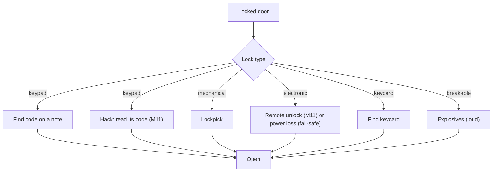

# Security

Milestone: M8 (Security wing). Network hacking (the deck, computers, firewalls, tracers) is M11: [hacking.md](hacking.md).

## Purpose

Electronic and mechanical obstacles that offer several ways through.

## Player-facing behaviour

- **Laser tripwires** ([ADR 0096](../decisions/0096-laser-tripwires.md)): a beam between two wall boxes; anything with a body breaking it (the player, a thrown prop, a body falling into it; not an able guard) sends an incident to the alarm controller it reaches: see [Laser tripwires](#laser-tripwires).
- **Cameras** see the player even when cloaked (not in the dark). A camera that sees an intruder sends an incident to the alarm controller it reaches: see [Cameras and turrets](#cameras-and-turrets).
- **Alarms are devices** ([ADR 0075](../decisions/0075-alarms-as-network-devices.md), replaces the global `LevelAlarm`): see [Alarm devices](#alarm-devices).
- **Turret** guards an area; Cloak does not hide the player from it. Who it shoots is a preset a terminal can change (intruders, guards, everyone).
- **Breaker panel** cuts lights ([light-and-visibility.md](light-and-visibility.md)). Built in M7 ([ADR 0066](../decisions/0066-power-circuits-shootable-lights.md)): `objects/breaker_panel/breaker_panel.tscn`, a `CircuitBreaker` (a `Usable`, "E: switch off <label>" / "switch on") that switches every `Powered` on its `circuit` through the circuit's group, clunks (noise 6) and logs `power.switched`. Lamps opt in with their `Powered.circuit`; the breaker names none. The perception lab has one (circuit `perception_lab`).
- **Terminals** (M8) keep the credentials placeholder: they unlock with credentials found in the world (a datapad), then show the security network they are cabled to (a Camera tab with live views, a Network tab with a graph) with each device's status and a button per command: see [Terminal](#terminal-m8-placeholder). M11 replaces them with computers (Halcyon OS desktop, Mail, Files, Security) and the deck ([hacking.md](hacking.md), [ADR 0074](../decisions/0074-network-hacking.md)).

## Devices

Cameras, laser tripwires, turrets, doors, keypads, sirens, alarm controllers, radio base stations, panic buttons and terminals are devices: entities with a link to the network (cable or wireless) or autonomous (no link, a maintenance port). Switches and access points connect them.

- **Power and damage**: devices, switches and access points have `Powered` and `Breakable` like any prop. Unpowering or breaking a switch or access point cuts every device behind it.
- **Standalone behaviour** when a device loses its link: a door still works locally (key, keycard, keypad) but cannot be opened remotely; a camera keeps watching but its incidents reach no controller; a turret keeps its target tags; a siren cannot be rung; a keypad accepts its code.
- **Doors on power loss**: a tag says fail-safe (unlocks) or fail-secure (stays locked). Breaking a switch can disable security but also stop you opening a door remotely.
- **Remote command interface** (M8): a command (open, lock, ring, disable, ...) is a stimulus delivered to the target device; the device's receptrons run it, blocked while it is unpowered or broken (`state.unpowered`, `state.broken`). Nothing branches on a device's identity. Doors: [Remote commands](#remote-commands).
- **Reach**: in M8 a device reaches another when every link and node between them is powered and unbroken (a simple physical link graph). M11 adds addresses, subnets and firewall rules on top ([hacking.md](hacking.md)).

### Built in M8 ([ADR 0077](../decisions/0077-devices-cables-and-remote-commands.md))

- **`Device`** (`objects/devices/device.gd`): the component that makes an entity a device. It mirrors `state.unpowered` (its `Powered` off) and `state.broken` (its `Breakable` depleted) into the entity's tags; up = powered and unbroken. Device scenes keep the broken husk (`Breakable.break_on_depleted` off) and hide the nodes in `broken_hide`. Saveable (`broken`).
- **Cables**: `Device.links` lists the devices it is cabled to (node paths to their entities); links are undirected, so one end is enough. A **network switch** (`objects/devices/network_switch.tscn`) is a device with links, `Powered` (the level sets its circuit) and `Breakable`. Links are invisible in M8.
- **Reach**: `DeviceGraph` (pure, `objects/devices/device_graph.gd`); `Device.graph(tree)` builds it from the level for each query. `Device.reaches(target)`; `Device.reached(type)`: the reached devices that accept `type` (one of their receivers has a receptron for it), nearest first.
- **Sending**: `Device.send_command(command, target, at = Device.NO_POINT, by = null) -> bool` emits `Stimulus.make_contact(command, 1.0, target_entity, sender_entity)` (origin `at`, or the target's position) through `StimulusSystem.emit()` only when the sender reaches the target, and logs `device.command {command, from, to, sent, point, stimulus, by}` either way (`stimulus`: the command's stimulus id when sent; `by`: the operator, a terminal's user, M9 [ADR 0087](../decisions/0087-mission-systems.md)). A turret makes the last preset or enable command it obeyed the cause of its shots, so a kill traces back to the operator. `send_to_all(command, at)` sends to every reached device that accepts it; `report_incident(at)` sends `device.incident` (origin = the incident) that way. Senders that are not devices (the debug panel) emit `Device.command_stimulus(command, target, source, at)` themselves.
- **Receiving**: one receptron per type in `objects/devices/receptrons/` (`command_ring.tres`, ..., `device_incident.tres`), blocked on `state.unpowered` and `state.broken`, runs `DeviceActionEffect`: `Device.receive_action()` emits `action_received(action, stimulus)` for the entity's behaviour components.
- Command types (constants on `Device`): `command.open`, `command.close`, `command.lock`, `command.unlock`, `command.ring`, `command.silence`, `command.test`, `command.disarm`, `command.reset`, `command.trigger`, `command.disable`, `command.enable`, `command.broadcast` (controller to base station); `device.incident` (sensor to controller). Cameras and turrets ([ADR 0079](../decisions/0079-security-cameras-and-turret.md)): `command.stop_sweep`, `command.resume_sweep`, `command.pan_left`, `command.pan_right`, `command.target_intruders`, `command.target_guards`, `command.target_everyone`.
- `Device.connected_devices()` ([ADR 0080](../decisions/0080-credentials-terminal.md)): the reached devices plus the dead ones right behind a live link (`DeviceGraph.connected()`). `DeviceGraph.component()` ([ADR 0083](../decisions/0083-security-terminal-redesign.md)): every device the cables join, up or down (the terminal's network view).
- **Status** ([ADR 0083](../decisions/0083-security-terminal-redesign.md), `DeviceStatus`): a device's behaviour components may implement `device_status() -> PackedStringArray` (their state in words) and `device_view() -> Node3D` (the node they see from, null while blind). Screens show "offline" for any device they cannot reach (unpowered, broken or behind a dead switch: never "broken"), else "online" and the components' words.
- Remote actions per device (open, close, lock, unlock, grant access; view feed, stop sweep, pan, disable; ...): [hacking.md](hacking.md#devices-and-their-remote-actions). M8 builds the interface; who may send which command over the network is M11.

## Alarm devices

[ADR 0075](../decisions/0075-alarms-as-network-devices.md), built in M8.

| Device | Behaviour |
|---|---|
| Alarm controller | Receives incidents from sensors (cameras, laser tripwires, panic buttons; tracers from M11) and sends "ring" to every siren it reaches. Rings for 90 s; another incident restarts it. Remote actions: disarm, reset, trigger |
| Siren | While rung, emits a loud siren stimulus. Guards who hear it go into Searching around where they stand. Remote actions: silence, test |
| Radio base station | If the controller reaches it, broadcasts the incident location; guards with `equipment.radio` in its range search there first |
| Panic button | The old alarm panel: using it sends an incident to the controller it reaches |

- If every siren is broken, disabled or disconnected, nothing rings.
- The HUD shows "ALARM" while the player can hear a ringing siren.

Scenes (graybox, wall-mounted: origin on the wall face, +Z out; each has `Tags`, `Attributes` health, `Breakable` (metal, husk kept), `Powered` (a green LED shows while powered), `Device` and a behaviour component with `.tres` tuning):

| Scene | Component, tuning | Accepts | Behaviour |
|---|---|---|---|
| `objects/alarm/alarm_controller.tscn` | `AlarmController`, `alarm_controller.tres` (duration 90 s, ring refresh 1 s); group `alarm_controller` | `device.incident`, `command.trigger`, `reset`, `disarm`, `disable`, `enable` | An incident or a trigger rings it for 90 s (another restarts it; `AlarmTimer`). While ringing it sends `command.ring` to every reached device that accepts it, again every second, and `command.silence` when it stops; on an incident it also sends `command.broadcast` at the incident location. `reset` stops it. `disarm` (or `disable`) stops it and makes it ignore incidents and triggers until `enable` re-arms it (a power cycle does not). Losing power or breaking stops it. Saveable |
| `objects/alarm/siren.tscn` | `Siren`, `siren.tres` (loudness 35, every 1 s, ring hold 2.5 s, test 3 s) | `command.ring`, `silence`, `test` | `ring` sounds it for 2.5 s (the controller's refresh keeps it going; cut off, it falls silent within 2.5 s), `test` for 3 s, `silence` stops it. While sounding: `alarm.siren` every second (RADIUS, PATH, loudness 35: heard up to 34 m of path), a red beacon, a placeholder tone. Unpowered or broken: silent. Saveable |
| `objects/alarm/radio_base_station.tscn` | `RadioBaseStation`, `radio_base_station.tres` (range 40 m) | `command.broadcast` | Emits `alert.dispatch`, 40 m straight from the station, `about_point` = the incident; guards' `heard_dispatch` (radios) search there |
| `objects/alarm/panic_button.tscn` | `PanicButton` (a `Usable`, "E: press panic button") | | Reports an incident at the button (silent) |
| `objects/devices/network_switch.tscn` | | | Carries links; the level sets its `Powered.circuit` |

EventLog: `device.command {command, from, to, sent, point, stimulus, by}`, `device.state {device, up, unpowered, broken}`, `device.panic {button, by, controllers}`, `alarm.raised {by, point, duration, again}`, `alarm.ended {reason}` (timeout, reset, disarmed, unpowered, broken), `alarm.armed {armed}`, `alarm.ignored {by, point}`, `siren.started {siren, by}`, `siren.stopped {siren, reason}` (silenced, timeout, unpowered, broken), `radio.dispatch {station, point, range}`.

In the hub: the AI arena ([hub-and-gallery.md](../levels/hub-and-gallery.md)) has a controller, a switch (circuit `ai_arena_network`, no breaker: shoot it) carrying two sirens, a panic button and a radio base station cabled to the controller. The security wing (room 5, [hub-and-gallery.md](../levels/hub-and-gallery.md#5-security-wing)) cables a controller, two sirens, a panic button, a radio base station, a camera, four laser tripwires, a turret, a vault door and a terminal through one switch on breaker B (circuit `security_wing_b`), so cutting B or shooting the switch cuts the whole chain.

## Cameras and turrets

[ADR 0079](../decisions/0079-security-cameras-and-turret.md), built in M8. Both see through a `PerceptionSensor` on their turning head with their own `PerceptionConfig`: the guards' light, distance and line-of-sight rules ([ADR 0067](../decisions/0067-vision-and-detection.md)), no hidden tags (Cloak does not hide you), no peripheral cone. A `SightMeter` (pure, `objects/devices/sight_meter.gd`) rises by the sighting's gain per second, falls 0.25/s unseen; at 1.0 the device detects and reports `Device.report_incident(target position)` to the alarm controllers it reaches, then reports nothing more until no target has been seen for 10 s. A device cut off from its controller still detects but tells nobody.

| Scene | Component, tuning | Accepts | Behaviour |
|---|---|---|---|
| `objects/camera/security_camera.tscn` (wall or ceiling, origin on the face, +Z out; mount about 2.6 m up) | `SecurityCamera`, `security_camera.tres`; vision `security_camera_perception.tres` | `command.disable`, `enable`, `stop_sweep`, `resume_sweep`, `pan_left`, `pan_right` | Hostile `actor.player`; focus ±25° to 15 m; gain 0.8 (lit at 4 m: 1.25 s; 6 m: 1.3 s; dim at 4 m: 3.3 s; dark: never). Sweeps ±40° around its rest yaw at 15°/s, 2 s hold at each end; waits while it sees a target. Lamp: green, amber above 0.3, red while detected; off while blind. Detection: incident, beep (noise 8). Pan: 15° steps clamped to ±40° (stops the sweep). Disabled, unpowered or broken: blind. Health 20, `material.electronics` (blunt ×4): one pistol round or baton hit breaks it. Saveable |
| `objects/turret/turret.tscn` (floor-standing, origin on the floor, +Z forward; head 1.15 m up) | `Turret`, `turret.tres`; vision `turret_perception.tres`; weapon `turret_gun.tres`, aim `turret_aim.tres` | `command.disable`, `enable`, `target_intruders`, `target_guards`, `target_everyone` | Hostile tags from its preset (`TurretConfig.presets`: intruders `actor.player`, guards `actor.guard`, everyone both); focus ±60° to 15 m; gain 2.0. Turns toward what it sees (120°/s). Full meter: incident, 1 s wind-up (beep noise 10, red laser), then bursts of 1.5 s / 0.75 s pause through `WeaponHolder.trigger()`: 15 ballistic a hit every 0.25 s, cone 3° + 0.1° per metre beyond 4 m, shot noise 25. Never fires unless the first thing on the line is the target (the guards' line of fire). Stops 1 s after losing sight. Standing lit player at 6 m: dead in about 4 s from stepping into view. Disabled, unpowered or broken: idle. Health 60, metal (three pistol rounds). Saveable |

In the gallery: the security wing's camera over its vault door watches the lit corridor (two dark alcoves, light level 0.04, where it cannot see you), and its turret faces the inside of the vault door ([hub-and-gallery.md](../levels/hub-and-gallery.md#5-security-wing)).

EventLog: `camera.detected {camera, target, point, controllers}`, `turret.detected {turret, target, point, controllers}`, `turret.engaged {turret, target}`, `turret.disengaged {turret, reason}`, `turret.retargeted {turret, preset, tags}`; shots as `weapon.fired`.

## Laser tripwires

[ADR 0096](../decisions/0096-laser-tripwires.md), built in M9g.

| Scene | Component, tuning | Accepts | Behaviour |
|---|---|---|---|
| `objects/laser/laser_tripwire.tscn` (wall-mounted: origin on the emitter's wall face at beam height, +Z across the gap; per instance `LaserBehaviour.beam_length` = the gap to the far wall face, `start_disabled`, `Device.links`) | `LaserTripwire`, `laser_tripwire.tres` | `command.disable`, `enable` | Each tick a 0.03 m box along the beam (0.08 m in from each end) is checked against player, actors, objects, static actors and downed bodies (never the world), and held props through the `carried` group. Ignores `actor.guard` unless `state.unconscious` or `state.dead`. A break: incident at the beam point nearest the body, beep (noise 8 at the emitter), `laser.tripped`; nothing more until the beam has been clear for 1 s. Disabled, unpowered or broken: no check, no beam. Status: enabled / disabled, clear / tripped. Health 20, `material.electronics`: one pistol round breaks it (either end). Saveable |

- **Heights** ([metrics](../levels/metrics.md)): low beam 0.4 m, jumped (apex 1.0 m; a walking take-off 0.64 to 1.92 m before the beam clears it); high beam 1.3 m, crouched under (crouched height 0.95 m); a pair 0.4 m + 1.3 m stops both: disable it (terminal), cut its power or shoot an emitter.
- Throwing a prop through a beam rings the alarm on purpose (a distraction).
- EventLog: `laser.tripped {laser, by, point, controllers}`, `laser.toggled {laser, enabled}`.

In the gallery: the security wing's laser hall behind closet D1 has a low beam, a high beam and a pair, cabled to the wing's switch ([hub-and-gallery.md](../levels/hub-and-gallery.md#5-security-wing)).

## Terminal (M8 placeholder)

[ADR 0080](../decisions/0080-credentials-terminal.md), screen redesigned by [ADR 0083](../decisions/0083-security-terminal-redesign.md). `objects/terminal/terminal.tscn` (wall-mounted, origin on the face, +Z out; screen centre about 1.45 m up): a Device with `Powered`, `Breakable` (health 20, electronics) and a `Terminal` (a `Usable`, "E: use <label>"; tuning `terminal.tres`). Per instance: `credentials_id`, `username`, `password`, `label`.

- **Credentials**: a datapad's `Readable.codes[credentials_id] = "user:password"` (split at the first colon). Once read, the login screen shows "Known: <user> from '<datapad title>'" and a Fill in button. User names ignore case, passwords do not. Wrong: "Wrong password." and a beep (noise 4). It stays logged in until someone logs out (saved).
- **Screen** (`ui/terminal/terminal_screen.tscn`, a child of the Player): the game keeps running; Esc leaves, every time (also while typing); E never does. It closes when you walk more than 3 m away, cannot act, or the terminal dies.
- **Devices** (`Terminal.devices()`): every device on the terminal's physical network (cabled to it directly or through switches, up or down), the terminal itself first. Online when the terminal reaches it, else offline (greyed, no commands). Status words come from the device's components (`DeviceStatus`): camera enabled / disabled, sweeping / holding, suspicious / alert; turret enabled / disabled, targets intruders / guards / everyone, idle / tracking / firing; alarm controller armed / disarmed, ringing / silent; siren ringing / silent; door open / closed and locked / unlocked; radio base station broadcasting / idle; terminal logged in / out; laser enabled / disabled, clear / tripped; a switch is just online. Commands: the label table's (`TerminalConfig.command_labels`, in order: Open, Close, Lock, Unlock, Enable, Disable, Stop sweep, Resume sweep, Pan left, Pan right, Target intruders / guards / everyone, Trigger, Reset, Disarm, Ring, Test, Silence) that the device accepts. Refreshed four times a second.
- **Camera tab** (default): the devices with a view (cameras and turrets today) on the left with their status; the selected one's live point of view (480 x 270, rendered only while shown; "No signal" when offline or disabled), its status and command buttons below.
- **Network tab**: the network as a floor plan (devices' world x / z from above, north up), cables as arcs (dashed when an end is offline), the terminal outlined in blue, each node with its status line. Click a node: a menu under it with its status and command buttons.
- EventLog: `terminal.opened {terminal, by}`, `terminal.login {terminal, user, ok}`, `terminal.logout {terminal}`.

Showcase (tests and screenshots, not a gallery room): `tests/objects/fixtures/showcase/security_showcase.tscn`, a terminal cabled through a switch to a camera, a turret, an alarm controller, a siren and a door, with the credentials datapad on a desk.

In the gallery: the security wing (room 5, [hub-and-gallery.md](../levels/hub-and-gallery.md#5-security-wing)) chains every M8 device into one route: a keypad code on a datapad opens a closet with the booth keycard, a lockpicked closet holds the terminal's login datapad, the booth terminal disables or retargets the turret and opens the fail-secure vault door; a camera with a sweep watches the corridor to the vault (two dark alcoves to wait in), a baton guard holds a post by the vault door, and breaker A unlocks a fail-safe door.

## Door and lock types

Built in M8 ([ADR 0078](../decisions/0078-doors-locks-and-door-navigation.md)). Showcase: `tests/objects/fixtures/showcase/door_showcase.tscn` (one door per lock type). In the gallery: the security wing's lock row (keypad, pin lock, keycard, fail-safe electronic, breakable with a barrel beside it) and its fail-secure vault door ([hub-and-gallery.md](../levels/hub-and-gallery.md#5-security-wing)).

### Doors

- `objects/door/door.tscn`: a sliding pocket door filling a 1.2 x 2.2 m doorway (origin on the floor at the doorway's centre, panel in the wall's middle plane, X along the wall). The panel slides 1.3 m along +X into the wall in 0.6 s (`door_settings.tres`). Closed, it blocks bodies and sight (world layer) and its `SoundAttenuator` adds 6 m to noise paths through the doorway (while less than half open). It does not close on a body in the doorway (player, guard, prop: `door.blocked`; a closing door that something walks into opens again). Place it where 1.35 m of wall continues on its +X side (the pocket) and 1 m on its -X side (control panels); set `Door.wall_thickness` (default 0.25) so the control panels sit on the wall faces. A face that opens into a corridor too narrow for a panel beside the doorway sets `Door.front_side_wall` / `back_side_wall` (the distance from the doorway's centre line to the corridor's side wall on the panel's side): that panel then hangs on the side wall, facing across the corridor, 0.4 m in from the door's wall ([ADR 0092](../decisions/0092-warehouse-polish.md)). Rotate it 180 degrees to swap sides.
- **Size and motion are data** ([ADR 0090](../decisions/0090-door-size-free-side-locks-warehouse-security.md)): `DoorSettings.doorway` (width x height, default 1.2 x 2.2), `travel` (where the panel moves to open, door-local: +X slides it into the wall beside the doorway, +Y raises it into the wall above), `panel_thickness`, `panel_offset` (off the wall's middle plane, e.g. a gate sliding past its posts outside a fence) and `open_time`. The door sizes its panel, noise attenuator, navigation carve and control panels from them at `_ready`. Shipped: `door_settings.tres` (1.2 x 2.2, slides 1.3 m in 0.6 s), `roller_door_settings.tres` (4 x 4 m, rises 4.1 m in 2.5 s, noise 15), `vehicle_gate_settings.tres` (6 x 3 m, slides 6.2 m past its post, 0.3 m outside the fence line, in 3 s), `fence_gate_settings.tres` (1.2 x 3 m in a 3 m fence). A roller door needs `travel.y` of wall above the doorway; a pocket door 1.35 m of wall beside it. `DoorSettings.bar_spacing` above 0 makes the panel a grille (vertical bars `bar_width` wide and two rails, one concave shape and one mesh): bodies are stopped, sight, shots and light pass between the bars like the palisade fence; the two gate settings use the fence's 0.22 m and do not muffle noise (`attenuate_below` 0, [ADR 0092](../decisions/0092-warehouse-polish.md)).
- E on the panel or on either control panel: "E: open" / "E: close"; locked: what a lock offers ("E: enter code", "E: open (keycard)"), "Picking 40%" while picking, else "Locked: keycard or lockpick" (the locks' reasons), "Locked" with no lock. The control panels' light is red while locked, green unlocked, dark when broken or unpowered; their label lists the locks.
- `objects/door/breakable_door.tscn`: the same plus `Breakable` (health 50, material `reinforced`: `damage.explosive` x1; ballistic, blunt, stun and fire x0) with `free_entity` off. A barrel blast (100 / 4 m) breaks it within about 2 m of the door's centre (100 x (1 - 2/4) = 50); pistol rounds (25 ballistic) and baton hits (20 stun + 5 blunt) never do. Broken, the panel is gone for good: passable, no attenuation, `state.broken`.
- Saveable: `Door` (`open`, `broken`), `Lockable` (`locked`); `Tags` and `Attributes` save themselves.
- EventLog: `door.opened` / `door.closed` {door, by}, `door.opened_freely` (from a lock's free side), `door.blocked`, `door.refused`, `door.command {door, command, done}`; `lock.unlocked` / `lock.locked` {entity, how}, `lock.code_entered {entity, code_id, correct}`, `lock.pick_started` / `lock.pick_cancelled` / `lock.picked`.

### Locks (components on any entity)

`Lockable` (`objects/locks/lockable.gd`) holds the locked state; each `Lock` component on the same entity is one way to unlock it, with its data in a Resource. A door can have several locks or none. Locks are placed where the device sits (their noises come from there). A user who unlocks on purpose also opens the door; power loss and commands only unlock.

| Component | Data | Opens by | Notes |
|---|---|---|---|
| `KeypadLock` | `KeypadLockData`: `code_id`, `code`, `max_digits` 8, `wrong_noise` 4, `accept_noise` 2 | E opens the user's keypad screen; the right code | A wrong code beeps (noise 4) and clears the entry. The screen shows "Note: 2817, from 'Storage access'" when the user's PersonalLog knows the code (`known_code(code_id)`, `code_source(code_id)`); the user still types it. Only the code opens it until M11 ([ADR 0076](../decisions/0076-computer-skill-multitool-removed.md)) |
| `MechanicalLock` | `MechanicalLockData`: `pins` (one type per pin: `standard`, `spool`, `serrated`), `pin_seed`, `tool` (`lockpick`), `seconds_per_pin` 1.0, `open_noise` 4 | Holding LMB with a lockpick in hand, looking at the door | M8 placeholder: pins x 1 s x the picker's `lockpick_time_mult` (3 pins: 3 s untrained, 2.25 s Trained); letting go or looking away loses the progress; success consumes nothing (picks break only on failure, M10). The hook is the `Lock` tool interface (`accepts_tool`, `tool_hold`, `tool_release`, `tool_progress`) driven by the user's `ToolUse`: M10 replaces `tool_hold` with the minigame |
| `KeycardLock` | `KeycardLockData`: `access_id`, `accept_noise` 2 | E while carrying a keycard whose `key_id` is the access id | A character tagged `access.<access_id>` has the same access: guards with it path through and open the door while it stays locked |
| `ElectronicLock` | the entity's tags | Remote unlock or open; power loss when fail-safe | `door.fail_safe` unlocks on power loss (its `Powered` switching off, or `state.unpowered` added); `door.fail_secure` (or no tag) stays as it is |

- **Free side** (any lock, [ADR 0090](../decisions/0090-door-size-free-side-locks-warehouse-security.md)): `Lock.free_side` names a side of the entity (FRONT: its +Z, BACK: its -Z) from which it opens without that lock's key, like an exit handle or a push bar. There the door prompts "E: open" and makes an authorised open (it stays locked, so it is locked again once closed; `door.opened_freely`); `Lockable.grants_passage()` lets a character on that side through. The door's main navigation link stays on the lock's layers; a second, one-way link (`FreeSideLink`, on the walk layer while the door is locked) runs from the free side through the doorway, so any guard plans out through it but never in ([ADR 0092](../decisions/0092-warehouse-polish.md)). The warehouse's back gate, tunnel gate, side door, roof doors and office doors use it.
- Keypad: code found in world notes. Datapads are read in place and copied to the player's personal log ([ADR 0060](../decisions/0060-datapads-read-in-place-personal-log.md)); a datapad's `Readable.codes` maps the keypad's code id to the code. A code learned any other way (a conversation, a log entry) feeds the same reminder. The gallery's "Storage access" datapad carries `storage_door: 2817`. From M11 a keypad is also hackable ("read its code", [hacking.md](hacking.md)).
- Mechanical lock: the pin-tumbler minigame replaces the placeholder in M10 ([lockpicking.md](lockpicking.md)).
- Electronic: the lock is a network device: opened remotely (from M11 with access to a machine it trusts or to the door itself), or by power loss when it is fail-safe.

### Remote commands

Every door is a network device: `door.tscn` carries a `Device` ([ADR 0077](../decisions/0077-devices-cables-and-remote-commands.md)), standalone until cabled (`Device.links`). `command.open`, `command.close`, `command.lock`, `command.unlock` (`Device.OPEN` ... `Device.UNLOCK`, sent with `Device.send_command(command, door)` by a device that reaches the door) run through the shared receptrons `objects/devices/receptrons/command_*.tres` (blocked while the door carries `state.unpowered` or `state.broken`) and the Device's `action_received`: the `Door` opens / closes, the `Lockable` locks / unlocks (`lock.locked` / `lock.unlocked` with `how: command`). A remote open is an authorised open: it opens a locked door without unlocking it (it is locked again once closed). A door with a `Powered` on a circuit is unpowered while the circuit is off (the Device mirrors it into `state.unpowered`): no commands, and a fail-safe lock unlocks.

### Guards and doors

The doorway is carved out of the navmesh and bridged by the door's `NavigationLink3D`: on navigation layer 1 while the door is passable (unlocked, open or broken), else on layer 2 plus the layer of each access id its locks let through ([ADR 0078](../decisions/0078-doors-locks-and-door-navigation.md)). A guard's `DoorOpener` puts its agent on layer 1 plus its `access.<id>` tags' layers and opens a closed door when its next 3.5 m of path cross the doorway. Doors guards open stay open. Noise uses every layer, so it passes locked doors (with the closed door's 6 m).

## Rules

- Skills: Computer (the deck's tools, M11; replaces Electronics), Lockpicking (tolerances; M8 placeholder: pick time; picks break only on failure): [abilities.md](abilities.md).
- Closed doors attenuate noise along the path (+6 m); doors are navigation links for guards, locked ones only for guards with the access ([perception-and-ai.md](perception-and-ai.md), [stimulus-response.md](stimulus-response.md), [ADR 0078](../decisions/0078-doors-locks-and-door-navigation.md)).
- From M10 lockpicks break only on failure, success consumes nothing ([inventory.md](inventory.md), [lockpicking.md](lockpicking.md)). There is no multitool.
- Cameras and turrets use the same perception and receiver framework.

## Interactions

- The warehouse mission's doors, keys and security network: [../levels/mission-warehouse.md](../levels/mission-warehouse.md#doors-locks-and-keys-m9-wave-2)
- Network hacking: [hacking.md](hacking.md). Guards and sirens: [perception-and-ai.md](perception-and-ai.md).

## Open questions

- Settled in M8: camera field of view and sweep, turret damage and behaviour ([ADR 0079](../decisions/0079-security-cameras-and-turret.md)); what M8 terminals do ([ADR 0080](../decisions/0080-credentials-terminal.md)); siren loudness (35) and radio base station range (40 m) ([ADR 0077](../decisions/0077-devices-cables-and-remote-commands.md)).
- Terminal content beyond the device list (mail, files) is M11. Cameras do not track a moving target beyond holding their sweep; turrets do not lead moving targets.
- Guards running to panic buttons.
