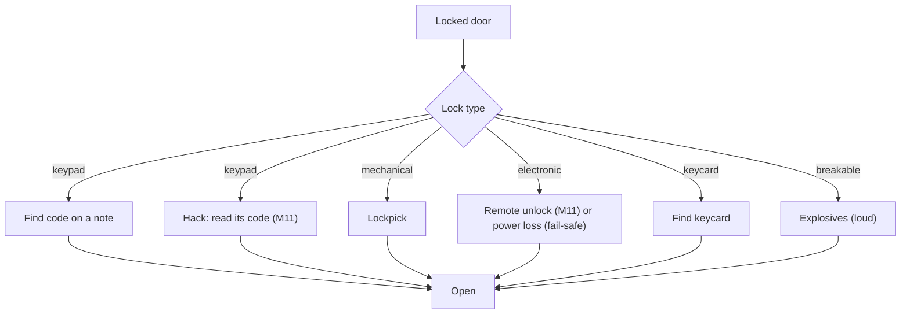

# Security

Milestone: M8 (Security wing). Network hacking (the deck, computers, firewalls, tracers) is M11: [hacking.md](hacking.md).

## Purpose

Electronic and mechanical obstacles that offer several ways through.

## Player-facing behaviour

- **Cameras** see the player even when cloaked. A camera that sees an intruder sends an incident to the alarm controller it reaches.
- **Alarms are devices** ([ADR 0075](../decisions/0075-alarms-as-network-devices.md), replaces the global `LevelAlarm`): see [Alarm devices](#alarm-devices).
- **Turret** guards an area; Cloak does not hide the player from it.
- **Breaker panel** cuts lights ([light-and-visibility.md](light-and-visibility.md)). Built in M7 ([ADR 0066](../decisions/0066-power-circuits-shootable-lights.md)): `objects/breaker_panel/breaker_panel.tscn`, a `CircuitBreaker` (a `Usable`, "E: switch off <label>" / "switch on") that switches every `Powered` on its `circuit` through the circuit's group, clunks (noise 6) and logs `power.switched`. Lamps opt in with their `Powered.circuit`; the breaker names none. The perception lab has one (circuit `perception_lab`).
- **Terminals** (M8) keep the credentials placeholder: they unlock with credentials found in the world. M11 replaces them with computers (Halcyon OS desktop, Mail, Files, Security) and the deck ([hacking.md](hacking.md), [ADR 0074](../decisions/0074-network-hacking.md)).

## Devices

Cameras, turrets, doors, keypads, sirens, alarm controllers, radio base stations, panic buttons and terminals are devices: entities with a link to the network (cable or wireless) or autonomous (no link, a maintenance port). Switches and access points connect them.

- **Power and damage**: devices, switches and access points have `Powered` and `Breakable` like any prop. Unpowering or breaking a switch or access point cuts every device behind it.
- **Standalone behaviour** when a device loses its link: a door still works locally (key, keycard, keypad) but cannot be opened remotely; a camera keeps watching but its incidents reach no controller; a turret keeps its target tags; a siren cannot be rung; a keypad accepts its code.
- **Doors on power loss**: a tag says fail-safe (unlocks) or fail-secure (stays locked). Breaking a switch can disable security but also stop you opening a door remotely.
- **Remote command interface** (M8): a command (open, lock, ring, disable, ...) is a stimulus delivered to the target device; the device's receptrons run it, blocked while it is unpowered or broken. Nothing branches on a device's identity.
- **Reach**: in M8 a device reaches another when every link and node between them is powered and unbroken (a simple physical link graph). M11 adds addresses, subnets and firewall rules on top ([hacking.md](hacking.md)).

### Built in M8 ([ADR 0077](../decisions/0077-devices-cables-and-remote-commands.md))

- **`Device`** (`objects/devices/device.gd`): the component that makes an entity a device. It mirrors `state.unpowered` (its `Powered` off) and `state.broken` (its `Breakable` depleted) into the entity's tags; up = powered and unbroken. Device scenes keep the broken husk (`Breakable.break_on_depleted` off) and hide the nodes in `broken_hide`. Saveable (`broken`).
- **Cables**: `Device.links` lists the devices it is cabled to (node paths to their entities); links are undirected, so one end is enough. A **network switch** (`objects/devices/network_switch.tscn`) is a device with links, `Powered` (the level sets its circuit) and `Breakable`. Links are invisible in M8.
- **Reach**: `DeviceGraph` (pure, `objects/devices/device_graph.gd`); `Device.graph(tree)` builds it from the level for each query. `Device.reaches(target)`; `Device.reached(type)`: the reached devices that accept `type` (one of their receivers has a receptron for it), nearest first.
- **Sending**: `Device.send_command(command, target, at = Device.NO_POINT) -> bool` emits `Stimulus.make_contact(command, 1.0, target_entity, sender_entity)` (origin `at`, or the target's position) through `StimulusSystem.emit()` only when the sender reaches the target, and logs `device.command {command, from, to, sent, point}` either way. `send_to_all(command, at)` sends to every reached device that accepts it; `report_incident(at)` sends `device.incident` (origin = the incident) that way. Senders that are not devices (the debug panel) emit `Device.command_stimulus(command, target, source, at)` themselves.
- **Receiving**: one receptron per type in `objects/devices/receptrons/` (`command_ring.tres`, ..., `device_incident.tres`), blocked on `state.unpowered` and `state.broken`, runs `DeviceActionEffect`: `Device.receive_action()` emits `action_received(action, stimulus)` for the entity's behaviour components.
- Command types (constants on `Device`): `command.open`, `command.close`, `command.lock`, `command.unlock`, `command.ring`, `command.silence`, `command.test`, `command.disarm`, `command.reset`, `command.trigger`, `command.disable`, `command.enable`, `command.broadcast` (controller to base station); `device.incident` (sensor to controller).
- Remote actions per device (open, close, lock, unlock, grant access; view feed, stop sweep, pan, disable; ...): [hacking.md](hacking.md#devices-and-their-remote-actions). M8 builds the interface; who may send which command over the network is M11.

## Alarm devices

[ADR 0075](../decisions/0075-alarms-as-network-devices.md), built in M8.

| Device | Behaviour |
|---|---|
| Alarm controller | Receives incidents from sensors (cameras, panic buttons; tracers from M11) and sends "ring" to every siren it reaches. Rings for 90 s; another incident restarts it. Remote actions: disarm, reset, trigger |
| Siren | While rung, emits a loud siren stimulus. Guards who hear it go into Searching around where they stand. Remote actions: silence, test |
| Radio base station | If the controller reaches it, broadcasts the incident location; guards with `equipment.radio` in its range search there first |
| Panic button | The old alarm panel: using it sends an incident to the controller it reaches |

- If every siren is broken, disabled or disconnected, nothing rings.
- The HUD shows "ALARM" while the player can hear a ringing siren.

Scenes (graybox, wall-mounted: origin on the wall face, +Z out; each has `Tags`, `Attributes` health, `Breakable` (metal, husk kept), `Powered` (a green LED shows while powered), `Device` and a behaviour component with `.tres` tuning):

| Scene | Component, tuning | Accepts | Behaviour |
|---|---|---|---|
| `objects/alarm/alarm_controller.tscn` | `AlarmController`, `alarm_controller.tres` (duration 90 s, ring refresh 1 s); group `alarm_controller` | `device.incident`, `command.trigger`, `reset`, `disarm`, `disable`, `enable` | An incident or a trigger rings it for 90 s (another restarts it; `AlarmTimer`). While ringing it sends `command.ring` to every reached device that accepts it, again every second, and `command.silence` when it stops; on an incident it also sends `command.broadcast` at the incident location. `reset` stops it. `disarm` (or `disable`) stops it and makes it ignore incidents and triggers until `enable` re-arms it (a power cycle does not). Losing power or breaking stops it. Saveable |
| `objects/alarm/siren.tscn` | `Siren`, `siren.tres` (loudness 35, every 1 s, ring hold 2.5 s, test 3 s) | `command.ring`, `silence`, `test` | `ring` sounds it for 2.5 s (the controller's refresh keeps it going; cut off, it falls silent within 2.5 s), `test` for 3 s, `silence` stops it. While sounding: `alarm.siren` every second (RADIUS, PATH, loudness 35: heard up to 34 m of path), a red beacon, a placeholder tone. Unpowered or broken: silent. Saveable |
| `objects/alarm/radio_base_station.tscn` | `RadioBaseStation`, `radio_base_station.tres` (range 40 m) | `command.broadcast` | Emits `alert.dispatch`, 40 m straight from the station, `about_point` = the incident; guards' `heard_dispatch` (radios) search there |
| `objects/alarm/panic_button.tscn` | `PanicButton` (a `Usable`, "E: press panic button") | | Reports an incident at the button (silent) |
| `objects/devices/network_switch.tscn` | | | Carries links; the level sets its `Powered.circuit` |

EventLog: `device.command {command, from, to, sent, point}`, `device.state {device, up, unpowered, broken}`, `device.panic {button, by, controllers}`, `alarm.raised {by, point, duration, again}`, `alarm.ended {reason}` (timeout, reset, disarmed, unpowered, broken), `alarm.armed {armed}`, `alarm.ignored {by, point}`, `siren.started {siren, by}`, `siren.stopped {siren, reason}` (silenced, timeout, unpowered, broken), `radio.dispatch {station, point, range}`.

In the hub: the AI arena ([hub-and-gallery.md](../levels/hub-and-gallery.md)) has a controller, a switch (circuit `ai_arena_network`, no breaker: shoot it) carrying two sirens, a panic button and a radio base station cabled to the controller.

## Door and lock types

- Keypad: code found in world notes. The multitool is removed ([ADR 0076](../decisions/0076-computer-skill-multitool-removed.md)): until M11 a keypad accepts only its code; from M11 it is also hackable ("read its code", [hacking.md](hacking.md)).
  - Datapads are read in place and copied to the player's personal log (not picked up). A datapad can carry codes linked to a keypad (by the keypad's code id). Once the player has read it, the keypad's entry screen shows a reminder with the known code ("Note: 0451, from 'Shift roster'"); the player still types it. A code learned any other way (a conversation, a log entry) feeds the same reminder. Data side (built, [ADR 0060](../decisions/0060-datapads-read-in-place-personal-log.md)): a datapad's `Readable.codes` maps the keypad's code id to the code; the keypad asks the user's `PersonalLog.known_code(code_id)` ("" when unknown) and `code_source(code_id)` (the entry's title) for the reminder. The gallery's "Storage access" datapad carries `storage_door: 2817`.
- Mechanical lock: lockpick, a pin-tumbler minigame ([lockpicking.md](lockpicking.md), M10). M8 builds locks as data (pin count and pin types per lock, a `Lock` component) with a pick interaction hook and a placeholder: hold LMB with a lockpick, timer scaled by `lockpick_time_mult`. M10 replaces the placeholder without touching doors.
- Electronic: the door's lock is a network device: opened remotely (from M11, with access to a machine it trusts or to the door itself), or by power loss when it is fail-safe.
- Keycard.
- Breakable: explosives.

## Rules

- Skills: Computer (the deck's tools, M11; replaces Electronics), Lockpicking (tolerances; M8 placeholder: pick time; picks break only on failure): [abilities.md](abilities.md).
- Closed doors attenuate noise along the path; doors are navigation links for guards ([perception-and-ai.md](perception-and-ai.md), [stimulus-response.md](stimulus-response.md)).
- From M10 lockpicks break only on failure, success consumes nothing ([inventory.md](inventory.md), [lockpicking.md](lockpicking.md)). There is no multitool.
- Cameras and turrets use the same perception and receiver framework.

## Interactions

- Mission office and side-door route: [../levels/mission-warehouse.md](../levels/mission-warehouse.md)
- Network hacking: [hacking.md](hacking.md). Guards and sirens: [perception-and-ai.md](perception-and-ai.md).

## Open questions

- Camera field of view and sweep, turret damage and behaviour, what M8 terminals can do, terminal content: TBD in M8. Siren loudness (35) and radio base station range (40 m): [ADR 0077](../decisions/0077-devices-cables-and-remote-commands.md).
- Guards running to panic buttons.
