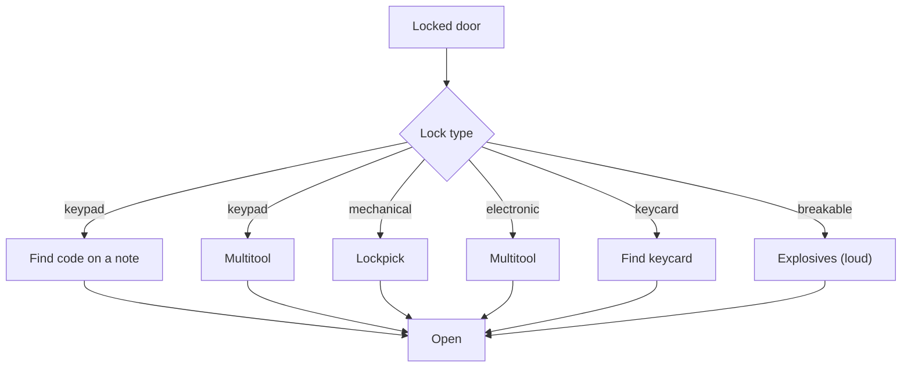

# Security

Milestone: M8 (Security wing).

## Purpose

Electronic and mechanical obstacles that offer several ways through.

## Player-facing behaviour

- **Cameras** see the player even when cloaked.
- **Alarm panel** raises the level-wide alarm; linked to cameras.
- **Turret** guards an area; Cloak does not hide the player from it.
- **Breaker panel** cuts lights ([light-and-visibility.md](light-and-visibility.md)).
- **Terminals** are unlocked with credentials found in the world. The user's own hacking design comes later ([../backlog.md](../backlog.md)).

## Door and lock types

- Keypad: code found in world notes, or multitool.
- Mechanical lock: lockpick.
- Electronic: multitool.
- Keycard.
- Breakable: explosives.

## Rules

- Skills: Electronics (bypass time / multitools used), Lockpicking (pick time / lockpicks used): [abilities.md](abilities.md).
- Closed doors attenuate noise along the path; doors are navigation links for guards ([perception-and-ai.md](perception-and-ai.md), [stimulus-response.md](stimulus-response.md)).
- Multitools and lockpicks are consumable inventory items ([inventory.md](inventory.md)).
- Cameras and turrets use the same perception and receiver framework.

## Interactions

- Mission office and side-door route: [../levels/mission-warehouse.md](../levels/mission-warehouse.md)

## Open questions

- Camera field of view and sweep, turret damage and behaviour, bypass durations, alarm duration and reset, terminal content: TBD in M8.
