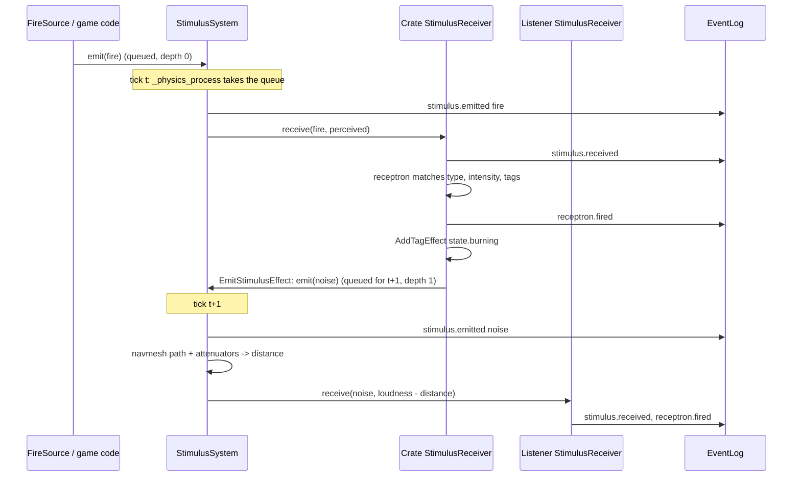
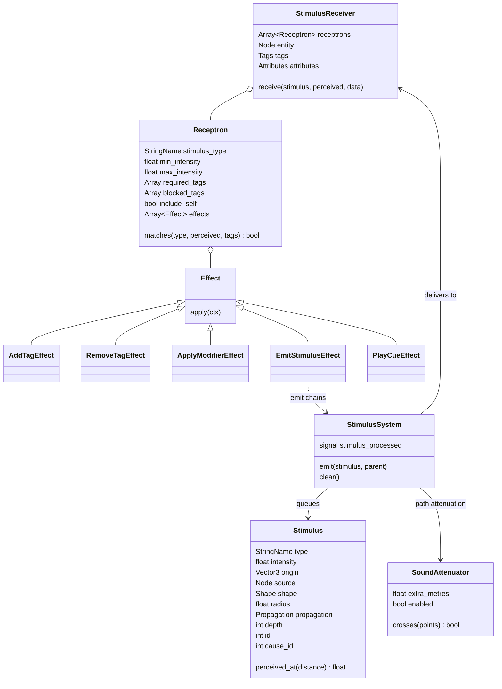
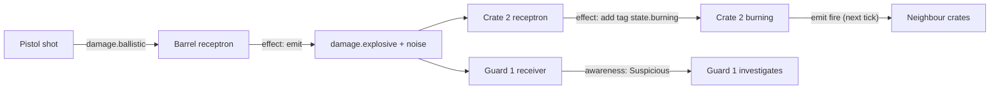

# Stimulus and response

Milestone: M2 (`StimulusSystem` autoload added in M2); M3 added LINE_OF_SIGHT propagation and `cause_id`. Used by M3 onwards.

## Purpose

The systemic core, modelled on the Dark Engine "Act/React" approach (Thief, System Shock 2). Anything that happens in the world is a stimulus; anything that can react holds receptrons. Emergent chains come from effects that emit further stimuli.

## Player-facing behaviour

The player never sees the framework directly. They see consequences: a shot barrel explodes, nearby crates burn, a guard hears the noise and investigates. Footsteps and landings already emit `noise` stimuli (M2).

## Rules

### Stimulus (`core/stimulus/stimulus.gd`)

| Field | Meaning |
|---|---|
| `type` | StringName, hierarchical: `noise`, `fire`, `damage.ballistic`, `damage.blunt`, `damage.stun`, `damage.fire`, `damage.explosive`, ... |
| `intensity` | float; for noise the loudness in audible metres ([ADR 0032](../decisions/0032-noise-loudness-audible-metres.md)) |
| `origin`, `source` | world position; the causing node (may be null) |
| `shape` | `RADIUS` (sphere of `radius`), `CONTACT` (`target` node), `RAY` (`direction` x `length`, first collider) |
| `propagation` | RADIUS only: `STRAIGHT` (straight line), `PATH` (navmesh path, used by noise) or `LINE_OF_SIGHT` (straight line, blocked by world geometry; used by fire and explosions) |
| `id`, `depth` | set by the system on emit: unique id; chain depth (0 outside processing, parent + 1 for effect emits) |
| `cause_id` | id of the stimulus that caused this one, across chains; 0 = none. `emit()` fills it with the parent's id when left at 0; components that re-emit on their own tick set it themselves (a burning crate's pulses carry the id of the stimulus that ignited it, [ADR 0046](../decisions/0046-heat-accumulation-fire-model.md)) |
| `source_label` | the source's name, remembered on emit, so the log still names a source freed before processing (a breaking crate's noise) |

Constructors: `Stimulus.make_radius()`, `make_noise(loudness, origin, source)` (intensity = radius = loudness, PATH), `make_contact()`, `make_ray()`.

### Falloff ([ADR 0038](../decisions/0038-linear-falloff-noise-metres.md))

- RADIUS: `perceived = intensity x (1 - distance / radius)`, delivered only while `distance <= radius`.
- Noise is emitted with `intensity = radius = loudness`, so `perceived = loudness - distance`: the metres of margin left. A guard with `min_intensity 2` hears a noise only from 2 m inside its audible range.
- CONTACT and RAY: `perceived = intensity`.

### Propagation and delivery

- **RADIUS / STRAIGHT**: every registered receiver within `radius` of `origin` (straight line, through walls).
- **RADIUS / PATH** ([ADR 0039](../decisions/0039-path-propagation-sound-attenuators.md)): distance = |origin to its nearest navmesh point| + navmesh path length (`NavigationServer3D.map_get_path` on the receiver's world map, usually the default 3D map) + |path end to receiver|, plus `extra_metres` of every enabled `SoundAttenuator` the straight segments of that polyline cross (each attenuator counted once).
  - No navmesh on the map, or no path found: straight-line distance (attenuators on that line still count); the reception is logged with `propagation: "straight_fallback"`.
  - Receivers further than `radius` in a straight line are skipped before any path query (a path is never shorter).
- **RADIUS / LINE_OF_SIGHT** (M3): straight-line distance, delivered only when a ray from `origin` to the receiver hits nothing on collision layer 1 (world, [ADR 0045](../decisions/0045-collision-layers.md)); the source's and the receiver entity's own bodies are excluded (a barricade on the world layer receives fire aimed at its centre; a brazier emits from inside itself). Physics objects (layer 4) never block. Logged with `propagation: "line_of_sight"`.
- **SoundAttenuator** (`core/stimulus/sound_attenuator.gd`): an `Area3D` in group `sound_attenuator` with `extra_metres` and `enabled`. Only the volumes of its `CollisionShape3D` children matter (box and sphere exact, other shapes by bounding box); no physics monitoring. M8 closed doors toggle `enabled`.
- **CONTACT**: the receivers of `target`, or of its nearest ancestor that has receivers (a hitbox delivers to its entity).
- **RAY**: `intersect_ray` from `origin` along `direction` for `length`, excluding the source body; the receivers of the first collider (same ancestor rule).
- Receivers are only delivered to when one of their receptrons matches the type (and, for own stimuli, opts in): no log noise, no path queries for deaf receivers.

### StimulusReceiver, Receptron, Effect

- **StimulusReceiver** (`Node3D` component): `receptrons: Array[Receptron]`; distances are measured to the receiver node, so put it where the entity perceives from (a guard's head). Exported paths, resolved once in `_ready`: `entity_path` (default `..`), `tags_path` (`../Tags`), `attributes_path` (`../Attributes`); the last two are optional. Registers with `StimulusSystem` in `_ready` (and on re-entry), unregisters on exit.
- **Self-exclusion**: a stimulus whose `source` is the receiver's entity (or inside it) only reaches receptrons with `include_self = true`.
- **Receptron** (Resource): `stimulus_type` (exact or ancestor: `damage` matches `damage.fire`; empty matches nothing), `min_intensity` / `max_intensity` (inclusive, on the perceived intensity; `max <= 0` = no max), `required_tags` (all), `blocked_tags` (none), `include_self`, `effects`. Every matching receptron runs its effects in order.
- **Effect** (Resource, `apply(ctx: EffectContext)`): `AddTagEffect`, `RemoveTagEffect`, `ApplyModifierEffect` (adds a copy of its `Modifier` to the entity's `Attributes`; `replace_same_source` stops stacking), `EmitStimulusEffect` (type, intensity, shape, radius, propagation, ray direction/length; origin = receiver position, source = entity, CONTACT target = the source of the stimulus reacted to), `PlayCueEffect` (one-shot `AudioStreamPlayer3D` at the receiver, freed when finished), `LogEventEffect` (records an EventLog entry of its `kind` with the stimulus id, type, perceived intensity and shape; the player's `player.hurt` stand-in until M4). Object effects live with the objects: `HeatEffect`, `DamageEffect` ([objects-and-fire.md](objects-and-fire.md)). New effect = small subclass.
- **EffectContext**: `receiver`, `entity`, `stimulus`, `perceived`, plus `tags()` / `attributes()` (null without the component).

### StimulusSystem (autoload, `core/stimulus/stimulus_system.gd`)

- `emit(stimulus, parent = null)`: assigns `id` and `depth` (depth of `parent` or of the stimulus being delivered, + 1; else 0) and queues. Beyond `MAX_DEPTH` (16) it is dropped and logged.
- `_physics_process`: takes the whole queue and delivers it FIFO. Stimuli emitted meanwhile (by effects) form the next tick's queue: no recursion.
- `clear()` drops the queue (level change, quickload). The queue is transient and not saved; tags and attributes are.
- `stimulus_processed(stimulus, paths)` signal after each delivery, with the PATH polylines and ray segments: for debug overlays only.
- There is no `process_now()`: tests drive physics frames. Note that awaiting `physics_frame` resumes before that frame's processing, so a stimulus emitted from a test is observable after two awaits.

### EventLog kinds

| Kind | Source / target | Data |
|---|---|---|
| `stimulus.emitted` | source name / contact target | `id, type, intensity, origin, depth, source, shape, cause_id` (logged when the stimulus is processed, i.e. enters the world) |
| `stimulus.received` | source name / entity name | `id, type, perceived, distance`, plus `propagation` (`straight`, `path`, `straight_fallback`, `line_of_sight`) for RADIUS |
| `receptron.fired` | source name / entity name | `id, receptron` (resource_name, else index), `effects` (class names) |
| `stimulus.dropped` | source name | `id, type, depth` |

Per receiver the reception is logged, then its receptron firings, then the next receiver.

Object and player kinds (M3, [objects-and-fire.md](objects-and-fire.md)): `object.ignited {object, by, heat}`, `object.burnt_out`, `object.exploded {object, by}`, `object.damaged {object, type, amount, health}`, `object.broken {object, reason, by, debris, contents}`, `object.impact {object, other, speed, loudness}`, `player.picked_up`, `player.dropped {object, how}`, `player.threw {object, speed}`, `player.pickup_refused {object, mass, limit}`, `player.hurt {id, type, perceived, shape}`, `debug.spawned {object, scene}`.

Tracing a fire: `object.ignited.by` is the id of the stimulus that lit it; that stimulus's `stimulus.emitted` entry names its source (the burning neighbour) and its `cause_id`, which equals the neighbour's own `object.ignited.by`; repeat until a stimulus with `cause_id` 0.

## One tick

## Class diagram

## Stimulus chain example

## Interactions

- Tags and attributes: [attributes-and-tags.md](attributes-and-tags.md)
- Noise sources and surfaces: [movement.md](movement.md)
- Fire and explosions: [objects-and-fire.md](objects-and-fire.md)
- Damage types: [damage.md](damage.md)
- Hearing and reactions: [perception-and-ai.md](perception-and-ai.md)
- Door attenuation: [security.md](security.md)
- Live log and Overlays tab: [debug-panel.md](debug-panel.md)
- Architecture: [../tech/architecture.md](../tech/architecture.md)

## Open questions

- Chain depth only follows effect emits (or an explicit `parent`). Components that re-emit on their own tick (a burning crate's periodic `fire`) start a new chain at depth 0 and link back through `cause_id` (decided in M3, [ADR 0046](../decisions/0046-heat-accumulation-fire-model.md)).
- A receiver whose nearest navmesh point is unreachable from the noise gets the partial path plus a straight tail through the wall (never shorter than the straight line). Revisit if sealed rooms hear too much.
