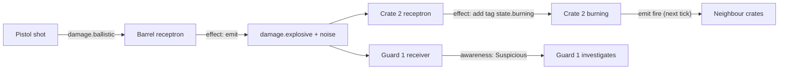
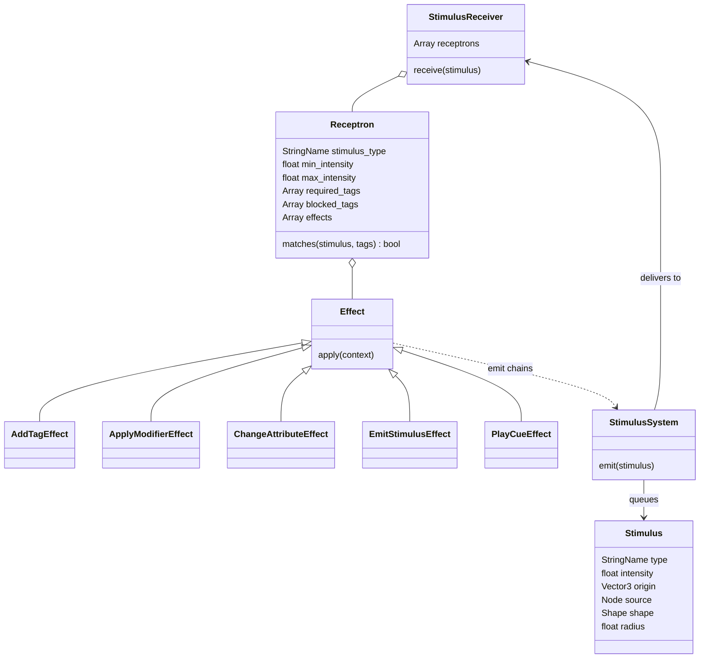

# Stimulus and response

Milestone: M2 (`StimulusSystem` autoload added in M2). Used by M3 onwards.

## Purpose

The systemic core, modelled on the Dark Engine "Act/React" approach (Thief, System Shock 2). Anything that happens in the world is a stimulus; anything that can react holds receptrons. Emergent chains come from effects that emit further stimuli.

## Player-facing behaviour

The player never sees the framework directly. They see consequences: a shot barrel explodes, nearby crates burn, a guard hears the noise and investigates.

## Rules

- **Stimulus**: type (StringName: `noise`, `fire`, `damage.ballistic`, `damage.blunt`, `damage.stun`, `damage.fire`, `damage.explosive`, ...), intensity, origin, source node, shape (`radius` | `contact` | `ray`), radius. Emitted via `StimulusSystem.emit()`.
- **Noise intensity** is the audible distance in metres ([ADR 0032](../decisions/0032-noise-loudness-audible-metres.md)).
- **Propagation**: noise travels by navmesh path distance (NavigationServer3D), attenuated by distance and by closed doors on the path. Other stimuli propagate by shape: radius sphere query, contact, ray hit.
- **StimulusReceiver** component holds **Receptrons** (Resources): stimulus type, min/max intensity, required tags, blocked tags, effects[]. A matching receptron runs its **Effects** in order.
- **Effects** (Resources): add/remove tag, apply modifier, change attribute, emit stimulus, play cue (sound/VFX). New effect types are small Resource subclasses.
- **Tick model**: processing happens in `_physics_process` on a fixed tick. Stimuli emitted while processing are queued for the next tick: no recursion, chain depth tracked.
- **EventLog**: every emit and every receptron firing is logged (tick, kind, source, target, data).
- Guard perception is just another receiver.

## Stimulus chain example

## Class diagram

Class names are illustrative; exact names settle in M2.

## Interactions

- Tags and attributes: [attributes-and-tags.md](attributes-and-tags.md)
- Noise sources and surfaces: [movement.md](movement.md)
- Fire and explosions: [objects-and-fire.md](objects-and-fire.md)
- Damage types: [damage.md](damage.md)
- Hearing and reactions: [perception-and-ai.md](perception-and-ai.md)
- Door attenuation: [security.md](security.md)
- Live log: [debug-panel.md](debug-panel.md)
- Architecture: [../tech/architecture.md](../tech/architecture.md)

## Open questions

- Exact intensity attenuation curves and values: TBD in M2.
- Class and file names: TBD in M2.
