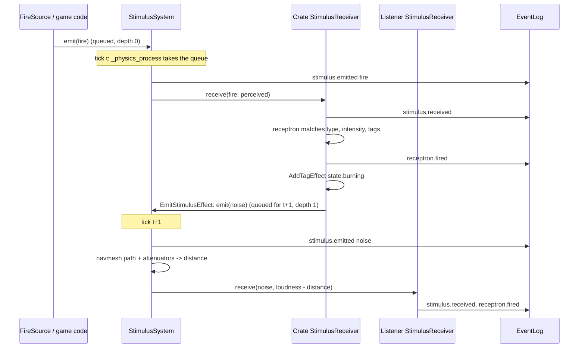
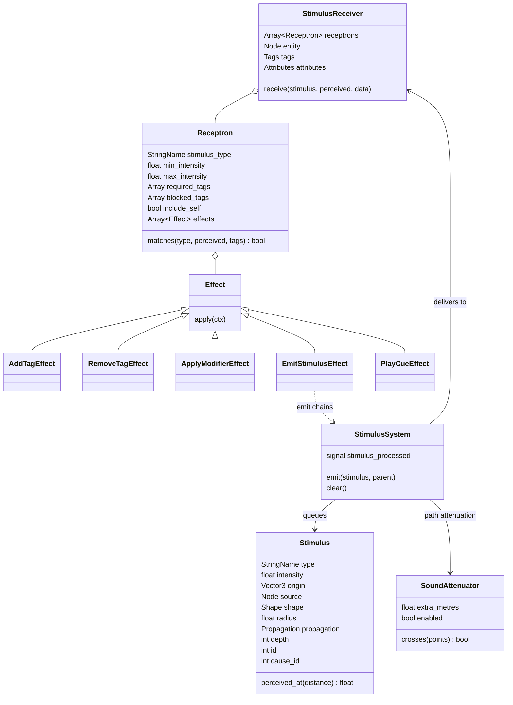
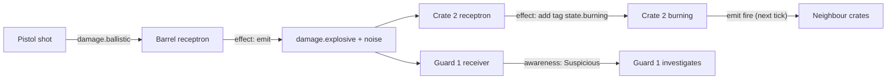

# Stimulus and response

Milestone: M2 (`StimulusSystem` autoload added in M2); M3 added LINE_OF_SIGHT propagation and `cause_id`. Used by M3 onwards.

## Purpose

The systemic core, modelled on the Dark Engine "Act/React" approach (Thief, System Shock 2). Anything that happens in the world is a stimulus; anything that can react holds receptrons. Emergent chains come from effects that emit further stimuli.

## Player-facing behaviour

The player never sees the framework directly. They see consequences: a shot barrel explodes, nearby crates burn, a guard hears the noise and investigates. Footsteps and landings already emit `noise` stimuli (M2).

## Rules

### Stimulus (`core/stimulus/stimulus.gd`)

| Field | Meaning |
|---|---|
| `type` | StringName, hierarchical: `noise`, `fire`, `damage.ballistic`, `damage.blunt`, `damage.stun`, `damage.fire`, `damage.explosive`, `force.blast`, `force.impact`, `heal`, ... |
| `intensity` | float; for noise the loudness in audible metres ([ADR 0032](../decisions/0032-noise-loudness-audible-metres.md)) |
| `origin`, `source` | world position; the causing node (may be null) |
| `shape` | `RADIUS` (sphere of `radius`), `CONTACT` (`target` node), `RAY` (`direction` x `length`, first collider on `collision_mask`, ignoring `exclude`) |
| `propagation` | RADIUS only: `STRAIGHT` (straight line), `PATH` (navmesh path, used by noise) or `LINE_OF_SIGHT` (straight line, blocked by world geometry; used by fire and explosions) |
| `id`, `depth` | set by the system on emit: unique id; chain depth (0 outside processing, parent + 1 for effect emits) |
| `cause_id` | id of the stimulus that caused this one, across chains; 0 = none. `emit()` fills it with the parent's id when left at 0; components that re-emit on their own tick set it themselves (a burning crate's pulses carry the id of the stimulus that ignited it, [ADR 0046](../decisions/0046-heat-accumulation-fire-model.md)) |
| `source_label` | the source's name, remembered on emit, so the log still names a source freed before processing (a breaking crate's noise) |
| `about_point` | (M8) the place the stimulus is about when that is not where it travels from (a radio base station's dispatch spreads from the station and names an incident); `Vector3.INF` = unset; read with `about()` (falls back to `origin`). `AwarenessEffect` SEARCH searches at `about()` ([ADR 0077](../decisions/0077-devices-cables-and-remote-commands.md)) |
| `scale_attribute`, `scale` | (M6) attribute of the source that multiplies `intensity` once, on emit (`Attributes.read(source, attribute, 1)`; empty: none); `scale` is the factor applied. What an entity puts out depends on its skills and augmentations: weapon damage (`pistol_damage_mult`, `melee_damage_mult`), a medkit's heal (`medical_heal_mult`). `would_affect()` uses the scaled intensity; `stimulus.emitted` logs `scale_attribute` and `scale` ([ADR 0061](../decisions/0061-abilities-model.md)) |

Constructors: `Stimulus.make_radius()`, `make_noise(loudness, origin, source)` (intensity = radius = loudness, PATH), `make_contact()`, `make_ray()`.

Forces and healing are stimuli too ([ADR 0057](../decisions/0057-forces-item-use-and-heat-as-generic-systems.md)):

| Type | Shape | Intensity | Emitted by | Reacted to by |
|---|---|---|---|---|
| `force.blast` | RADIUS, LINE_OF_SIGHT | impulse in N s at the centre, linear falloff to 0 at the radius; direction = origin to the receiving entity | `Explosive` (`ExplosiveConfig.impulse` / `impulse_radius`) | every `PhysicsObject` (`pushed_by_force` receptron, `ApplyImpulseEffect`, lift 0.3) |
| `force.impact` | RAY | impulse in N s along `stimulus.direction`, at the hit `position` | ranged weapons (`WeaponData.impact_impulse`) | every `PhysicsObject` (same receptron) |
| `heal` | CONTACT on the user | health restored, split over damaged parts | consumable items (`ItemData.use_stimuli`) | characters (`heal` receptron, `HealEffect`, `include_self`) |

Devices and alarms (M8, [ADR 0077](../decisions/0077-devices-cables-and-remote-commands.md); shouts and radio: [perception-and-ai.md](perception-and-ai.md)):

| Type | Shape | Intensity | Emitted by | Reacted to by |
|---|---|---|---|---|
| `command.*` (`open`, `close`, `lock`, `unlock`, `ring`, `silence`, `test`, `disarm`, `reset`, `trigger`, `disable`, `enable`, `broadcast`) | CONTACT on the target device's entity; origin = a point (the incident for `broadcast`) or the target | 1 | `Device.send_command()` (only when the sender reaches the target), the debug panel | devices' receptrons (`objects/devices/receptrons/`, blocked on `state.unpowered`, `state.broken`), `DeviceActionEffect` |
| `device.incident` | CONTACT on an alarm controller; origin = the incident | 1 | `Device.report_incident()` (panic button; cameras later) | alarm controllers (`device_incident` receptron) |
| `alarm.siren` | RADIUS, PATH | loudness 35 (= radius), every 1 s while a siren sounds | `Siren` | characters (`heard_siren` receptron, margin >= 1, `HeardAlarmEffect` -> `AlarmHearing`) |
| `alert.dispatch` | RADIUS, STRAIGHT, 40 m from the station; `about_point` = the incident | 1 | `RadioBaseStation` on `command.broadcast` | radios (`heard_dispatch`, requires `equipment.radio`, `AwarenessEffect` SEARCH, reason `radio`) |

### Falloff ([ADR 0038](../decisions/0038-linear-falloff-noise-metres.md))

- RADIUS: `perceived = intensity x (1 - distance / radius)`, delivered only while `distance <= radius`. A `uniform` RADIUS stimulus has no falloff: `perceived = intensity` anywhere inside (a gas cloud's `damage.stun.gas` dose, an EMP's `emp`; M14b, [ADR 0131](../decisions/0131-grenades-mines-and-effects.md#as-built-m14b-the-four-effects)).
- Noise is emitted with `intensity = radius = loudness`, so `perceived = loudness - distance`: the metres of margin left. A guard with `min_intensity 2` hears a noise only from 2 m inside its audible range.
- CONTACT and RAY: `perceived = intensity`.

### Propagation and delivery

- **RADIUS / STRAIGHT**: every registered receiver within `radius` of `origin` (straight line, through walls).
- **RADIUS / PATH** ([ADR 0039](../decisions/0039-path-propagation-sound-attenuators.md)): distance = |origin to its nearest navmesh point| + navmesh path length (`NavigationServer3D.map_get_path` on the receiver's world map, usually the default 3D map, on every navigation layer: noise crosses a locked door's link, which characters may not path through, [ADR 0078](../decisions/0078-doors-locks-and-door-navigation.md)) + |path end to receiver|, plus `extra_metres` of every enabled `SoundAttenuator` the straight segments of that polyline cross (each attenuator counted once).
  - No navmesh on the map, or no path found: straight-line distance (attenuators on that line still count); the reception is logged with `propagation: "straight_fallback"`.
  - Partial paths ([ADR 0094](../decisions/0094-noise-reach-on-partial-paths.md)): a path stops short when the origin is on a navmesh island (a cabinet top) or the receiver is unreachable. A gap at either end longer than 0.6 m counts only through open air: a ray between its ends, lifted 0.25 m and trimmed 0.1 m at each end, straight or round one corner, hits no world geometry (layer 1). Otherwise a path from the receiver back to the origin is tried with the same rule; when both are blocked the stimulus does not reach that receiver (no per-wall penalty).
  - Receivers further than `radius` in a straight line are skipped before any path query (a path is never shorter).
- **RADIUS / LINE_OF_SIGHT** (M3): straight-line distance, delivered only when a ray from `origin` to the receiver hits nothing on collision layer 1 (world, [ADR 0045](../decisions/0045-collision-layers.md)); the source's and the receiver entity's own bodies are excluded (a barricade on the world layer receives fire aimed at its centre; a brazier emits from inside itself). Physics objects (layer 4) never block. Logged with `propagation: "line_of_sight"`.
- **SoundAttenuator** (`core/stimulus/sound_attenuator.gd`): an `Area3D` in group `sound_attenuator` with `extra_metres` and `enabled`. Only the volumes of its `CollisionShape3D` children matter (box and sphere exact, other shapes by bounding box); no physics monitoring. M8 doors enable it while less than half open (+6 m; [security.md](security.md)).
- **CONTACT**: the receivers of `target`, or of its nearest ancestor that has receivers (a hitbox delivers to its entity).
- **RAY**: `intersect_ray` from `origin` along `direction` for `length` on `collision_mask` (default all layers; weapons use `PhysicsLayers.WEAPON_MASK`: world, objects, hitboxes), excluding the source body and the `exclude` RIDs (a shooter's own hitboxes); the receivers of the first collider (same ancestor rule). M4, [ADR 0047](../decisions/0047-hitboxes-layer-5-part-aware-ray.md).
- **Delivery data** (M4): receivers pass it to their effects (`EffectContext.data`). CONTACT: `distance` 0 and `collider` (the target node). RAY: `distance`, `collider` (the node hit, e.g. a hitbox), `position` and `normal`. RADIUS: `distance`, `propagation`. `ctx.collider()` returns the collider; body-part damage reads the hitbox's `body_part` from it.
- Receivers are only delivered to when one of their receptrons matches the type (and, for own stimuli, opts in): no log noise, no path queries for deaf receivers.

### StimulusReceiver, Receptron, Effect

- **StimulusReceiver** (`Node3D` component): `receptrons: Array[Receptron]`; distances are measured to the receiver node, so put it where the entity perceives from (a guard's head). Exported paths, resolved once in `_ready`: `entity_path` (default `..`), `tags_path` (`../Tags`), `attributes_path` (`../Attributes`); the last two are optional. Registers with `StimulusSystem` in `_ready` (and on re-entry), unregisters on exit.
- **Self-exclusion**: a stimulus whose `source` is the receiver's entity (or inside it) only reaches receptrons with `include_self = true`.
- **Receptron** (Resource): `stimulus_type` (exact or ancestor: `damage` matches `damage.fire`; empty matches nothing), `min_intensity` / `max_intensity` (inclusive, on the perceived intensity; `max <= 0` = no max), `required_tags` (all), `blocked_tags` (none), `include_self`, `effects`. Every matching receptron runs its effects in order.
- **Effect** (Resource, `apply(ctx: EffectContext)`; `can_apply(ctx) -> bool`, default true, says whether apply() would change anything, asked by the dry run below): `AddTagEffect`, `RemoveTagEffect`, `ApplyModifierEffect` (adds a copy of its `Modifier` to the entity's `Attributes`; `replace_same_source` stops stacking), `EmitStimulusEffect` (type, intensity, shape, radius, propagation, ray direction/length, `scale_attribute`; origin = receiver position, source = entity, CONTACT target = the source of the stimulus reacted to), `ChangeAttributeEffect` (M6: adds perceived x `per_intensity` to an attribute's base, clamped to `min_value` and the value of `max_attribute`; can_apply only when the entity has the attribute and it would change: a biocell at full energy), `PlayCueEffect` (one-shot `AudioStreamPlayer3D` at the receiver, freed when finished), `LogEventEffect` (records an EventLog entry of its `kind` with the stimulus id, type, perceived intensity and shape; a stand-in reaction before a system exists), `ApplyImpulseEffect` (pushes a `RigidBody3D` entity with the perceived intensity as an impulse in N s; RADIUS away from the origin tilted up by `radial_lift`, RAY and CONTACT along `stimulus.direction`, at the RAY hit `position` when there is one; [ADR 0057](../decisions/0057-forces-item-use-and-heat-as-generic-systems.md)). Object effects live with the objects: `HeatEffect`, `DamageEffect` ([objects-and-fire.md](objects-and-fire.md)); characters use `BodyDamageEffect` ([damage.md](damage.md)), `HealEffect` (`heal` -> `BodyParts.heal`, can_apply only when alive and hurt) and `AwarenessEffect` (M7: NOISE / HARM / ALERT reported to the entity's `Awareness`; receptrons `heard_noise` on a floor-level `Ears` receiver and `harmed`, [perception-and-ai.md](perception-and-ai.md)). New effect = small subclass.
- **The core effects are the framework** (audit 2026-11-13, Q34): `AddTagEffect`, `RemoveTagEffect`, `ApplyModifierEffect`, `EmitStimulusEffect`, `LogEventEffect` and `PlayCueEffect` are kept for any receptron `.tres` to compose, though no shipped receptron uses them today (shipped content uses the specialised effects above). Each is covered by `tests/core/stimulus/effects/effects_test.gd` and the stimulus chain tests; do not delete one because content does not use it yet.
- **EffectContext**: `receiver`, `entity`, `stimulus`, `perceived`, `data` (delivery data, above), plus `tags()` / `attributes()` (null without the component) and `collider()`.

### StimulusSystem (autoload, `core/stimulus/stimulus_system.gd`)

- `emit(stimulus, parent = null)`: assigns `id` and `depth` (depth of `parent` or of the stimulus being delivered, + 1; else 0) and queues. Beyond `MAX_DEPTH` (16) it is dropped and logged.
- `_physics_process`: takes the whole queue and delivers it FIFO. Stimuli emitted meanwhile (by effects) form the next tick's queue: no recursion.
- `emit_now(stimulus)` ([ADR 0057](../decisions/0057-forces-item-use-and-heat-as-generic-systems.md)): outside stimulus processing it delivers at once (a deliberate act from input or UI: using an item, also while the inventory screen pauses the game); called from an effect during processing it queues like `emit()`. What its effects emit is queued as its children.
- `would_affect(stimulus)`: dry run of a CONTACT stimulus: true when delivering it now would run an effect whose `can_apply()` is true (same type, intensity, tag and self rules as delivery; nothing run or logged). Other shapes: true. Used to refuse a consumable that would do nothing.
- `clear()` drops the queue (level change, quickload). The queue is transient and not saved; tags and attributes are.
- `stimulus_processed(stimulus, paths)` signal after each delivery, with the PATH polylines and ray segments: for debug overlays only.
- There is no `process_now()`: tests drive physics frames. Note that awaiting `physics_frame` resumes before that frame's processing, so a stimulus emitted from a test is observable after two awaits.

### EventLog kinds

The EventLog has two roles ([ADR 0136](../decisions/0136-event-kinds-and-entity-attribution.md)): `entry_added` is the stream of gameplay events, and the 2000-entry ring buffer is history for the debug panel and scenario tests. Gameplay consumers (mission tallies and objectives, hit markers, network feedback) listen to `entry_added` and keep what they need; they never read back through the buffer. Every kind is a constant in `EventKinds` (`events/event_kinds.gd`); emitters record and consumers match the constants, never literals. Kinds name events (`<subject>.<what happened>`: `actor.died`, `actor.awareness`) and are never tags, though both are dotted. An entry's source, target and Node data values are display names in the entry and the entities themselves behind it (`EventLogEntry.entity()`, `source_entity()`, `target_entity()`): consumers decide who did something by the entity's tags (`actor.player`), never by its name. The kinds gameplay reads and the keys it reads are documented on their constants and checked by `tests/events/event_contract_*_test.gd`.

| Kind | Source / target | Data |
|---|---|---|
| `stimulus.emitted` | source entity / contact target entity | `id, type, intensity, origin, depth, source, shape, cause_id` (logged when the stimulus is processed, i.e. enters the world) |
| `stimulus.received` | source name / entity name | `id, type, perceived, distance`, plus `propagation` (`straight`, `path`, `straight_fallback`, `line_of_sight`) for RADIUS; `collider` (name) for CONTACT and RAY, `position` and `normal` for RAY |
| `receptron.fired` | source name / entity name | `id, receptron` (resource_name, else index), `effects` (class names) |
| `stimulus.dropped` | source name | `id, type, depth` |

Per receiver the reception is logged, then its receptron firings, then the next receiver.

Object and player kinds (M3, [objects-and-fire.md](objects-and-fire.md)): `object.ignited {object, by, heat}`, `object.burnt_out`, `object.exploded {object, by}`, `object.damaged {object, type, amount, health}`, `object.broken {object, reason, by, debris, contents}`, `object.impact {object, other, speed, loudness}`, `carry.picked_up`, `carry.dropped {object, how}`, `carry.threw {object, speed}`, `carry.pickup_refused {object, mass, limit}`, `debug.spawned {object, scene}`.

Damage and weapon kinds (M4, [damage.md](damage.md), [weapons-and-aiming.md](weapons-and-aiming.md)): `actor.damaged {actor, part, type, amount, health, by}`, `actor.stunned {actor, amount, stun, behind, aware, by}`, `actor.knocked_out {actor, stun, by}`, `actor.died {actor, by}`, `actor.healed {actor, amount, requested}`, `actor.reset {actor, by}` (RestoreEffect), `item.use_refused {object, reason}`, `weapon.equipped`, `weapon.holstered`, `weapon.fired {weapon, magazine, spread, hit}`, `weapon.swung {weapon, hit}`, `weapon.dry_fire`, `weapon.reload_started`, `weapon.reloaded`, `weapon.refused {weapon, reason}`, `level.reset {scene}`. `by` is the id of the damaging stimulus. (`player.hurt` from M3 is gone: the `body_damage` receptron replaced it.)

Character component kinds ([ADR 0056](../decisions/0056-generic-character-components.md)): `actor.footstep {mode, surface, loudness}` and `actor.landed {impact_speed, surface, loudness}` (MovementNoise; were `player.footstep` / `player.landed`), `actor.struck {actor, object, speed, damage}` (ImpactSensor), `actor.knocked_back {actor, impulse, speed}` (Knockback). Awareness (M7, [ADR 0068](../decisions/0068-awareness-states-and-guard-behaviour.md)): `actor.awareness {actor, from, to, reason, meter, point}`, `actor.heard {actor, perceived, point}`, `actor.bark {actor, line, from, to}`.

### What characters receive ([ADR 0056](../decisions/0056-generic-character-components.md))

Generic components and receptrons any character composes (the player has all of them; the static training dummy `body_damage`, `heal`, `restore` and an inactive ImpactSensor):

| Stimulus | From | Receptron / effect | Result |
|---|---|---|---|
| `damage.*` | weapons, fire, explosions, `ImpactNoise`, `ImpactSensor` | `body_damage` (`BodyDamageEffect`, x1) | body-part damage ([damage.md](damage.md)) |
| `damage.fall` CONTACT, intensity = impact speed (m/s), source = the faller | `FallImpact` on the character itself (touchdown at 3 m/s or more) | `fall_damage` (`include_self`; `BodyDamageEffect` threshold 10, x16, legs 50/50) | (v - 10) x 8 per leg; `body_damage` skips it (own stimulus) |
| `damage.blunt` CONTACT, source = the prop | `ImpactSensor` on a body props pass through (the player), when a prop flies into it | `body_damage` | kinetic energy / 40, as `ImpactNoise` |
| `force.blast` RADIUS, intensity = impulse (N s) at the centre, linear falloff | explosions | `knockback` on `force` (`KnockbackEffect`) | shove away from the origin towards the receiver |
| `force.impact` RAY, intensity = impulse (N s) | weapon hits | `knockback` | shove along the ray |
| `heal` CONTACT on the user, x the user's `medical_heal_mult` | medkit use; Regeneration (2 every 0.5 s, unscaled, only while something is hurt) | `heal` (`HealEffect`) | split over the damaged parts |
| `restore` CONTACT on the body (intensity unused) | a training dummy's `use` / `reset()`, the range's "Reset dummies" button (to bodies that cannot act) | `restore` (`include_self`; `RestoreEffect`) | `BodyParts.reset()`: full health, `state.dead` / `state.unconscious` removed (without BodyParts: the two tags removed); `actor.reset` |
| `energy` CONTACT on the user, intensity = energy | biocell use (25) | `energy` (`actors/common/abilities/receptrons/energy.tres`, `ChangeAttributeEffect` on `energy`, max `energy_max`) | restores energy; refused when full ([abilities.md](abilities.md)) |

Jamming is a tag, not a stimulus ([ADR 0138](../decisions/0138-surfaces-jamming-tag-and-tuning-configs.md)): a jamming field adds `state.jammed` to every entity with Tags inside it and removes it as they leave or the field ends. The `heard_radio` and `heard_dispatch` receptrons (`AwarenessEffect.radio`) drop a radio message, logging `radio.jammed {type, id}`, when the receiving entity or the stimulus source carries it.

Inventory kinds (M5, [inventory.md](inventory.md)): `item.picked_up {item, count, left}`, `item.pickup_refused {item, count, reason}`, `item.dropped {item, count}`, `item.used {item, action}`, `item.use_refused {item, reason}` (was `{object, reason}` for the M4 world medkit), `debug.gave_item {item, count}`.

Ability kinds (M6, [abilities.md](abilities.md)): `skill.tier_changed {skill, tier, name}`, `augmentation.activated {id, energy}`, `augmentation.deactivated {id, reason}` (toggled, depleted, uninstalled), `augmentation.refused {id, reason}` (no_energy, not_installed), `augmentation.installed {id, installed}`.

Tracing a fire: `object.ignited.by` is the id of the stimulus that lit it; that stimulus's `stimulus.emitted` entry names its source (the burning neighbour) and its `cause_id`, which equals the neighbour's own `object.ignited.by`; repeat until a stimulus with `cause_id` 0.

## One tick

## Class diagram

## Stimulus chain example

## Interactions

- Tags and attributes: [attributes-and-tags.md](attributes-and-tags.md)
- Noise sources and surfaces: [movement.md](movement.md)
- Fire and explosions: [objects-and-fire.md](objects-and-fire.md)
- Damage types: [damage.md](damage.md)
- Hearing and reactions: [perception-and-ai.md](perception-and-ai.md)
- Door attenuation and door commands: [security.md](security.md)
- Door commands (`command.open` / `close` / `lock` / `unlock`, table above): the Door and its Lockable act on the Device's `action_received` ([ADR 0078](../decisions/0078-doors-locks-and-door-navigation.md))
- Live log and Overlays tab: [debug-panel.md](debug-panel.md)
- Architecture: [../tech/architecture.md](../tech/architecture.md)

## Open questions

- Chain depth only follows effect emits (or an explicit `parent`). Components that re-emit on their own tick (a burning crate's periodic `fire`) start a new chain at depth 0 and link back through `cause_id` (decided in M3, [ADR 0046](../decisions/0046-heat-accumulation-fire-model.md)).
