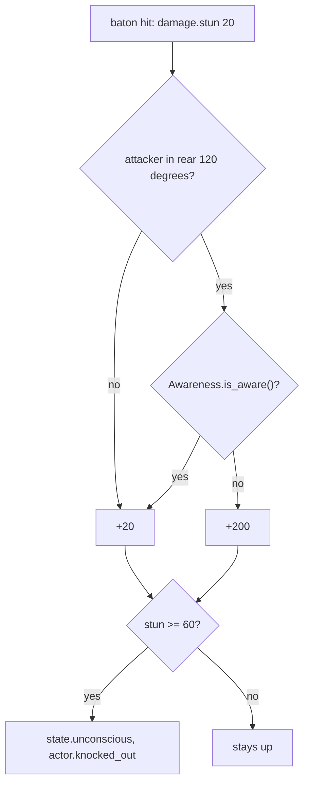

# Weapons and aiming

Milestone: M4 (Shooting range). Systems done in M4; the gallery room is built on top of them.

## Purpose

One lethal and one non-lethal weapon, with a softened Deus Ex 1 aiming model.

## Player-facing behaviour

- **Silenced pistol** (lethal), **stun baton** (non-lethal), carried as inventory items (M5, [inventory.md](inventory.md)). Their belt key draws them; the same key again holsters. LMB fires or swings, R reloads from the pistol ammo in the inventory.
- The reticle circle is the exact spread cone; shots always land inside it. Standing still it settles over about 0.8 s (untrained) to a small circle; walking, sprinting, jumping, mouse look, each shot and arm injuries widen it.
- The baton is quiet up close: one hit from behind on an unaware target knocks it out; from the front or on an aware target it takes three.

## Rules

### Aim model ([ADR 0048](../decisions/0048-aim-model.md))

`AimModel` (`items/weapons/aim_model.gd`, pure) holds the spread (half-angle of the cone, degrees) for one `WeaponHolder`; tuning in `items/weapons/aim_untrained.tres` (`AimConfig`).

| Quantity | Value |
|---|---|
| Floor standing still | 0.5 degrees (`base_min_deg`; about 0.17 m radius at 20 m, head-sized) |
| Crouched and still | base x0.8 = 0.4 |
| Walking / crouch-walking (> 0.5 m/s) | base + 3 = 3.5 |
| Sprinting | base + 6 = 6.5 |
| Airborne (after 0.1 s off the ground) | base + 6 = 6.5 |
| Arm penalty | + `aim_spread_add` (3 per disabled arm) |
| Settle | exponential toward the floor, time constant `settle_time` 0.8 s (M6 Pistols skill lowers it to 0.2) |
| Mouse look | +0.02 degrees per pixel moved, at most +2 per physics frame |
| Per shot | +2.5 |
| Max | 10 |

- Each physics step: if the floor is above the spread, the spread jumps to it (moving widens at once); otherwise the excess decays as `exp(-dt / settle_time)`. After one time constant 37 % of the excess is left, after 5 less than 1 %. Within 0.005 degrees of the floor the spread snaps onto it, so a settled cone is exactly `base_min_deg`.
- A shot direction is sampled uniformly on the cone's disk: radius tan(spread) x sqrt(u), angle 2 pi v, from a `RandomNumberGenerator` owned by the holder (`rng_seed`, `seed_rng()`; tests seed it).
- **Sway**: a slow figure-of-eight drift of the aim point, amplitude 0.15 degrees x `aim_sway_mult` (x2 per disabled arm), 0.35 Hz. The cone (and the reticle) is centred on the swayed aim.
- **Reticle** (HUD): circle radius in pixels = tan(spread) / tan(fov / 2) x viewport height / 2 (vertical fov 80 degrees: 3.4 px at rest and 44 px sprinting on a 648 px viewport; no minimum gap, the ring is always the real cone), plus a centre dot that shrinks (2 px down to 0.8 px) with a tight cone so it does not cover the ring; melee weapons and holstered show only the dot.

### Weapons (`items/weapons/`)

- `WeaponData` Resource per weapon (`pistol/pistol.tres`, `baton/baton.tres`): damage stimuli, cycle time, range, ammo, sweep radius, noises, impulse, sounds, placeholder view model (a box in front of the camera). The view model hangs off a pivot at the grip (`view_offset`; `view_box_offset`, `view_rest_deg`, `view_swing_deg`, `view_chop_share` in the `.tres`): the pistol's box turns about its centre, the baton is held pointing up and forward (about 60 degrees, tilted inwards) and a swing chops down across the view about the grip, then returns more slowly. Visual only: the swing timing and the hit sweep are unchanged.
- `WeaponState` (pure, unit-tested): magazine, cooldown, reload timer; spare rounds come from an `AmmoPool` (a plain count for fixed loadouts, or `InventoryAmmo`: the inventory's stacks of the weapon's `ammo_item`, smallest first). Results: `FIRED`, `DRY` (empty magazine: click, waits a cycle), `BUSY` (cycle running), `RELOADING`.
- `WeaponHolder` (node, child of the player's camera): the equipped `WeaponState`, the `AimModel`, the view model and sounds. Armed either from a fixed loadout (`weapons`, `equip(index)`; saveable; guards in M7) or with `equip_state()` from an inventory weapon stack (the player since M5: `PlayerInventory` owns one state per pistol stack and mirrors its magazine into the stack's `magazine`).

| | Silenced pistol | Stun baton |
|---|---|---|
| Damage | `damage.ballistic` 25 RAY (x2 on the head) | `damage.stun` 20 + `damage.blunt` 5 CONTACT |
| Reach | ray 60 m along the sampled direction | sphere r 0.2 m swept along the view until its front is 1.8 m from the camera (no spread) |
| Layers hit | world, objects, hitboxes (`WEAPON_MASK`) | same |
| Rate | 0.35 s between shots | 0.6 s per swing |
| Ammo | magazine 10, reload 1.6 s (R) from `pistol_ammo` stacks (HUD: magazine / rounds in the inventory); `reserve_ammo` 30 only for fixed loadouts | none |
| Noise (PATH) | 6 m at the muzzle, 4 m at the hit point | 3 m swing (from the eye), 6 m on a hit (at the hit point) |
| Physics objects hit | `force.impact` 3 N s at the hit point (an explosive barrel's 25 health: one shot) | blunt 5 (stun x0 on objects) |
| Sounds | shot: `kenney_impact-sounds/impactPunch_medium_000-002` (a muffled thud reads as suppressed; random pitch); hit: `impactGeneric_light_000`; dry: `kenney_interface-sounds/click_002`; reload: `Hollywood/Heavy Gun Reload` (-8 dB) | swing: `Medieval/Weapon Whoosh` (-10 dB); hit: `impactPunch_heavy_000` |

- The baton hit is resolved when the swing starts; the rest of the 0.6 s is the animation and cooldown.
- A shot is one immediate ray (impact point, impact noise, hit sound) plus one RAY stimulus per damage entry and a `force.impact` RAY (intensity `impact_impulse` N s) with the same origin and direction, delivered on the next tick. The push is no longer applied by the weapon: whatever the ray hits and has a `force` receptron (every physics prop) pushes itself at the hit point ([ADR 0057](../decisions/0057-forces-item-use-and-heat-as-generic-systems.md)). A shot at an object carried by someone else is not possible: `fire` throws while carrying.
- Both arms disabled, dead or unconscious: `trigger()` refuses (`weapon.refused {weapon, reason}`).
- EventLog: `weapon.equipped`, `weapon.holstered`, `weapon.fired {weapon, magazine, spread, hit}`, `weapon.swung {weapon, hit}`, `weapon.dry_fire`, `weapon.reload_started {weapon, time}`, `weapon.reloaded {weapon, magazine}`, `weapon.refused`.

### Stun and knockout ([ADR 0049](../decisions/0049-knockout-rules-awareness.md))

- `damage.stun` adds stun points to `BodyParts.stun` (x the profile's `damage.stun` multiplier) instead of health. At 60 (`knockout_threshold`): tag `state.unconscious`, signal `knocked_out`, EventLog `actor.knocked_out {actor, stun, by}`; a dummy tips over. Each hit logs `actor.stunned {actor, amount, stun, behind, aware, by}`.
- **From behind**: the attacker (the stimulus source) stands inside the 120 degree arc centred on the target's back (horizontal plane; `StunRules.is_behind`). From behind on a target whose `Awareness.is_aware()` is false: stun x10 (200: instant knockout). Otherwise 20 per hit: three hits.
- `Awareness` (`actors/common/awareness/awareness.gd`) is a stand-in interface: `is_aware()` returns the exported `aware` flag (dummies: false). M7 guard perception implements it. Characters without the component (the player) count as aware.
- Stun points do not decay in v0; dummies reset with E.

## Interactions

- Skills: Pistols (accuracy, settle, reload), Low-Tech (baton damage/speed, knockout threshold): [abilities.md](abilities.md).
- Damage types and parts: [damage.md](damage.md).
- Shots emit stimuli ([stimulus-response.md](stimulus-response.md)); guards hear the 6 m muzzle noise and the impact noise in M7 ([perception-and-ai.md](perception-and-ai.md)); shooting lights: [light-and-visibility.md](light-and-visibility.md).
- Controls: [controls.md](controls.md). Ammo and items: [inventory.md](inventory.md). Combat Strength strengthens melee: [abilities.md](abilities.md).

## Open questions

- Auto-reload on an empty magazine (DX1 does it): v0 clicks dry until R.
- View models are placeholder boxes; real meshes and muzzle flash later.
- Pistol noise 6 m is quiet by design (silenced); revisit with M7 guards.
