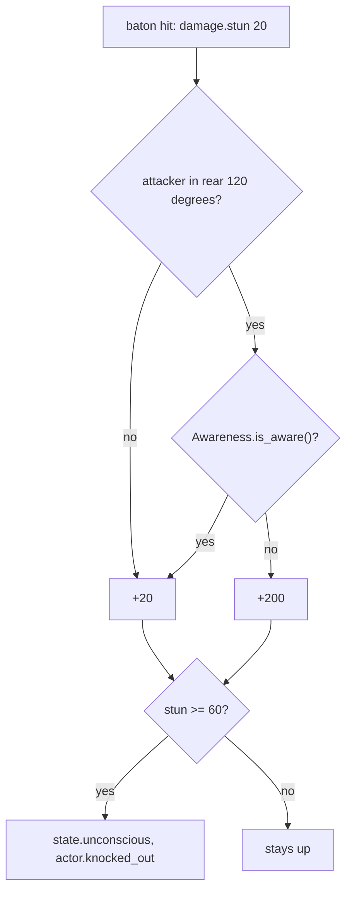

# Weapons and aiming

Milestone: M4 (Shooting range). Systems done in M4; the gallery room is built on top of them. Shotgun, sniper rifle, assault rifle and the silencer: [ADR 0085](../decisions/0085-weapons-and-attachments.md).

## Purpose

Lethal weapons with distinct roles and one non-lethal weapon, with a softened Deus Ex 1 aiming model; being quiet is a choice (fit a silencer), not a property of the starting gun.

## Player-facing behaviour

- **Pistol** (lethal, loud: guards hear it about 25 m away), **stun baton** (non-lethal), and in the shooting range a **shotgun**, **sniper rifle** and **assault rifle**, carried as inventory items (M5, [inventory.md](inventory.md)). Their belt key draws them; the same key again holsters. LMB fires or swings, R reloads from the weapon's own ammo in the inventory.
- Shotgun: 8 pellets a shot, deadly up close, weak at range. Sniper rifle: wild from the hip; **RMB toggles the scope** (press to zoom in, press again to zoom out; it also comes off when you reload, switch or put the weapon away, or are knocked out): the view zooms to 15 degrees, the reticle becomes a black scope overlay with a thin crosshair and a thin ring (the aim cone), mouse look slows to match; held still, the ring shrinks to near-perfect in about 1.4 s. Assault rifle: **hold LMB** for full-auto, releasing stops; the spread grows with each shot and recovers when you stop.
- **Silencer**: an item; in the Inventory tab drag it onto the pistol, sniper rifle or assault rifle (they light up while you drag; the shotgun does not take one). It stays on for good: shots are a quarter as loud (pistol 25 m to 6.25 m), there is no muzzle flash, the shot sound is a muffled thud, and the silencer shows on the gun in your hands and on the floor when dropped. The weapon's name reads "Pistol (silenced)".
- The crosshair (four arms around a dot, Deus Ex style; M13a) opens to the exact spread cone: shots always land inside the circle its arms' inner ends trace. Standing still it settles over about 0.8 s (untrained) to its still cone (Master: none, the shot lands on the dot); walking a little, sprinting, jumping, mouse look, each shot and arm injuries widen it. On something a weapon can damage within the gun's range, the arms get "T" caps.
- **Recoil** (M13a): automatic weapons (assault rifle, submachine gun) climb along a learnable pattern while LMB is held; the camera climbs with it and comes back by itself about 0.4 s after you let go; pull the mouse down to keep the spray on target. The pistol kicks up a little per shot and is back before the next; the shotgun and sniper kick hard and a scoped sniper shot blacks the lens out for a moment.
- **Submachine gun** (M13a): 30 rounds of pistol ammo, fast and controllable up close, weak past about 15 m (its damage falls off).
- The baton is quiet up close: one hit from behind on an unaware target knocks it out; from the front or on an aware target it takes three. It breaks a security device in one or two hits and the turret in six, within 1.8 m of the eye ([security.md](security.md#breaking-devices)).

## Rules

### Aim model ([ADR 0048](../decisions/0048-aim-model.md))

`AimModel` (`items/weapons/aim_model.gd`, pure) holds the spread (half-angle of the cone, degrees) for one `WeaponHolder`; tuning per weapon (`AimConfig`: `pistol/pistol_aim.tres`, `assault_rifle/assault_rifle_aim.tres`, `smg/smg_aim.tres`, the sniper's two; `items/weapons/aim_untrained.tres` for weapons without their own: the shotgun). The table gives the pistol's numbers (M13a, [ADR 0123](../decisions/0123-recoil-and-skill-aim.md)); every `AimConfig` value is an `@export_range` the range's tuning panel lists.

| Quantity | Pistol | Assault rifle | SMG |
|---|---|---|---|
| Still floor (`base_min_deg`) x the shooter's `<class>_still_mult` | 2.0 (Pistols: x1 / 0.875 / 0.75 / 0: 2.0 / 1.75 / 1.5 / 0) | 1.0 (Rifles: x1 / 0.4 / 0.2 / 0) | 1.0 (Pistols) |
| Crouched and still | still floor x0.8 | same | same |
| Walking / crouch-walking (> 0.5 m/s), x `<class>_spread_mult` | +0.6 | +0.8 | +0.5 |
| Sprinting | +4 | +4 | +3 |
| Airborne (after 0.1 s off the ground) | +6 | +6 | +5 |
| Arm penalty | + `aim_spread_add` (3 per disabled arm) | same | same |
| Settle time constant (`settle_time`, x `<class>_settle_time` for Pistols and Sniper; x0.6 crouched) | 0.8 s (Pistols: 0.8 / 0.6 / 0.4 / 0.2 s) | 0.5 s | 0.3 s (Pistols x) |
| Mouse look, per pixel (cap 2 per frame) | +0.02 | +0.01 | +0.01 |
| Per shot, x `<class>_spread_mult` | +0.8 | +1.4 up to 5 | +0.5 up to 6 |
| Max | 10 | 10 | 10 |

`<class>_spread_mult`: Pistols x1.0 / 0.8 / 0.6 / 0.4, Rifles x1.0 / 0.65 / 0.5 / 0.4, Sniper x1.0 / 0.8 / 0.6 / 0.4. The shotgun's default cone (`aim_untrained.tres`): still 0.5, walking +0.75, sprinting +4, airborne +6, settle 0.8, +2.5 per shot. Measured on a torso-sized plate at 10 m (`tests/items/weapons/aim_tiers_test.gd`): pistol, a shot a second, 56 / 80 / 92 / 100 % by tier; assault rifle, 10-shot sprays pulling against the pattern, 31 / 49 / 67 / 87 % (targets of [ADR 0120](../decisions/0120-weapon-feel.md) +-10).

- Skills scale weapons through the holder's attributes, never through a skill check ([ADR 0061](../decisions/0061-abilities-model.md)): `WeaponData.attribute_class` (`pistol`, `rifle`: assault rifle and shotgun, `sniper`, `melee`) names them, `<class>_damage_mult` (damage stimuli via `Stimulus.scale_attribute`, not the `force.impact`), `<class>_cycle_mult` (cycle_time), `<class>_reload_mult` (reload_time), `<class>_spread_mult` (movement terms, bloom and the pellet cone: `pellet_spread_deg` x it), `<class>_still_mult` (the still floor, M13a), `<class>_recoil_size_mult`, `_recoil_noise_mult`, `_recoil_recover_mult` (recoil, M13a), `<class>_settle_time`, `<class>_sway_mult` (x `aim_sway_mult`). Pistols: damage x1.1 / 1.2 / 1.3, reload 1.6 s x0.85 / 0.7 / 0.5. Rifles and Sniper ([ADR 0101](../decisions/0101-rifles-and-sniper-skills.md)): spread x0.8 / 0.6 / 0.4 (Rifles x0.65 / 0.5 / 0.4 since M13a; shotgun pellet cone 2.5 degrees down to 1.0 at Master), reload x0.85 / 0.7 / 0.5, damage x1.1 / 1.2 / 1.3; Sniper also settle x0.8 / 0.6 / 0.4 and sway x0.75 / 0.5 / 0.25. Low-Tech: baton damage x1.25 / 1.5 / 2.0 (stun 25 / 30 / 40: frontal knockout in 3 / 2 / 2 hits), swing 0.6 s x0.9 / 0.8 / 0.7. Combat Strength: melee damage x1.5 on top ([abilities.md](abilities.md)).
- Each physics step: if the floor is above the spread, the spread jumps to it (moving widens at once); otherwise the excess decays as `exp(-dt / settle_time)`. After one time constant 37 % of the excess is left, after 5 less than 1 %. Within 0.005 degrees of the floor the spread snaps onto it, so a settled cone is exactly `base_min_deg`.
- A shot direction is sampled uniformly on the cone's disk: radius tan(spread) x sqrt(u), angle 2 pi v, from a `RandomNumberGenerator` owned by the holder (`rng_seed`, `seed_rng()`; tests seed it).
- **Sway**: a slow figure-of-eight drift of the aim point, amplitude 0.15 degrees x `aim_sway_mult` (x2 per disabled arm) x `<class>_sway_mult` (Sniper: x0.75 / 0.5 / 0.25), 0.35 Hz. The cone (and the reticle) is centred on the swayed aim.
- **Crosshair** (HUD `Reticle`, user request 2026-11-12, [ADR 0123](../decisions/0123-recoil-and-skill-aim.md)): four arms (up, down, left, right) whose inner ends sit at the cone's screen radius = tan(spread) / tan(fov / 2) x viewport height / 2 (no minimum gap), 11 px long at a 1080 px tall viewport (scaled with the height), 2 px thick with a 1 px dark outline, plus a centre dot that shrinks (2 px down to 0.8 px) with a tight cone. The whole crosshair moves by the aim offset (sway and the recoil climb the camera does not follow). When the aim (a ray along the shot direction, the weapon's layers, its `max_range`) is on something a weapon can damage (a hitbox, or an entity with `BodyParts` or `Breakable`: `Reticle.is_target()`), each arm gets a 7 px cap across its outer end. White; `Hud._target_color()` is the hook for colouring by hostility once factions exist. Melee weapons and holstered show only the dot; scoped, the scope overlay replaces it.

### Weapons (`items/weapons/`)

- `WeaponData` Resource per weapon (`pistol/pistol.tres`, `shotgun/shotgun.tres`, `sniper_rifle/sniper_rifle.tres`, `assault_rifle/assault_rifle.tres`, `baton/baton.tres`): damage stimuli, cycle time, range, ammo, sweep radius, noises, impulse, sounds, projectiles per shot (`pellets`, `pellet_spread_deg`), `automatic`, its own aim cone (`aim_config`) and scope (`scope_fov`, `scope_time`, `scope_aim_config`), the attachment slots it accepts (`attachment_slots`), its `grip` (which arms an animated character raises, [ADR 0103](../decisions/0103-character-models-and-animation.md): every shipped weapon is `ONE_HAND` since [ADR 0105](../decisions/0105-character-model-playtest-fixes.md); `TWO_HAND` still works for a weapon whose data asks for it) and its hold in a character's fist (`hold_rotation_deg`, Euler degrees about the hand mount, whose -Z runs out of the fist along the forearm, and `hold_offset`: the baton (90, 0, 0) stands upright across the fist, the guns point along the forearm, the long guns shifted forward so the grip sits in the fist), and the view model: a model scene (`view_scene`, a `WeaponModel` from the Kenney Blaster Kit, [ADR 0085](../decisions/0085-weapons-and-attachments.md)) or a placeholder box (`view_size`, `view_color`; the baton, the guards' pistol). `WeaponView` (the holder's child "ViewPivot") draws it from a pivot at the grip (`view_offset`; `view_box_offset`, `view_rest_deg`, `view_swing_deg`, `view_chop_share` in the `.tres`), moved on screen by the holder's `view_shift_deg` (degrees right and down, the same angle for every weapon: the pivot moves by its depth x tan(angle); the player's holder (3, 9) keeps the models low in the corner, guards 0; [ADR 0101](../decisions/0101-rifles-and-sniper-skills.md)): guns kick back, the long guns are turned 3 degrees inwards, the baton is held pointing up and forward (about 60 degrees, tilted inwards) and a swing chops down across the view about the grip, then returns more slowly. Visual only: the swing timing and the hit sweep are unchanged. A model's `muzzle` marker (or the end of a fitted muzzle attachment) is where the flash shows and the shot noise starts. On a character with an animated model (guards) the view hangs from its right hand instead (`WeaponView.hang_from()`: the grip at the fist, turned and shifted by the weapon's hold data, between the fists for two-handed weapons, 1.3x size, recoil kept, the arm's animation doing the melee chop); shots still leave the eye ([ADR 0103](../decisions/0103-character-models-and-animation.md)).
- `WeaponState` (pure, unit-tested): magazine, cooldown, reload timer; spare rounds come from an `AmmoPool` (a plain count for fixed loadouts, or `InventoryAmmo`: the inventory's stacks of the weapon's `ammo_item`, smallest first). Results: `FIRED`, `DRY` (empty magazine: click, waits a cycle), `BUSY` (cycle running), `RELOADING`.
- `WeaponHolder` (node, child of its user's eye: the player's camera, a guard's `Aim` node; [ADR 0070](../decisions/0070-guard-combat-and-loadouts.md)): the equipped `WeaponState`, the `AimModel`, the view model and sounds. It reads no input: whoever drives it points the eye and calls `physics_step(delta, stance, floor_add)` and `trigger()`, so any actor fires through the same code and stimuli (guards: [perception-and-ai.md](perception-and-ai.md#combat)). Armed either from a fixed loadout (`weapons`, `equip(index)`; saveable; guards' loadouts `guard_pistol.tscn`, `guard_baton.tscn`) or with `equip_state()` from an inventory weapon stack (the player since M5: `PlayerInventory` owns one state per pistol stack and mirrors its magazine into the stack's `magazine`).

The submachine gun (`smg/smg.tres`, M13a, Kenney `blaster-a` at 0.6 scale): `damage.ballistic` 9 RAY with damage falloff (full to 8 m, x0.25 from 22 m), reach 40 m, 0.07 s automatic, magazine 30 of `pistol_ammo`, reload 1.8 s, the Pistols skill (`attribute_class` `pistol`), a `muzzle` slot (silencer), noise 22 m (silenced 5.5) and 4 m at the hit, flash 0.1 m, `force.impact` 1.5 N s, Titan Handgun -8 dB; its own cone and recoil (tables above). Carried by two warehouse guards (`guard_smg.tscn`) and on the shooting range's second rack.

| | Pistol | Shotgun | Sniper rifle | Assault rifle | Stun baton |
|---|---|---|---|---|---|
| Damage | `damage.ballistic` 25 RAY (x2 on the head) | 8 pellets x `damage.ballistic` 12 RAY, evenly-random in a 2.5 degree half-angle cone around the aimed direction | `damage.ballistic` 90 RAY | `damage.ballistic` 14 RAY | `damage.stun` 20 + `damage.blunt` 5 CONTACT |
| Reach | ray 60 m along the sampled direction | 30 m | 150 m | 80 m | sphere r 0.2 m swept along the view until its front is 1.8 m from the camera (no spread) |
| Aim cone | the holder's (`aim_untrained.tres`, Pistols skill) | the holder's (Rifles skill) | (Sniper skill) hip `sniper_hip_aim.tres`: floor 6 degrees; scoped `sniper_scope_aim.tres`: floor 0.2, settle 0.3 s, look bloom 0.01 per px | (Rifles skill) `assault_rifle_aim.tres`: floor 1.0, +0.25 per shot up to 6, settle 0.5 s | none |
| Layers hit | world, objects, hitboxes (`WEAPON_MASK`) | same | same | same | same |
| Rate | 0.35 s between shots | 0.9 s | 1.4 s | 0.1 s, automatic while LMB is held | 0.6 s per swing |
| Ammo | magazine 10, reload 1.6 s (R) from `pistol_ammo` stacks (HUD: magazine / rounds in the inventory); `reserve_ammo` 30 only for fixed loadouts | 6, reload 2.4 s, `shotgun_shells` | 5, reload 2.5 s, `sniper_rounds` | 30, reload 2.2 s, `rifle_rounds` | none |
| Noise (PATH) | 25 m at the muzzle (silenced 6.25), 4 m at the hit point | 30 m, 5 m at the first pellet's hit | 35 m (silenced 8.75), 5 m | 28 m (silenced 7), 4 m | 3 m swing (from the eye), 6 m on a hit (at the hit point) |
| Muzzle flash | 0.12 m (none silenced) | 0.2 m | 0.15 m | 0.12 m | none |
| Physics objects hit | `force.impact` 3 N s at the hit point (an explosive barrel's 25 health: one shot) | 1 N s per pellet | 6 N s | 2 N s | blunt 5 (stun x0 on objects) |
| Attachment slots | `muzzle` | none | `muzzle` | `muzzle` | none |
| Sounds | shot: `Hollywood/Titan Handgun` (-4 dB); silenced: `kenney_impact-sounds/impactPunch_medium_000-002` (a muffled thud; random pitch); hit: `impactGeneric_light_000`; dry: `kenney_interface-sounds/click_002`; reload: `Hollywood/Heavy Gun Reload` (-8 dB) | Titan Handgun +2 dB | Titan Handgun +4 dB; silenced: impactPunch | Titan Handgun -6 dB, random pitch; silenced: impactPunch | swing: `Medieval/Weapon Whoosh` (-10 dB); hit: `impactPunch_heavy_000` |

Measured on a standing guard body, torso-centred, 8 fixed seeds (`tests/items/weapons/weapon_outcomes_test.gd`): shotgun one shot at 5 m on every seed, 1 to 3 shots at 15 m (median 2: its upper pellets reach the model-sized head, [ADR 0105](../decisions/0105-character-model-playtest-fixes.md); the user kept this strength); sniper rifle scoped and still one torso shot at 40 m (the scoped cone settles to 0.25 degrees in 1.4 s); assault rifle at Master held on the torso at 10 m, pulling against the recoil, kills in 0.43 s (7 seeds; 0.53 s on one). Submachine gun (`tests/items/weapons/smg_test.gd`, a component shooter pulling the recoil): Untrained at 5 m 0.60-0.73 s; at 20 m Master 1.3 s against the rifle's 0.43-1.33 s, Untrained no kill within a magazine (the rifle kills in 2 of 4 runs). Untrained against Master ([ADR 0101](../decisions/0101-rifles-and-sniper-skills.md), `tests/items/weapons/long_gun_skills_test.gd`): assault rifle 30-round group at 15 m pulling the recoil, mean distance from its centre 0.73 / 0.37 m; sniper scoped settle to 0.25 degrees 1.40 / 0.28 s (to its floor 2.13 / 0.75 s); shotgun pellets on a 0.5 m plate at 10 m 2 to 5 / 8 of 8.

### Recoil and damage falloff (M13a, [ADR 0123](../decisions/0123-recoil-and-skill-aim.md))

- `WeaponData.recoil` (a `RecoilConfig`, `<weapon>_recoil.tres`) and `RecoilState` (pure, the holder's `recoil`; on in holders with `recoil_enabled`: the player's, off on guards until M13b). Angles in degrees, x right, y up. Each shot leaves along the aim climbed by the earlier shots, then adds its step: an automatic weapon's `pattern[floor(heat)]` (the pattern repeats from `loop_from` past its end), else a kick (`kick_up_deg` up, up to `kick_side_deg` sideways at random), times `pattern_scale` x `<class>_recoil_size_mult`, plus noise (uniform +-`noise_deg` x `<class>_recoil_noise_mult` per axis). `recover_delay` s after the last shot the climb and the heat decay with time constant `recover_time` x `<class>_recoil_recover_mult` (snap below 0.01 degrees); a burst after a short pause starts part-way along the pattern.

| | Pistol | Shotgun | Sniper rifle | Assault rifle | SMG |
|---|---|---|---|---|---|
| Per shot | kick 1.2 up, +-0.4 side | kick 4 up, +-1 | kick 5 up, +-1 | 20-step pattern: 3.4 up over 10 shots, then side to side | 20-step pattern: 1.6 up and 1.3 right over 10 shots, then side to side |
| Noise | 0.1 | 0.3 | 0.2 | 0.2 | 0.3 |
| Return | at once, tau 0.06 s (back in ~0.2 s) | tau 0.08 s | tau 0.08 s; scoped: the lens blacks out, fading over 0.3 s | after 0.12 s, tau 0.12 s (90 % back 0.4 s after the last shot) | after 0.09 s, tau 0.11 s |

- Skills (all three gun skills): size x1.5 / 1.33 / 1.17 / 1, noise x2 / 1.5 / 1 / 0.5, return time x1 / 0.85 / 0.7 / 0.55.
- **Camera**: the eye's owner turns the eye by `RecoilState.view_recoil()` (`view_share` of the climb) and the holder adds the rest (`unfollowed()`) to the shots, so bullets follow the whole climb whatever the share. The player's share is the camera motion setting (`GameSettings.camera_motion()`, [ADR 0124](../decisions/0124-settings-profile.md)); its Camera node turns by it on top of mouse look (`pitch` and the yaw), so pulling the mouse down compensates. The crosshair moves by the unfollowed part. `settle()` (tests, level start) puts the recoil back to rest.
- **Damage falloff** (`WeaponData.falloff_start`, `falloff_end`, `falloff_min`): a projectile hitting d metres from the eye deals its damage x 1 up to the start, linearly down to `falloff_min` at the end and beyond. The SMG only: 8 m, 22 m, 0.25 (x0.625 at 15 m).
- **Automatic fire keeps its rhythm**: a held trigger's next cycle is shortened by the time the last one ran out before the physics step ended (`WeaponState.try_fire(keep_rhythm)`), so the SMG's 0.07 s cycle averages 0.07 s at 60 Hz.
- Measured (`recoil_state_test`, `recoil_holder_test`, `recoil_camera_test`): Untrained rifle 10-shot climb 5.2 up; the camera 90 % back 0.38 s after the release; at camera motion 0 the camera does not move and the bullets climb as far (1.24 m against 1.18 m at 15 m); a Master spray pulled against the pattern stays within 3 cm of the aim height at 8 m (29 cm above without pulling).

### Pellets, full-auto, scope, attachments ([ADR 0085](../decisions/0085-weapons-and-attachments.md))

- **Pellets** (`PelletPattern`, pure): pellet i lands in the i-th of n angular sectors, jittered inside it, at a radius uniform over the disk's area: no clumps or holes, never the same twice. Each pellet is its own damage and force ray from the shot's origin; one impact noise and hit sound per shot, at the first pellet's hit. `weapon.fired` logs `projectiles` and `hits`.
- **Automatic** (`WeaponData.automatic`): the holder fires again each `cycle_time` while `trigger_held` is true, checked before the cooldown ticks (exactly one shot per cycle, a shot at once on the press). An empty magazine ends the burst (no dry clicks); releasing stops it at once. The player sets `trigger_held` from LMB every tick (hold, not toggle; never while carrying or holding a non-weapon item). AI shooters (CombatBehaviour) hold it for bursts of 3-5 shots ([ADR 0088](../decisions/0088-weapon-drops-and-bursts.md), the rifle guard).
- **Item of a weapon** (`WeaponData.item_id`, M9): the inventory item a weapon is; a character's fixed-loadout weapon drops as that item ([ADR 0088](../decisions/0088-weapon-drops-and-bursts.md)). The guards' `pistol_unsilenced` drops as `pistol`.
- **Cause of a holder's stimuli** (`WeaponHolder.cause_id`, M9): when set, every shot, swing and noise names it as its cause; a turret sets it to the last command it obeyed so its kills trace back to whoever sent it ([ADR 0087](../decisions/0087-mission-systems.md)).
- **Sustained-fire bloom**: `AimConfig.shot_bloom_cap_deg` caps how far shots bloom the cone (a stance floor above the cap is not narrowed); the cone recovers through the normal settle when firing stops.
- **Scope** (`ScopeState`, pure): RMB (`alt_fire`) toggles it when the weapon has one (`scope_fov` > 0), the user can use its arms and it is not reloading. Each physics step it scopes out by itself when that stops being true (reload, knocked out, arms disabled); switching or holstering drops it at once. The zoom moves at 1 / `scope_time` per second. While scoped: the holder uses `scope_aim_config`, the view model is hidden, the shot noise starts at the eye; the player's camera FOV is `scope.view_fov()` (80 to 15 degrees), mouse sensitivity and look bloom scale by FOV / 80; the HUD shows the `ScopeOverlay` (black outside a lens of 0.46 x the screen height, thin crosshair, the cone as a thin red ring, all moved by the sway) instead of the reticle. Not a pause screen: the game keeps running. EventLog `weapon.scoped {weapon, scoped, reason}` (`toggle`, `auto`, `reload`).
- **Attachments**: a weapon stack's state records what is fitted (`attachments: {slot: item id}`); `WeaponState.attach()` adds the attachment's `Modifier`s to the weapon's stats and `stat(name)` reads any numeric `WeaponData` property through them. The holder reads `fire_noise`, `impact_noise`, `fire_volume_db`, `muzzle_flash_size` and `suppressed` (> 0: `suppressed_fire_sound`) through `stat()`. Silencer: noise x0.25, flash x0, volume -2 dB, suppressed. Fitting: [inventory.md](inventory.md#attachments).

- The baton hit is resolved when the swing starts; the rest of the 0.6 s is the animation and cooldown.
- A shot is one immediate ray (impact point, impact noise, hit sound) plus one RAY stimulus per damage entry and a `force.impact` RAY (intensity `impact_impulse` N s) with the same origin and direction, delivered on the next tick. The push is no longer applied by the weapon: whatever the ray hits and has a `force` receptron (every physics prop) pushes itself at the hit point ([ADR 0057](../decisions/0057-forces-item-use-and-heat-as-generic-systems.md)). A shot at an object carried by someone else is not possible: `fire` throws while carrying.
- Both arms disabled, dead or unconscious: `trigger()` refuses (`weapon.refused {weapon, reason}`).
- EventLog: `weapon.equipped`, `weapon.holstered`, `weapon.fired {weapon, magazine, spread, hit, projectiles, hits, noise}`, `weapon.swung {weapon, hit}`, `weapon.dry_fire`, `weapon.reload_started {weapon, time}`, `weapon.reloaded {weapon, magazine}`, `weapon.refused`, `weapon.scoped {weapon, scoped, reason}`.

### Stun and knockout ([ADR 0049](../decisions/0049-knockout-rules-awareness.md))

- `damage.stun` adds stun points to `BodyParts.stun` (x the profile's `damage.stun` multiplier) instead of health. At 60 (`knockout_threshold`): tag `state.unconscious`, signal `knocked_out`, EventLog `actor.knocked_out {actor, stun, by}`; a dummy tips over. Each hit logs `actor.stunned {actor, amount, stun, behind, aware, by}`.
- **From behind**: the attacker (the stimulus source) stands inside the 120 degree arc centred on the target's back (horizontal plane; `StunRules.is_behind`). From behind on a target whose `Awareness.is_aware()` is false: stun x10 (200: instant knockout). Otherwise 20 per hit: three hits.
- `Awareness` (`actors/common/awareness/awareness.gd`) is a stand-in interface: `is_aware()` returns the exported `aware` flag (dummies: false). M7 guard perception implements it. Characters without the component (the player) count as aware.
- Stun points do not decay in v0; dummies reset with E.

## M13 weapon feel ([ADR 0120](../decisions/0120-weapon-feel.md))

**M13a, built** ([ADR 0123](../decisions/0123-recoil-and-skill-aim.md)): the still cone per tier and the retuned cones (Aim model above), recoil and damage falloff (above), the submachine gun (Weapons above), the Deus Ex crosshair, the shooting range's tools ([ADR 0125](../decisions/0125-shooting-range-tools.md)) and the settings menu ([ADR 0124](../decisions/0124-settings-profile.md)). Kept: the shotgun's one-shot kill at 5 m, the scoped sniper's one torso shot at 40 m; the assault rifle kills at 10 m in 0.43 s at Master pulling the recoil (Untrained it often takes over a second: its spray hits about 30 %). Guards keep their aim model and fire without recoil until M13b (holder `weapon_aim` and `recoil_enabled` off; the rifle guard keeps its old cone in `actors/guard/guard_rifle_aim.tres`).

**M13b**

- Hit markers (subtle; distinct for a headshot and a kill), impacts by material (metal, concrete, wood, glass; capped, fading), a small dark-red puff on body hits, a blue-white spark for stun hits, tracers on automatic weapons and guards' shots.
- Getting hit: the view kicks and spread grows for ~0.3 s; a guard flinches (next shot ~0.3 s later), a limb hit staggers it.
- Guards obey weapon spread and recoil, compensating ~70 %, retuned so the ADR 0070 survival targets hold (at least 3 s at 10 m, about 2 s at 4 m).
- Weapon motion by code (kick, sway, bob, reload, draw; no arms), a slight camera shake on firing, per-weapon sounds layered from the packs in the project with an indoor/outdoor echo tail.

## Interactions

- Skills: Pistols (cone, settle, reload, damage), Rifles (assault rifle and shotgun: cone and pellet cone, reload, damage), Sniper (cone, settle, sway, reload, damage), Low-Tech (baton damage and swing speed): [abilities.md](abilities.md). Cloak (`state.cloaked`) draws the view model at 30 % opacity.
- Damage types and parts: [damage.md](damage.md).
- Shots emit stimuli ([stimulus-response.md](stimulus-response.md)); guards hear the muzzle noise (pistol 25 m, 6.25 m silenced) and the impact noise in M7 ([perception-and-ai.md](perception-and-ai.md)); shooting lights: [light-and-visibility.md](light-and-visibility.md) (a muzzle flash is a real 4 m light for 0.06 s; silenced weapons have none).
- **Guards' pistol** (`items/weapons/pistol/pistol_unsilenced.tres`, ADR 0070): the same numbers as the player's unsilenced pistol (muzzle noise 25 m, `muzzle_flash_size` 0.12: a `MuzzleFlash`, an unshaded box at the front of the gun and a 4 m light for 0.06 s), drawn as the placeholder box. Guards' loadouts did not change with ADR 0085. Guards aim with their own `AimConfig` (`actors/guard/guard_aim.tres`: floor 0 standing, +3 walking, no shot bloom, sway 0.1) whose floor the combat component raises with its range, target-speed and settle terms.
- Controls: [controls.md](controls.md). Ammo and items: [inventory.md](inventory.md). Combat Strength strengthens melee: [abilities.md](abilities.md).

## Open questions

- Auto-reload on an empty magazine (DX1 does it): v0 clicks dry until R.
- The baton and the guards' pistol are still placeholder boxes; the muzzle flash is a placeholder box and light.
- The Rifles skill scales the assault rifle and the shotgun (`attribute_class` `rifle`), the Sniper skill the sniper rifle (`sniper`), like Pistols: spread, reload, damage; Sniper also settle and sway ([ADR 0101](../decisions/0101-rifles-and-sniper-skills.md), [abilities.md](abilities.md)).
- All loud guns share the one gunshot sound in the project (Titan Handgun) at different volumes; per-weapon sounds come in M13b ([ADR 0120](../decisions/0120-weapon-feel.md)).
- Detaching attachments: not possible by design (user decision); other attachments (scopes, extended magazines) would be new `AttachmentData` with modifiers.
