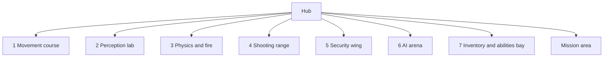

# Hub and gallery

Milestone: hub in M0; rooms arrive with their system milestones.

## Purpose

A central graybox hub with doorways to seven test rooms (one per system, each with spawnable elements) and the mission area. Rooms double as manual test spaces ([../tech/playtest-checklist.md](../tech/playtest-checklist.md)).

## Rooms

| # | Room | Tests | Milestone | Docs |
|---|---|---|---|---|
| 1 | Movement course | Walk, crouch, sprint, jump, mantle, vents, footstep noise | M1 | [movement](../game/movement.md) |
| 2 | Perception lab | Light levels, shootable lights, breaker, guard vision over different floors | M7 | [light](../game/light-and-visibility.md), [perception](../game/perception-and-ai.md) |
| 3 | Physics and fire | Throwable, breakable, flammable, explosive objects; fire spread | M3 | [objects](../game/objects-and-fire.md) |
| 4 | Shooting range | Per-part dummies, damage readouts | M4 | [damage](../game/damage.md), [weapons](../game/weapons-and-aiming.md) |
| 5 | Security wing | Camera, alarm panel, turret, keypad/lock/keycard/breakable doors, terminal | M8 | [security](../game/security.md) |
| 6 | AI arena | Guard group, patrols, escalation, body discovery, waking | M7 | [perception](../game/perception-and-ai.md) |
| 7 | Inventory and abilities bay | Items of every footprint, stats menu | M5, M6 | [inventory](../game/inventory.md), [abilities](../game/abilities.md) |

The mission area is described in [mission-warehouse.md](mission-warehouse.md).

## Hub

30 x 30 m, 5 m high, doorways 2 x 3 m. The player spawns at `PlayerSpawn` (0, 0, 10) facing the north wall (doorways 1 and 2). Each room scene is instanced in `levels/hub/hub.tscn` behind its doorway, with its origin on the outer face of the hub wall.

## 1 Movement course

`levels/gallery/movement/movement_course.tscn`, instanced at hub (-7.5, 0, -15.5). Built-in CSG with collision, Label3D signs. A 4 m corridor leads into a 26 x 52 m hall, 8 m high. Local coordinates: -Z points away from the hub.

| Area | Local position | Contents |
|---|---|---|
| Surface strips | z -5 to -19 | Five 3 x 14 m strips, raised 2 cm: concrete, carpet, wood, metal, grass, each with `surface` metadata, a distinct colour and a floor label |
| Ledges | faces at z -24 | 0.5, 1.0, 1.5, 1.9 m (mantleable, orange) and 2.3 m (not mantleable, red; Speed aug target) |
| Vent | x -4, z -24 to -29.6, then to x -11 | Metal duct, 1.2 m wide, 1.0 m high. Mouth on the 1.5 m ledge line (mantle in, ends crouched), 5 m straight, 90° turn, 20° down-ramp, exit at floor level facing the gap track |
| Low ceiling | x 4 to 7.5, z -24 to -30 | 3 m wide crawl space under a 1.2 m ceiling (blocked uncrouch) |
| Gap track | x -17 to -13 | 30° ramp to a 2 m high walkway: runway, 2 m gap (walk jump), platform, 3.3 m gap (sprint jump), platform with a 2 m drop off its end |
| Drop tower | x 4 to 7.5, z -32 to -44.7 | 30° ramp to a 5 m platform, drop off its far end |

Gap labels come from the jump numbers in [../game/movement.md](../game/movement.md): a flat jump covers about 2.6 m from walk and 3.8 m from sprint, so 2 m is a walk jump and 3.3 m needs a sprint jump (a walk jump falls short). Integration tests (`tests/levels/gallery/movement/`) check the strips, ledges, vent crawl, both gaps and the walk from the hub into the course.

## Rules

- Levels are CSG graybox (csg_blockout addon); fiction is abstract ([ADR 0010](../decisions/0010-fiction-graybox.md)).
- Level scenes live in `levels/hub/` and `levels/gallery/<room>/`.
- Each room supports spawning its elements via the debug panel ([../game/debug-panel.md](../game/debug-panel.md)).

## Open questions

- Room dimensions and layout of rooms 2 to 7: TBD per room milestone. Doorways without a room lead into the void for now (the player respawns at the hub spawn when falling out).
