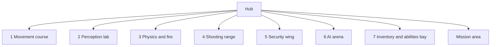

# Hub and gallery

Milestone: hub in M0; rooms arrive with their system milestones.

## Purpose

A central graybox hub with doorways to seven test rooms (one per system, each with spawnable elements) and the mission area. Rooms double as manual test spaces ([../tech/playtest-checklist.md](../tech/playtest-checklist.md)).

## Rooms

| # | Room | Tests | Milestone | Docs |
|---|---|---|---|---|
| 1 | Movement course | Walk, crouch, sprint, jump, mantle, vents, footstep noise | M1 | [movement](../game/movement.md) |
| 2 | Perception lab | Light levels, shootable lights, breaker, guard vision over different floors | M7 | [light](../game/light-and-visibility.md), [perception](../game/perception-and-ai.md) |
| 3 | Physics and fire | Throwable, breakable, flammable, explosive objects; fire spread | M3 | [objects](../game/objects-and-fire.md) |
| 4 | Shooting range | Per-part dummies, damage readouts | M4 | [damage](../game/damage.md), [weapons](../game/weapons-and-aiming.md) |
| 5 | Security wing | Camera, alarm panel, turret, keypad/lock/keycard/breakable doors, terminal | M8 | [security](../game/security.md) |
| 6 | AI arena | Guard group, patrols, escalation, body discovery, waking | M7 | [perception](../game/perception-and-ai.md) |
| 7 | Inventory and abilities bay | Items of every footprint, stats menu | M5, M6 | [inventory](../game/inventory.md), [abilities](../game/abilities.md) |

The mission area is described in [mission-warehouse.md](mission-warehouse.md).

## Rules

- Levels are CSG graybox (csg_blockout addon); fiction is abstract ([ADR 0010](../decisions/0010-fiction-graybox.md)).
- Level scenes live in `levels/hub/` and `levels/gallery/<room>/`.
- Each room supports spawning its elements via the debug panel ([../game/debug-panel.md](../game/debug-panel.md)).

## Open questions

- Room dimensions, layout and doorway placement: TBD in M0 (hub) and per room milestone.
