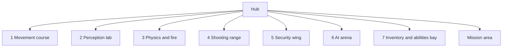

# Hub and gallery

Milestone: hub in M0; rooms arrive with their system milestones.

## Purpose

A central graybox hub with doorways to seven test rooms (one per system, each with spawnable elements) and the mission area. Rooms double as manual test spaces ([../tech/playtest-checklist.md](../tech/playtest-checklist.md)).



## Rooms

| # | Room | Tests | Milestone | Docs |
|---|---|---|---|---|
| 1 | Movement course | Walk, crouch, sprint, jump, mantle, vents, footstep noise | M1 | [movement](../game/movement.md) |
| 2 | Perception lab | Light levels, shootable lights, breaker, guard vision over different floors | M7 | [light](../game/light-and-visibility.md), [perception](../game/perception-and-ai.md) |
| 3 | Physics and fire | Throwable, breakable, flammable, explosive objects; fire spread | M3 | [objects](../game/objects-and-fire.md) |
| 4 | Shooting range | Per-part dummies, damage readouts | M4 | [damage](../game/damage.md), [weapons](../game/weapons-and-aiming.md) |
| 5 | Security wing | Camera, alarm panel, turret, keypad/lock/keycard/breakable doors, terminal | M8 | [security](../game/security.md) |
| 6 | AI arena | Guard group, patrols, escalation, body discovery, waking | M7 | [perception](../game/perception-and-ai.md) |
| 7 | Inventory and abilities bay | Items of every footprint, stats menu | M5, M6 | [inventory](../game/inventory.md), [abilities](../game/abilities.md) |

The mission area is described in [mission-warehouse.md](mission-warehouse.md).

## Hub

30 x 30 m, 5 m high, doorways 2 x 3 m. The player spawns at `PlayerSpawn` (0, 0, 10) facing the north wall (doorways 1 and 2). Each room scene is instanced in `levels/hub/hub.tscn` behind its doorway, with its origin on the outer face of the hub wall.

The hub is one kit `Room` (interior 30 x 5 x 30 m, 0.5 m walls) whose eight `RoomOpening`s are named after the doorways (`Room/DoorwayMovement` ...); doorway labels are kit `Sign`s (LARGE). Its `Navigation` node (`LevelNavigation`) bakes the navmesh for the hub and every gallery room instanced in it (movement course, physics and fire, shooting range, inventory bay) when the hub loads ([kit](kit.md#navigation), [ADR 0041](../decisions/0041-runtime-navmesh-bake.md)).

Loadout table (`Loadout/`, M5): the player starts with an empty inventory, so a 1.0 m wood `Ledge` (`Table`, 2.6 x 0.7 m, lip at (1.9, 0, 8.4), top z 7.7 to 8.4) stands to the front right of the spawn with the starting kit as item pickups, 0.36 m apart: `Pistol` (silenced pistol), `Baton` (stun baton), `PistolAmmo` x60, `Medkit` x2, `Multitool` x3, `Lockpick` x2, `Biocell` x2. Sign "Loadout" (SMALL) above its back edge. The table's west end (x 0.6) leaves the walk straight north from the spawn free, and it is more than 5 m from every doorway.

## 1 Movement course

`levels/gallery/movement/movement_course.tscn`, instanced at hub (-7.5, 0, -15.5). Built from [graybox kit](kit.md) parts (one free CSG shape: the low ceiling), kit `Sign`s for labels. A 4 m corridor (`Shell/Corridor`, a `Room` open at both ends) leads into a 26 x 52 m hall (`Shell/Hall`), 8 m high, concrete floor. Local coordinates: -Z points away from the hub.

| Area | Local position | Contents |
|---|---|---|
| Steps strip | x -17.3 to -8.3, lips at z -9 | `Ledge`s as single steps 0.15 and 0.3 m (walked up) and 0.45 m (jumped), 1.6 x 1 m tops, and a stair of six stacked 0.17 m tiers (0.3 m treads, 1.4 m wide, 1.2 m landing at 1.02 m, down the far side to z -13.2); floor labels at z -7.4; 5 m of run-up from the hall's south wall ([ADR 0058](../decisions/0058-step-climbing.md)) |
| Surface strips | z -5 to -19 | Five 3 x 14 m `SurfaceFloor` strips, raised 2 cm: concrete, carpet, wood, metal, grass, each with `surface` metadata, its graybox material and a floor label (the concrete strip looks like the concrete hall floor; its label marks it) |
| Ledges | faces at z -24 | `Ledge`s 0.5, 1.0, 1.5, 1.9 m (concrete) and 2.3 m (not mantleable, `hazard` orange; Speed aug target) |
| Vent | x -4, z -24 to -29.6, then to x -11 | Four `VentSegment`s, 1.2 m wide, 1.0 m high: Mouth on the 1.5 m ledge line (mantle in, ends crouched), 4.4 m straight, Turn (corner left), Slope (4 m, 1.45 m drop, 20°), Exit (2.4 m) at floor level facing the gap track. `fill_below` keeps the housing solid down to the floor |
| Low ceiling | x 4 to 7.5, z -24 to -30 | 3 m wide crawl space under a 1.2 m ceiling (blocked uncrouch) |
| Gap track | x -17 to -13 | 30° `Ramp` (foot at z -31.04) to a 2 m high walkway of two chained `Gap`s: runway (z -34.5 to -38.5), 2 m gap (walk jump), platform, 3.3 m gap (sprint jump), platform with a 2 m drop off its end |
| Drop tower | x 4 to 7.5, z -32 to -44.7 | 30° `Ramp` to a 5 m `Ledge` used as platform (3.5 x 4 m), drop off its far end |

Gap labels come from the jump numbers in [../game/movement.md](../game/movement.md): a flat jump covers about 2.6 m from walk and 3.8 m from sprint, so 2 m is a walk jump and 3.3 m needs a sprint jump (a walk jump falls short). Integration tests (`tests/levels/gallery/movement/`) check the strips, steps and stair (heights, walked up, 0.45 m blocks, no landing over the stair), ledges, vent crawl, both gaps and the walk from the hub into the course. First-person review shots of the steps: `tests/levels/gallery/movement/fixtures/course_shots.tscn` (run in a window with `-- shot=<name> out=<png>`).

## 3 Physics and fire

`levels/gallery/physics_fire/physics_fire_room.tscn`, instanced at hub (15.5, 0, -7.5) and turned so its local -Z points east (+X) through doorway "3 Physics & Fire"; local +X is hub +Z. Kit parts only (no free CSG), M3 objects from `objects/`, kit `Sign`s. A 3.5 m corridor (`Shell/Corridor`, 2 x 3 m, open at both ends, walls shared with the hub and the hall as in [ADR 0043](../decisions/0043-room-connections-share-a-wall.md)) leads into a 20 x 16 m hall, 5 m high, concrete (`Shell/Hall`, interior x -10 to 10, z -4 to -20). A 3 x 3 x 3 m side room (`Shell/SideRoom`) shares the hall's west wall; its only opening is a 1.2 x 2.2 m doorway blocked by a wooden barricade. Lighting: four shadowed 0.75-energy ceiling lights (the hub's ambient adds the rest), a corridor light and a dim side-room light, kept low enough that fire and explosion lights read on the walls and floor.

Floor plan (room-local, not to scale; top is the back wall):

```
             x -10          -5           0           5          10
   z -20     +---------------------------------------------------+
             |                                            B2     |   C barrel chain (sign on back wall)
   +-----+   |                                       B1          |
   |side |  [=]  barricade (doorway z -17)         s             |   s = stack of 3 small crates
   |room |   |   H|1  2  3  4  5   M   6  7                       |   A fire row, z -15.5 (| = 2 m wall)
   +-----+   |                                                   |
             |                                                   |
   z -10     |   +---------+                           ==========|   parapet 1.2 m
             |   |  metal  |                                     |
             |   |  floor  |                           b         |   B brazier corner (* brazier,
             |   +---------+                           b     *   |     c crates, b boxes)
             |   [ table  ]                 L  M       b c c c   |   E table + metal floor, F too heavy
   z -4      +--------------------[ door ]-----------------------+
                                  corridor -> hub doorway 3
```

| Station | Local position | Contents and spacing |
|---|---|---|
| A Fire spread (`FireSpread/`) | row along x at z -15.5 | Small crates `FireCrate1`-`5` at x -6.0 to -2.4, 0.3 m gaps (centres 0.9 m: each catches about 5 s after the previous one); `FireMetalCrate` (x -1.1) with 0.6 m gaps either side, so `FireCrate6`/`7` (x 0.2, 1.1) are 2.6 m from the last burning crate, beyond the 1.5 m reach. `FireCrateBehindWall` (x -6.8) is 0.8 m from `FireCrate1` (in reach: it would catch in about 4 s) behind `Wall`, a 2 m high, 0.1 m thick concrete `Ledge` between them: it never warms. Sign "Fire spread · metal stops it · walls block it" |
| B Brazier corner (`BrazierCorner/`) | brazier (8.3, -7) | 3 small crates along the south wall (z -4.7) and 3 cardboard boxes (x 6), all 2.3-2.7 m from the brazier, outside its 1.2 m fire: carry or throw them in. Sign on the east wall |
| C Barrel chain (`BarrelAlley/`) | barrels (7, -16.6), (8.6, -17.8) | `Barrel1` and `Barrel2` 2 m apart on a diagonal, `StackCrate1`-`3` (stacked, 1.8 m beyond `Barrel1`, 3.8 m from `Barrel2`); the 1.2 m `Parapet` (x 6 to 10, z -10 to -10.4) is 6.2 m from the nearer barrel and sees all three. Barrel 1's burst lights the stack at once: the two lower crates (8.0 >= 6) and, on the edge, the top one (2.08 m: 6.1); it used to be pushed out of reach a tick before the fire arrived and catch a few seconds later ([ADR 0057](../decisions/0057-forces-item-use-and-heat-as-generic-systems.md)). Sign "Barrel chain" |
| D Barricade (`BarricadeRoom/`) | doorway (-10.25, -17) | `Barricade` centred in the shared wall, ends in the jambs; `SideRoomCrate` (-12.7, -17.8) holds 2 glass bottles (`Breakable.contents`) and is 2.7 m from the barricade's fire (1.8 m reach). Sign "Burn the barricade" above the doorway |
| E Throwables (`Throwables/`) | table (-7.5, -6 to -7) | `Table`: 1.0 m wood `Ledge`, 3 x 1 m, with 4 glass bottles, 2 cardboard boxes, 2 small crates; `MetalFloor`: 4 x 4 m metal `SurfaceFloor` (raised 2 cm) behind it at z -8 to -12 for loud landings. Sign "Throw things · listen" |
| F Too heavy (`TooHeavy/`) | (2.8, -5), (4.3, -5) | Large wooden crate (60 kg) and metal crate (25 kg), over the 20 kg base carry limit; liftable with Combat Strength (70 kg, installed by default since M6). Sign "Too heavy (Combat Strength)" on the south wall |

Nothing outside the alley is within 5 m of a barrel; flammables of different stations are at least 3.8 m apart, beyond any fire reach (2 m at most), so one station never lights another. The barricade and the brazier are navmesh sources (group `navigation_source`): the side room floor is baked but cut off until the barricade is gone and the level re-baked (when that happens in play is M7's call). Fires use objects up: the debug Spawn tab's "Reset level" reloads the hub ([debug-panel.md](../game/debug-panel.md)).

Tests (`tests/levels/gallery/physics_fire/`): `physics_fire_room_test.gd` (shell, station spacing above, signs, no coplanar faces), `physics_fire_scenarios_test.gd` (in the real room scene: row A burns crates 1-5 within about 20 s and never 6, 7 or the walled-off crate over 45 s; damaging barrel 1 chains barrel 2 on the next tick and lights the stack, nothing else touched; the side room crate breaks into two whole bottles), `physics_fire_hub_test.gd` (walk in from the hub, navmesh coverage, the burnt barricade opens the side room for the player and, after a re-bake, the navmesh). First-person review shots: `tests/levels/gallery/physics_fire/fixtures/room_shots.tscn` (run in a window with `-- shot=<name> out=<png>`).

## 4 Shooting range

`levels/gallery/shooting_range/shooting_range_room.tscn`, instanced at hub (15.5, 0, 7.5) and turned like room 3 (local -Z points east through doorway "4 Shooting Range", local +X is hub +Z). Kit parts only, M4 training dummies from `actors/dummy/`, M3/M4 objects from `objects/`, kit `Sign`s. A 3.5 m corridor (`Shell/Corridor`, 2 x 3 m, walls shared as in [ADR 0043](../decisions/0043-room-connections-share-a-wall.md)) leads into a 14 x 48 m hall, 5 m high, concrete (`Shell/Hall`, interior x -3.5 to 10.5, z -4 to -52). The hall is off-centre on its door (offset -3.5) so its west wall (hub z 3.5 to 4) stays clear of room 3's hall, whose east wall ends at hub z 3. Lighting: two shadowed 0.8-energy lights over the booth, four 1.0-energy lights down the range, and two spot lights on the 20 m and 40 m dummies so the 40 m one reads inside the settled reticle from the firing line.

Floor plan (room-local; columns to scale at 0.25 m, rows not to scale; top is the far wall):

```
  z -52  +-------------------------------------------------------+   far wall, sign "Long shots"
  -51.6  |     B             B       M      B                    |   barrels 3 m apart (gap), M metal crate
    -48  |                                                  D    |   40 m dummy (lane 4), spot light
         :                                                       :
    -28  |                                        D              |   20 m dummy (lane 3), spot light
    -22  |    c     c                                            |   2 small crates, 1.5 m gap from X
    -20  |       X                                               |   blast lane barrel, sign
    -18  |==============                D                        |   2 m line; 10 m dummy (lane 2)
    -17  |==============                                         |   3 m line
    -16  |               |         |         |         |         |   dividers end
    -14  |============== |         |         |         |         |   6 m line
    -13  |               |    D    |         |         |         |   5 m dummy (lane 1)
    -10  |               |         |         |         |         |   dividers 1.2 m start
     -8  |    ###################################################|   counter 1.0 m + stripe: firing line
         |gap              5m        10m       20m       40m     |   lane signs on the counter
   -5.6  |                                         A<          >U|   melee: A aware, U unaware (3 m)
   -4.4  |                       [TTT]                           |   medkit table, 3 medkits
   z -4  +---------[  door  ]------------------------------------+
                   corridor -> hub doorway 4
      x  -3.5            0.5       3         5.5       8         10.5
```

The firing line is the counter's lip at z -8; distances are centre to centre from it.

| Station | Local position | Contents and spacing |
|---|---|---|
| Firing line (`FiringLine/`) | z -8 | `Counter`: 1.0 m wood `Ledge`, 0.6 m deep, from x -2.3 to the east wall, leaving a 1.2 m gap at the west wall to walk downrange; `Stripe`: 0.1 m hazard `SurfaceFloor` (raised 2 cm) along its lip, wall to wall. Lane signs "5 m" to "40 m" lie on the counter top; sign "Firing line · 1 pistol · 2 baton · R reload" above it |
| Lanes 1-4 (`Lanes/`) | x 1.75, 4.25, 6.75, 9.25 | 2.5 m lanes between four 1.2 m concrete `Ledge` dividers 0.2 m thick (x 0.5, 3, 5.5, 8; z -10 to -16: 2 m past the counter, 6 m long; `Divider1` also separates the blast lane). `Dummy5m`, `Dummy10m`, `Dummy20m`, `Dummy40m` at z -13, -18, -28, -48, turned to face the firing line (unaware) |
| Melee corner (`Melee/`) | z -5.6, booth side | `AwareDummy` (x 6.9, `Awareness.aware` on) faces west, towards the walkway from the door: from behind it still takes three baton hits. `UnawareDummy` (x 9.9, 3 m further) faces the east wall, its back to the walkway: one hit from behind knocks it out. Signs "Aware · 3 hits" (south wall) and "Sneak behind · baton KO" (east wall) |
| Blast lane (`BlastLane/`) | x -3.5 to 0.5 | The side lane west of `Divider1`, reached through the counter gap. `Barrel` at (-1.5, -20), past the dividers' end; hazard stripes `Stripe2m`/`3m`/`6m` (3.6 x 0.1 m) at 2, 3 and 6 m from it towards the firing line, with floor labels (the "3 m" one at the east end of its line so it does not crowd the "2 m" label a metre away); `Crate1`/`Crate2` (small) 1.5 m gap behind it, so the blast throws and lights them. Sign "Blast lane · Stand on a line · shoot the barrel". Expected (pistol from the line, measured by the scenario test): 2 m line 46.4 damage (torso 18.6, other parts 5.6 each), 3 m line 22.6, 6 m line 0 (outside the 4 m blast radius). The middle line was at 4 m until M5: exactly on the radius edge (4.07 m to the chest) it took nothing, so it taught nothing |
| Far wall (`FarWall/`) | z -51.6 (43.6 m) | `Barrel1`-`3` at x -2, 1.6, 5.2 (3 m gaps: no chain, a neighbour's blast does 10 of its 25 health) and a `MetalCrate` between barrels 2 and 3; the nearest is 5.4 m from the 40 m dummy. Sign "Long shots" |
| Medkits (`Medkits/`) | (3, -4.4) | `Table`: 1.0 m wood `Ledge` (1.2 x 0.6 m) against the south wall east of the door with three M5 medkit item pickups (`items/medkit/`: E takes one, using it from the belt heals 30). Sign "Medkits · E takes · use heals 30" |

The hub's `Navigation` bakes the range with the rest: the booth, the blast lane through the counter gap, the lanes around the dividers and the far wall (dummies and objects are not navigation sources). Damage and objects get used up: E on a dummy resets it, the Spawn tab's "Reset level" (or E after dying) reloads the hub.

Tests (`tests/levels/gallery/shooting_range/`): `shooting_range_room_test.gd` (shell, counter and stripe, dummy distances and facing, dividers, melee facing and awareness flags, blast lane lines and crates, far-wall spacing, medkits, signs, no coplanar faces), `shooting_range_hub_test.gd` (room on doorway 4, walk in to the counter, navmesh over the range floor), `shooting_range_scenarios_test.gd` (in the hub with the player, seeded weapon RNG: a pistol shot from the firing line hits the 10 m dummy's torso for 25; the baton knocks the unaware melee dummy out in one hit from behind and needs three on the aware one; the blast lane barrel hurts the player more on the 2 m line than on the 3 m line and not at all on the 6 m line). First-person review shots: `tests/levels/gallery/shooting_range/fixtures/range_shots.tscn` (run in a window with `-- shot=<name> out=<png>`; `lane_40m` draws the pistol so the reticle shows).

## 7 Inventory and abilities bay

`levels/gallery/inventory_bay/inventory_bay_room.tscn`, instanced at hub (-15.5, 0, 7.5) and turned so its local -Z points west (-X) through doorway "7 Inventory & Abilities"; local +X is hub -Z (towards the mission doorway). Kit parts only, M5 item pickups from `items/`, kit `Sign`s. A 3.5 m corridor (`Shell/Corridor`, 2 x 3 m, walls shared as in [ADR 0043](../decisions/0043-room-connections-share-a-wall.md)) leads into a 12 x 16 m hall, 5 m high, concrete (`Shell/Hall`, interior x -6 to 6, z -4 to -20). Footprint in hub coordinates (outer wall faces): x -19 to -36, z 1 to 14. The hall is 12 m across the door rather than 16 so it stays south of hub z 0.5 (the mission doorway at z -7.5 keeps the north half of the west side) and north of hub z 15.5 (room 6 lies beyond the south wall). Lighting: a corridor light and four shadowed 0.9-energy ceiling lights.

Floor plan (room-local, 1 column = 0.33 m, rows not to scale; top is the back wall):

```
  z -20  +------------------------------------+
         |LLLLL  +-------+                    |   L Speed ledge 2.3 m (1.8 x 2.5), sign on its face
  -18.7  |LLLLL  | dais b|          [P]   [C]|   dais 0.3 m carpet, b biocells x10; C 60 kg crate
  -17.5  |LLLLL  +-------+                    |   P datapad pedestal 1.1 m (two datapads)
         |T                                  F|   F "Fill the grid" table (east wall, 1 m deep):
  -14.4  |T     m                            F|     6 pistols, 6 batons, 2 x 100 ammo
         |T     m        +-----------+       F|
  -12    |T     m        |   metal   |       F|   drop zone 4 x 4 m (metal, raised 2 cm)
         |T     m        |   drop    |       F|   m Run Silent metal strip 1 x 8 m
  -10    |T     m        +-----------+        |   floor label "Drop things here · listen"
         |T     m                            S|   S stacks table: multitool 12, medkit 16, ammo 150
  -6     |T i1  m                            S|
  -5.4   |T                                  S|   T item table (west wall, 0.8 m deep), i1 .. i8
  z -4   +------------[ door ]----------------+
                     corridor -> hub doorway 7
      x  -6            0                      6
```

| Station | Local position | Contents and spacing |
|---|---|---|
| Item table (`ItemTable/`) | west wall, z -5.4 to -15 | `Table`: 1.0 m wood `Ledge`, 9.6 x 0.8 m, lip facing +X at x -5.2. One pickup of every item in `items/item_catalog.tres` in catalogue order from the door: `Pistol`, `Baton`, `PistolAmmo` (a box of 10), `Medkit`, `Multitool`, `Lockpick`, `Biocell`, `Keycard` (key_id `inventory_bay`), 1.05 m apart at x -5.6 (the datapad left the catalogue, ADR 0060: its old spot at z -14.4 is empty). Each has a tag on the wall behind it (`Labels/ItemTags/<name>`, SMALL at half pixel size: readable at the table, not across the room) "Name w×h" on two lines. Sign "Item table · every item · E picks up" |
| Stacks (`Stacks/`) | east wall, z -5.1 to -8.1 | `Table`: 1.0 m wood `Ledge`, 3 x 0.8 m, lip facing -X at x 5.2. `Multitool` x12, `Medkit` x16, `PistolAmmo` x150 (one pickup each, all above their max stack of 10 / 15 / 100), 1 m apart, tags "Multitool ×12 · max 10" ... Sign "Stacks split at their max" |
| Fill the grid (`FillGrid/`) | east wall, z -9.3 to -14.7 | `Table`: 1.0 m wood `Ledge`, 5.4 x 1 m. `Pistol1`-`6` (front row) and `Baton1`-`6` (back row), 0.75 m apart, `Ammo1`/`Ammo2` (100 rounds each): 12 + 18 + 2 = 32 cells for a 30-cell grid, so the table can never be emptied. Sign "Fill the grid · 6 × 5 · until: No room in inventory" |
| Datapad pedestal (`DatapadPedestal/`) | (3.5, -18.7) | `Pedestal`: 1.1 m concrete `Ledge`, 1.0 x 0.6 m. Two world datapads (`objects/datapad/datapad.tscn`, read in place, [ADR 0060](../decisions/0060-datapads-read-in-place-personal-log.md)), 0.5 m apart centre to centre (gap 0.36 m): `Datapad` at x 3.25, a plain note, entry `gallery.inventory_bay.note`, "Inventory bay": "Press I to open your inventory. Drag items to move them, right-click to use, drop or assign to the belt. Datapads stay where they are: what you read goes to your log (L)."; `StorageAccess` at x 3.75, entry `gallery.inventory_bay.storage_access`, "Storage access": "New code for the storage room keypad: 2817. ...", codes `{storage_door: "2817"}` (no keypad yet: M8). Sign "Datapads · E to read · L for log" |
| Drop zone (`DropZone/`) | centre (0, -12) | `Floor`: 4 x 4 m metal `SurfaceFloor` raised 2 cm: dropped items land loud (metal impact noise). Floor label "Drop things here · listen" at its near edge |
| Abilities station (`AbilitiesDais/`, M6) | back-west corner, metal strip x -3.4 | `Dais`: 0.3 m carpet `Ledge` (a step), 2.5 x 2.5 m at x -3.4 to -0.9, z -17.5 to -20, with `Biocells` (one pickup of 10). `SpeedLedge`: 2.3 m concrete `Ledge` (gap from the floor to the top, surface to surface), 1.8 x 2.5 m in the corner (x -6 to -4.2, lip at z -17.5): out of reach unaugmented (mantle max 1.9 m; from the dais top the rise is 2.0 m), mantled from standing with Speed Enhancement (max 2.5 m). Run-up: the lane between the item table's lip (x -5.2) and the ledge's east face (x -4.2) is clear from the door, at least 3 m in front of the lip; the pedestal (1.1 m, the nearest higher top) is 7.2 m from the ledge, beyond a mid-air catch. `LargeCrate`: 60 kg large crate at (5.2, -18.6) east of the pedestal, liftable only with Combat Strength. `RunSilentStrip`: 1 x 8 m metal `SurfaceFloor` raised 2 cm at x -3.4, z -6 to -14 (1.3 m from the item table's lip, 0.9 m from the drop zone). Signs: back wall above the dais "F1 Cloak · F2 Run Silent / F3 Speed · F4 Regeneration / Combat Strength: passive / Biocells: +25 energy"; on the ledge face "Speed (F3) · mantle me"; east wall "Combat Strength · lift me"; floor label at the strip's door end "Run Silent (F2) · sprint here" |

The hub's `Navigation` bakes the bay with the rest (the dais top is a 0.3 m step, within the navmesh max climb). Items get used up: the Spawn tab's "Reset level" reloads the hub with every pickup back.

Tests (`tests/levels/gallery/inventory_bay/`): `inventory_bay_room_test.gd` (shell, every catalogue item on the item table with its "Name w×h" tag, stack counts above their max, the fill-the-grid table overflows a 6 x 5 grid, the two pedestal datapads (Readables, no pickups, unique entry ids, the code), drop zone and dais, abilities station: biocells x10, 60 kg crate, metal strip, the Speed ledge's height against the mantle limits with and without Speed, its distance from the pedestal and its run-up lane, signs, no coplanar faces), `abilities_station_test.gd` (in the hub with the player: the ledge refused without Speed and mantled with F3; E takes the 10 biocells; the crate refused without Combat Strength and carried with it; sprinting along the strip makes metal footsteps, none with F2), `inventory_bay_hub_test.gd` (hall footprints of all gallery rooms do not overlap and room 7 keeps to hub z 0.5-15.5, room on doorway 7, walk in from the hub, navmesh reaches every station), `inventory_bay_scenarios_test.gd` (in the hub with the player: pickups stay on their tables once physics runs; E on the item table's pistol, prompt "E: pick up Silenced pistol", puts it on belt slot 1 and key 1 draws it; taking the whole fill-the-grid table ends in "No room in inventory" with items left). The hub's loadout table: `tests/levels/hub/hub_loadout_test.gd`. First-person review shots: `tests/levels/gallery/inventory_bay/fixtures/bay_shots.tscn` (run in a window with `-- shot=<name> out=<png>`; `inventory` takes the whole item table and opens the inventory screen, `hub_loadout` and `spawn` show the hub's loadout table, `datapad` looks at the code datapad with its prompt, `log` reads both datapads and opens the log screen; M6: `station`, `station_strip`, `ledge_foot`, `on_dais`, `on_ledge`, `heavy_crate`, `hud_augs` (three augmentations on, energy 73, pistol drawn), `cloak`, `stats` (debug panel on the Stats tab)).

## Rules

- Levels are CSG graybox built from the [graybox kit](kit.md) plus free CSG where needed (csg_blockout addon for editing); fiction is abstract ([ADR 0010](../decisions/0010-fiction-graybox.md), [ADR 0037](../decisions/0037-graybox-kit.md)).
- Every level has a `LevelNavigation` node as its last child ([ADR 0041](../decisions/0041-runtime-navmesh-bake.md)).
- Level scenes live in `levels/hub/` and `levels/gallery/<room>/`.
- Each room supports spawning its elements via the debug panel ([../game/debug-panel.md](../game/debug-panel.md)).

## Open questions

- Room dimensions and layout of rooms 2, 5 and 6: TBD per room milestone. The mission area behind the west wall's north doorway must stay north of hub z 1 (the outer face of room 7's north wall). Room 5 (security, south wall at hub x 7.5) must stay west of hub x 19 (the range's hall). Doorways without a room lead into the void for now (the player respawns at the hub spawn when falling out).
