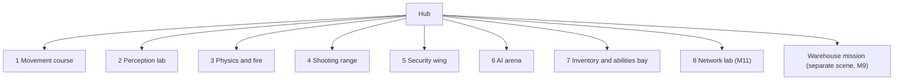

# Hub and gallery

Milestone: hub in M0; rooms arrive with their system milestones.

## Purpose

A central graybox hub with doorways to seven test rooms (one per system, each with spawnable elements) and the mission area. Rooms double as manual test spaces ([../tech/playtest-checklist.md](../tech/playtest-checklist.md)).



## Rooms

| # | Room | Tests | Milestone | Docs |
|---|---|---|---|---|
| 1 | Movement course | Walk, crouch, sprint, jump, mantle, vents, footstep noise | M1 | [movement](../game/movement.md) |
| 2 | Perception lab | Light levels, shootable lights, breaker, guard vision over different floors | M7 | [light](../game/light-and-visibility.md), [perception](../game/perception-and-ai.md) |
| 3 | Physics and fire | Throwable, breakable, flammable, explosive objects; fire spread | M3 | [objects](../game/objects-and-fire.md) |
| 4 | Shooting range | Per-part dummies, damage readouts | M4 | [damage](../game/damage.md), [weapons](../game/weapons-and-aiming.md) |
| 5 | Security wing | Camera corridor with dark alcoves, laser hall (low and high one-beam arrays, a two-beam array), alarm devices (controller, sirens, radio base station, panic button), a switch on a breaker, turret in a vault, keypad / pin-lock / keycard / electronic (fail-safe, fail-secure) / breakable doors, credentials terminal, a guard; practice locks (M10) | M8, M10 | [security](../game/security.md) |
| 6 | AI arena | Guard group, patrols, escalation, body discovery, waking | M7 | [perception](../game/perception-and-ai.md) |
| 7 | Inventory and abilities bay | Items of every footprint, stats menu | M5, M6 | [inventory](../game/inventory.md), [abilities](../game/abilities.md) |
| 8 | Network lab | Every entry point, subnets behind a gateway, a tracer, a security console, network devices, clues | M11 | [hacking](../game/hacking.md) |

The mission is a separate scene, `levels/mission/warehouse.tscn` (M9), described in [mission-warehouse.md](mission-warehouse.md). The hub's west wall north doorway loads it when the player walks through: `MissionExit`, a kit `LevelExit` (1 x 3 x 2 m box at (-15.7, 0, -7.5), from x -16.2 to -15.2, so the player triggers it once its capsule (radius 0.35) reaches 0.2 m into the doorway, its centre 0.15 m short of the wall's inner face at x -15; [ADR 0087](../decisions/0087-mission-systems.md)); the mission offers a way back to the hub after extraction ([ADR 0086](../decisions/0086-warehouse-mission.md)). Nothing the player carries in the hub comes along. Tests: `tests/levels/mission/mission_kit/mission_level_change_test.gd`.

## Hub

30 x 30 m, 5 m high, doorways 2 x 3 m. The player spawns at `PlayerSpawn` (0, 0, 10) facing the north wall (doorways 1 and 2). Each room scene is instanced in `levels/hub/hub.tscn` behind its doorway, with its origin on the outer face of the hub wall.

The hub is one kit `Room` (interior 30 x 5 x 30 m, 0.5 m walls) whose eight `RoomOpening`s are named after the doorways (`Room/DoorwayMovement` ...); doorway labels are kit `Sign`s (LARGE). Its `Navigation` node (`LevelNavigation`) bakes the navmesh for the hub and every gallery room instanced in it (movement course, perception lab, physics and fire, shooting range, security wing, AI arena, inventory bay) when the hub loads ([kit](kit.md#navigation), [ADR 0041](../decisions/0041-runtime-navmesh-bake.md)).

Loadout table (`Loadout/`, M5): the player starts with an empty inventory, so a 1.0 m wood `Ledge` (`Table`, 2.6 x 0.7 m, lip at (1.9, 0, 8.4), top z 7.7 to 8.4) stands to the front right of the spawn with the starting kit as item pickups, 0.33 m apart (centre to centre; neighbours never touch): `Pistol` (loud since [ADR 0085](../decisions/0085-weapons-and-attachments.md)), `Silencer` (drag it onto the pistol in the inventory to fit it), `Baton` (stun baton), `PistolAmmo` x60, `Medkit` x2, `Lockpick` x2, `Biocell` x2, at x 0.9 to 2.88 (the multitool was removed in M8, [ADR 0076](../decisions/0076-computer-skill-multitool-removed.md)). Sign "Loadout" (SMALL) above its back edge. The table's west end (x 0.6) leaves the walk straight north from the spawn free, and it is more than 5 m from every doorway.

## 1 Movement course

`levels/gallery/movement/movement_course.tscn`, instanced at hub (-7.5, 0, -15.5). Built from [graybox kit](kit.md) parts (one free CSG shape: the low ceiling), kit `Sign`s for labels. A 4 m corridor (`Shell/Corridor`, a `Room` open at both ends) leads into a 26 x 52 m hall (`Shell/Hall`), 8 m high, concrete floor. Local coordinates: -Z points away from the hub.

| Area | Local position | Contents |
|---|---|---|
| Steps strip | x -17.3 to -8.3, lips at z -9 | `Ledge`s as single steps 0.15 and 0.3 m (walked up) and 0.45 m (jumped), 1.6 x 1 m tops, and a stair of six stacked 0.17 m tiers (0.3 m treads, 1.4 m wide, 1.2 m landing at 1.02 m, down the far side to z -13.2); floor labels at z -7.4; 5 m of run-up from the hall's south wall ([ADR 0058](../decisions/0058-step-climbing.md)) |
| Surface strips | z -5 to -19 | Five 3 x 14 m `SurfaceFloor` strips, raised 2 cm: concrete, carpet, wood, metal, grass, each with `surface` metadata, its graybox material and a floor label (the concrete strip looks like the concrete hall floor; its label marks it) |
| Ledges | faces at z -24 | `Ledge`s 0.5, 1.0, 1.5, 1.9 m (concrete) and 2.3 m (not mantleable, `hazard` orange; Speed aug target) |
| Vent | x -4, z -24 to -29.6, then to x -11 | Four `VentSegment`s, 1.2 m wide, 1.0 m high: Mouth on the 1.5 m ledge line (mantle in, ends crouched), 4.4 m straight, Turn (corner left), Slope (4 m, 1.45 m drop, 20°), Exit (2.4 m) at floor level facing the gap track. `fill_below` keeps the housing solid down to the floor |
| Low ceiling | x 4 to 7.5, z -24 to -30 | 3 m wide crawl space under a 1.2 m ceiling (blocked uncrouch) |
| Gap track | x -17 to -13 | 30° `Ramp` (foot at z -31.04) to a 2 m high walkway of two chained `Gap`s: runway (z -34.5 to -38.5), 2 m gap (walk jump), platform, 3.3 m gap (sprint jump), platform with a 2 m drop off its end |
| Drop tower | x 4 to 7.5, z -32 to -44.7 | 30° `Ramp` to a 5 m `Ledge` used as platform (3.5 x 4 m), drop off its far end |

Gap labels come from the jump numbers in [../game/movement.md](../game/movement.md): a flat jump covers about 2.6 m from walk and 3.8 m from sprint, so 2 m is a walk jump and 3.3 m needs a sprint jump (a walk jump falls short). Integration tests (`tests/levels/gallery/movement/`) check the strips, steps and stair (heights, walked up, 0.45 m blocks, no landing over the stair), ledges, vent crawl, both gaps and the walk from the hub into the course. First-person review shots of the steps: `tests/levels/gallery/movement/fixtures/course_shots.tscn` (run in a window with `-- shot=<name> out=<png>`).

## 2 Perception lab

`levels/gallery/perception_lab/perception_lab.tscn`, instanced at hub (7.5, 0, -15.5), not turned (local -Z is hub -Z, through doorway "2 Perception Lab"). Kit parts only, M7 lamps and breaker from `objects/`, kit `Sign`s. No corridor: the hall's south wall is the hub's north wall ([ADR 0043](../decisions/0043-room-connections-share-a-wall.md); same 0.5 m thickness, the same 2 x 3 m door at local x 0). Hall 16 x 18 m, 4 m high, concrete (`Shell/Hall`, interior x -5.5 to 10.5, z 0 to -18; hub x 2 to 18). It sits off-centre on its door because the movement course's hall ends at hub x 1.0 (outer face) and the physics and fire room's hall starts at hub x 19.0: 0.5 m of void is left on each side.

Floor plan (room-local, 1 column = 0.5 m, rows not to scale; top is the north wall):

```
  z -18  +--------------------------------+   sign "2 Perception lab" (XLARGE)
         |              [P]               |   P GuardPost marker (2.5, 0, -16), facing +Z
         |                                |
  z -12  |  DARK     |  DIM      |  LIT    |   lanes 4.8 x 8 m strips (raised 2 cm), 0.2 m apart
         |  carpet   |  wood     |  metal  |
  z -10  |           |           |   L     |   L lit lamps (7.5, -6) and (7.5, -10), energy 2.0, range 5
  z -8   |  x -2.5   |  D  x 2.5 |  x 7.5  |   D dim lamp (2.5, -8), energy 0.35, range 4
  z -6   |           |           |   L     |
  z -4   |  "Dark · carpet"  "Dim · wood"  "Lit · metal" (floor labels at z -4.6)
         |W B                A            |   B breaker (west wall, z -2, 1.2 m), W wall lamp above it (2.6 m)
         |    "Light gauge" floor sign    |   A apron lamp (2.5, -1.5), energy 0.8, range 5
  z 0    +------[ door ]------------------+
      x -5.5    0     2.5       7.5    10.5
```

| Station | Local position | Contents and spacing |
|---|---|---|
| Lanes (`Lanes/`) | centres x -2.5, 2.5, 7.5 (5 m centre to centre), z -4 to -12 | `DarkFloor` carpet, `DimFloor` wood, `LitFloor` metal: 4.8 x 8 m `SurfaceFloor`s raised 2 cm (footsteps differ: carpet x0.5, wood x1.2, metal x1.6). Floor labels "Dark · carpet", "Dim · wood", "Lit · metal" at z -4.6 |
| Lamps (`Lamps/`) | ceiling lamps hang from 4 m (light at 3.6 m) | `LitLamp1`/`2` over the lit lane (z -6, -10), `DimLamp` over the dim lane centre: all on circuit `perception_lab`. `ApronLamp` (2.5, -1.5) and `BreakerLamp` (wall lamp above the breaker) on `perception_lab_apron`, never cut. Every lamp's light stays out of range of the other lanes' centres at chest height by at least 0.4 m (lit lamps 6.0 m from the dim centre with range 5; the dim lamp 5.6 m from the dark and lit centres with range 4; apron lamps 6.8 m or more from every lane centre) |
| Breaker (`Breaker`) | west wall (-5.5, 1.2, -2), facing +X | Breaker panel, circuit `perception_lab`, label "lab lights": "E: switch off lab lights" / "switch on". Sign "Breaker · E: lab lights off / on" above it |
| Guard post (`GuardPost`) | (2.5, 0, -16) | `Marker3D` facing +Z; 8.0 m from the dim lane centre and 9.4 m from the dark and lit ones (centre to centre) |
| Guard (`Guard`, M7) | (2.5, 0, -16), facing +Z | An unarmed guard (`actors/guard/guard.tscn`) on the guard post, no patrol route: it holds the post (glancing 45 degrees left and right) and only leaves to investigate. A target standing in the lit lane at (6, -7.5), 9.2 m away and 22 degrees off its facing (focus cone), is seen; with the breaker open it is not, until it comes within 2 m (close override) |
| Darkness (`AmbientDark`) | box x -6 to 11, y -0.5 to 4.5, z -18.5 to 0.4 | `ReflectionProbe` in ambient-colour mode (0.5, 0.55, 0.65) x 0.12, replacing the hub's ambient inside the lab so the dark lane looks dark ([ADR 0065](../decisions/0065-light-level-model.md)); its box stops short of the hub wall's inner face (local z 0.5) |

Light levels at the lane centres (z -8), standing / crouched, measured by the player's `LightExposure` in the hub: breaker closed dark 0.04 / 0.04, dim 0.31 / 0.21, lit 0.93 / 0.88; breaker open 0.04 everywhere. The apron by the breaker reads about 0.6.

Tests (`tests/levels/gallery/perception_lab/`): `perception_lab_room_test.gd` (shell and doorway, lane strips and surfaces, lamp circuits, lamp ranges against the other lanes, breaker, guard post distances, signs, no coplanar faces), `perception_lab_hub_test.gd` (hall between its neighbours, room on doorway 2, walk in, navmesh to the lanes, breaker and guard post), `perception_lab_guard_test.gd` (in the hub without the player: the guard on its post on the navmesh facing +Z; a stand-in target in the lit lane seen with the lights on, not seen once the breaker opens, seen 1.2 m in front in the dark), `perception_lab_light_test.gd` (in the hub with the player: lane values standing and crouched with the breaker closed, open with E and closed again; the apron lamps stay on; a shot lamp and the open breaker survive a save and load of the hub). First-person review shots: `tests/levels/gallery/perception_lab/fixtures/lab_shots.tscn` (run in a window with `-- shot=<name> out=<png>`; `breaker_open`, `lanes_from_post_off` and `apron_off` open the breaker first, `overlays` opens the debug panel's Overlays tab).

## 3 Physics and fire

`levels/gallery/physics_fire/physics_fire_room.tscn`, instanced at hub (15.5, 0, -7.5) and turned so its local -Z points east (+X) through doorway "3 Physics & Fire"; local +X is hub +Z. Kit parts only (no free CSG), M3 objects from `objects/`, kit `Sign`s. A 3.5 m corridor (`Shell/Corridor`, 2 x 3 m, open at both ends, walls shared with the hub and the hall as in [ADR 0043](../decisions/0043-room-connections-share-a-wall.md)) leads into a 20 x 16 m hall, 5 m high, concrete (`Shell/Hall`, interior x -10 to 10, z -4 to -20). A 3 x 3 x 3 m side room (`Shell/SideRoom`) shares the hall's west wall; its only opening is a 1.2 x 2.2 m doorway blocked by a wooden barricade. Lighting: four shadowed 0.75-energy ceiling lights (the hub's ambient adds the rest), a corridor light and a dim side-room light, kept low enough that fire and explosion lights read on the walls and floor.

Floor plan (room-local, not to scale; top is the back wall):

```
             x -10          -5           0           5          10
   z -20     +---------------------------------------------------+
             |                                            B2     |   C barrel chain (sign on back wall)
   +-----+   |                                       B1          |
   |side |  [=]  barricade (doorway z -17)         s             |   s = stack of 3 small crates
   |room |   |   H|1  2  3  4  5   M   6  7                       |   A fire row, z -15.5 (| = 2 m wall)
   +-----+   |                                                   |
             |                                                   |
   z -10     |   +---------+                           ==========|   parapet 1.2 m
             |   |  metal  |                                     |
             |   |  floor  |                           b         |   B brazier corner (* brazier,
             |   +---------+                           b     *   |     c crates, b boxes)
             |   [ table  ]                 L  M       b c c c   |   E table + metal floor, F too heavy
   z -4      +--------------------[ door ]-----------------------+
                                  corridor -> hub doorway 3
```

| Station | Local position | Contents and spacing |
|---|---|---|
| A Fire spread (`FireSpread/`) | row along x at z -15.5 | Small crates `FireCrate1`-`5` at x -6.0 to -2.4, 0.3 m gaps (centres 0.9 m: each catches about 5 s after the previous one); `FireMetalCrate` (x -1.1) with 0.6 m gaps either side, so `FireCrate6`/`7` (x 0.2, 1.1) are 2.6 m from the last burning crate, beyond the 1.5 m reach. `FireCrateBehindWall` (x -6.8) is 0.8 m from `FireCrate1` (in reach: it would catch in about 4 s) behind `Wall`, a 2 m high, 0.1 m thick concrete `Ledge` between them: it never warms. Sign "Fire spread · metal stops it · walls block it" |
| B Brazier corner (`BrazierCorner/`) | brazier (8.3, -7) | 3 small crates along the south wall (z -4.7) and 3 cardboard boxes (x 6), all 2.3-2.7 m from the brazier, outside its 1.2 m fire: carry or throw them in. Sign on the east wall |
| C Barrel chain (`BarrelAlley/`) | barrels (7, -16.6), (8.6, -17.8) | `Barrel1` and `Barrel2` 2 m apart on a diagonal, `StackCrate1`-`3` (stacked, 1.8 m beyond `Barrel1`, 3.8 m from `Barrel2`); the 1.2 m `Parapet` (x 6 to 10, z -10 to -10.4) is 6.2 m from the nearer barrel and sees all three. Barrel 1's burst lights the stack at once: the two lower crates (8.0 >= 6) and, on the edge, the top one (2.08 m: 6.1); it used to be pushed out of reach a tick before the fire arrived and catch a few seconds later ([ADR 0057](../decisions/0057-forces-item-use-and-heat-as-generic-systems.md)). Sign "Barrel chain" |
| D Barricade (`BarricadeRoom/`) | doorway (-10.25, -17) | `Barricade` centred in the shared wall, ends in the jambs; `SideRoomCrate` (-12.7, -17.8) holds 2 glass bottles (`Breakable.contents`) and is 2.7 m from the barricade's fire (1.8 m reach). Sign "Burn the barricade" above the doorway |
| E Throwables (`Throwables/`) | table (-7.5, -6 to -7) | `Table`: 1.0 m wood `Ledge`, 3 x 1 m, with 4 glass bottles, 2 cardboard boxes, 2 small crates; `MetalFloor`: 4 x 4 m metal `SurfaceFloor` (raised 2 cm) behind it at z -8 to -12 for loud landings. Sign "Throw things · listen" |
| F Too heavy (`TooHeavy/`) | (2.8, -5), (4.3, -5) | Large wooden crate (60 kg) and metal crate (25 kg), over the 20 kg base carry limit; liftable with Combat Strength on (F5, 70 kg). Sign "Too heavy (F5 Combat Strength)" on the south wall |

Nothing outside the alley is within 5 m of a barrel; flammables of different stations are at least 3.8 m apart, beyond any fire reach (2 m at most), so one station never lights another. The barricade and the brazier are navmesh sources (group `navigation_source`): the side room floor is baked but cut off until the barricade is gone and the level re-baked (when that happens in play is M7's call). Fires use objects up: the debug Spawn tab's "Reset level" reloads the hub ([debug-panel.md](../game/debug-panel.md)).

Tests (`tests/levels/gallery/physics_fire/`): `physics_fire_room_test.gd` (shell, station spacing above, signs, no coplanar faces), `physics_fire_scenarios_test.gd` (in the real room scene: row A burns crates 1-5 within about 20 s and never 6, 7 or the walled-off crate over 45 s; damaging barrel 1 chains barrel 2 on the next tick and lights the stack, nothing else touched; the side room crate breaks into two whole bottles), `physics_fire_hub_test.gd` (walk in from the hub, navmesh coverage, the burnt barricade opens the side room for the player and, after a re-bake, the navmesh). First-person review shots: `tests/levels/gallery/physics_fire/fixtures/room_shots.tscn` (run in a window with `-- shot=<name> out=<png>`).

## 4 Shooting range

`levels/gallery/shooting_range/shooting_range_room.tscn`, instanced at hub (15.5, 0, 7.5) and turned like room 3 (local -Z points east through doorway "4 Shooting Range", local +X is hub +Z). Kit parts only, M4 training dummies from `actors/dummy/`, M3/M4 objects from `objects/`, kit `Sign`s. A 3.5 m corridor (`Shell/Corridor`, 2 x 3 m, walls shared as in [ADR 0043](../decisions/0043-room-connections-share-a-wall.md)) leads into a 14 x 48 m hall, 5 m high, concrete (`Shell/Hall`, interior x -3.5 to 10.5, z -4 to -52). The hall is off-centre on its door (offset -3.5) so its west wall (hub z 3.5 to 4) stays clear of room 3's hall, whose east wall ends at hub z 3. Lighting: two shadowed 0.8-energy lights over the booth, four 1.0-energy lights down the range, and two spot lights on the 20 m and 40 m dummies so the 40 m one reads inside the settled reticle from the firing line.

Floor plan (room-local; columns to scale at 0.25 m, rows not to scale; top is the far wall):

```
  z -52  +-------------------------------------------------------+   far wall, sign "Long shots"
  -51.6  |     B             B       M      B                    |   barrels 3 m apart (gap), M metal crate
    -48  |                                                  D    |   40 m dummy (lane 4), spot light
         :                                                       :
    -28  |                                        D              |   20 m dummy (lane 3), spot light
    -22  |    c     c                                            |   2 small crates, 1.5 m gap from X
    -20  |       X                                               |   blast lane barrel, sign
    -18  |==============                D                        |   2 m line; 10 m dummy (lane 2)
    -17  |==============                                         |   3 m line
    -16  |               |         |         |         |         |   dividers end
    -14  |============== |         |         |         |         |   6 m line
    -13  |               |    D    |         |         |         |   5 m dummy (lane 1)
    -10  |               |         |         |         |         |   dividers 1.2 m start
     -8  |    ###################################################|   counter 1.0 m + stripe: firing line
         |gap              5m        10m       20m       40m     |   lane signs on the counter
   -5.6  |                                         A<          >U|   melee: A aware, U unaware (3 m)
   -4.4  | [RRRRRRRR]            [TTT]                           |   weapons rack (west of the door), medkit table
   z -4  +---------[  door  ]------------------------------------+
                   corridor -> hub doorway 4
      x  -3.5            0.5       3         5.5       8         10.5
```

The firing line is the counter's lip at z -8; distances are centre to centre from it.

| Station | Local position | Contents and spacing |
|---|---|---|
| Firing line (`FiringLine/`) | z -8 | `Counter`: 1.0 m wood `Ledge`, 0.6 m deep, from x -2.3 to the east wall, leaving a 1.2 m gap at the west wall to walk downrange; `Stripe`: 0.1 m hazard `SurfaceFloor` (raised 2 cm) along its lip, wall to wall. Lane signs "5 m" to "40 m" lie on the counter top; sign "Firing line · 1 pistol · 2 baton · R reload" above it |
| Lanes 1-4 (`Lanes/`) | x 1.75, 4.25, 6.75, 9.25 | 2.5 m lanes between four 1.2 m concrete `Ledge` dividers 0.2 m thick (x 0.5, 3, 5.5, 8; z -10 to -16: 2 m past the counter, 6 m long; `Divider1` also separates the blast lane). `Dummy5m`, `Dummy10m`, `Dummy20m`, `Dummy40m` at z -13, -18, -28, -48, turned to face the firing line (unaware) |
| Melee corner (`Melee/`) | z -5.6, booth side | `AwareDummy` (x 6.9, `Awareness.aware` on) faces west, towards the walkway from the door: from behind it still takes three baton hits. `UnawareDummy` (x 9.9, 3 m further) faces the east wall, its back to the walkway: one hit from behind knocks it out. Signs "Aware · 3 hits" (south wall) and "Sneak behind · baton KO" (east wall) |
| Blast lane (`BlastLane/`) | x -3.5 to 0.5 | The side lane west of `Divider1`, reached through the counter gap. `Barrel` at (-1.5, -20), past the dividers' end; hazard stripes `Stripe2m`/`3m`/`6m` (3.6 x 0.1 m) at 2, 3 and 6 m from it towards the firing line, with floor labels (the "3 m" one at the east end of its line so it does not crowd the "2 m" label a metre away); `Crate1`/`Crate2` (small) 1.5 m gap behind it, so the blast throws and lights them. Sign "Blast lane · Stand on a line · shoot the barrel". Expected (pistol from the line, measured by the scenario test): 2 m line 46.4 damage (torso 18.6, other parts 5.6 each), 3 m line 22.6, 6 m line 0 (outside the 4 m blast radius). The middle line was at 4 m until M5: exactly on the radius edge (4.07 m to the chest) it took nothing, so it taught nothing |
| Far wall (`FarWall/`) | z -51.6 (43.6 m) | `Barrel1`-`3` at x -2, 1.6, 5.2 (3 m gaps: no chain, a neighbour's blast does 10 of its 25 health) and a `MetalCrate` between barrels 2 and 3; the nearest is 5.4 m from the 40 m dummy. Sign "Long shots" |
| Weapons rack (`Rack/`, [ADR 0085](../decisions/0085-weapons-and-attachments.md)) | x -3.45 to -1.05, z -4.1 to -5.1 | `Table`: 1.0 m wood `Ledge`, 2.4 x 1.0 m, against the south wall west of the door (its east end 0.05 m short of the door opening at x -1; 2.9 m to the counter's back, so the walk from the door to the counter gap stays open; measured free: the west wall at x -3.5 to the door at x -1, nothing else in the booth west of the door). Back row (z -4.36): `SniperRifle` (x -2.82) and `Shotgun` (x -1.67), muzzles west; front row (z -4.84): `AssaultRifle` (x -2.95), `ShotgunShells` x24, `SniperRounds` x15, `RifleRounds` x90 and a second `Silencer` at x -2.3, -2.0, -1.7, -1.35 (gaps at least 0.15 m). Signs on the wall above: "Weapons rack", "RMB: sniper scope on / off", "Hold LMB: rifle full-auto", "Silencer: I, drag onto a weapon" (SMALL at half pixel size, fitting between the west wall and the door) |
| Medkits (`Medkits/`) | (3, -4.4) | `Table`: 1.0 m wood `Ledge` (1.2 x 0.6 m) against the south wall east of the door with three M5 medkit item pickups (`items/medkit/`: E takes one, using it from the belt heals 30). Sign "Medkits · E takes · use heals 30" |

The hub's `Navigation` bakes the range with the rest: the booth, the blast lane through the counter gap, the lanes around the dividers and the far wall (dummies and objects are not navigation sources). Damage and objects get used up: E on a dummy resets it, the Spawn tab's "Reset level" (or E after dying) reloads the hub.

Tests (`tests/levels/gallery/shooting_range/`): `shooting_range_room_test.gd` (shell, counter and stripe, dummy distances and facing, dividers, melee facing and awareness flags, blast lane lines and crates, far-wall spacing, medkits, signs, no coplanar faces), `shooting_range_hub_test.gd` (room on doorway 4, walk in to the counter, navmesh over the range floor), `shooting_range_scenarios_test.gd` (in the hub with the player, seeded weapon RNG: a pistol shot from the firing line hits the 10 m dummy's torso for 25; the baton knocks the unaware melee dummy out in one hit from behind and needs three on the aware one; the blast lane barrel hurts the player more on the 2 m line than on the 3 m line and not at all on the 6 m line). First-person review shots: `tests/levels/gallery/shooting_range/fixtures/range_shots.tscn` (run in a window with `-- shot=<name> out=<png>`; `lane_40m` draws the pistol so the reticle shows; ADR 0085 adds `fp_pistol`, `fp_pistol_silenced`, `fp_shotgun`, `fp_sniper`, `fp_sniper_silenced`, `fp_sniper_scope`, `fp_rifle`, `fp_rifle_silenced`, `fp_rifle_flash`, `rack`, `rack_signs`). `shooting_range_rack_test.gd` (ADR 0085): the rack's contents on the table without overlaps, clear of the door and of the walk to the counter gap, its signs; in the hub the whole rack fits in the inventory next to the hub kit; scoped and still, the sniper rifle's first shot from lane 4 hits the 40 m dummy's torso and kills it.

## 5 Security wing

`levels/gallery/security_wing/security_wing.tscn`, instanced at hub (7.5, 0, 15.5) on the outer face of the hub's south wall, behind doorway "5 Security". **Not turned**, like room 6: local axes are hub axes, local +Z points away from the hub (south), so hub = local + (7.5, 0, 15.5). Kit parts only, M7 ceiling lamps, M8 doors, locks and security devices from `objects/` ([security](../game/security.md)), item pickups from `items/`, one baton guard, kit `Sign`s. No corridor from the hub: the entry hall's north wall is the hub's south wall ([ADR 0043](../decisions/0043-room-connections-share-a-wall.md), the same 2 x 3 m door at local x 0). Every other connection is a shared 0.5 m wall too: eleven kit `Room`s under `Shell/` (`Hall`, `ClosetD1`, `ClosetD2`, `Booth`, `ClosetD4`, `ClosetD5`, `Corridor`, `Alcove1`, `Alcove2`, `Vault`, `LaserHall`). Footprint in hub coordinates (outer wall faces): x -0.5 to 18.5, z 15 to 38, leaving 0.5 m of void to room 6's hall (east face at hub x -1) and to the shooting range's hall (west face at hub x 19); the laser hall (M9g, outer x -8 to -4, z 9 to 18) fills the west end of the area south of the closets; the rest of it (local x -4 to 5, z 9.5 to 18) is left empty. An `AmbientDark` `ReflectionProbe` over the corridor, the alcoves and the vault darkens the ambient so the alcoves look as dark as they measure. No multitool ([ADR 0076](../decisions/0076-computer-skill-multitool-removed.md)); the terminal is the M8 credentials placeholder ([ADR 0080](../decisions/0080-credentials-terminal.md)).

Floor plan (room-local, 1 column = 0.5 m, rows not to scale; top is the hub wall):

```
  z 0     +=================[hub door]=================================+   hub doorway 2 x 3 m at x 0
  z 0     |PPPP     [TT]      |       A    S  K   s                     |   north wall: T table, A breaker A, S switch, K panic button, s siren
  z 1.5   |P                                                            |   P practice-lock wall (west, z 1.5..4.5): kept free for M10
  z 5.2   |P                                                  b         |   b explosive barrel (6.7, 5.2)
  z 6.25  +==[D1]=====[D2]=====[D3]=====[D4]=====[D5]=====+==[  ]======+   lock-row wall; corridor mouth 2 x 3 m at x 9
  z 6.5   | C1 k   | C2 d   | BOOTH  | C4 r   | C5 m   |  CORRIDOR    |   k keycard, d login datapad, r / m rewards on shelves
          |        |        | T B Cn |        |        |   L          |   booth: T terminal, B breaker B, Cn controller + base station
  z 9.5   +==[  ]==+========+========+========+========+              |   C1's back wall opens into the laser hall
          | LASER  |
  z 11.5  |-  -  - |  low beam 0.4 m          ALCOVE1 ...
  z 14.5  |--------|  high beam 1.3 m
  z 16.4  |========|  pair 0.4 + 1.3 m
  z 17.5  +========+  (x -7.5 .. -4.5)
  z 10.3                               ALCOVE1 [ dark   =    L         |   alcove 1.5 x 1.6 m, 2.2 m high, open to the corridor
  z 12.6                                                |    L       s |   s corridor siren (east wall); L lamps on the centre line
  z 14.9                               ALCOVE2 [ dark   =              |
  z 16.4                                                |    G         |   G baton guard, facing the vault door
  z 18.25                    +===========================+=[vault]=====+   vault door (fail-secure) at x 9, camera above it (2.6 m)
  z 20                       |   [loot]                      R         |   R turret (9, 21.2) facing the door
  z 22                       +=========================================+
      x  -7.5              -1.5   1   3            7   7.5   9    10.5
```

| Station | Local position | Contents and spacing |
|---|---|---|
| Entry hall (`Shell/Hall`) | interior x -7.5 to 10.5, z 0 to 6, 4 m high | Hub door at x 0. Table (`Shell/Table`, 1.0 m wood `Ledge`, 1.6 x 0.7 m, lip (-4, 0, 0.71)) with the `ClosetCode` datapad (entry `gallery.security_wing.closet_code`, codes `{security_closet: "5309"}`) and two `Lockpick`s. North wall east of the door: `BreakerA` (2.6, 1.3; circuit `security_wing_a`, "D4 power"), the network `Switch` (5, 1.6; circuit `security_wing_b`), the `PanicButton` (6.5, 1.3) and `SirenHall` (8.2, 3.2). **Practice-lock wall**: the west wall, z 1.5 to 4.5, 0.5 to 2.5 m up (3 x 2 m), is kept free for M10's four acrylic practice locks, one per tier (Simple, Standard, Secure, High-security), showing the pins as the lockpicking tutorial ([lockpicking](../game/lockpicking.md), [ADR 0073](../decisions/0073-realistic-lockpicking.md)) |
| Lock row (`Doors/`) | doors at x -6.4, -3.4, -0.4, 2.6, 5.6 in the hall's south wall (z 6 to 6.5) | Five 2.5 x 2.5 m closets, 3 m high, sharing side walls (pitch 3 m). Each door stands 1.1 m from its closet's west wall: its -X wall boxes (keypad, reader, status: [ADR 0098](../decisions/0098-door-lock-hardware-and-keycard-relock.md)) sit on the hall and closet faces and the 1.3 m pocket ends 0.45 m before the next doorway, inside the hall wall. `Door.wall_thickness` 0.5. A sign above each door says what to try |
| D1 keypad (`D1Keypad`) | x -6.4 | `KeypadLock`, code id `security_closet`, code 5309 (the table datapad; the keypad screen shows the reminder once it is read). Behind it: the `Keycard` (`key_id` `security_booth`) on a 1.0 m shelf |
| D2 pin lock (`D2Mechanical`) | x -3.4 | `MechanicalLock`, three standard pins (a lockpick, 3 s untrained). Behind it: the `BoothLogin` datapad (entry `gallery.security_wing.booth_login`, codes `{security_wing_terminal: "rvoss:kestrel4"}`) |
| D3 keycard (`D3Keycard`) to the booth | x -0.4 | `KeycardLock`, access id `security_booth`. The booth (`Shell/Booth`): `Terminal` on the back wall (credentials id `security_wing_terminal`, user `rvoss`, password `kestrel4`, label "security terminal"; on no circuit, so it stays on with breaker B off), `BreakerB` on the west wall (circuit `security_wing_b`, "network power"), `Controller` (dark red box) and `BaseStation` (dark blue box with an antenna) on the east wall, each under a SMALL sign ("Alarm controller", "Radio base station", [ADR 0083](../decisions/0083-security-terminal-redesign.md)) |
| D4 electronic (`D4Electronic`) | x 2.6 | Tag `door.fail_safe`, `Powered` circuit `security_wing_a`, `ElectronicLock`: breaker A off unlocks it (it stays shut until opened by hand). Reward: 2 biocells |
| D5 breakable (`D5Breakable`) | x 5.6 | `breakable_door.tscn`, locked, no lock. The explosive barrel (`Props/Barrel`, (6.7, 0.45, 5.2)) is 1.65 m from the door's centre: its blast (100 / 4 m) does about 59 of the door's 50 health. The hall lamps, the switch and the corridor lamps are more than 4 m from it. Reward: a medkit |
| Laser hall (`Shell/LaserHall`, M9g, [ADR 0096](../decisions/0096-laser-tripwires.md); arrays since M9h, [ADR 0100](../decisions/0100-laser-arrays-alarm-time-downed-targets.md)) | interior x -7.5 to -4.5, z 9.5 to 17.5, 3 m high | Shares closet D1's back wall; a 1.2 x 2.2 m opening at x -6.25 (D1's shelf with the keycard moved to D1's east wall, lip at x -5.51). Three `laser_array.tscn` on the west wall face (x -7.49), every beam 2.98 m east (`Beam<n>.length`) to the east wall: `Devices/LaserLow`, one beam at 0.4 m, z 11.5 (jump it: the walking take-off window, 0.64 to 1.92 m before the beam, starts inside the hall), `LaserHigh`, one beam at 1.3 m, z 14.5 (crouch: a jump from mid-window lands 1.4 m short of it), and `LaserPair`, one device with two beams at z 16.4: `Beam1` 0.4 m and `Beam2` (a `laser_beam.tscn` 0.9 m above it) 1.3 m, their heads joined by the emitter's mast (stop both; 1.2 m to stand between the high beam and the pair; one incident, one Disable, one shot at the emitter darkens both). Two biocells behind the pair (-6, 17). A cardboard box (`Props/LaserBox`, (-5, 10.2)) to throw through a beam. Lamps `LampLaserNorth` / `South` at z 11 and 15.5 (energy 0.8). Signs: above the opening ("Laser hall"), on the west wall (what trips it, the box) and on the east wall at each gate |
| Camera corridor (`Shell/Corridor`) | interior x 7.5 to 10.5, z 6.5 to 18, 3.5 m high | Open to the hall through a 2 x 3 m mouth at x 9. `Camera` above the vault door, (9, 2.6, 17.99), facing north up the corridor (15 m, ±25°, sweep ±40°): every centre-line point from z 7.5 to 16.4 is within 15 m and 65° of its rest yaw, in clear sight. Two dark alcoves (`Shell/Alcove1`, `Alcove2`: 1.5 m deep, 1.6 m wide, 2.2 m high, centres (6.25, 10.3) and (6.25, 14.9)) open off the west wall halfway between the lamps; from inside an alcove neither the lamps nor the camera are in sight. `SirenCorridor` on the east wall (10.49, 3, 12.6) |
| Guard (`Guards/GuardBatonVault`) | (9, 0, 16.4), facing +Z (the vault door) | `guard_baton.tscn` (radio), holding its post under `LampCorridorSouth`, 1.85 m from the vault door. It faces away from the corridor so the player can sneak up on it from the alcoves; the camera watches the corridor past it. Within 30 m of navmesh path of both sirens and 40 m of the base station, so a siren sends it searching where it stands and a camera incident dispatches it to the spot |
| Vault (`Shell/Vault`) | interior x 3 to 10.5, z 18.5 to 22, 3 m high | `VaultDoor` (9, 0, 18.25): `door.tscn` with tag `door.fail_secure`, `Powered` circuit `security_wing_b`, `ElectronicLock`, locked. Only the terminal opens it (a remote open: it opens and stays locked, locking again once closed); breaker B off keeps it locked. `Turret` (9, 0, 21.2) faces the door's inside 2.95 m away (±60°, 15 m): the closed door blocks its line of sight to the corridor and the hall; open, it sees straight up the corridor. `VaultTable` (1.0 m wood `Ledge`, 2 x 0.7 m, against the south wall at x 4.5) with 5 biocells, 2 medkits and 40 pistol rounds |
| Network (`Devices/Switch` links) | | The switch is cabled to the terminal, camera, turret, controller, both sirens, panic button, base station, vault door and the three laser arrays ([ADR 0077](../decisions/0077-devices-cables-and-remote-commands.md)). Breaker B off (or a shot at the switch) cuts every link: the camera still detects but tells nobody, the lasers go dark, the turret keeps shooting intruders, the vault stays locked and every device on the terminal's screen reads offline |

Lamps (`Lamps/`, ceiling lamps, light 0.4 m below the ceiling, range 5, no circuit, shootable): hall `LampHallWest` / `Middle` / `East` at (-4.5, 2.5), (0.5, 2.5), (5, 2.5), energy 1.0; one per closet at its centre, energy 0.8; corridor `LampCorridorNorth` / `Middle` / `South` on the centre line at z 8, 12.6 and 17.2, energy 1.2 (each alcove centre is 2.3 m along the corridor from the nearest lamp, so the alcove's side walls hide it); `LampVault` (6.75, 20.25), energy 1.2. Measured light levels (a standing stand-in): corridor centre line 0.85 to 0.86 (z 7.5, 10.3, 12.6, 14.9, 16.4), alcoves 0.04 (centre and back half), guard post 0.86, vault in front of the door 0.72.

How the stations chain: the table datapad opens D1, the keycard behind D1 opens the booth, the datapad behind D2 (picked with the table's lockpicks) logs in at the booth terminal, and the terminal disables or retargets the turret and opens the vault. The laser hall behind D1 practises the laser arrays: jump the low beam, crouch under the high one; the two-beam array needs the booth terminal (Disable), breaker B or a shot at its emitter, and a beam broken by the player or a thrown box rings the alarm (the base station dispatches the vault guard to it). Other ways the room allows: shoot the camera (one round), wait out its sweep in the alcoves, cut breaker B or shoot the switch (no alarm, but no vault either), retarget the turret at guards (it shoots the guard by the vault door), take the guard down from behind, press the panic button and watch the guard search.

The hub's `Navigation` bakes the wing with the rest: hall, closets, corridor, alcoves and vault (doors carve their doorways and bridge them with links; locked ones only for their access ids, [ADR 0078](../decisions/0078-doors-locks-and-door-navigation.md)). Items and the barrel get used up: the Spawn tab's "Reset level" reloads the hub.

Tests (`tests/levels/gallery/security_wing/`): `security_wing_test.gd` (the room alone: hall on the hub wall, closets of 2.5 x 2.5 m sharing the hall wall and each other's walls, wall boxes and pockets clear of the neighbouring doorways, every door's wall boxes flush on the walls and clear of the leaves (ADR 0098), corridor, alcoves and vault sharing walls, footprint, rays through the open doorways clear and blocked by every closed door and by plain walls, each door's lock and prompt, the items that open them in the right rooms, unique datapad entries, the practice-lock wall free, signs, the booth signs above the controller and the base station, no coplanar faces), `security_wing_lasers_test.gd` (the laser hall shares D1's back wall and the walking lane clears both doorways; each array's beams at their heights, wall face to wall face with no world geometry across them; the signs fit their walls; the real player walks in through D1, jumps the low beam, crouches under the high one, stands up before the pair and walks into the two-beam array: one incident rings the wing's alarm), `security_wing_devices_test.gd` (the terminal reaches the camera, turret, controller, both sirens, panic button, base station, vault door and the three laser arrays and offers their commands; breaker B off or a shot switch shows them all offline and keeps the vault locked; breaker A off unlocks D4 only; the closed vault door blocks the turret's line of sight to the corridor and the hall, the open one does not; the camera covers the corridor centre line; light levels: corridor > 0.5, alcoves < 0.1, guard post and vault > 0.5), `security_wing_hub_test.gd` (in the hub: on doorway 5, not turned, every wing room clear of the other gallery rooms and inside hub x -0.5 to 18.5, z 15 to 38; the player walks in; the navmesh covers the wing and holds the guard, reachable from the spawn; the guard within 30 m of path of both sirens), `security_wing_scenario_test.gd` (in the hub with the player: read the code, open D1, take the keycard, open D3; take the lockpicks, pick D2, read the login, log in at the terminal with what the log knows, disable the turret, open the vault; the barrel's blast breaks D5 and leaves D4 shut), `security_wing_turret_kill_test.gd` (M9h regression, [ADR 0100](../decisions/0100-laser-arrays-alarm-time-downed-targets.md): the terminal sets the turret on guards and opens the vault; once the turret has killed the post guard it never engages the body again, makes no noise and its beep stops). First-person review shots: `tests/levels/gallery/security_wing/fixtures/wing_shots.tscn` (run in a window with `-- shot=<name> out=<png>`; `open` opens doors first, `alarm` triggers the controller; the player drops its `actor.player` tag).

## 6 AI arena

`levels/gallery/ai_arena/ai_arena.tscn`, instanced at hub (-7.5, 0, 15.5) on the outer face of the hub's south wall, behind doorway "6 AI Arena". **Not turned**: local axes are hub axes, so local +Z points away from the hub (south). Every other room is turned so local -Z points away; this one was built unturned because guards then turned by their local yaw. Since M7 wave 2 `NavWalker` turns its global yaw ([ADR 0071](../decisions/0071-bodies-discovery-waking-carrying.md) consequences; `tests/actors/common/movement/nav_walker_facing_test.gd`), so later rooms with guards may be turned. Kit parts only, M7 ceiling lamps, crates from `objects/`, five guards (`actors/guard/guard_pistol.tscn` and `guard_baton.tscn`), kit `Sign`s. No corridor: the hall's north wall is the hub's south wall ([ADR 0043](../decisions/0043-room-connections-share-a-wall.md), the same 2 x 3 m door at local x 0). Hall 18 x 20 m, 4 m high, concrete (`Shell/Hall`, interior x -12 to 6, z 0 to 20; hub x -19.5 to -1.5). A 5 x 20 m radio room, 3 m high (`Shell/RadioRoom`, interior x -17.5 to -12.5), shares the hall's west wall; its only door (1.6 x 2.4 m, centre z 18.6) is at the far end, so the radio post at its near end is a long walk from the hall but close through the wall. Footprint in hub coordinates (outer wall faces): x -25.5 to -1, z 15 to 36. The hall sits off-centre on its door (east outer face at hub x -1) so the south wall east of x -1 is left to room 5 (door at hub x 7.5); the radio room lies west of the hub, south of room 7 (whose south wall is at hub z 14). An `AmbientDark` `ReflectionProbe` (as in the perception lab) darkens both rooms' ambient so the dark corner looks dark.

Floor plan (room-local, 1 column = 0.5 m, rows not to scale; top is the far (south) wall, the hub is at the bottom):

```
  z 20    +-----------------------------------------------+
  z 19.5  |          |                 "6 AI arena" DDDDDD|    far wall sign; D dark corner x 3..6, z 17..20
  z 18.6  |          =                              DDDDDD|    = radio door 1.6 x 2.4 m in the shared wall (z 17.8..19.4)
  z 17.5  |          |              B0  L . . . B1  DDDDDD|    route B, L lamp (-3, 17.5)
  z 15.2  |          |                                [C3]|    C3 large crate (4.6, 15.2)
  z 14    |          |           A3 . . . . . . .A2       |    route A loop A0 > A1 > A2 > A3
  z 11    |          |           :               :        |
  z 10    |     m    |         zL:   m C1C2      :L       |    z downed guard, m metal crates, C1/C2 large crates
  z 9     |          |           :               :        |
  z 6     |          |           A0 . . . . . . .A1       |
  z 3.5   |          |    C4                       L      |    C4 large crate; L entry lamp (2.5, 3.5)
  z 3     |     L    |                                P   |    L radio lamp (-15, 3); P baton post (4, 3)
  z 1.6   |     R    |                                    |    R radio guard (-15, 1.6), radio desk behind it
  z 0     +---------------------------------[door]--------+    hub doorway 2 x 3 m at x 0
        x -18      -12.5                -3    0           6
```

Guards are named by their loadout: `GuardPistol*` are `guard_pistol.tscn`, `GuardBaton*` are `guard_baton.tscn` ([ADR 0070](../decisions/0070-guard-combat-and-loadouts.md)). All have `equipment.radio` (from `guard.tscn`). The arena's alarm devices (`Alarm/`, [ADR 0077](../decisions/0077-devices-cables-and-remote-commands.md)) replace M7's hub `LevelAlarm`:

| Guard (`Guards/`) | Local position, facing | Role |
|---|---|---|
| `GuardPistolA` | (-6.5, 0, 6), +X | Patrols `Routes/RouteA`: A0 (-6.5, 6) > A1 (1.5, 6, wait 2 s) > A2 (1.5, 14) > A3 (-6.5, 14, wait 2 s), looped round the central crates (32 m, about 24 s a lap with the waits) |
| `GuardPistolB` | (1, 0, 17.5), -X | Patrols `Routes/RouteB`: B0 (-5, 17.5) and B1 (1, 17.5), 3 s at each; at B1 it faces the dark corner 2 m away |
| `GuardBatonPost` | (4, 0, 3), +Z turned 30 degrees east (facing (0.5, 0, 0.87)) | Holds its post just inside the door, its back to the hub door: the takedown target (from the door the player is about 155 degrees off its facing, 110 even during a 45 degree glance, outside the 60 degree cone). Turned east so the downed guard (59 degrees west of +Z, 13.5 m) stays out of its focus cone even at the end of a west glance (44 degrees off, focus 30): patrol A finds the body deep in the hall, as intended. Facing straight +Z, the post found it first (about 12 s after loading) and shouted from 4 m beside the hub door, so the searchers searched in the doorway and saw the player at the hub spawn (M8 playtest bug; `tests/levels/hub/hub_start_guards_test.gd`) |
| `GuardBatonDowned` | feet (-7.6, 0, 9), lying along +Z to z 10.8 | Starts unconscious (Tags `initial_tags` `actor.guard`, `equipment.radio`, `state.unconscious`; `DownedPose` lays it down). 1.1 m beside route A's A3 > A0 leg, under `LampDowned` (light level 0.82): guard A sees it ahead while walking A2 > A3 and walks straight at it on the A3 > A0 leg, about 12-20 s after the level loads. Nothing within 1.5 m on the patrol side |
| `GuardPistolRadio` | (-15, 0, 1.6), +Z | Holds the radio post at the near end of the radio room, facing its door 17 m away, under `LampRadio` |

| Station | Local position | Contents and spacing |
|---|---|---|
| Lamps (`Lamps/`) | ceiling lamps, light 0.4 m below the ceiling | `LampEntry` (2.5, 3.5) 1.2, `LampEast` (1.5, 10.5) 1.2, `LampDowned` (-7, 9.9) 1.5, `LampSouth` (-3, 17.5) 1.2, `LampRadio` (-15, 3) 1.0 (energy; range 5, no circuit: always on, shootable). Measured light levels: downed guard 0.82, baton post 0.66, radio post 0.81, (0, 10) beside the central crates 0.66, route B 0.72 |
| Dark corner | x 3 to 6, z 17 to 20 | Every lamp is at least 1.3 m beyond its range from the corner at body heights (0.2-1.6 m); light level 0.04. Sign "Dark corner" on the east wall |
| Cover (`Cover/`) | | Large crates (60 kg, fixed cover) `LargeCrate1`/`2` (-3, 10), (-1.7, 10) and `MetalCrate1` (-4.3, 10.3) in the middle of route A's loop; `LargeCrate3` (4.6, 15.2) before the dark corner; `LargeCrate4` (-9.5, 3.5) near the door; `MetalCrate2` (-13.6, 10) half-way down the radio room. Crates are not navmesh sources: route legs and posts keep at least 1 m (gap) from them |
| Radio desk (`Shell/RadioDesk`) | lip (-15, 0, 0.8) | 1.0 m wood `Ledge`, 1.6 x 0.7 m, behind the radio guard |
| Alarm devices (`Alarm/`, [ADR 0077](../decisions/0077-devices-cables-and-remote-commands.md)) | wall-mounted, 1 cm off the wall face | North wall, right of the hub door: `Controller` (2.6, 1.5), `Switch` (3.9, 1.5; circuit `ai_arena_network`, no breaker: shoot it), `PanicButton` (5, 1.3). `SirenEast` on the east wall (6, 3.2, 7.5), `SirenWest` on the west wall by the radio door (-12, 3.2, 13.5). `BaseStation` on the radio room's north wall (-16.7, 1.2), left of the desk. Cables: switch to controller and both sirens; panic button and base station straight to the controller. Every standing guard's spot is within 30 m of navmesh path of a siren (sirens carry 34 m) and 36 m straight of the base station (40 m) |
| Signs (`Labels/`) | | "6 AI arena" (far wall); north wall: "Sneak up behind a guard: the baton knocks it out / Hide the body in the dark corner (far right)", "Alarm: panic button or debug panel (\`) / Sirens heard 34 m (walking distance) / Shoot the switch to cut them off"; west wall by the downed guard: "A guard who finds an unconscious ally wakes it / Carry a downed guard: E on the body · Q drops it"; above the radio door: "Radio room / Shouts carry about 17 m (walking distance) / Radios 30 m, through walls"; behind the radio guard: "Radio post: too far to hear shouts / alerted by radio" |

Shout and radio ranges (shouts reach allies within 17 m of navmesh path, radios 30 m in a straight line through walls): from the radio post, the navmesh path to every other guard's likely spot (route points, the middle of every leg, the posts and the hall centre) is 24.3 m or more (A3 24.3, B0 24.5, downed guard 27.7, hall centre 29.6, A0 30.9, B1 30.4, A2 31.6, A1 35.6, baton post 39.5) and the straight line 22.6 m or less (B1 22.6, A2 20.6, baton post 19.1, B0 18.8, A1 17.1, A3 15.0, hall centre 14.7, downed guard 10.5, A0 9.6). Inside the hall every spot is within about 17 m of path of most others, so shouts carry across it.

Tests (`tests/levels/gallery/ai_arena/`): `ai_arena_test.gd` (the room alone: shell, both doorways and the shared wall, rays through both doorways along a standing capsule clear and a plain wall blocks, lamps and their ranges against the dark corner, guard names, routes and post facings, the baton post's glances never bring the downed guard into view, the downed guard's tags and its distance from route A, routes and posts clear of the crates, the alarm devices' cables (controller reaches both sirens through the switch, not with it unpowered), signs, no coplanar faces), `ai_arena_hub_test.gd` (in the hub: on doorway 6, not turned, clear of the other rooms, east outer face at hub x -1 or less; the player walks in; every guard and patrol point on the navmesh; the radio guard's path (> 20 m) and straight (<= 27 m) distances; every standing guard within 30 m of path of a siren and 36 m of the base station; the dark corner reads below 0.1 and the downed guard, baton post and radio guard above 0.5). First-person review shots: `tests/levels/gallery/ai_arena/fixtures/arena_shots.tscn` (run in a window with `-- shot=<name> out=<png>`; the player drops its `actor.player` tag so the guards keep to their routine; `lab_guard` looks at the perception lab's guard).

## 7 Inventory and abilities bay

`levels/gallery/inventory_bay/inventory_bay_room.tscn`, instanced at hub (-15.5, 0, 7.5) and turned so its local -Z points west (-X) through doorway "7 Inventory & Abilities"; local +X is hub -Z (towards the mission doorway). Kit parts only, M5 item pickups from `items/`, kit `Sign`s. A 3.5 m corridor (`Shell/Corridor`, 2 x 3 m, walls shared as in [ADR 0043](../decisions/0043-room-connections-share-a-wall.md)) leads into a 12 x 16 m hall, 5 m high, concrete (`Shell/Hall`, interior x -6 to 6, z -4 to -20). Footprint in hub coordinates (outer wall faces): x -19 to -36, z 1 to 14. The hall is 12 m across the door rather than 16 so it stays north of hub z 15.5 (room 6 lies beyond the south wall). Lighting: a corridor light and four shadowed 0.9-energy ceiling lights.

Floor plan (room-local, 1 column = 0.33 m, rows not to scale; top is the back wall):

```
  z -20  +------------------------------------+
         |LLLLL  +-------+                    |   L Speed ledge 2.3 m (1.8 x 2.5), sign on its face
  -18.7  |LLLLL  | dais b|          [P]   [C]|   dais 0.3 m carpet, b biocells x10; C 60 kg crate
  -17.5  |LLLLL  +-------+                    |   P datapad pedestal 1.1 m (two datapads)
         |T                                  F|   F "Fill the grid" table (east wall, 1 m deep):
  -14.4  |T     m                            F|     6 pistols, 6 batons, 2 x 100 ammo
         |T     m        +-----------+       F|
  -12    |T     m        |   metal   |       F|   drop zone 4 x 4 m (metal, raised 2 cm)
         |T     m        |   drop    |       F|   m Run Silent metal strip 1 x 8 m
  -10    |T     m        +-----------+        |   floor label "Drop things here · listen"
         |T     m                            S|   S stacks table: lockpick 12, medkit 16, ammo 150
  -6     |T i1  m                            S|
  -5.4   |T                                  S|   T item table (west wall, 0.8 m deep), i1 .. i8
  z -4   +------------[ door ]----------------+
                     corridor -> hub doorway 7
      x  -6            0                      6
```

| Station | Local position | Contents and spacing |
|---|---|---|
| Item table (`ItemTable/`) | west wall, z -5.4 to -15 | `Table`: 1.0 m wood `Ledge`, 9.6 x 0.8 m, lip facing +X at x -5.2. One pickup of every item in `items/item_catalog.tres` in catalogue order from the door at x -5.6: `Pistol` (z -5.7), `Baton` (-6.3), `PistolAmmo` (a box of 10, -6.86), `Medkit` (-7.42), `Lockpick` (-7.98), `Biocell` (-8.54), `Keycard` (key_id `inventory_bay`, -9.1), and since [ADR 0085](../decisions/0085-weapons-and-attachments.md) `Shotgun` (-9.75), `SniperRifle` (-10.95), `AssaultRifle` (-12.2), `ShotgunShells` (-12.88), `SniperRounds` (-13.44), `RifleRounds` (-14.0), `Silencer` (-14.44) and since [ADR 0091](../decisions/0091-warehouse-population.md) the mission's `Prototype` (-14.88): at least 0.2 m between neighbours (surface to surface) and 0.56 m centre to centre (the multitool was removed in M8, [ADR 0076](../decisions/0076-computer-skill-multitool-removed.md); the datapad left the catalogue, ADR 0060). Each has a tag on the wall behind it (`Labels/ItemTags/<name>`, SMALL at half pixel size: readable at the table, not across the room) "Name w×h" on two lines, alternately at 1.4 and 1.66 m so neighbouring names never touch. Sign "Item table · every item · E picks up" |
| Stacks (`Stacks/`) | east wall, z -5.1 to -8.1 | `Table`: 1.0 m wood `Ledge`, 3 x 0.8 m, lip facing -X at x 5.2. `Lockpick` x12, `Medkit` x16, `PistolAmmo` x150 (one pickup each, all above their max stack of 10 / 15 / 100), 1 m apart, tags "Lockpick ×12 · max 10" ... Sign "Stacks split at their max". The lockpicks replace the removed multitool ([ADR 0076](../decisions/0076-computer-skill-multitool-removed.md)) |
| Fill the grid (`FillGrid/`) | east wall, z -9.3 to -14.7 | `Table`: 1.0 m wood `Ledge`, 5.4 x 1 m. `Pistol1`-`6` (front row) and `Baton1`-`6` (back row), 0.75 m apart, `Ammo1`/`Ammo2` (100 rounds each): 12 + 18 + 2 = 32 cells for a 30-cell grid, so the table can never be emptied. Sign "Fill the grid · 6 × 5 · until: No room in inventory" |
| Datapad pedestal (`DatapadPedestal/`) | (3.5, -18.7) | `Pedestal`: 1.1 m concrete `Ledge`, 1.0 x 0.6 m. Two world datapads (`objects/datapad/datapad.tscn`, read in place, [ADR 0060](../decisions/0060-datapads-read-in-place-personal-log.md)), 0.5 m apart centre to centre (gap 0.36 m): `Datapad` at x 3.25, a plain note, entry `gallery.inventory_bay.note`, "Inventory bay": "Press I to open your inventory. Drag items to move them, right-click to use, drop or assign to the belt. Datapads stay where they are: what you read goes to your log (L)."; `StorageAccess` at x 3.75, entry `gallery.inventory_bay.storage_access`, "Storage access": "New code for the storage room keypad: 2817. ...", codes `{storage_door: "2817"}` (no keypad yet: M8). Sign "Datapads · E to read · L for log" |
| Drop zone (`DropZone/`) | centre (0, -12) | `Floor`: 4 x 4 m metal `SurfaceFloor` raised 2 cm: dropped items land loud (metal impact noise). Floor label "Drop things here · listen" at its near edge |
| Abilities station (`AbilitiesDais/`, M6) | back-west corner, metal strip x -3.4 | `Dais`: 0.3 m carpet `Ledge` (a step), 2.5 x 2.5 m at x -3.4 to -0.9, z -17.5 to -20, with `Biocells` (one pickup of 10). `SpeedLedge`: 2.3 m concrete `Ledge` (gap from the floor to the top, surface to surface), 1.8 x 2.5 m in the corner (x -6 to -4.2, lip at z -17.5): out of reach unaugmented (mantle max 1.9 m; from the dais top the rise is 2.0 m), mantled from standing with Speed Enhancement (max 2.5 m). Run-up: the lane between the item table's lip (x -5.2) and the ledge's east face (x -4.2) is clear from the door, at least 3 m in front of the lip; the pedestal (1.1 m, the nearest higher top) is 7.2 m from the ledge, beyond a mid-air catch. `LargeCrate`: 60 kg large crate at (5.2, -18.6) east of the pedestal, liftable only with Combat Strength on (F5). `RunSilentStrip`: 1 x 8 m metal `SurfaceFloor` raised 2 cm at x -3.4, z -6 to -14 (1.3 m from the item table's lip, 0.9 m from the drop zone). Signs: back wall above the dais "F1 Cloak · F2 Run Silent / F3 Speed · F4 Regeneration / F5 Combat Strength / Biocells: +25 energy"; on the ledge face "Speed (F3) · mantle me"; east wall "F5 Combat Strength · lift me"; floor label at the strip's door end "Run Silent (F2) · sprint here" |

The hub's `Navigation` bakes the bay with the rest (the dais top is a 0.3 m step, within the navmesh max climb). Items get used up: the Spawn tab's "Reset level" reloads the hub with every pickup back.

Tests (`tests/levels/gallery/inventory_bay/`): `inventory_bay_room_test.gd` (shell, every catalogue item on the item table with its "Name w×h" tag, stack counts above their max, the fill-the-grid table overflows a 6 x 5 grid, the two pedestal datapads (Readables, no pickups, unique entry ids, the code), drop zone and dais, abilities station: biocells x10, 60 kg crate, metal strip, the Speed ledge's height against the mantle limits with and without Speed, its distance from the pedestal and its run-up lane, signs, no coplanar faces), `abilities_station_test.gd` (in the hub with the player: the ledge refused without Speed and mantled with F3; E takes the 10 biocells; the crate refused without Combat Strength and carried after F5; sprinting along the strip makes metal footsteps, none with F2), `inventory_bay_hub_test.gd` (hall footprints of all gallery rooms do not overlap and room 7 keeps to hub z 0.5-15.5, room on doorway 7, walk in from the hub, navmesh reaches every station), `inventory_bay_scenarios_test.gd` (in the hub with the player: pickups stay on their tables once physics runs; E on the item table's pistol, prompt "E: pick up Pistol", puts it on belt slot 1 and key 1 draws it; taking the whole fill-the-grid table ends in "No room in inventory" with items left). The hub's loadout table: `tests/levels/hub/hub_loadout_test.gd`. First-person review shots: `tests/levels/gallery/inventory_bay/fixtures/bay_shots.tscn` (run in a window with `-- shot=<name> out=<png>`; `inventory` takes the whole item table and opens the inventory screen, `hub_loadout` and `spawn` show the hub's loadout table, `datapad` looks at the code datapad with its prompt, `log` reads both datapads and opens the log screen; M6: `station`, `station_strip`, `ledge_foot`, `on_dais`, `on_ledge`, `heavy_crate`, `hud_augs` (four augmentations on, Combat Strength included, energy 73, pistol drawn), `cloak`, `stats` (debug panel on the Stats tab); ADR 0101: `ammo_colours` (the four guns and their ammo in the inventory screen, `give`)).

## 8 Network lab

Not built yet (M11). Size and position: measure the free space between neighbouring rooms when M11 is planned. Teaches hacking one idea per station ([hacking](../game/hacking.md), [ADR 0074](../decisions/0074-network-hacking.md)):

- Every entry point: a computer used bare-handed, a wall jack, an access point area (its range marked on the floor), an autonomous device with a maintenance port, a computer to plug the deck into.
- Two or three subnets behind one gateway with a tracer, so the locked-subnet node, a firewall rule and a foothold can each be tried.
- A security console with cameras that trust it, an office PC that cannot reach them ("Cannot reach SEC-SERVER").
- Devices with remote actions: a door (one fail-safe, one fail-secure), a camera, a turret, a siren, an alarm controller, a keypad.
- A switch and an access point with `Powered` and `Breakable`: cutting or breaking them shows what falls back to standalone.
- Clues: an explicit one (sticky note or datapad), an implicit one (email plus a photo), an exploit datapad, passwords of each strength.
- A guard whose patrol uses a device, for the Sniffer and the device log.

## Rules

- Levels are CSG graybox built from the [graybox kit](kit.md) plus free CSG where needed (csg_blockout addon for editing); fiction is abstract ([ADR 0010](../decisions/0010-fiction-graybox.md), [ADR 0037](../decisions/0037-graybox-kit.md)).
- Every level has a `LevelNavigation` node as its last child ([ADR 0041](../decisions/0041-runtime-navmesh-bake.md)).
- Level scenes live in `levels/hub/` and `levels/gallery/<room>/`.
- Each room supports spawning its elements via the debug panel ([../game/debug-panel.md](../game/debug-panel.md)).

## Open questions

- The west wall's north doorway loads the mission scene, so it needs no space behind the wall. South of the hub, room 5 takes hub x -0.5 to 18.5 up to z 38 and room 6 x -25.5 to -1 up to z 36. Doorways without a room lead into the void for now (the player respawns at the hub spawn when falling out).
