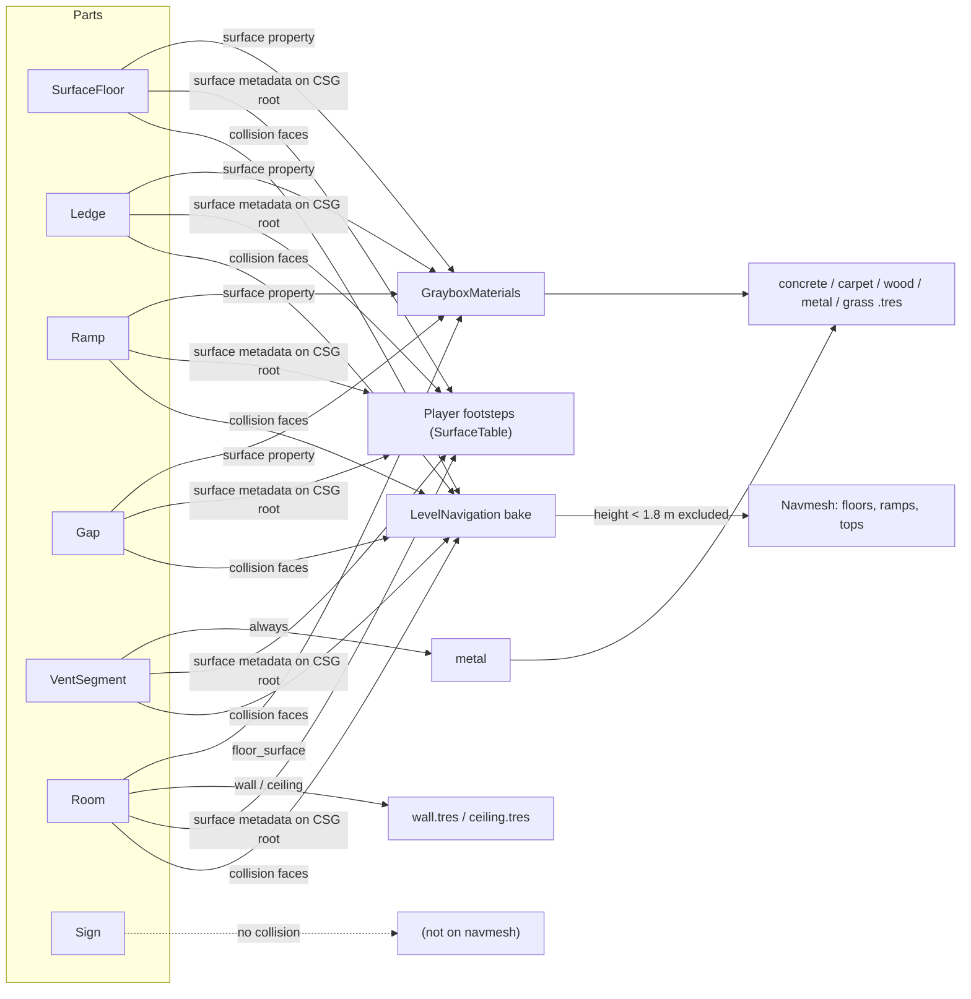

# Graybox kit

Parametric level parts for graybox levels ([ADR 0037](../decisions/0037-graybox-kit.md), conventions in [ADR 0042](../decisions/0042-kit-part-conventions.md)). Parts live in `levels/kit/` (`<part>.gd` + `<part>.tscn`), materials in `assets/materials/graybox/`. Every part enforces the [level metrics](metrics.md). Open `levels/kit/kit_showcase.tscn` to see every part side by side. Back to [hub and gallery](hub-and-gallery.md).

## Placing a part

Instance the part's `.tscn`, set its transform and one to three properties:

```
[ext_resource type="PackedScene" path="res://levels/kit/ledge.tscn" id="5_ledge"]

[node name="Ledge150" parent="Ledges" instance=ExtResource("5_ledge")]
transform = Transform3D(1, 0, 0, 0, 1, 0, 0, 0, 1, -6, 0, -24)
height = 1.5
```

- **Origin**: every part documents its anchor point (below); most sit on the ground (y = 0) and extend towards -Z from their front edge, so the transform is the spot where the player meets the part.
- **Collision and surface**: the part node is the CSG root with `use_collision` and the `surface` metadata (StringName) footsteps read ([ADR 0033](../decisions/0033-floor-surface-metadata.md)); its material follows the surface automatically. `material_override` (inherited) recolours a part without changing its surface, e.g. `hazard` for a "no" ledge. A `Room` also writes `wall_surface` = `concrete`: bullet impacts on its walls and ceiling are concrete whatever its floor ([ADR 0126](../decisions/0126-shot-feedback.md)).
- **Rebuild**: changing any exported property rebuilds the part's generated CSG children, in the editor and at runtime. Generated children are internal: not saved in the scene, not duplicated, hidden in the scene tree. Your own CSG children added to a part are combined after the generated ones (e.g. an extra subtraction).
- **Warnings**: values outside the legal range are clamped for the geometry and shown as a configuration warning (yellow triangle in the scene tree); metric "grey zones" (a 1.95 m ledge, a 2.6 m gap) warn without clamping.
- Free CSG is still fine for one-off shapes (e.g. the 1.2 m low ceiling in the movement course); use the graybox materials on it.

## Parts

| Part | Properties (default) | Origin and extent | Metric rules |
|---|---|---|---|
| `SurfaceFloor` | `size` x/z (4 x 4), `thickness` (0.2), `surface` | Centre of the top face; slab goes down | Size ≥ 0.1 m, thickness 0.02-10 m. As an overlay on a floor, raise it 2 cm so its collider is the one hit |
| `Ledge` | `height` (1.5), `width` (2.5), `depth` (3), `surface`; read-only `band` | Bottom centre of the lip; lip at z = 0 faces +Z, block extends to -Z | `band`: ≤ 0.3 "step up" (walked onto, [ADR 0058](../decisions/0058-step-climbing.md)), 0.35-1.0 "jump up", 1.0-1.9 "mantle", 2.0-2.2 "deliberate no", ≥ 2.3 "out of reach"; 0.3-0.35, 1.9-2.0 and 2.2-2.3 warn "between bands". Height 0.05-20 m. Stairs: stack 0.17 m ledges, each tier on the one below and deep enough to reach the back (the movement course stair) |
| `Ramp` | `rise` (1), `run` (2), `width` (2), `surface` | Bottom centre of the low edge; solid wedge rising towards -Z, top edge at (0, rise, -run) | Slope ≤ 40°: a steeper rise is lowered to `run × tan 40°` and warned ([ADR 0034](../decisions/0034-ramps-not-stair-stepping.md)) |
| `Gap` | `gap_width` (2), `length` (4), `width` (4), `platform_height` (2), `pit_depth` (2), `near_platform` (on), `surface`; read-only `difficulty_label` | Ground level, centre of the near platform's near edge; track runs towards -Z | `difficulty_label` "<w> m: walk-jump" (≤ 2 m), "sprint-jump" (3-3.5 m), "impassable" (≥ 4.2 m); 2-3 m and 3.5-4.2 m warn. Pit floor = ground when `pit_depth` equals the platform height, else a slab. Chain gaps with `near_platform` off |
| `VentSegment` | `kind` (STRAIGHT / CORNER_LEFT / CORNER_RIGHT), `length` (2), `interior_height` (1.1), `drop` (0), `fill_below` (0) | Centre of the interior floor at the entry; runs towards -Z. Always metal | Interior 1.2 m wide, 1.0-1.2 m high (clamped). `drop` slopes a straight segment down (≤ 40°). `fill_below` makes the housing solid down to that depth so nothing can crawl under it |
| `Room` | `size` (4 x 3 x 4 interior), `wall_thickness` (0.25), `floor_surface`, `wall_material`, `ceiling_material`, `openings`, `indoor_acoustics` (on: an acoustic zone over the interior gives sounds made inside the indoor echo, [ADR 0128](../decisions/0128-weapon-motion-and-shot-sounds.md)) | Centre of the interior floor; walls outside the interior, north = -Z, east = +X. Walls run the full outer height (corners included); floor and ceiling slabs cover only the interior. Connecting rooms: see below | Openings are `RoomOpening` resources: `wall`, `offset` (along x for north/south, along z for east/west), `width` (1.2), `height` (2.2), `sill` (0 = door), `node_name` (name of the generated cut). Openings are clamped to their wall; doors < 0.8 m wide or < 1.9 m high and rooms < 1.9 m high warn |
| `Sign` | `text`, `size` (SMALL 48 / MEDIUM 64 / LARGE 96 / XLARGE 128 px), inherited `billboard` | Label3D, centred | White text, black outline, 5 mm per pixel. MEDIUM reads from about 6 m |
| `NetworkPanel` (M12c) | `size` (width, height), `subnet` (Subnet data), `title` | Centre of the back face, on the wall face, +Z out | Painted panel behind a wiring closet's gear, a stripe in the subnet's Map colour with `title`; visual only (no collision), 2 mm off the wall ([ADR 0122](../decisions/0122-network-readability-lights-plates-ar.md)) |
| `Stairs` | `rise` (1), `width` (1.2), `tread` (0.3), `max_riser` (0.18), `solid` (on), `thickness` (0.3), `surface` | Bottom centre of the first riser on the lower floor; climbs towards -Z, step k spans z -(k-1)·tread .. -k·tread with its top at k·riser, so the last step is level with the upper floor at z = -run | n = ceil(rise / max_riser) equal risers, `max_riser` clamped to 0.3 (walk-up, on the navmesh); `steps()`, `riser()`, `run()`. `solid` fills each step to the floor; off, each step is a `thickness` block (a steel flight you can walk under). Warns under 1.2 m wide, under 0.25 m treads, over 40 degrees ([ADR 0089](../decisions/0089-warehouse-layout.md)) |
| `Fence` | `length` (4), `height` (3), `bar_spacing` (0.22), `bar_width` (0.05), `rails` (heights, [0.3, 2.7]) | Bottom of the first bar; runs along +X, bars centred on z = 0. Not CSG: a `StaticBody3D` with one triangle-mesh shape and one MultiMesh, on the world layer, in `navigation_source` | See-through: bodies cannot pass the gaps, rays (sight, shots, light) pass between bars. Palisade fence: the defaults (gap 0.17 m). Railing: bars every 1 m, rails at 0.5 and height - 0.025 (1.0 m). Warns when a gap is 0.6 m or wider and an opening between rails is 0.9 m or taller (a crouched player gets through). Thin tops cannot be mantled ([ADR 0089](../decisions/0089-warehouse-layout.md)) |
| `LevelExit` (M9, [ADR 0087](../decisions/0087-mission-systems.md)) | `scene_path`, `required_tag` (`actor.player`), `size` (1 x 3 x 2) | Invisible Area3D box standing on the origin, centred in x and z | Loads `scene_path` when an entity with the tag that can act enters (once). Put it in a doorway, behind the wall's inner face, so only walking through triggers it: the hub's `MissionExit` at (-15.7, 0, -7.5) |

### Vent connection points

`exit_transform()` returns the next segment's transform relative to the current one, so `next.transform = segment.transform * segment.exit_transform()`:

| Kind | Exit point | Next heading |
|---|---|---|
| STRAIGHT | (0, -drop, -length) | same (-Z) |
| CORNER_LEFT | (-0.6, 0, -0.6) | -X (yaw +90°) |
| CORNER_RIGHT | (0.6, 0, -0.6) | +X (yaw -90°) |

Housings end exactly at the entry and exit planes (a corner has no wall on its exit side), so segments butt together with continuous floors. The movement course vent is Mouth (straight 4.4 m) → Turn (corner left) → Slope (straight 4 m, drop 1.45 m) → Exit (straight 2.4 m); its test checks the snapping.

### Room connections

Two rooms connect through one shared wall ([ADR 0043](../decisions/0043-room-connections-share-a-wall.md)): give both the same `wall_thickness`, start the neighbour's interior at the outer face of this room's wall (so the two walls overlap exactly), and give both an opening with the same width, height and position along the wall. Because walls own the rim and slabs stop at the interior, only wall meets wall, whatever the two ceiling heights. Example: the hub (wall 0.5 m, north wall z -15.5 to -15) and the movement course corridor (interior from z -15.5, south wall z -15.5 to -15), both with a 2 x 3 m door at x = -7.5. Don't butt rooms back to back or let a slab of one room touch another room's visible face: different materials on one plane z-fight. `KitGeometry.coplanar_material_overlaps()` finds such faces (tests below).

## Materials

`assets/materials/graybox/<name>.tres`: CSG Blockout's world-aligned triplanar grid shader (copied with its MIT licence, `LICENSE-csg_blockout.txt`), 1 m grid with 0.5 m subdivisions, a two-tone checker per material.

| Material | Colour | Use |
|---|---|---|
| `concrete` | mid grey | Default floor surface |
| `carpet` | dark red | Floor surface |
| `wood` | warm brown | Floor surface |
| `metal` | blue-grey, metallic 0.5, roughness 0.4 | Floor surface, vents |
| `grass` | green | Floor surface |
| `wall` | light grey | Room walls |
| `ceiling` | dark grey, no checker | Room ceilings |
| `hazard` | orange | Danger or "no" geometry (`material_override`) |
| `interactive` | yellow | Things to use (`material_override`) |

`GrayboxMaterials` (`levels/kit/graybox_materials.gd`) maps surface names to materials; the five surfaces match `actors/common/movement/surface_table.tres`.

## Navigation

`LevelNavigation` (`levels/kit/level_navigation.gd`, a NavigationRegion3D) bakes the level's navmesh when the level loads ([ADR 0041](../decisions/0041-runtime-navmesh-bake.md)): synchronously in `_ready`, from every CSG root with collision under its parent (plus static colliders of nodes in group `navigation_source`). Agent radius 0.35 m, height 1.8 m, max slope 45°, max climb 0.3 m (walk-up steps, [ADR 0058](../decisions/0058-step-climbing.md)), cells 5 cm. Spaces lower than 1.8 m (vents, the low ceiling) drop out by agent height; steps and stair risers up to 0.3 m, 2 cm floor overlays and ramps stay connected; higher ledges are not climbed. Add it as the last child of a level; the hub has one (`Navigation`) that covers the movement course. Call `bake()` after changing geometry at runtime.



## Tests

`tests/levels/kit/`: one suite per part (`stairs_test.gd` and `fence_test.gd` included) (collision bounds, `surface` metadata and material, clamping and warnings, rebuild on property change), `room_passage_test.gd` (the player walks through a 1.2 x 2.2 m opening; a wall without one blocks), `level_navigation_test.gd` (hub navmesh, path from `PlayerSpawn` into the movement course, ramps connected, vent and crawl-space interiors off the navmesh, re-bake after a geometry change), `graybox_materials_test.gd`. `room_test.gd` also joins a tall room to a low corridor the documented way, and `tests/levels/hub/hub_faces_test.gd` checks the hub with every gallery room instanced in it (movement course, perception lab, physics and fire, shooting range, security wing, AI arena, inventory bay, network lab) and its loadout table (the room alone and `kit_showcase_test.gd` check their own scenes the same way): no two CSG roots may render different materials on the same plane (`KitGeometry.coplanar_material_overlaps()`: same plane within 1 mm, same facing, overlap > 1 cm²).
