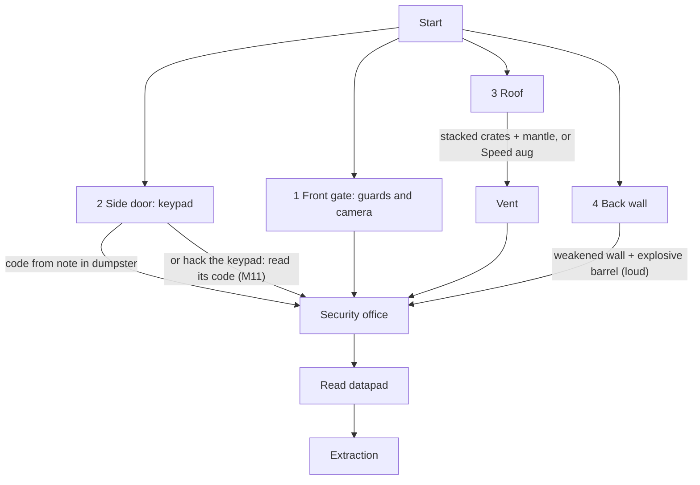

# Mission: warehouse

Milestone: M9.

## Goal

Small two-storey warehouse compound. Read the datapad in the security office (datapads are read in place, [ADR 0060](../decisions/0060-datapads-read-in-place-personal-log.md)), then reach extraction.

## Contents

- 5 guards, mixed loadouts (pistol / baton) ([../game/perception-and-ai.md](../game/perception-and-ai.md))
- 2 cameras, 1 turret guarding the office, an alarm controller with sirens and a panic button (the cameras send it incidents), a radio base station, 1 breaker panel (lights) ([../game/security.md](../game/security.md), [ADR 0075](../decisions/0075-alarms-as-network-devices.md))
- From M11: a small network ([Network](#network-m11))

## Routes



## Network (M11)

A sketch, not a layout ([../game/hacking.md](../game/hacking.md)). Three subnets behind one gateway, FW-01, which runs the "Sentry" tracer watching Guest and Office:

```text
  [AP Guest] ~~ range reaches the yard by the side door
      |
  Guest 10.0.1.0/24 ---+
                       |
  Office 10.0.2.0/24 --+-- FW-01 (Sentry tracer: Guest, Office) -- rules: Guest -> Office deny,
    office PC x2       |                                             Office -> Security deny,
    (mail with clues)  |                                             SEC-SERVER -> any allow
                       |
  Security 10.0.3.0/24 +   (unwatched by Sentry)
    SEC-SERVER (security console; cameras, doors, turret trust it)
    2 cameras, office door, turret, alarm controller, sirens x2, radio base station
```

- Entry: wireless from the yard (Guest), a wall jack in the office (Office), the office PCs bare-handed, the security console.
- Example routes: sniff a guard's login on the Guest wireless, use it on an office PC, read the mail with the security console's password hint; or break the Security switch to kill the cameras and sirens (the office door is fail-secure, so it then needs another way in); or crack FW-01's admin account (Medium) and add a rule "you -> Security allow".
- Numbers (passwords, tracer tuning, software versions) are set in M11.

## Rules

- Success: extraction after reading the datapad (its entry is in the personal log). Fail: death, then reload or restart ([../game/saving.md](../game/saving.md)).
- Summary screen on extraction: time, alarms, kills/knockouts, route used.
- Route relevance: movement ([../game/movement.md](../game/movement.md)), physics and explosives ([../game/objects-and-fire.md](../game/objects-and-fire.md)), abilities ([../game/abilities.md](../game/abilities.md)).
- Scenario tests cover the routes ([../tech/testing.md](../tech/testing.md)).
- No difficulty settings.

## Open questions

- Network layout and which guards use devices on patrol: M11.
- Layout, guard patrols, how route is detected for the summary, how reading the datapad is checked (`PersonalLog.has(entry_id)`): TBD in M9.
