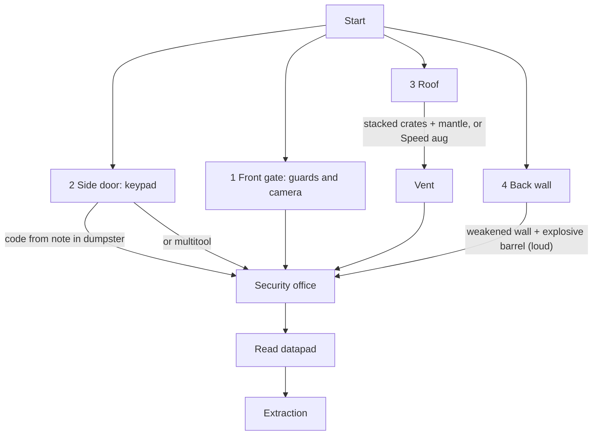

# Mission: warehouse

Milestone: M9.

## Goal

Small two-storey warehouse compound. Read the datapad in the security office (datapads are read in place, [ADR 0060](../decisions/0060-datapads-read-in-place-personal-log.md)), then reach extraction.

## Contents

- 5 guards, mixed loadouts (pistol / baton) ([../game/perception-and-ai.md](../game/perception-and-ai.md))
- 2 cameras, 1 turret guarding the office, 1 alarm panel linked to the cameras, 1 breaker panel (lights) ([../game/security.md](../game/security.md))

## Routes

## Rules

- Success: extraction after reading the datapad (its entry is in the personal log). Fail: death, then reload or restart ([../game/saving.md](../game/saving.md)).
- Summary screen on extraction: time, alarms, kills/knockouts, route used.
- Route relevance: movement ([../game/movement.md](../game/movement.md)), physics and explosives ([../game/objects-and-fire.md](../game/objects-and-fire.md)), abilities ([../game/abilities.md](../game/abilities.md)).
- Scenario tests cover the routes ([../tech/testing.md](../tech/testing.md)).
- No difficulty settings.

## Open questions

- Layout, guard patrols, how route is detected for the summary, how reading the datapad is checked (`PersonalLog.has(entry_id)`): TBD in M9.
