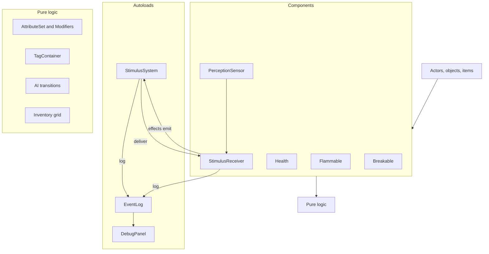

# Architecture

## Layers

1. **Core framework** (`core/`): stimulus, attributes/tags/modifiers, event log, save. No game content.
2. **Components**: small nodes attached to entities (`Flammable`, `Breakable`, `Health`, `StimulusReceiver`, `PerceptionSensor`). Behaviour is composed, not inherited.
3. **Content**: actors, objects, items, UI, levels. Tuning data in `.tres` Resources.

Pure logic (rules, propagation math, AI transitions, inventory, attributes) lives in RefCounted/Resource classes testable without the scene tree. Nodes are thin adapters.

## Folder layout

```text
core/stimulus/  core/attributes/  core/event_log/  core/save/
actors/player/  actors/guard/
objects/        items/
ui/hud/         ui/debug_panel/
levels/hub/     levels/gallery/<room>/   levels/mission/
tests/          (mirrors source; tests/scenarios/ for scenario tests)
tools/          (run_tests.sh, lint.sh, hooks/)
design/         assets/         addons/
```

Folders are by feature, not by file type.

## Autoloads

Exactly three:

| Autoload | Role | Added |
|---|---|---|
| `StimulusSystem` | Queue, propagate (straight, navmesh path, ray) and deliver stimuli on the physics tick; registry of `StimulusReceiver`s; `stimulus_processed` signal for debug overlays | M2 |
| `EventLog` | Record emits and receptron firings | M0 |
| `DebugPanel` | Debug overlays, spawn, time, stats, log UI | M0 (shell) |

## Signals vs stimuli

- Signals: local events (parent/child, UI).
- Stimuli: world events that other entities may perceive or react to.

## Determinism and tick model

Stimulus processing runs in `_physics_process` on a fixed tick. Stimuli emitted during processing are queued for the next tick: no recursion, chain depth is tracked. This makes integration and scenario tests deterministic (fixed number of frames).

Autoload order in `project.godot`: `EventLog`, `StimulusSystem`, `DebugPanel` (each may use the ones before it in `_ready`). Components register with `StimulusSystem` in `_ready`, never `_enter_tree` (main-scene nodes enter the tree before autoloads are ready). The stimulus queue is transient (not saved); `StimulusSystem.clear()` drops it. Details: [../game/stimulus-response.md](../game/stimulus-response.md).

## Saveable contract

Nodes in group `saveable` implement `save_state() -> Dictionary` and `load_state(data: Dictionary) -> void`. Applies from M0; quicksave/quickload (F5/F9) in M6. See [../game/saving.md](../game/saving.md).

Save flow ([ADR 0063](../decisions/0063-quicksave-quickload.md)), all in `core/save/`, static, no autoload: `QuickSave.save_game()` -> `LevelSnapshot.capture(current_scene)` (states by node path, removed and spawned entities against the level's packed scene) -> `SaveFile.write()` (JSON of `JSON.from_native`). `QuickSave.load_game()` (a static coroutine) -> `SaveFile.read()` -> `LevelReset.load_level()` -> on `SceneTree.scene_changed`: pause, `LevelSnapshot.apply()` (free removed, recreate spawned, `load_state()` in tree pre-order), 3 physics frames, `bake()` on group `rebake_after_load` if geometry was removed, `StimulusSystem.clear()`, unpause, `on_quickloaded()` on group `quickload_listener`.

## Component diagram



See also [../game/stimulus-response.md](../game/stimulus-response.md), [../game/attributes-and-tags.md](../game/attributes-and-tags.md), [conventions.md](conventions.md), [testing.md](testing.md).
