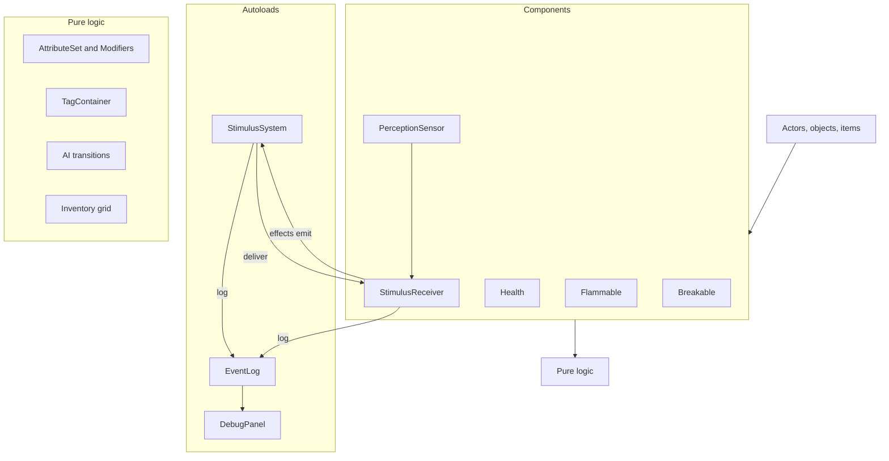

# Architecture

## Layers

1. **Core framework** (`core/`): stimulus, attributes/tags/modifiers, event log, save. No game content.
2. **Components**: small nodes attached to entities (`Flammable`, `Breakable`, `Health`, `StimulusReceiver`, `PerceptionSensor`). Behaviour is composed, not inherited.
3. **Content**: actors, objects, items, UI, levels. Tuning data in `.tres` Resources.

Pure logic (rules, propagation math, AI transitions, inventory, attributes) lives in RefCounted/Resource classes testable without the scene tree. Nodes are thin adapters.

## Folder layout

```text
core/stimulus/  core/attributes/  core/event_log/  core/save/
actors/player/  actors/guard/
objects/        items/
ui/hud/         ui/debug_panel/   ui/window/ (shared window frame and theme)
levels/hub/     levels/gallery/<room>/   levels/mission/
tests/          (mirrors source; tests/scenarios/ for scenario tests)
tools/          (run_tests.sh, lint.sh, hooks/)
design/         assets/         addons/
```

Folders are by feature, not by file type.

## Autoloads

Exactly three:

| Autoload | Role | Added |
|---|---|---|
| `StimulusSystem` | Queue, propagate (straight, navmesh path, ray) and deliver stimuli on the physics tick; registry of `StimulusReceiver`s; `stimulus_processed` signal for debug overlays | M2 |
| `EventLog` | Record emits and receptron firings | M0 |
| `DebugPanel` | Debug overlays, spawn, time, stats, log UI | M0 (shell) |

## UI windows (deck, Halcyon OS)

The deck's screen (`DeckScreen`), the computer overlay (`ComputerScreen`) and the shooting range's tuning panel (`TuningPanel`, ADR 0125) share one window: `ui/window/window_frame.gd` (`WindowFrame`), a rounded outer panel with a header row (title, subtitles, trace bar slot, actions slot, ✕), an optional left sidebar and a body. Inner regions have no background of their own: the frame paints the body, header and sidebar regions itself (each with the frame's radius on its outer corners) and draws its border last, over everything inside, so nothing covers its rounded corners or border. One left inset is shared by the header title, the sidebar items' text and the body's content (one inset inside the body region); the ✕ sits the same inset from the top-right corner, its top level with the title's. `tests/ui/window/window_frame_test.gd` checks both at 1152 x 648 and 2560 x 1440.

Looks are data: `ui/window/window_theme.tres` (a `Theme`, text). The `WindowFrame` type holds the sizes both looks share as constants (spacing scale `space_xs`..`space_xl` = 4/8/12/16/24, `inset`, `radius`, `radius_small`, `border`, `header_height`, `sidebar_width`, `close_size`; `WindowFrame.metric()` reads them); `DeckFrame` and `HalcyonFrame` hold each look's colours; type variations style the widgets (`DeckButton`, `DeckButtonPrimary`, `DeckToolButton`, `DeckCard`, `DeckTrack`, `DeckField`, `DeckAssist`, `DeckToast`, `DeckLetter`, `HalcyonButton`, `HalcyonListEntry`, `HalcyonField`, `HalcyonCard`, `HalcyonReader`, `HalcyonFeed`, `HalcyonSlider`, `<look>CloseButton`; `WindowBody` is the inset margin of a body view). The frame sets the theme on itself; `DeckStyle` and `HalcyonStyle` keep colours, label builders and logic (`DeckStyle.reconcile()`, status colours). A reconciled button's key uses its type variation and overrides, not the theme-resolved look (the fresh copy is out of the tree). The Tab interface (`ui/tab_interface/`, ADR 0110) keeps its own look.

The deck's screen is a host (`deck_screen.gd`: raise/lower, input, tool switching, header) over one view per tool: `DeckMapView` (+ `DeckDeviceMenu`, the Map's device menus), `DeckIceView`, `FirewallView`, `WifiPanel`; exploit items are used from the Map's menus (`IntrusionMenu`, `ExploitItems`); trace bars are `DeckTraceBars`. The computer's login card is `ComputerLogin`. The map's layout is split into passes (`network_layout.gd` + `network_layout_state.gd`, `network_grouping.gd`, `network_switch_trees.gd`, `network_region_planner.gd`, `network_routing.gd`) and its control into `network_graph.gd`, `network_menu.gd`, `network_node_box.gd`, `network_map_painter.gd`, `network_map_inputs.gd`.

## Signals vs stimuli

- Signals: local events (parent/child, UI).
- Stimuli: world events that other entities may perceive or react to.

## Determinism and tick model

Stimulus processing runs in `_physics_process` on a fixed tick. Stimuli emitted during processing are queued for the next tick: no recursion, chain depth is tracked. This makes integration and scenario tests deterministic (fixed number of frames).

Autoload order in `project.godot`: `EventLog`, `StimulusSystem`, `DebugPanel` (each may use the ones before it in `_ready`). Components register with `StimulusSystem` in `_ready`, never `_enter_tree` (main-scene nodes enter the tree before autoloads are ready). The stimulus queue is transient (not saved); `StimulusSystem.clear()` drops it. Details: [../game/stimulus-response.md](../game/stimulus-response.md).

## Saveable contract

Nodes in group `saveable` implement `save_state() -> Dictionary` and `load_state(data: Dictionary) -> void`. Applies from M0; save/load in M6 (Esc game menu, [ADR 0064](../decisions/0064-game-menu.md)). See [../game/saving.md](../game/saving.md).

Save flow ([ADR 0063](../decisions/0063-quicksave-quickload.md)), all in `core/save/`, static, no autoload: `QuickSave.save_game()` -> `LevelSnapshot.capture(current_scene)` (states by node path, removed and spawned entities against the level's packed scene) -> `SaveFile.write()` (JSON of `JSON.from_native`). `QuickSave.load_game()` (a static coroutine) -> `SaveFile.read()` -> `LevelReset.load_level()` -> on `SceneTree.scene_changed`: pause, `LevelSnapshot.apply()` (free removed, recreate spawned, `load_state()` in tree pre-order), 3 physics frames, `bake()` on group `rebake_after_load` if geometry was removed, `StimulusSystem.clear()`, unpause, `on_quickloaded()` on group `quickload_listener` (the player's `GameMenu`, [ADR 0064](../decisions/0064-game-menu.md), shows "Loaded").

## Component diagram



See also [../game/stimulus-response.md](../game/stimulus-response.md), [../game/attributes-and-tags.md](../game/attributes-and-tags.md), [conventions.md](conventions.md), [testing.md](testing.md).
