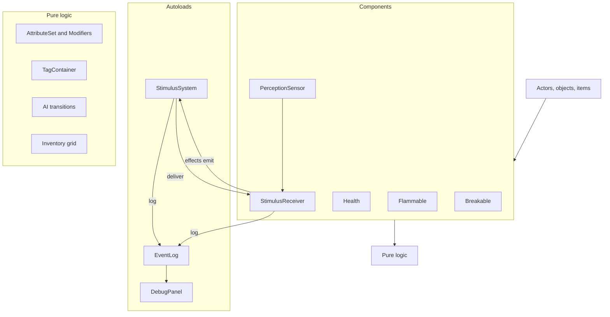

# Architecture

## Layers

1. **Core framework** (`core/`): stimulus, attributes/tags/modifiers, event log, save. No game content.
2. **Components**: small nodes attached to entities (`Flammable`, `Breakable`, `Health`, `StimulusReceiver`, `PerceptionSensor`). Behaviour is composed, not inherited.
3. **Content**: actors, objects, items, UI, levels. Tuning data in `.tres` Resources.

Pure logic (rules, propagation math, AI transitions, inventory, attributes) lives in RefCounted/Resource classes testable without the scene tree. Nodes are thin adapters.

## Folder layout

```text
core/stimulus/  core/attributes/  core/event_log/  core/save/
events/         (EventKinds: every EventLog kind, game content)
actors/player/  actors/guard/
objects/        items/
ui/hud/         ui/debug_panel/   ui/window/ (shared window frame and theme)
levels/hub/     levels/gallery/<room>/   levels/mission/
tests/          (mirrors source; tests/scenarios/ for scenario tests)
tools/          (run_tests.sh, lint.sh, hooks/)
design/         assets/         addons/
```

Folders are by feature, not by file type.

## Autoloads

Exactly three:

| Autoload | Role | Added |
|---|---|---|
| `StimulusSystem` | Queue, propagate (straight, navmesh path, ray) and deliver stimuli on the physics tick; registry of `StimulusReceiver`s; `stimulus_processed` signal for debug overlays | M2 |
| `EventLog` | Record gameplay events (kinds in `EventKinds`), stream them (`entry_added`) and keep a bounded history for debug and tests | M0 |
| `DebugPanel` | Debug overlays, spawn, time, stats, log UI | M0 (shell) |

## UI windows (deck, Halcyon OS)

The deck's screen (`DeckScreen`), the computer overlay (`ComputerScreen`) and the shooting range's tuning panel (`TuningPanel`, ADR 0125) share one window: `ui/window/window_frame.gd` (`WindowFrame`), a rounded outer panel with a header row (title, subtitles, trace bar slot, actions slot, ✕), an optional left sidebar and a body. Inner regions have no background of their own: the frame paints the body, header and sidebar regions itself (each with the frame's radius on its outer corners) and draws its border last, over everything inside, so nothing covers its rounded corners or border. One left inset is shared by the header title, the sidebar items' text and the body's content (one inset inside the body region); the ✕ sits the same inset from the top-right corner, its top level with the title's. `tests/ui/window/window_frame_test.gd` checks both at 1152 x 648 and 2560 x 1440.

Looks are data: `ui/window/window_theme.tres` (a `Theme`, text). The `WindowFrame` type holds the sizes both looks share as constants (spacing scale `space_xs`..`space_xl` = 4/8/12/16/24, `inset`, `radius`, `radius_small`, `border`, `header_height`, `sidebar_width`, `close_size`; `WindowFrame.metric()` reads them); `DeckFrame` and `HalcyonFrame` hold each look's colours; type variations style the widgets (`DeckButton`, `DeckButtonPrimary`, `DeckToolButton`, `DeckCard`, `DeckTrack`, `DeckField`, `DeckAssist`, `DeckToast`, `DeckLetter` (and its `Locked`, `Active`, `Flash` variants), `HalcyonButton`, `HalcyonListEntry`, `HalcyonField`, `HalcyonCard`, `HalcyonReader`, `HalcyonFeed`, `HalcyonSlider`, `<look>CloseButton`; `WindowBody` is the inset margin of a body view). The frame sets the theme on itself; `DeckStyle` and `HalcyonStyle` keep colours, label builders and logic (`DeckStyle.reconcile()`, status colours). A reconciled button's key uses its type variation and overrides, not the theme-resolved look (the fresh copy is out of the tree). The Tab interface (`ui/tab_interface/`, ADR 0110) keeps its own look.

The Tab interface's looks are type variations too, in `ui/tab_interface/tab_theme.tres` (`TabButton`, `TabRow`, `TabPanel`, `TabTab`, `Character*`, `Journal*`; `TabStyle.themed()`), and the mission screens' in `ui/mission/mission_theme.tres`.

Screens that keep the world running (Tab interface, computer, deck, keypad, lockpick, reading overlay, tuning panel) and the debug panel hold a counted `OverlayFocus` (ADR 0133): the user's input off, the HUD hidden if asked, the mouse in the newest hold's mode, all restored once when the last hold goes; `PauseScreens` (game menu, briefing, summary) pause the tree and hold it for the mouse. World objects open screens through `Screens` by id (`KeypadLock.SCREEN`, `MechanicalLock.SCREEN`, `Computer.SCREEN`, `DeckSession.SCREEN`, `TuningDesk.SCREEN`); the screens extend `UserScreen`. Player-facing notices go through the entity's `Notices` component (the HUD and the raised deck's toast listen).

Device status and commands (ADR 0137): components return `StatusWord`s (`objects/devices/status_word.gd`, `.tres` words in `objects/devices/status_words/`: text, colour, blink, alert) from `device_status()` and declare the commands that apply now in `device_commands()`; each command constant lives with the component that handles it. `DeviceStatus` collects them (`words_of()`, `applicable()`) and holds the screens' one colour rule (`tone()`), which `DeckStyle` and `HalcyonStyle` map to their palettes. The interaction frame's words are StatusWords too (`TargetStatus`; a component's own word through `StatusWord.FRAME_GROUP` and `frame_word()`). The reach graph is built by `DeviceGraphBuilder` (`DeviceGraph` stays pure logic); a tool's owner reacts to `ToolUse.worked` (the deck plugs in), never the target; `NetworkSource.Kind` is the one entry-kind enum (a device's `deck_port` and the deck's traffic), its labels in `KIND_LABELS`; `DeviceNetwork.address_of()` is the one address lookup.

The deck's screen is a host (`deck_screen.gd`: raise/lower, input, a registry of tools by id, header) over one view per tool: `DeckMapView` (+ `DeckDeviceMenu`, the Map's device menus), `DeckIceView`, `FirewallView`, `WifiPanel`; exploit items are used from the Map's menus (`IntrusionMenu`, `ExploitItems`); trace bars are `DeckTraceBars`. The computer's login card is `ComputerLogin`. The map's layout is split into passes (`network_layout.gd` + `network_layout_state.gd`, `network_grouping.gd`, `network_switch_trees.gd`, `network_region_planner.gd`, `network_routing.gd`) and its control into `network_graph.gd`, `network_menu.gd`, `network_node_box.gd`, `network_map_painter.gd`, `network_map_inputs.gd`.

## Settings (profile, not save)

`GameSettings` (`core/settings/`, static, no autoload; [ADR 0124](../decisions/0124-settings-profile.md)) holds the player's profile: `user://settings.cfg` (ConfigFile), loaded on first use (the Player reads the FOV in `_ready`) and applied at once (bus volumes to the `AudioServer`, fullscreen and vsync through `GameSettings.display`, a `GameSettingsDisplay`). It is separate from save games (`QuickSave`, `user://saves/`): a load never changes settings. API: `ensure_loaded()`, `load_profile()`, `save_profile()`, `save_if_changed()`, `use_path(path)` (tests: `user://test_settings.cfg`, back to `DEFAULT_PATH` in `after_test`), `value(key)` / `set_value(key, value)` (clamped, applied live, marks dirty), one getter per key (`mouse_sensitivity()` a multiplier on the player config, `invert_y()`, `fov()`, `camera_motion() -> float` 0..1, `master_volume()`, `effects_volume()`, `music_volume()`, `fullscreen()`, `vsync()`), and `notifier().changed(key)` for consumers that must react at once (the player's camera FOV while the menu pauses the game); others read the getter when they need it. Buses (`default_bus_layout.tres`): `Master`, `Effects` (every sound today: `GameSettings.EFFECTS_BUS`), `Music`, and two reverb buses sending to `Effects` ([ADR 0128](../decisions/0128-weapon-motion-and-shot-sounds.md)): `ReverbIndoor` (fed by acoustic zones, `Area3D`s on physics layer 9 that every kit `Room` makes) and `ReverbOutdoor` (shot voices outside any zone play on it; `core/audio/acoustics.gd`). The Settings screen (`ui/game_menu/settings_menu.gd`) is nested in the game menu and shares its theme (`ui/game_menu/game_menu_theme.tres`).

## Weapons

`WeaponHolder` (`items/weapons/weapon_holder.gd`) is the coordinator any armed character (player, guards, turrets) carries under its eye: the loadout and its save, the equipped `WeaponState` (cycle, ammo, attachments' stats), the aim (`AimModel` cone and sway, `RecoilState`, `ScopeState`), the first-person `WeaponView`, and `trigger()` / `reload()`. Its public API is what callers use; the work below is behind it.

- **Delivery** (`items/weapons/delivery/`): what a fired trigger does is the weapon's `WeaponDelivery`, picked by `WeaponData.delivery()` from its `kind` (one stateless instance per kind, no `match` in the holder): `RangedFire` (damage and `force.impact` RAYs along the sampled cone, pellets, falloff, muzzle and impact noise, impacts and tracers, bloom, flash), `MeleeSweep` (a sphere swept along the view, `damage.*` CONTACT, swing and impact noise) and `ThrowRelease` (the user's `Thrower`; `can_deliver()` is false without one, so the weapon does not cycle). A delivery emits through the holder's `cause_id`, sets `last_hit` and logs its `weapon.*` entry; the holder adds the recoil of any fired weapon with a `RecoilConfig`, emits `fired` and `changed`. Noises read `WeaponState.stat()` in every delivery, so attachments apply to all kinds. `WeaponHolder.aimed_hit` (the HUD's crosshair target) is the delivery's centre ray: `RangedFire` casts it like a shot, other kinds aim at nothing.
- **Audio** (`items/weapons/audio/weapon_audio.gd`): the holder's `WeaponAudio` child plays the layered shot (`ShotAudio`, `shot_audio`), the single fire, dry, reload and hit sounds; every volume comes from `WeaponData` (`fire_volume_db` through attachments, `hit_volume_db`, `reload_volume_db`).
- **Feedback**: `ShotFeedback` (impacts by material, tracers) and `MuzzleFlash` (in the view).
- **Shared helpers**: `OwnBody.rids(entity)` (`actors/common/own_body.gd`) is a caster's own body plus hitboxes, left out of shots, sweeps, lines of fire, the Interactor's ray and the crosshair ray. `AimSolver` (`actors/common/combat/aim_solver.gd`) is the aim rule of guards (`CombatBehaviour`) and turrets: the first of the target's aim points (hitboxes torso, head, limbs) with a clear weapon line, and a safe `look_at()`.
- Class attributes (`<class>_damage_mult`, ...) are read by `WeaponData.class_value(user, stat, base)` through `Attributes.read()`.

## Signals vs stimuli

- Signals: local events (parent/child, UI).
- Stimuli: world events that other entities may perceive or react to.
- Lasting conditions an area puts on what is inside it are tags the area adds and removes, never a query of the area's registry: a jamming field adds `state.jammed` to every entity with Tags it covers; radios, the network and the deck read the tag ([ADR 0138](../decisions/0138-surfaces-jamming-tag-and-tuning-configs.md)).
- EventLog entries: what happened, for systems that keep score or give feedback (below).

## Gameplay events ([ADR 0136](../decisions/0136-event-kinds-and-entity-attribution.md))

- **The mechanism** is `core/event_log/` (the `EventLog` autoload and `EventLogEntry`); it knows no kind. `EventLog.entry_added` is the event stream; the ring buffer (2000 entries) is history for the debug panel and tests only. Gameplay consumers listen to `entry_added` and keep what they need (MissionTally's counts and attributed stimulus ids, HitMarkerRules' last 64 shooter stimuli); they never scan `entries()` or `find()`.
- **The kinds** are game content: `EventKinds` (`events/event_kinds.gd`) lists every one as a constant. Emitters record and consumers match the constants, never string literals (`tests/events/event_kinds_test.gd` scans the code). The few kinds `core/` records itself are core constants that EventKinds aliases.
- **Naming** (audit S25): `<subject>.<what happened>`, a past participle or an event noun (`actor.died`, `object.broken`, `actor.awareness`). Kinds name events and tags name states; both are dotted, so the test also checks no kind is a tag in any scene or resource.
- **Entities, not names**: `EventLog.record(kind, source, target, data)` takes entities (Nodes) or display names for source and target, and Node values in `data`. The entry stores the names (debug panel, `str(entry)`, test assertions) and the entities by instance id: `entry.entity(role)` (`source_entity()`, `target_entity()`, or a data key such as `by` on `device.command`) returns the live entity or null. Consumers decide who did something from the entity's tags or components: "the player" is the entity with `actor.player` (MissionTally, PickUpObjective, NetworkFeedback); a HUD's hit markers watch the HUD's own character by reference. Objects remembered across a save (MissionTally's broken and lit objects) are keyed by node path, the identity saves use (`LevelSnapshot`).
- **Contract**: the kinds gameplay reads carry "Consumed" doc comments with their entities and data keys; `tests/events/event_contract_actor_test.gd` and `event_contract_object_test.gd` drive each real emitter and check them.

## Surfaces and tuning configs

- What a collider is made of is `Surface.of(collider, normal)` (`objects/materials/surface.gd`): static geometry's `wall_surface` / `surface` metadata, else the entity's `material.*` tag. Footsteps (`SurfaceTable`) and bullet impacts (`ShotFxConfig`) read it; nothing else reads the metadata or the material tags for a surface (ADR 0138).
- Gameplay tuning shared by every instance of a component sits in a `*Config` `.tres` the scenes reference (`config`), with the component's `DEFAULT_CONFIG` as the fallback for instances built in code; a level that needs another value gives that instance its own config (the warehouse's AP-YARD). Per-instance placement and identity (a light offset, a breaker's circuit, a Wi-Fi key) stay node exports (ADR 0138).

## Determinism and tick model

Stimulus processing runs in `_physics_process` on a fixed tick. Stimuli emitted during processing are queued for the next tick: no recursion, chain depth is tracked. This makes integration and scenario tests deterministic (fixed number of frames).

Autoload order in `project.godot`: `EventLog`, `StimulusSystem`, `DebugPanel` (each may use the ones before it in `_ready`). Components register with `StimulusSystem` in `_ready`, never `_enter_tree` (main-scene nodes enter the tree before autoloads are ready). The stimulus queue is transient (not saved); `StimulusSystem.clear()` drops it. Details: [../game/stimulus-response.md](../game/stimulus-response.md).

## Saveable contract

Nodes in group `saveable` implement `save_state() -> Dictionary` and `load_state(data: Dictionary) -> void`. Applies from M0; save/load in M6 (Esc game menu, [ADR 0064](../decisions/0064-game-menu.md)). See [../game/saving.md](../game/saving.md).

Save flow ([ADR 0063](../decisions/0063-quicksave-quickload.md)), all in `core/save/`, static, no autoload: `QuickSave.save_game()` -> `LevelSnapshot.capture(current_scene)` (states by node path, removed and spawned entities against the level's packed scene) -> `SaveFile.write()` (JSON of `JSON.from_native`). `QuickSave.load_game()` (a static coroutine) -> `SaveFile.read()` -> `LevelReset.load_level()` -> on `SceneTree.scene_changed`: pause, `LevelSnapshot.apply()` (free removed, recreate spawned, `load_state()` in tree pre-order), 3 physics frames, `bake()` on group `rebake_after_load` if geometry was removed, `StimulusSystem.clear()`, unpause, `on_quickloaded()` on group `quickload_listener` (the player's `GameMenu`, [ADR 0064](../decisions/0064-game-menu.md), shows "Loaded").

## Component diagram



See also [../game/stimulus-response.md](../game/stimulus-response.md), [../game/attributes-and-tags.md](../game/attributes-and-tags.md), [conventions.md](conventions.md), [testing.md](testing.md).
